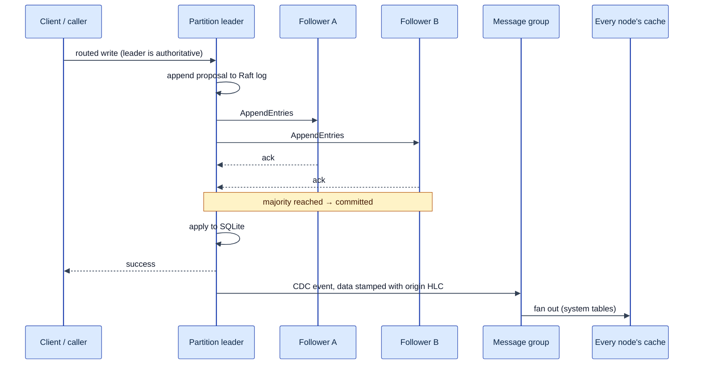
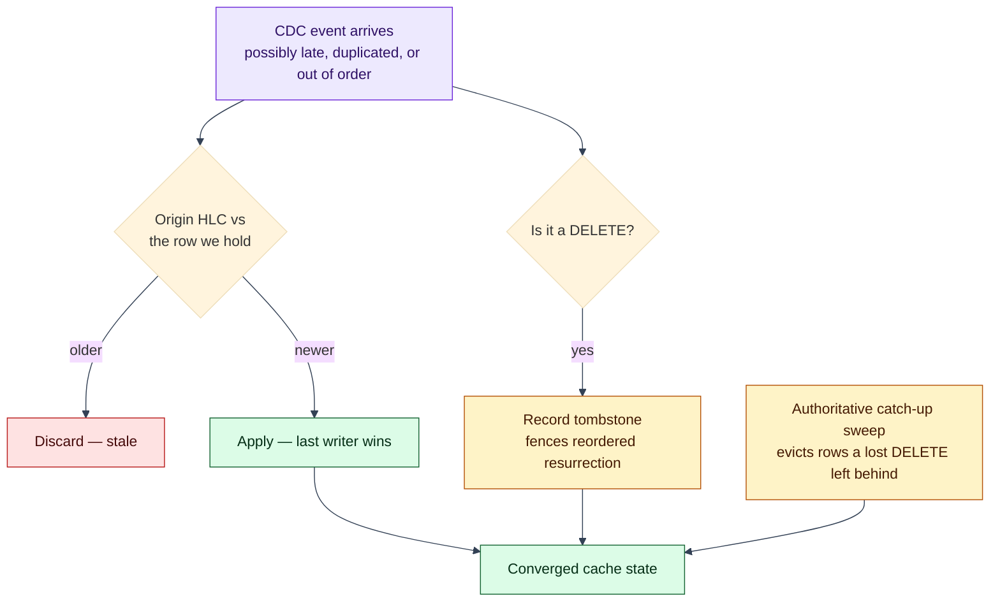
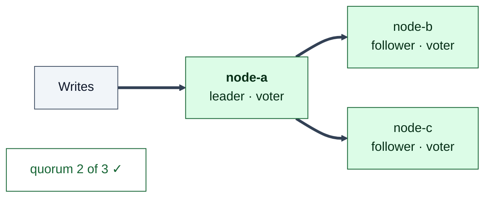
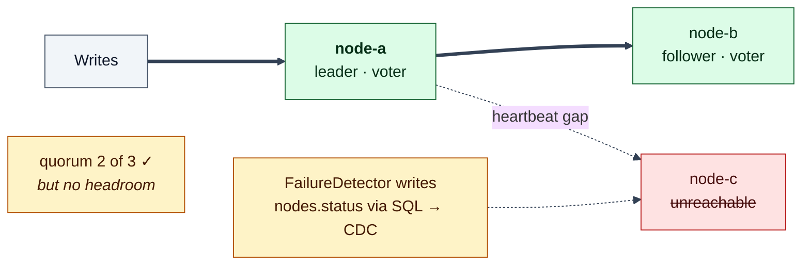
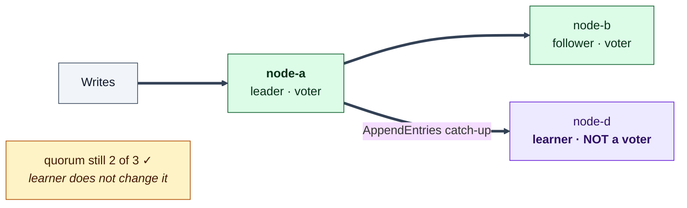
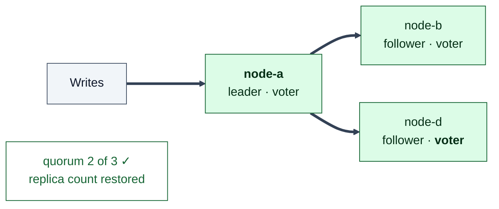
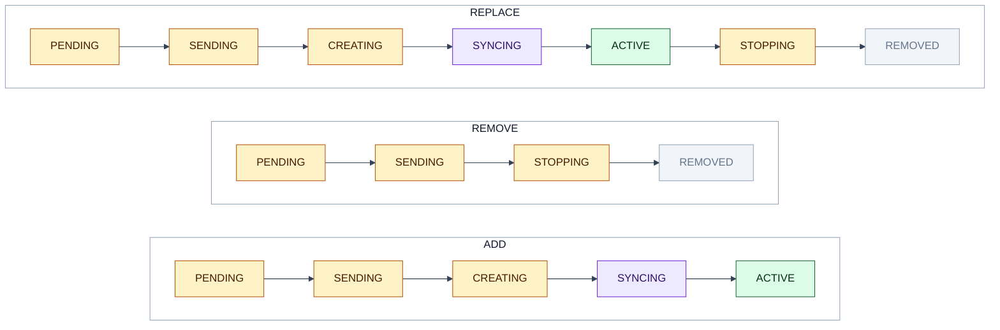

# Process: Replication

How a write becomes durable, how it reaches every node's read model, and how a
replica that is added or lost is brought back to full membership.

Prerequisite: [The Lagrange System Model](system-model.md) — including its
[diagram legend](system-model.md#diagram-legend). Which nodes a group's replicas
land on is [rebalancing](process-rebalancing.md).

## The unit of replication

Every partition is a Raft consensus group. Current placement policy uses odd
replica counts (three by default, with its minimum floor from
`POLICY_DEFAULT.MIN_REPLICA_COUNT`) so an added voter improves failure tolerance
instead of only raising the write quorum. Consensus runs through the semantic
Raft operation port backed by the vendored raft-rs/WASM runtime
([`partition-service-core-base.js`](../src/partition/partition-service-core-base.js));
there is no alternate consensus backend selection or provider injection. Each
consensus-owning replica keeps its durable Raft state in its owned SQLite
database; committed membership comes from raft-rs `ConfState`, not
service/cache projections.

The active entity kinds share replica-operation accounting, but they do not all
replicate state through Raft:

| Group type | State | Raft log | Consensus today |
| --- | --- | --- | --- |
| Partition | SQLite rows | Raft-rs durable store | Yes, through the single raft-rs operation port |
| Message group | replicated transport/application commands | SQLite, persistent | Yes, through the raft-rs operation port |
| Runtime-service Cell (`runtime_service`) | disposable process-local execution state; durable application state remains in tables | — | No; Cells are placed and repaired through `replica_operations`, not a service-state Raft group |
| WASM service consensus path (`wasm_service`) | session/KV, safety-interval, timer and service-state commands | SQLite, persistent | raft-rs when placement supplies an explicit canonical replica set; otherwise startup fails closed |

Current WASI component execution continues to use Binding-derived
`runtime_service` Cells for placed service execution. The `wasm_service`
consensus lifecycle is a separate state-replication path and does not invent
membership locally: it requires placement/topology to supply the founding
replica set.

### What a replica's disk keeps: process crash versus power loss

Every consensus-owning replica database (partition, message group and WASM
service alike) runs SQLite in WAL mode with `synchronous = NORMAL`. A NORMAL
commit survives a process crash, but SQLite does not sync the WAL on commit,
so a power loss or an OS crash can lose the commits made since the last sync.

What Raft promises to its peers is therefore synced to disk before any message
that depends on it is sent (owner decision O4, 2026-10-05). raft-rs says which
Ready must be synced (`Ready::must_sync`: a changed term or vote, appended log
entries, or a snapshot); the durable store commits that Ready's transaction
with `synchronous = FULL`, so SQLite fsyncs the WAL as part of the COMMIT, and
the runtime hands the Ready's messages to the transport only afterwards. A
granted vote, an acknowledged append and a leader's own appended entries are
synced to disk before they are sent and survive a power loss. The replica's
lifecycle row (retired, or held for reseed) is synced the same way, because
the open-time refusal reads it.

Everything else keeps NORMAL: a hard state whose only change is its commit
index, the applied index and configuration it carries, and the application's
own rows. After a power loss these can roll back to an earlier point, and the
replica re-applies the committed entries from its synced log. Because the WAL
is append-only, a synced commit also makes every earlier commit of the same
file durable.

The guarantee assumes the disk honours a flush. A device or virtualisation
layer that acknowledges a flush while the data is still in a volatile write
cache without power-loss protection voids it. On Linux SQLite issues `fsync`
on the WAL (and on its directory when the WAL is created); `PRAGMA fullfsync`
only applies to macOS.

### A replica held for reseed

A raft-rs replica whose own log is proven shorter than what its group's leader
holds it to have acknowledged has lost history. The proof is a heartbeat from a
member of the replica's own configuration, at a term not below its own, whose
commit lies beyond the replica's persisted log. Such a replica would otherwise
vote and campaign on an empty or short log. The runtime holds it for reseed:
it never steps, ticks, votes or campaigns again, and every operation on it is
refused with `reseed-required`. Other groups on the node keep running.

What an operator sees:

- one ERROR line `raft-rs inbound step refused` (subsystem `raft-rs`, reason
  `peer-commit-beyond-local-log`) naming the group, the replica, the sender,
  the message's term and commit, and the replica's persisted last index;
- the replica's lifecycle row in `_raft_rs_replica_lifecycle`, in the
  replica's own SQLite database: `state = 'retired'`,
  `reason = 'reseed-required'`. Find held replicas on a node with
  `SELECT group_id, replica_identity, changed_at FROM _raft_rs_replica_lifecycle
  WHERE reason = 'reseed-required'` against each replica database. No admin or
  diagnostics endpoint reports this row today;
- if the row could not be written (for example `SQLITE_BUSY`), one ERROR line
  `raft-rs reseed hold not yet durable`. The hold stays in force in memory,
  and the replica's next operation or delivery writes the row again.

The hold is permanent. There is no reseed procedure and no release: the
replica stays out of consensus, also across restarts, and its group runs on
its other replicas. Restoring the group's replica count uses the
fresh-replica-identity `ADD`/`REPLACE`/`REMOVE` workflow (`FreshMG` for
message groups and `UnifiedRebalancer` for partitions) so a new replica joins
under a fresh identity rather than reusing the retired replica's ID.

A joining node creates its own self-hosted message-group replica via
`CREATE_SELF_HOSTED`, while off-seed message-group replication and replacement
use fresh-replica-identity `ADD`/`REPLACE`/`REMOVE` (`FreshMG`).

### Partition checkpoint and recovery status at the raft-rs boundary

**Automatic rs-raft partition checkpoint cadence and proof-gated log compaction are active** for file-backed SQLite user partitions (`SN1`). In
[`partition-snapshot-cadence.js`](../src/partition/partition-snapshot-cadence.js),
a live file-backed user-partition leader evaluates its durable `RaftRsDurableStore`
state (`_raft_rs_log` and `_raft_rs_snapshot`) against the entry threshold
(`10,000` entries) and pending-log byte threshold (`256 MiB`). When triggered
(or when retrying an uncompacted checkpoint after a leadership change), it seals
a `raft_rs_replica_image` SQLite checkpoint via
[`snapshot-checkpoint-store.js`](../src/raft/snapshot-checkpoint-store.js) and
[`snapshot-application-content.js`](../src/raft/snapshot-application-content.js)
(preserving user tables, partition metadata tables, `raft_rs_peer_identity`, and
`maxCommittedHlc` while refusing creation if prepared transactions are pending),
sweeps unpinned retention generations, and compacts `_raft_rs_log` through
[`snapshot-compaction.js`](../src/raft/snapshot-compaction.js)
(`compactRaftRsCommittedEntries`). Lagging followers whose `nextIndex` falls
behind the compacted boundary catch up through
[`snapshot-catchup.js`](../src/raft/snapshot-catchup.js) and
[`snapshot-install.js`](../src/raft/snapshot-install.js).

Operational boundaries:

- Control-plane system partitions (`CONTROL_PLANE_PARTITION_IDS`) and in-memory
  test partitions are intentionally excluded from automatic snapshot cadence.
- SQLite-backed message-group logs still grow without bound and rely on full
  replay; message-group log compaction is not yet implemented.
- Partition snapshots are internal replica repair, not a customer backup/restore
  or point-in-time recovery product, and carry no published RPO/RTO SLA.

The active [capability declaration](../docs/current-capabilities.json) and
generated [capability page](../docs/current-capabilities-and-limitations.md)
record these separate states.

## The write path

Three details that matter when reading the code or a trace:

- **Writes are leader-only.** Write routing consults the canonical owner row
  (`partitions.leader_node_id`), not the `services` table, which carries only
  supporting replica detail. A non-leader replica is transport toward the
  leader, never a write target.
- **Commit mode is a decision with two outcomes,** resolved by the
  [write kernel](../src/partition/partition-write-kernel.js):

  | Mode | Condition | Effect |
  | --- | --- | --- |
  | `RAFT` | Local raft state is leader without a contradictory known remote leader | propose through consensus, including in a one-voter group; commit/apply on the port's durable outcome |
  | `REJECTED` | Otherwise | no direct write; return the owner-defined routing/refusal outcome |

  The former single-replica `DIRECT` bypass is absent. A one-voter leader
  proposes through raft-rs, not through a parallel local-apply path.

- **CDC is emitted from the apply callback, not the propose path,** and only when
  the local replica is the leader. The leader stamps `updated_at_hlc` onto the
  event's `data` at generation time, and that stamp rides unchanged to every
  receiver — which is what makes the cache merge skew-immune. It is cache-only:
  the durable write path filters it out, so it is a cache-visible field, not a
  persisted column.

## Propagation to read models

Replication makes a write durable inside its group. CDC is what makes a
*system-table* write visible to every node's `SystemTableCache`, the read model
that routing, placement, and admission decisions run on.

Because delivery is point-in-time with no global ordering, the apply path is
convergent rather than ordered:

The practical rule: **the cache converges, but it is not a completion oracle.**
Never read "the row is not in my cache yet" as "the operation did not happen".

## Losing and repairing a replica, stage by stage

This is the sequence to have in your head when a node dies. The same three-node
group is shown at each stage; watch the voter count, because that is what
determines whether the group can still commit.

### Stage 1 — Healthy

### Stage 2 — One replica lost; the group still commits

Under-replication is classified as *critical*, so the repair gets a multiplied
rebalance budget rather than queueing behind ordinary spread optimisation.

### Stage 3 — Replacement joins as a learner

The learner phase is the point of the design: a fresh, far-behind replica
receives log entries without voting, so adding it can neither block a quorum nor
trigger an election while it catches up.

### Stage 4 — Promoted; group healthy again

Promotion requires a **current leader's progress proof** after the initial
time-based scheduling delay (30 s; 5 s for priority control-plane partitions,
re-polled every second) and local voter-count safety checks. The partition
requests that proof from its discovered leader, and the leader grants it only
when the learner's match index reaches the safe promotion index, derived from
the committed index, for the current term and membership epoch.

After the round trip, the partition validates the proof against its current
leader identity, term, membership epoch and learner role before becoming a
follower. A missing, stale or refused proof defers promotion with a typed reason
and a scheduled recheck. The delay schedules the check; elapsed time alone
does not authorize promotion. The implementation owners are
`src/partition/partition-service-learner-promotion-methods.js` and
`src/raft/learner-promotion-progress.js`.

Learner mode is not universal either: replicas created during fresh bootstrap,
or when no viable leader row is visible, start as voters and skip the learner
phase entirely.

### The same sequence as operation state

Those stages correspond to the `workflow_step` values recorded on the
`replica_operations` row, which is why a stalled repair can be read off the row
instead of inferred from logs. There are three distinct chains, one per
operation type — `ADD`, `REMOVE`, and `REPLACE` are the only types the
coordinator creates:

`FAILED` is a `workflow_step` value but is not part of any of the three chains —
it is the out-of-band error terminal. (`MOVE_ASSIGNMENT` rows also appear in
this table; they are bootstrap-owned join reservations, deliberately outside
coordinator logic, and there is no `MOVE` operation type.)

The operation lifecycle itself is owned by `RebalanceCoordinator`; see
[rebalancing](process-rebalancing.md).

## Reads and consistency

- Reads may be served by any routable replica of the partition; writes may not.
- Within an explicit transaction, session reads replay deterministic staged
  operations inside a rolled-back SQLite transaction over current committed
  state (read-your-own-writes over current committed state), and `BEGIN`
  captures the partition write generation for first-committer-wins conflict
  detection at `PREPARE` and apply (`TX1`).
- Distributed transactions use two-phase commit (`PARTICIPANT_PREPARE` and
  `PARTICIPANT_DECISION`), owned by `DistributedTransactionCoordinator`. Both
  prepared operations and commit/abort decisions are replicated through the
  partition's `raft-rs` group, so prepared and committed writes survive leader
  failover.

## What this means when you build on it

- **Replica count is a durability/latency trade, and it must stay odd.**
- **A write is acknowledged after majority commit,** so a minority partition
  cannot accept writes — intended behaviour, not something to route around.
- **Do not build a second notification channel.** A component that needs to know
  about a metadata change should observe the CDC-fed cache, not receive a
  bespoke message.
