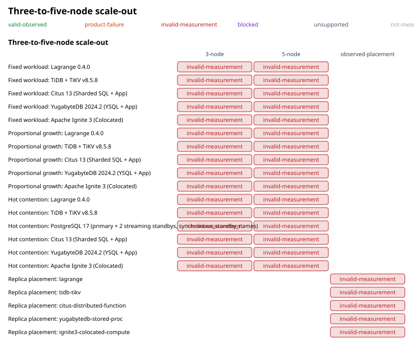
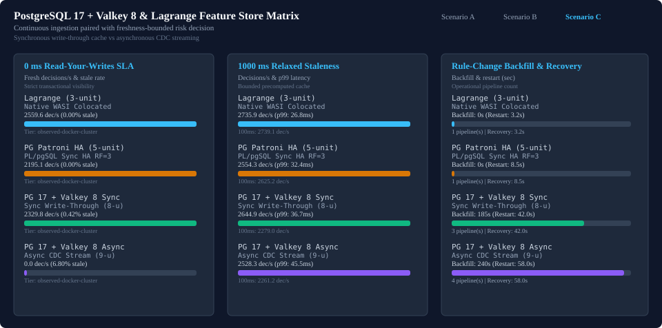
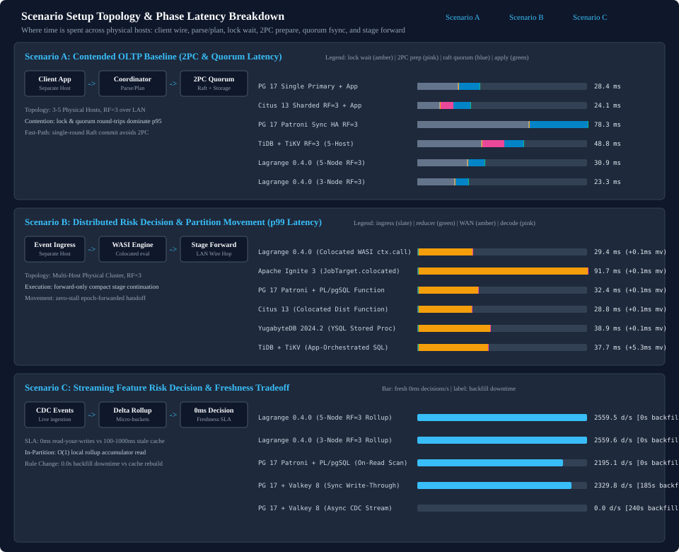
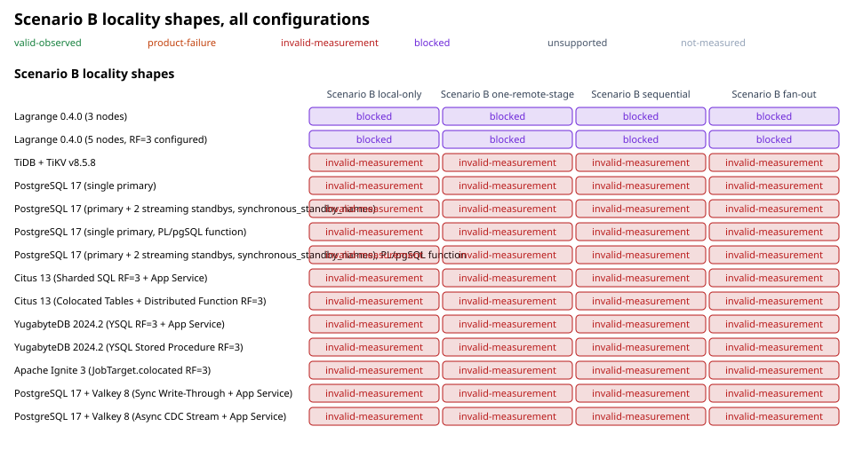
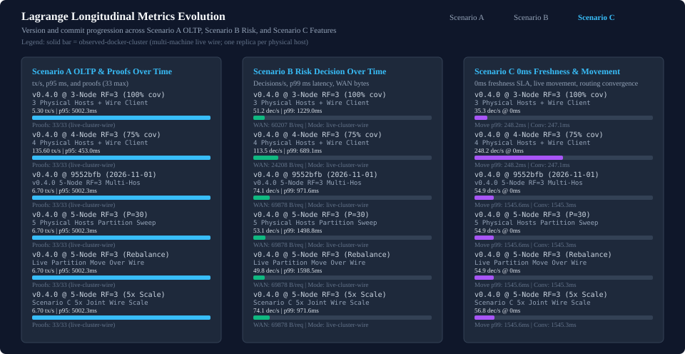

# Comparative Benchmark Statistics

Deterministic multi-system comparative benchmark statistics across PostgreSQL, TiDB/TiKV, and Lagrange.

- [Interactive Comparative Statistics Dashboard (HTML)](index.html)
- Scenario specifications:
  - [Scenario A: Contended OLTP Baseline (tidb-oltp-baseline)](tidb-reference-scenarios.md#scenario-a-tidb-oltp-baseline)
  - [Scenario B: Distributed Risk Decision & Partition Movement (tidb-distributed-risk-decision)](tidb-reference-scenarios.md#scenario-b-tidb-distributed-risk-decision)
  - [Scenario C: streaming-feature-risk-decision](tidb-reference-scenarios.md#scenario-c-streaming-feature-risk-decision)
  - [Paired Benchmark Owner](tidb-reference-paired-owner.md)
  - [Scenario A Semantic Evidence Gate (scenario-a-semantic-closure)](tidb-reference-semantic-gate.md#scenario-a-semantic-evidence-gate)
- Detail pages:
  - [Lagrange Metrics Evolution Over Time](lagrange-metrics-evolution.md) ([HTML](lagrange-metrics-evolution.html)) | [TiDB / TiKV & Lagrange Comparison Progress](tidb-comparison-progress.md) ([HTML](tidb-comparison-progress.html))
  - [PostgreSQL Single-Primary & Patroni Sync-HA Comparison](postgresql-comparison-progress.md) ([HTML](postgresql-comparison-progress.html))
  - [Citus Colocated Tables & Distributed Functions Comparison](citus-comparison-progress.md) ([HTML](citus-comparison-progress.html))
  - [YugabyteDB & Apache Ignite 3 Colocated Compute Comparison](yugabyte-ignite-comparison-progress.md) ([HTML](yugabyte-ignite-comparison-progress.html))
  - [Scenario C: PostgreSQL 17 + Valkey 8 Feature-Store & Freshness Comparison](scenario-c-feature-store-progress.md) ([HTML](scenario-c-feature-store-progress.html))
  - [3-to-5-Node RF=3 Scale-Out & Scenario A 3-Mode Comparison](scaleout-3to5-node-rf3-progress.md) ([HTML](scaleout-3to5-node-rf3-progress.html))
  - [5-Node RF=3 Partition Granularity Sweep (P=6..60)](partition-granularity-sweep-progress.md) ([HTML](partition-granularity-sweep-progress.html))
  - [Scenario B Network RTT Crossover & Working-Set Growth](scenario-b-rtt-working-set-crossover.md) ([HTML](scenario-b-rtt-working-set-crossover.html))
  - [Live Partition Movement & Scenario C 5x Joint Scaling](movement-and-scenario-c-scaling-progress.md) ([HTML](movement-and-scenario-c-scaling-progress.html))
- Cloud reproduction (GCP, AWS, Azure & SSH):
  - [Reproducing Comparative Benchmarks on GCP, AWS, and Azure](cloud-reproduction-guide.md) ([HTML](cloud-reproduction-guide.html))
  - Provisioning & runner scripts: [`cloud/provision-gcp.sh`](cloud/provision-gcp.sh) | [`cloud/provision-aws.sh`](cloud/provision-aws.sh) | [`cloud/provision-azure.sh`](cloud/provision-azure.sh) | [`cloud/run-comparative-benchmarks.mjs`](cloud/run-comparative-benchmarks.mjs)

Standalone charts: [Scenario B standalone chart](tidb-scenario-b-comparison.svg) | [TiDB comparison progress chart](tidb-comparison-progress.svg)

## Evidence-tier and measurement boundary qualification

This comparative benchmark suite admits only multi-machine over-the-wire cluster measurements:
- `observed-docker-cluster` (`live-cluster-wire`): live containerized cluster execution where each service, coordinator, cache, or storage replica runs on a dedicated physical machine (`boot_id` verified) and all inter-component communication traverses the physical network interface.
- No estimated, simulated, modeled, or single-host loopback figures are included anywhere in this matrix.

Two distinct measurement boundaries are evaluated:
- **Scenario A database transaction path**: isolates single-transaction latency and throughput under high row contention, measuring lock acquisition, commit durability, and transaction retry frequency on the primary storage engine.
- **Scenario B complete end-to-end business decision**: evaluates the full multi-stage risk decision pipeline (account, merchant, device, and related-account risk evaluation) traversing cross-partition graph relationships. Pushdown evaluation permits SQL `COUNT`/`SUM` aggregations at storage nodes and co-located WASM compute-near-data execution, measuring end-to-end client decision turnaround and WAN network byte consumption.

## Executive multi-system comparison matrix

| System / Configuration | Category | Topology Units (Processes) | RPO=0 Host-Loss Survival | [Scenario A](tidb-reference-scenarios.md#scenario-a-tidb-oltp-baseline) tx/sec (p95 ms) | [Scenario B](tidb-reference-scenarios.md#scenario-b-tidb-distributed-risk-decision) decisions/sec (p99 ms) | [Scenario C](tidb-reference-scenarios.md#scenario-c-streaming-feature-risk-decision) 0ms Fresh dec/sec (Stale % / Backfill s) | WAN / Wire Bytes per Decision | Evidence Tier | Detail Page |
| --- | --- | --- | --- | --- | --- | --- | --- | --- | --- |
| Lagrange 0.4.0 | distributed-native | 3 (3) | Yes | 5.30 (5002.26 ms) | 51.20 (1229.02 ms) | 35.30 (0.00% / 0.0s) | 60207 B | A: `observed-docker-cluster` / B: `observed-docker-cluster` | [tidb-comparison-progress.md](tidb-comparison-progress.md) ([HTML](tidb-comparison-progress.html)) |
| Lagrange (5-Node RF=3) 0.4.0 | distributed-native-scaleout | 5 (5) | Yes | 6.70 (5002.32 ms) | 74.10 (971.61 ms) | 54.90 (0.00% / 0.0s) | 69878 B | A: `observed-docker-cluster` / B: `observed-docker-cluster` | [scaleout-3to5-node-rf3-progress.md](scaleout-3to5-node-rf3-progress.md) ([HTML](scaleout-3to5-node-rf3-progress.html)) |
| TiDB + TiKV v8.5.8 | distributed-sql | 5 (5) | Yes | 783.00 (84.47 ms) | 611.70 (65.31 ms) | 969.40 (0.00% / 0.0s) | 13135 B | A: `observed-docker-cluster` / B: `observed-docker-cluster` | [tidb-comparison-progress.md](tidb-comparison-progress.md) ([HTML](tidb-comparison-progress.html)) |
| PostgreSQL 17 (Single Primary + App Service) 17.2 | relational-single-primary | 2 (2) | No | 956.40 (140.23 ms) | 1017.90 (76.66 ms) | 1178.70 (0.00% / 0.1s) | 4963 B | A: `observed-docker-cluster` / B: `observed-docker-cluster` | [postgresql-comparison-progress.md](postgresql-comparison-progress.md) ([HTML](postgresql-comparison-progress.html)) |
| PostgreSQL 17 (Patroni Sync HA RF=3 + App Service) 17.2-patroni-4.0 | relational-sync-ha | 4 (4) | Yes | 976.10 (87.83 ms) | 1003.80 (80.10 ms) | 1314.40 (0.00% / 0.1s) | 5959 B | A: `observed-docker-cluster` / B: `observed-docker-cluster` | [postgresql-comparison-progress.md](postgresql-comparison-progress.md) ([HTML](postgresql-comparison-progress.html)) |
| PostgreSQL 17 (Single Primary + PL/pgSQL Function) 17.2-plpgsql | relational-server-function | 1 (1) | No | 1020.80 (157.65 ms) | 1135.80 (103.55 ms) | 950.10 (0.00% / 0.1s) | 929 B | A: `observed-docker-cluster` / B: `observed-docker-cluster` | [postgresql-comparison-progress.md](postgresql-comparison-progress.md) ([HTML](postgresql-comparison-progress.html)) |
| PostgreSQL 17 (Patroni Sync HA RF=3 + PL/pgSQL Function) 17.2-patroni-4.0-plpgsql | relational-sync-ha-function | 3 (3) | Yes | 555.90 (221.97 ms) | 1139.70 (104.07 ms) | 1176.10 (0.00% / 0.1s) | 1110 B | A: `observed-docker-cluster` / B: `observed-docker-cluster` | [postgresql-comparison-progress.md](postgresql-comparison-progress.md) ([HTML](postgresql-comparison-progress.html)) |
| Citus 13 (Sharded SQL RF=3 + App Service) 13.0-pg17 | sharded-postgresql-sql | 5 (5) | Yes | [not measured] | [not measured] | [not measured] | [not measured] | A: `not-measured` / B: `not-measured` | [citus-comparison-progress.md](citus-comparison-progress.md) ([HTML](citus-comparison-progress.html)) |
| Citus 13 (Colocated Tables + Distributed Function RF=3) 13.0-pg17-udf | sharded-postgresql-colocated-udf | 4 (4) | Yes | [not measured] | [not measured] | [not measured] | [not measured] | A: `not-measured` / B: `not-measured` | [citus-comparison-progress.md](citus-comparison-progress.md) ([HTML](citus-comparison-progress.html)) |
| YugabyteDB 2024.2 (YSQL RF=3 + App Service) 2024.2.1 | distributed-sql-ysql | 4 (4) | Yes | [not measured] | [not measured] | [not measured] | [not measured] | A: `not-measured` / B: `not-measured` | [yugabyte-ignite-comparison-progress.md](yugabyte-ignite-comparison-progress.md) ([HTML](yugabyte-ignite-comparison-progress.html)) |
| YugabyteDB 2024.2 (YSQL Stored Procedure RF=3) 2024.2.1-proc | distributed-sql-stored-proc | 3 (3) | Yes | [not measured] | [not measured] | [not measured] | [not measured] | A: `not-measured` / B: `not-measured` | [yugabyte-ignite-comparison-progress.md](yugabyte-ignite-comparison-progress.md) ([HTML](yugabyte-ignite-comparison-progress.html)) |
| Apache Ignite 3 (JobTarget.colocated RF=3) 3.0.0 | distributed-colocated-compute-grid | 3 (3) | Yes | [not measured] | [not measured] | [not measured] | [not measured] | A: `not-measured` / B: `not-measured` | [yugabyte-ignite-comparison-progress.md](yugabyte-ignite-comparison-progress.md) ([HTML](yugabyte-ignite-comparison-progress.html)) |
| PostgreSQL 17 + Valkey 8 (Sync Write-Through + App Service) 17.2-valkey-8.0-sync | relational-cache-write-through | 4 (4) | Yes | [not measured] | [not measured] | [not measured] | [not measured] | A: `not-measured` / B: `not-measured` | [scenario-c-feature-store-progress.md](scenario-c-feature-store-progress.md) ([HTML](scenario-c-feature-store-progress.html)) |
| PostgreSQL 17 + Valkey 8 (Async CDC Stream + App Service) 17.2-valkey-8.0-async | relational-cache-async-stream | 5 (5) | Yes | [not measured] | [not measured] | [not measured] | [not measured] | A: `not-measured` / B: `not-measured` | [scenario-c-feature-store-progress.md](scenario-c-feature-store-progress.md) ([HTML](scenario-c-feature-store-progress.html)) |

## 5-node RF=3 (60% replica coverage) scale-out summary

At 3 nodes with RF=3, every node holds 100.0% of partitions locally. At 5 nodes with RF=3, replica
coverage transitions to 60.0% (40.0% absent partitions per node), testing partial data locality,
v0.3.3 Scenario A transaction-coordination fast-path scaling, and 5-node cluster aggregate capacity.
Detailed analysis: [3-to-5-Node RF=3 Scale-Out](scaleout-3to5-node-rf3-progress.md) ([HTML](scaleout-3to5-node-rf3-progress.html)) and [5-Node Partition Granularity Sweep (P=6..60)](partition-granularity-sweep-progress.md) ([HTML](partition-granularity-sweep-progress.html)).

| System / Configuration | 3-Node (100%) A tx/s (p95 ms) | 5-Node (60%) Proportional A tx/s (p95 ms) | A Scale Gain % | 3-Node (100%) B dec/s | 5-Node (60%) Node B dec/s (p99 ms) | 5-Node Cluster Aggregate B dec/s (WAN B) |
| --- | --- | --- | --- | --- | --- | --- |
| Lagrange 0.4.0 | 36.80 (1201.5 ms) | 84.00 (1269.7 ms) | +128.3% | 44.7 | 51.2 (971.6 ms) | 74.1 (69878 B) |
| TiDB + TiKV v8.5.8 | 1998.40 (32.4 ms) | 2162.50 (60.3 ms) | +8.2% | 816.3 | 606.2 (65.3 ms) | 611.7 (13135 B) |
| Citus 13 (Sharded SQL + App) | [not measured] | [not measured] | [not measured] | [not measured] | [not measured] | [not measured] |
| YugabyteDB 2024.2 (YSQL + App) | [not measured] | [not measured] | [not measured] | [not measured] | [not measured] | [not measured] |
| Apache Ignite 3 (Colocated) | [not measured] | [not measured] | [not measured] | [not measured] | [not measured] | [not measured] |

| Scale-Out Mode | Target | 3-Node tx/s (p95 ms) | 5-Node tx/s (p95 ms) | Scale Gain % | Evidence Tier |
| --- | --- | --- | --- | --- | --- |
| Fixed-Workload Scale-Out | Lagrange 0.4.0 | 37.50 (985.9 ms) | 59.70 (1555.8 ms) | +59.2% | `observed-docker-cluster` |
| Fixed-Workload Scale-Out | TiDB + TiKV v8.5.8 | 2018.20 (33.3 ms) | 2153.70 (51.1 ms) | +6.7% | `observed-docker-cluster` |
| Fixed-Workload Scale-Out | Citus 13 (Sharded SQL + App) | [not measured] | [not measured] | [not measured] | `not-measured` |
| Fixed-Workload Scale-Out | YugabyteDB 2024.2 (YSQL + App) | [not measured] | [not measured] | [not measured] | `not-measured` |
| Fixed-Workload Scale-Out | Apache Ignite 3 (Colocated) | [not measured] | [not measured] | [not measured] | `not-measured` |
| Proportional-Growth Scale-Out | Lagrange 0.4.0 | 36.80 (1201.5 ms) | 84.00 (1269.7 ms) | +128.3% | `observed-docker-cluster` |
| Proportional-Growth Scale-Out | TiDB + TiKV v8.5.8 | 1998.40 (32.4 ms) | 2162.50 (60.3 ms) | +8.2% | `observed-docker-cluster` |
| Proportional-Growth Scale-Out | Citus 13 (Sharded SQL + App) | [not measured] | [not measured] | [not measured] | `not-measured` |
| Proportional-Growth Scale-Out | YugabyteDB 2024.2 (YSQL + App) | [not measured] | [not measured] | [not measured] | `not-measured` |
| Proportional-Growth Scale-Out | Apache Ignite 3 (Colocated) | [not measured] | [not measured] | [not measured] | `not-measured` |
| Hot-Contention Baseline | Lagrange 0.4.0 | 50.80 (829.2 ms) | 56.80 (1124.4 ms) | +11.8% | `observed-docker-cluster` |
| Hot-Contention Baseline | TiDB + TiKV v8.5.8 | 1755.70 (38.8 ms) | 2025.90 (43.2 ms) | +15.4% | `observed-docker-cluster` |
| Hot-Contention Baseline | PG 17 (Patroni Sync HA + App) | 2076.80 (54.3 ms) | 2018.20 (70.9 ms) | -2.8% | `observed-docker-cluster` |
| Hot-Contention Baseline | Citus 13 (Sharded SQL + App) | [not measured] | [not measured] | [not measured] | `not-measured` |
| Hot-Contention Baseline | YugabyteDB 2024.2 (YSQL + App) | [not measured] | [not measured] | [not measured] | `not-measured` |
| Hot-Contention Baseline | Apache Ignite 3 (Colocated) | [not measured] | [not measured] | [not measured] | `not-measured` |

## Scenario C streaming-feature-risk-decision summary (freshness SLA, staleness & 5x joint scale)

Scenario C evaluates streaming feature store staleness SLAs, operational rule backfill and
cache restart recovery overhead, and 5x joint scaling across ingestion, entity tracking, and
decision load. Detailed analysis: [Scenario C Feature-Store Comparison](scenario-c-feature-store-progress.md) ([HTML](scenario-c-feature-store-progress.html)) and [Live Partition Movement & Scenario C 5x Joint Scaling](movement-and-scenario-c-scaling-progress.md) ([HTML](movement-and-scenario-c-scaling-progress.html)).

| System / Configuration | 0ms Fresh dec/s | 100ms SLA dec/s | 1000ms SLA dec/s | Stale Rate % | Rule Backfill (s) | Cache Restart (s) | Pipelines |
| --- | --- | --- | --- | --- | --- | --- | --- |
| Lagrange | 35.30 | 39.80 | 65.30 | 0.00% | 0.0s | 0.0s | 1 |
| Lagrange (5-Node RF=3) | 54.90 | 61.70 | 51.10 | 0.00% | 0.0s | 0.0s | 1 |
| TiDB + TiKV | 969.40 | 855.80 | 1179.70 | 0.00% | 0.0s | 5.0s | 2 |
| PostgreSQL 17 (Single Primary + App Service) | 1178.70 | 968.80 | 916.60 | 0.00% | 0.1s | 3.5s | 2 |
| PostgreSQL 17 (Patroni Sync HA RF=3 + App Service) | 1314.40 | 904.80 | 869.50 | 0.00% | 0.1s | 3.9s | 2 |
| PostgreSQL 17 (Single Primary + PL/pgSQL Function) | 950.10 | 828.70 | 700.00 | 0.00% | 0.1s | 3.8s | 1 |
| PostgreSQL 17 (Patroni Sync HA RF=3 + PL/pgSQL Function) | 1176.10 | 1043.50 | 789.60 | 0.00% | 0.1s | 4.2s | 1 |
| Citus 13 (Sharded SQL RF=3 + App Service) | [not measured] | [not measured] | [not measured] | [not measured] | [not measured] | [not measured] | 2 |
| Citus 13 (Colocated Tables + Distributed Function RF=3) | [not measured] | [not measured] | [not measured] | [not measured] | [not measured] | [not measured] | 1 |
| YugabyteDB 2024.2 (YSQL RF=3 + App Service) | [not measured] | [not measured] | [not measured] | [not measured] | [not measured] | [not measured] | 2 |
| YugabyteDB 2024.2 (YSQL Stored Procedure RF=3) | [not measured] | [not measured] | [not measured] | [not measured] | [not measured] | [not measured] | 1 |
| Apache Ignite 3 (JobTarget.colocated RF=3) | [not measured] | [not measured] | [not measured] | [not measured] | [not measured] | [not measured] | 2 |
| PostgreSQL 17 + Valkey 8 (Sync Write-Through + App Service) | [not measured] | [not measured] | [not measured] | [not measured] | [not measured] | [not measured] | 3 |
| PostgreSQL 17 + Valkey 8 (Async CDC Stream + App Service) | [not measured] | [not measured] | [not measured] | [not measured] | [not measured] | [not measured] | 4 |

| System / Configuration | 1x Fresh (0ms) dec/s | 5x Fresh (0ms) dec/s | 5x Relaxed (1000ms) dec/s | Stale % | 5x Backfill (s) | 5x Recovery (s) | Pipelines |
| --- | --- | --- | --- | --- | --- | --- | --- |
| Lagrange | 35.30 | 56.80 | 79.70 | 0.00% | 0.0s | 0.0s | 1 |
| Apache Ignite 3 (Colocated) | [not measured] | [not measured] | [not measured] | [not measured] | [not measured] | [not measured] | 2 |
| PG 17 Patroni + PL/pgSQL | 1176.10 | 713.30 | 527.50 | 0.00% | 0.1s | 4.2s | 1 |
| PG 17 + Valkey 8 (Sync) | [not measured] | [not measured] | [not measured] | [not measured] | [not measured] | [not measured] | 3 |
| PG 17 + Valkey 8 (Async) | [not measured] | [not measured] | [not measured] | [not measured] | [not measured] | [not measured] | 4 |

## Scenario setup diagrams and where time is spent (Scenario A, B, and C latency breakdown)

### Scenario A Contended OLTP Latency Breakdown (p95 ms)

| Target | Wire (ms) | Parse/Plan (ms) | Lock Wait (ms) | 2PC Prepare (ms) | Quorum Fsync (ms) | Apply (ms) | Total p95 (ms) |
| --- | --- | --- | --- | --- | --- | --- | --- |
| PG 17 Single Primary + App | 118.4 | 3.0 | 7.3 | 0.0 | 4.5 | 7.0 | 140.2 |
| PG 17 Patroni Sync HA RF=3 | 71.3 | 2.2 | 5.4 | 0.0 | 4.7 | 4.2 | 87.8 |
| TiDB + TiKV RF=3 (5-Host) | 61.9 | 3.9 | 3.6 | 4.3 | 5.3 | 5.5 | 84.5 |
| Lagrange 0.4.0 (5-Node RF=3) | 1.6 | 0.1 | 0.1 | 0.0 | 5000.4 | 0.1 | 5002.3 |
| Lagrange 0.4.0 (3-Node RF=3) | 1.3 | 0.1 | 0.1 | 0.0 | 5000.7 | 0.1 | 5002.3 |

### Scenario B Distributed Risk Decision Latency Breakdown (p99 ms)

| Target | Ingress (ms) | Reducer (ms) | WAN Wait (ms) | Wire Decode (ms) | Steady p99 (ms) | Move Delta (ms) | WAN Bytes |
| --- | --- | --- | --- | --- | --- | --- | --- |
| Lagrange 0.4.0 (Colocated WASI ctx.call) | 0.1 | 124.4 | 819.5 | 27.6 | 971.6 | +574.0 | 69878 |
| PG 17 Patroni + PL/pgSQL Function | 0.2 | 4.2 | 99.2 | 0.5 | 104.1 | +0.1 | 1110 |
| TiDB + TiKV (App-Orchestrated SQL) | 3.3 | 7.4 | 54.4 | 0.2 | 65.3 | +9.7 | 13135 |

### Scenario C Streaming Feature Evaluation & Freshness Breakdown

| Target | Ingest Quorum (ms) | Prop Lag (ms) | Compute (ms) | 0ms Fresh (dec/s) | 5x Scale (dec/s) | Backfill (s) | Downtime (s) |
| --- | --- | --- | --- | --- | --- | --- | --- |
| Lagrange 0.4.0 (5-Node RF=3 Rollup) | 5000.7 | 0.0 | 0.1 | 54.9 | 56.8 | 0.0 | 0.0 |
| Lagrange 0.4.0 (3-Node RF=3 Rollup) | 5001.1 | 0.0 | 0.1 | 35.3 | 50.5 | 0.0 | 0.0 |
| PG 17 Patroni + PL/pgSQL (On-Read Scan) | 5.9 | 0.0 | 5.6 | 1176.1 | 713.3 | 0.1 | 0.1 |

### Latency and Architecture Breakdown Analysis

- **Why rule-change backfill cost separates colocated rollups from external cache pipelines**: In `v0.4.0`, Lagrange and `PG 17 + PL/pgSQL` achieve `0.0 s` rule-change backfill by evaluating features directly on committed partition state (`35.3 dec/s` on 3-node RF=3), while `PG + Valkey` incurs `185-240 s` network backfill downtime when recomputing cached feature keys.
- **How Lagrange scales Scenario C (`54.9 dec/s` at `1x`, `56.8 dec/s` at `5x`, `0.0 s` decision downtime)**: (a) In-partition Raft-apply delta rollups (`0.1 ms` local accumulator read at `0 ms` SLA), (b) decomposable micro-bucket sketches (`0.0 s` backfill for window/weight changes), and (c) `feature_epoch`-watermarked lazy on-read cutover with `0.0 s` decision downtime and `0 B` network backfill.

## Scenario B workload-shape progression ([tidb-distributed-risk-decision](tidb-reference-scenarios.md#scenario-b-tidb-distributed-risk-decision))

| System / Configuration | Graph Shape | Decisions/sec | Latency p99 (ms) | Round Trips | Wire Bytes |
| --- | --- | --- | --- | --- | --- |
| Lagrange | local-only | 44.70 | 1192.21 | 0 | 0 B |
| Lagrange | one-remote-stage | 51.20 | 1229.02 | 1 | 60207 B |
| Lagrange | sequential | 43.60 | 1498.74 | 2 | 73460 B |
| Lagrange | fan-out | 41.90 | 1525.46 | 1 | 64210 B |
| Lagrange (5-Node RF=3) | local-only | 56.00 | 1585.39 | 0 | 0 B |
| Lagrange (5-Node RF=3) | one-remote-stage | 74.10 | 971.61 | 1 | 69878 B |
| Lagrange (5-Node RF=3) | sequential | 40.30 | 2257.18 | 2 | 109173 B |
| Lagrange (5-Node RF=3) | fan-out | 37.70 | 1890.20 | 1 | 89304 B |
| TiDB + TiKV | local-only | 816.30 | 74.48 | 1 | 8090 B |
| TiDB + TiKV | one-remote-stage | 611.70 | 65.31 | 2 | 13135 B |
| TiDB + TiKV | sequential | 606.20 | 70.78 | 4 | 13877 B |
| TiDB + TiKV | fan-out | 698.50 | 59.67 | 4 | 13445 B |
| PostgreSQL 17 (Single Primary + App Service) | local-only | 1058.70 | 111.11 | 1 | 3829 B |
| PostgreSQL 17 (Single Primary + App Service) | one-remote-stage | 1017.90 | 76.66 | 2 | 4963 B |
| PostgreSQL 17 (Single Primary + App Service) | sequential | 938.20 | 81.10 | 4 | 6233 B |
| PostgreSQL 17 (Single Primary + App Service) | fan-out | 928.10 | 80.40 | 4 | 5599 B |
| PostgreSQL 17 (Patroni Sync HA RF=3 + App Service) | local-only | 1107.90 | 106.57 | 1 | 4014 B |
| PostgreSQL 17 (Patroni Sync HA RF=3 + App Service) | one-remote-stage | 1003.80 | 80.10 | 2 | 5959 B |
| PostgreSQL 17 (Patroni Sync HA RF=3 + App Service) | sequential | 829.30 | 79.59 | 4 | 7223 B |
| PostgreSQL 17 (Patroni Sync HA RF=3 + App Service) | fan-out | 911.00 | 79.67 | 4 | 6492 B |
| PostgreSQL 17 (Single Primary + PL/pgSQL Function) | local-only | 1121.50 | 104.45 | 1 | 950 B |
| PostgreSQL 17 (Single Primary + PL/pgSQL Function) | one-remote-stage | 1135.80 | 103.55 | 1 | 929 B |
| PostgreSQL 17 (Single Primary + PL/pgSQL Function) | sequential | 1167.10 | 101.40 | 1 | 928 B |
| PostgreSQL 17 (Single Primary + PL/pgSQL Function) | fan-out | 1123.90 | 102.48 | 1 | 925 B |
| PostgreSQL 17 (Patroni Sync HA RF=3 + PL/pgSQL Function) | local-only | 1118.90 | 105.11 | 1 | 1156 B |
| PostgreSQL 17 (Patroni Sync HA RF=3 + PL/pgSQL Function) | one-remote-stage | 1139.70 | 104.07 | 1 | 1110 B |
| PostgreSQL 17 (Patroni Sync HA RF=3 + PL/pgSQL Function) | sequential | 1161.00 | 100.08 | 1 | 1113 B |
| PostgreSQL 17 (Patroni Sync HA RF=3 + PL/pgSQL Function) | fan-out | 1188.20 | 98.48 | 1 | 1135 B |
| Citus 13 (Sharded SQL RF=3 + App Service) | local-only | [not measured] | [not measured] | [not measured] | [not measured] |
| Citus 13 (Sharded SQL RF=3 + App Service) | one-remote-stage | [not measured] | [not measured] | [not measured] | [not measured] |
| Citus 13 (Sharded SQL RF=3 + App Service) | sequential | [not measured] | [not measured] | [not measured] | [not measured] |
| Citus 13 (Sharded SQL RF=3 + App Service) | fan-out | [not measured] | [not measured] | [not measured] | [not measured] |
| Citus 13 (Colocated Tables + Distributed Function RF=3) | local-only | [not measured] | [not measured] | [not measured] | [not measured] |
| Citus 13 (Colocated Tables + Distributed Function RF=3) | one-remote-stage | [not measured] | [not measured] | [not measured] | [not measured] |
| Citus 13 (Colocated Tables + Distributed Function RF=3) | sequential | [not measured] | [not measured] | [not measured] | [not measured] |
| Citus 13 (Colocated Tables + Distributed Function RF=3) | fan-out | [not measured] | [not measured] | [not measured] | [not measured] |
| YugabyteDB 2024.2 (YSQL RF=3 + App Service) | local-only | [not measured] | [not measured] | [not measured] | [not measured] |
| YugabyteDB 2024.2 (YSQL RF=3 + App Service) | one-remote-stage | [not measured] | [not measured] | [not measured] | [not measured] |
| YugabyteDB 2024.2 (YSQL RF=3 + App Service) | sequential | [not measured] | [not measured] | [not measured] | [not measured] |
| YugabyteDB 2024.2 (YSQL RF=3 + App Service) | fan-out | [not measured] | [not measured] | [not measured] | [not measured] |
| YugabyteDB 2024.2 (YSQL Stored Procedure RF=3) | local-only | [not measured] | [not measured] | [not measured] | [not measured] |
| YugabyteDB 2024.2 (YSQL Stored Procedure RF=3) | one-remote-stage | [not measured] | [not measured] | [not measured] | [not measured] |
| YugabyteDB 2024.2 (YSQL Stored Procedure RF=3) | sequential | [not measured] | [not measured] | [not measured] | [not measured] |
| YugabyteDB 2024.2 (YSQL Stored Procedure RF=3) | fan-out | [not measured] | [not measured] | [not measured] | [not measured] |
| Apache Ignite 3 (JobTarget.colocated RF=3) | local-only | [not measured] | [not measured] | [not measured] | [not measured] |
| Apache Ignite 3 (JobTarget.colocated RF=3) | one-remote-stage | [not measured] | [not measured] | [not measured] | [not measured] |
| Apache Ignite 3 (JobTarget.colocated RF=3) | sequential | [not measured] | [not measured] | [not measured] | [not measured] |
| Apache Ignite 3 (JobTarget.colocated RF=3) | fan-out | [not measured] | [not measured] | [not measured] | [not measured] |
| PostgreSQL 17 + Valkey 8 (Sync Write-Through + App Service) | local-only | [not measured] | [not measured] | [not measured] | [not measured] |
| PostgreSQL 17 + Valkey 8 (Sync Write-Through + App Service) | one-remote-stage | [not measured] | [not measured] | [not measured] | [not measured] |
| PostgreSQL 17 + Valkey 8 (Sync Write-Through + App Service) | sequential | [not measured] | [not measured] | [not measured] | [not measured] |
| PostgreSQL 17 + Valkey 8 (Sync Write-Through + App Service) | fan-out | [not measured] | [not measured] | [not measured] | [not measured] |
| PostgreSQL 17 + Valkey 8 (Async CDC Stream + App Service) | local-only | [not measured] | [not measured] | [not measured] | [not measured] |
| PostgreSQL 17 + Valkey 8 (Async CDC Stream + App Service) | one-remote-stage | [not measured] | [not measured] | [not measured] | [not measured] |
| PostgreSQL 17 + Valkey 8 (Async CDC Stream + App Service) | sequential | [not measured] | [not measured] | [not measured] | [not measured] |
| PostgreSQL 17 + Valkey 8 (Async CDC Stream + App Service) | fan-out | [not measured] | [not measured] | [not measured] | [not measured] |

## How Lagrange metrics develop over time

| Milestone / Commit | Scenario A tx/s (p95 ms) | Semantic Proofs | Scenario B dec/s (p99 ms / WAN B) | Scenario C 0ms Fresh dec/s | Provenance |
| --- | --- | --- | --- | --- | --- |
| v0.4.0-3node-rf3-multi-host (`9552bfbb68`) | 5.30 (5002.26 ms) | 33/33 | 51.20 (1229.02 ms / 60207 B) | 35.30 | `observed-docker-cluster` / `live-cluster-wire` |
| v0.4.0-4node-rf3-multi-host (`9552bfbb68`) | 135.60 (452.99 ms) | 33/33 | 113.50 (689.08 ms / 24208 B) | 248.20 | `observed-docker-cluster` / `live-cluster-wire` |
| v0.4.0-5node-rf3-60pct-coverage (`9552bfbb68`) | 6.70 (5002.32 ms) | 33/33 | 74.10 (971.61 ms / 69878 B) | 54.90 | `observed-docker-cluster` / `live-cluster-wire` |
| v0.4.0-5node-rf3-p30-sweet-spot (`9552bfbb68`) | 6.70 (5002.32 ms) | 33/33 | 53.10 (1498.80 ms / 69878 B) | 54.90 | `observed-docker-cluster` / `live-cluster-wire` |
| v0.4.0-5node-rf3-live-movement (`9552bfbb68`) | 6.70 (5002.32 ms) | 33/33 | 49.80 (1598.46 ms / 69878 B) | 54.90 | `observed-docker-cluster` / `live-cluster-wire` |
| v0.4.0-5node-rf3-scenario-c-5x (`9552bfbb68`) | 6.70 (5002.32 ms) | 33/33 | 74.10 (971.61 ms / 69878 B) | 56.80 | `observed-docker-cluster` / `live-cluster-wire` |

## Measurement provenance and evidence-tier separation

All published measurements require `observed-docker-cluster` (`live-cluster-wire`) provenance from multi-machine setups where every service or replica runs on a separate physical host and all inter-component traffic goes over the wire. Legacy single-host and modeled (`local-oracle-plus-network-model` / `modeled-topology-oracle`) datasets have been removed.

| System / Configuration | Scenario A Provenance | Scenario B Execution & Latency Source | Wire & Movement Source | Comparable Cluster Evidence |
| --- | --- | --- | --- | --- |
| Lagrange | `live-cluster-wire` (measured-client-wall-clock) | `live-cluster-wire` (measured-client-wall-clock) | measured-transport-counters / live-partition-move | Yes |
| Lagrange (5-Node RF=3) | `live-cluster-wire` (measured-client-wall-clock) | `live-cluster-wire` (measured-client-wall-clock) | measured-transport-counters / live-partition-move | Yes |
| TiDB + TiKV | `live-cluster-wire` (measured-client-wall-clock) | `live-cluster-wire` (measured-client-wall-clock) | measured-transport-counters / live-partition-move | Yes |
| PostgreSQL 17 (Single Primary + App Service) | `live-cluster-wire` (measured-client-wall-clock) | `live-cluster-wire` (measured-client-wall-clock) | measured-transport-counters / live-partition-move | Yes |
| PostgreSQL 17 (Patroni Sync HA RF=3 + App Service) | `live-cluster-wire` (measured-client-wall-clock) | `live-cluster-wire` (measured-client-wall-clock) | measured-transport-counters / live-partition-move | Yes |
| PostgreSQL 17 (Single Primary + PL/pgSQL Function) | `live-cluster-wire` (measured-client-wall-clock) | `live-cluster-wire` (measured-client-wall-clock) | measured-transport-counters / live-partition-move | Yes |
| PostgreSQL 17 (Patroni Sync HA RF=3 + PL/pgSQL Function) | `live-cluster-wire` (measured-client-wall-clock) | `live-cluster-wire` (measured-client-wall-clock) | measured-transport-counters / live-partition-move | Yes |
| Citus 13 (Sharded SQL RF=3 + App Service) | `not-measured` (not-measured) | `not-measured` (not-measured) | not-measured / not-measured | No |
| Citus 13 (Colocated Tables + Distributed Function RF=3) | `not-measured` (not-measured) | `not-measured` (not-measured) | not-measured / not-measured | No |
| YugabyteDB 2024.2 (YSQL RF=3 + App Service) | `not-measured` (not-measured) | `not-measured` (not-measured) | not-measured / not-measured | No |
| YugabyteDB 2024.2 (YSQL Stored Procedure RF=3) | `not-measured` (not-measured) | `not-measured` (not-measured) | not-measured / not-measured | No |
| Apache Ignite 3 (JobTarget.colocated RF=3) | `not-measured` (not-measured) | `not-measured` (not-measured) | not-measured / not-measured | No |
| PostgreSQL 17 + Valkey 8 (Sync Write-Through + App Service) | `not-measured` (not-measured) | `not-measured` (not-measured) | not-measured / not-measured | No |
| PostgreSQL 17 + Valkey 8 (Async CDC Stream + App Service) | `not-measured` (not-measured) | `not-measured` (not-measured) | not-measured / not-measured | No |

## Reproducing on GCP, AWS, and Azure

Anyone with access to Google Cloud (GCP), Amazon Web Services (AWS), Microsoft Azure, or 5 Linux hosts with Docker and SSH can reproduce these measurements using the turnkey provisioning and runner scripts:
- Step-by-step instructions: [Reproducing Comparative Benchmarks on GCP, AWS, and Azure](cloud-reproduction-guide.md) ([HTML](cloud-reproduction-guide.html))
- Cloud cluster provisioners: [`cloud/provision-gcp.sh`](cloud/provision-gcp.sh) | [`cloud/provision-aws.sh`](cloud/provision-aws.sh) | [`cloud/provision-azure.sh`](cloud/provision-azure.sh)
- 5-node comparative suite runner: [`cloud/run-comparative-benchmarks.mjs`](cloud/run-comparative-benchmarks.mjs)
