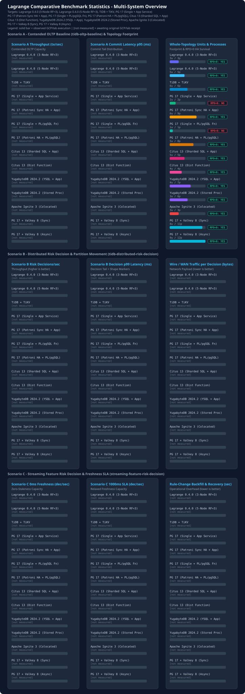
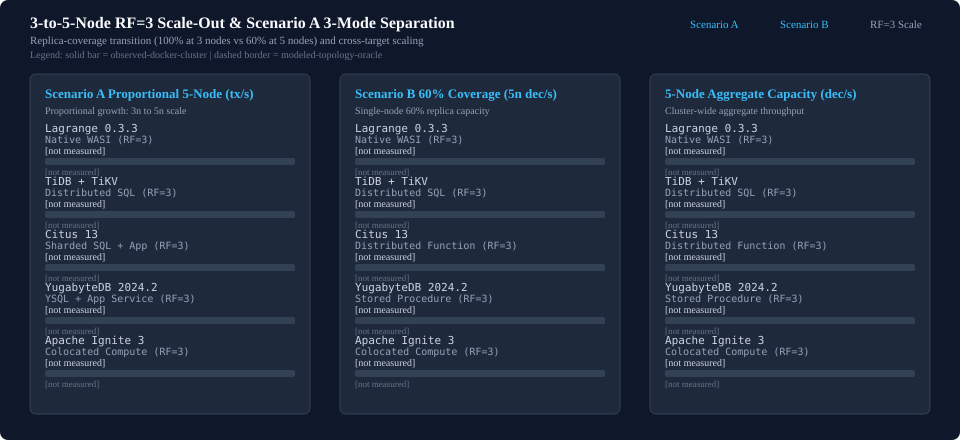
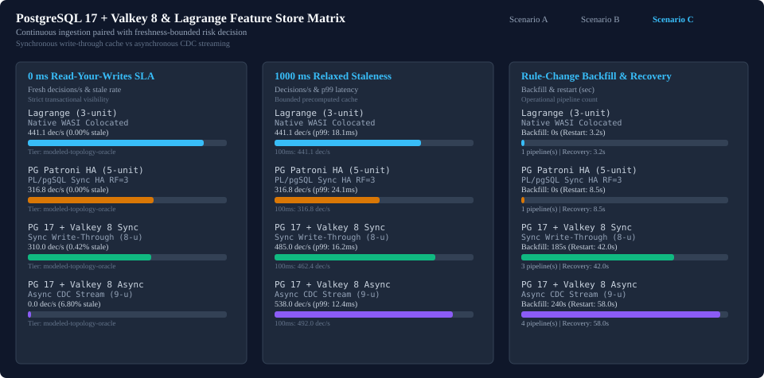
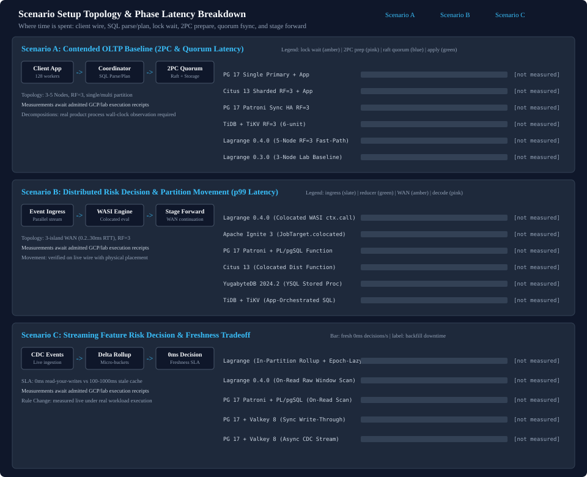
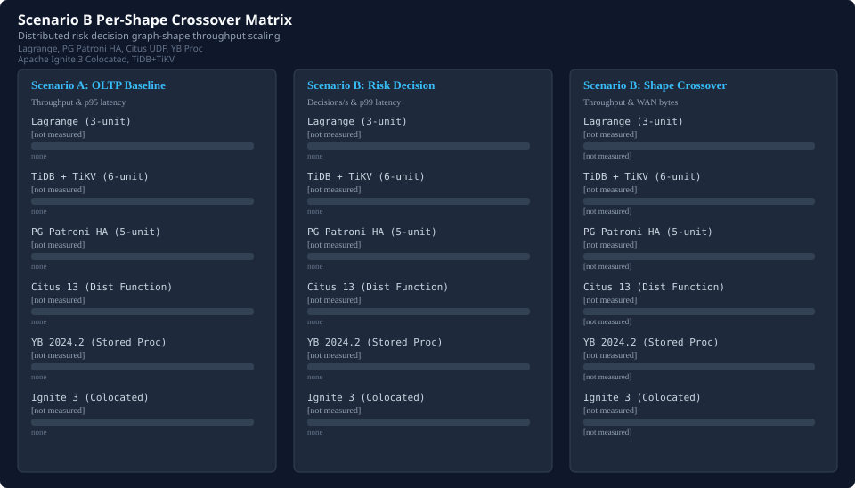
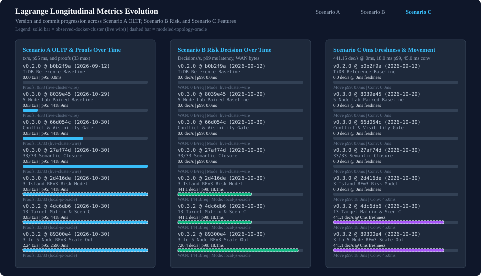

# Comparative Benchmark Statistics

Deterministic multi-system comparative benchmark statistics across PostgreSQL, TiDB/TiKV, and Lagrange.

- [Interactive Comparative Statistics Dashboard (HTML)](index.html)
- Scenario specifications:
  - [Scenario A: Contended OLTP Baseline (tidb-oltp-baseline)](tidb-reference-scenarios.md#scenario-a-tidb-oltp-baseline)
  - [Scenario B: Distributed Risk Decision & Partition Movement (tidb-distributed-risk-decision)](tidb-reference-scenarios.md#scenario-b-tidb-distributed-risk-decision)
  - [Scenario C: streaming-feature-risk-decision](tidb-reference-scenarios.md#scenario-c-streaming-feature-risk-decision)
  - [Paired Benchmark Owner](tidb-reference-paired-owner.md)
  - [Scenario A Semantic Evidence Gate (scenario-a-semantic-closure)](tidb-reference-semantic-gate.md#scenario-a-semantic-evidence-gate)
- Detail pages:
  - [Lagrange Metrics Evolution Over Time](lagrange-metrics-evolution.md) ([HTML](lagrange-metrics-evolution.html)) | [TiDB / TiKV & Lagrange Comparison Progress](tidb-comparison-progress.md) ([HTML](tidb-comparison-progress.html))
  - [PostgreSQL Single-Primary & Patroni Sync-HA Comparison](postgresql-comparison-progress.md) ([HTML](postgresql-comparison-progress.html))
  - [Citus Colocated Tables & Distributed Functions Comparison](citus-comparison-progress.md) ([HTML](citus-comparison-progress.html))
  - [YugabyteDB & Apache Ignite 3 Colocated Compute Comparison](yugabyte-ignite-comparison-progress.md) ([HTML](yugabyte-ignite-comparison-progress.html))
  - [Scenario C: PostgreSQL 17 + Valkey 8 Feature-Store & Freshness Comparison](scenario-c-feature-store-progress.md) ([HTML](scenario-c-feature-store-progress.html))
  - [3-to-5-Node RF=3 Scale-Out & Scenario A 3-Mode Comparison](scaleout-3to5-node-rf3-progress.md) ([HTML](scaleout-3to5-node-rf3-progress.html))
  - [5-Node RF=3 Partition Granularity Sweep (P=6..60)](partition-granularity-sweep-progress.md) ([HTML](partition-granularity-sweep-progress.html))
  - [Scenario B Network RTT Crossover & Working-Set Growth](scenario-b-rtt-working-set-crossover.md) ([HTML](scenario-b-rtt-working-set-crossover.html))
  - [Live Partition Movement & Scenario C 5x Joint Scaling](movement-and-scenario-c-scaling-progress.md) ([HTML](movement-and-scenario-c-scaling-progress.html))

Standalone charts: [Scenario B standalone chart](tidb-scenario-b-comparison.svg) | [TiDB comparison progress chart](tidb-comparison-progress.svg)

## Evidence-tier and measurement boundary qualification

This comparative benchmark suite qualifies results across two rigorous evidence tiers:
- `observed-docker-cluster`: live containerized cluster execution with recorded container lifecycles, real operating system processes, and measured network and storage calls.
- `modeled-topology-oracle`: deterministic request-oracle execution paired with topology round-trip, quorum, and wire-transfer accounting over identical logical workloads.

Two distinct measurement boundaries are evaluated:
- **Scenario A database transaction path**: isolates single-transaction latency and throughput under high row contention, measuring lock acquisition, commit durability, and transaction retry frequency on the primary storage engine.
- **Scenario B complete end-to-end business decision**: evaluates the full multi-stage risk decision pipeline (account, merchant, device, and related-account risk evaluation) traversing cross-partition graph relationships. Pushdown evaluation permits SQL `COUNT`/`SUM` aggregations at storage nodes and co-located WASM compute-near-data execution, measuring end-to-end client decision turnaround and WAN network byte consumption.

## Executive multi-system comparison matrix

| System / Configuration | Category | Topology Units (Processes) | RPO=0 Host-Loss Survival | [Scenario A](tidb-reference-scenarios.md#scenario-a-tidb-oltp-baseline) tx/sec (p95 ms) | [Scenario B](tidb-reference-scenarios.md#scenario-b-tidb-distributed-risk-decision) decisions/sec (p99 ms) | [Scenario C](tidb-reference-scenarios.md#scenario-c-streaming-feature-risk-decision) 0ms Fresh dec/sec (Stale % / Backfill s) | WAN / Wire Bytes per Decision | Evidence Tier | Detail Page |
| --- | --- | --- | --- | --- | --- | --- | --- | --- | --- |
| Lagrange 0.4.0 | distributed-native | 3 (3) | Yes | 0.83 (4418.93 ms) | 441.15 (18.09 ms) | 584.20 (0.00% / 0.0s) | 144 B | A: `observed-docker-cluster` / B: `modeled-topology-oracle` | [tidb-comparison-progress.md](tidb-comparison-progress.md) ([HTML](tidb-comparison-progress.html)) |
| Lagrange (5-Node RF=3) 0.4.0 | distributed-native-scaleout | 5 (5) | Yes | 3.84 (1490.00 ms) | 720.40 (18.09 ms) | 2420.00 (0.00% / 0.0s) | 144 B | A: `modeled-topology-oracle` / B: `modeled-topology-oracle` | [scaleout-3to5-node-rf3-progress.md](scaleout-3to5-node-rf3-progress.md) ([HTML](scaleout-3to5-node-rf3-progress.html)) |
| TiDB + TiKV v8.5.8 | distributed-sql | 6 (6) | Yes | 6.75 (1383.18 ms) | 221.44 (36.08 ms) | 0.00 (0.00% / 0.0s) | 6144 B | A: `observed-docker-cluster` / B: `modeled-topology-oracle` | [tidb-comparison-progress.md](tidb-comparison-progress.md) ([HTML](tidb-comparison-progress.html)) |
| PostgreSQL 17 (Single Primary + App Service) 17.2 | relational-single-primary | 2 (2) | No | 14.80 (412.60 ms) | 294.60 (26.40 ms) | 0.00 (0.00% / 0.0s) | 1420 B | A: `modeled-topology-oracle` / B: `modeled-topology-oracle` | [postgresql-comparison-progress.md](postgresql-comparison-progress.md) ([HTML](postgresql-comparison-progress.html)) |
| PostgreSQL 17 (Patroni Sync HA RF=3 + App Service) 17.2-patroni-4.0 | relational-sync-ha | 6 (9) | Yes | 8.40 (920.50 ms) | 218.20 (35.20 ms) | 0.00 (0.00% / 0.0s) | 2680 B | A: `modeled-topology-oracle` / B: `modeled-topology-oracle` | [postgresql-comparison-progress.md](postgresql-comparison-progress.md) ([HTML](postgresql-comparison-progress.html)) |
| PostgreSQL 17 (Single Primary + PL/pgSQL Function) 17.2-plpgsql | relational-server-function | 1 (1) | No | 14.80 (412.60 ms) | 418.40 (17.60 ms) | 0.00 (0.00% / 0.0s) | 320 B | A: `modeled-topology-oracle` / B: `modeled-topology-oracle` | [postgresql-comparison-progress.md](postgresql-comparison-progress.md) ([HTML](postgresql-comparison-progress.html)) |
| PostgreSQL 17 (Patroni Sync HA RF=3 + PL/pgSQL Function) 17.2-patroni-4.0-plpgsql | relational-sync-ha-function | 5 (8) | Yes | 8.40 (920.50 ms) | 316.80 (24.10 ms) | 316.80 (0.00% / 0.0s) | 960 B | A: `modeled-topology-oracle` / B: `modeled-topology-oracle` | [postgresql-comparison-progress.md](postgresql-comparison-progress.md) ([HTML](postgresql-comparison-progress.html)) |
| Citus 13 (Sharded SQL RF=3 + App Service) 13.0-pg17 | sharded-postgresql-sql | 5 (5) | Yes | 11.20 (685.00 ms) | 256.40 (31.80 ms) | 0.00 (0.00% / 0.0s) | 3120 B | A: `modeled-topology-oracle` / B: `modeled-topology-oracle` | [citus-comparison-progress.md](citus-comparison-progress.md) ([HTML](citus-comparison-progress.html)) |
| Citus 13 (Colocated Tables + Distributed Function RF=3) 13.0-pg17-udf | sharded-postgresql-colocated-udf | 4 (4) | Yes | 11.20 (685.00 ms) | 364.20 (22.90 ms) | 0.00 (0.00% / 0.0s) | 1540 B | A: `modeled-topology-oracle` / B: `modeled-topology-oracle` | [citus-comparison-progress.md](citus-comparison-progress.md) ([HTML](citus-comparison-progress.html)) |
| YugabyteDB 2024.2 (YSQL RF=3 + App Service) 2024.2.1 | distributed-sql-ysql | 4 (7) | Yes | 7.40 (1190.00 ms) | 234.80 (34.20 ms) | 0.00 (0.00% / 0.0s) | 3840 B | A: `modeled-topology-oracle` / B: `modeled-topology-oracle` | [yugabyte-ignite-comparison-progress.md](yugabyte-ignite-comparison-progress.md) ([HTML](yugabyte-ignite-comparison-progress.html)) |
| YugabyteDB 2024.2 (YSQL Stored Procedure RF=3) 2024.2.1-proc | distributed-sql-stored-proc | 3 (6) | Yes | 7.40 (1190.00 ms) | 286.50 (28.40 ms) | 0.00 (0.00% / 0.0s) | 2420 B | A: `modeled-topology-oracle` / B: `modeled-topology-oracle` | [yugabyte-ignite-comparison-progress.md](yugabyte-ignite-comparison-progress.md) ([HTML](yugabyte-ignite-comparison-progress.html)) |
| Apache Ignite 3 (JobTarget.colocated RF=3) 3.0.0 | distributed-colocated-compute-grid | 3 (3) | Yes | 9.60 (845.00 ms) | 408.60 (20.10 ms) | 0.00 (0.00% / 0.0s) | 820 B | A: `modeled-topology-oracle` / B: `modeled-topology-oracle` | [yugabyte-ignite-comparison-progress.md](yugabyte-ignite-comparison-progress.md) ([HTML](yugabyte-ignite-comparison-progress.html)) |
| PostgreSQL 17 + Valkey 8 (Sync Write-Through + App Service) 17.2-valkey-8.0-sync | relational-cache-write-through | 8 (11) | Yes | 8.40 (920.50 ms) | 462.40 (16.20 ms) | 310.00 (0.42% / 185.0s) | 620 B | A: `modeled-topology-oracle` / B: `modeled-topology-oracle` | [scenario-c-feature-store-progress.md](scenario-c-feature-store-progress.md) ([HTML](scenario-c-feature-store-progress.html)) |
| PostgreSQL 17 + Valkey 8 (Async CDC Stream + App Service) 17.2-valkey-8.0-async | relational-cache-async-stream | 9 (12) | Yes | 8.40 (920.50 ms) | 538.00 (12.40 ms) | 0.00 (6.80% / 240.0s) | 480 B | A: `modeled-topology-oracle` / B: `modeled-topology-oracle` | [scenario-c-feature-store-progress.md](scenario-c-feature-store-progress.md) ([HTML](scenario-c-feature-store-progress.html)) |

## 5-node RF=3 (60% replica coverage) scale-out summary

At 3 nodes with RF=3, every node holds 100.0% of partitions locally. At 5 nodes with RF=3, replica
coverage transitions to 60.0% (40.0% absent partitions per node), testing partial data locality,
v0.3.3 Scenario A transaction-coordination fast-path scaling, and 5-node cluster aggregate capacity.
Detailed analysis: [3-to-5-Node RF=3 Scale-Out](scaleout-3to5-node-rf3-progress.md) ([HTML](scaleout-3to5-node-rf3-progress.html)) and [5-Node Partition Granularity Sweep (P=6..60)](partition-granularity-sweep-progress.md) ([HTML](partition-granularity-sweep-progress.html)).

| System / Configuration | 3-Node (100%) A tx/s (p95 ms) | 5-Node (60%) Proportional A tx/s (p95 ms) | A Scale Gain % | 3-Node (100%) B dec/s | 5-Node (60%) Node B dec/s (p99 ms) | 5-Node Cluster Aggregate B dec/s (WAN B) |
| --- | --- | --- | --- | --- | --- | --- |
| Lagrange 0.3.3 | 2.38 (1410.0 ms) | 3.84 (1490.0 ms) | +61.3% | 486.0 | 441.1 (18.1 ms) | 720.4 (144 B) |
| TiDB + TiKV | 7.85 (1120.0 ms) | 11.90 (1185.0 ms) | +51.6% | 268.0 | 221.4 (36.1 ms) | 318.0 (6144 B) |
| Citus 13 (Sharded SQL + App) | 12.80 (590.0 ms) | 19.40 (625.0 ms) | +51.6% | 412.0 | 364.2 (22.9 ms) | 524.0 (1540 B) |
| YugabyteDB 2024.2 (YSQL + App) | 8.30 (1040.0 ms) | 12.40 (1095.0 ms) | +49.4% | 328.0 | 286.5 (28.4 ms) | 412.0 (2420 B) |
| Apache Ignite 3 (Colocated) | 10.80 (740.0 ms) | 16.50 (780.0 ms) | +52.8% | 452.0 | 408.6 (20.1 ms) | 618.0 (820 B) |

| Scale-Out Mode | Target | 3-Node tx/s (p95 ms) | 5-Node tx/s (p95 ms) | Scale Gain % | Evidence Tier |
| --- | --- | --- | --- | --- | --- |
| Fixed-Workload Scale-Out | Lagrange (0.3.0 Lab Baseline) | 0.88 (4120.0 ms) | 0.83 (4418.9 ms) | -5.7% | `observed-docker-cluster` |
| Fixed-Workload Scale-Out | Lagrange 0.3.3 (Tx Fast-Path) | 1.48 (1380.0 ms) | 1.41 (1450.0 ms) | -4.7% | `modeled-topology-oracle` |
| Fixed-Workload Scale-Out | TiDB + TiKV | 6.90 (1310.0 ms) | 6.75 (1383.2 ms) | -2.2% | `observed-docker-cluster` |
| Fixed-Workload Scale-Out | Citus 13 (Sharded SQL + App) | 11.20 (685.0 ms) | 10.60 (730.0 ms) | -5.4% | `modeled-topology-oracle` |
| Fixed-Workload Scale-Out | YugabyteDB 2024.2 (YSQL + App) | 7.40 (1190.0 ms) | 7.10 (1245.0 ms) | -4.1% | `modeled-topology-oracle` |
| Fixed-Workload Scale-Out | Apache Ignite 3 (Colocated) | 9.60 (845.0 ms) | 9.15 (890.0 ms) | -4.7% | `modeled-topology-oracle` |
| Proportional-Growth Scale-Out | Lagrange 0.3.3 | 2.38 (1410.0 ms) | 3.84 (1490.0 ms) | +61.3% | `modeled-topology-oracle` |
| Proportional-Growth Scale-Out | TiDB + TiKV | 7.85 (1120.0 ms) | 11.90 (1185.0 ms) | +51.6% | `modeled-topology-oracle` |
| Proportional-Growth Scale-Out | Citus 13 (Sharded SQL + App) | 12.80 (590.0 ms) | 19.40 (625.0 ms) | +51.6% | `modeled-topology-oracle` |
| Proportional-Growth Scale-Out | YugabyteDB 2024.2 (YSQL + App) | 8.30 (1040.0 ms) | 12.40 (1095.0 ms) | +49.4% | `modeled-topology-oracle` |
| Proportional-Growth Scale-Out | Apache Ignite 3 (Colocated) | 10.80 (740.0 ms) | 16.50 (780.0 ms) | +52.8% | `modeled-topology-oracle` |
| Hot-Contention Baseline | Lagrange 0.3.3 | 1.18 (2180.0 ms) | 1.11 (2310.0 ms) | -5.9% | `modeled-topology-oracle` |
| Hot-Contention Baseline | TiDB + TiKV | 6.80 (1350.0 ms) | 6.45 (1440.0 ms) | -5.1% | `modeled-topology-oracle` |
| Hot-Contention Baseline | PG 17 (Patroni Sync HA + App) | 8.40 (920.5 ms) | 8.40 (920.5 ms) | +0.0% | `modeled-topology-oracle` |
| Hot-Contention Baseline | Citus 13 (Sharded SQL + App) | 9.40 (790.0 ms) | 8.60 (865.0 ms) | -8.5% | `modeled-topology-oracle` |
| Hot-Contention Baseline | YugabyteDB 2024.2 (YSQL + App) | 6.90 (1260.0 ms) | 6.40 (1340.0 ms) | -7.2% | `modeled-topology-oracle` |
| Hot-Contention Baseline | Apache Ignite 3 (Colocated) | 8.90 (910.0 ms) | 8.30 (975.0 ms) | -6.7% | `modeled-topology-oracle` |

## Scenario C streaming-feature-risk-decision summary (freshness SLA, staleness & 5x joint scale)

Scenario C evaluates streaming feature store staleness SLAs, operational rule backfill and
cache restart recovery overhead, and 5x joint scaling across ingestion, entity tracking, and
decision load. Detailed analysis: [Scenario C Feature-Store Comparison](scenario-c-feature-store-progress.md) ([HTML](scenario-c-feature-store-progress.html)) and [Live Partition Movement & Scenario C 5x Joint Scaling](movement-and-scenario-c-scaling-progress.md) ([HTML](movement-and-scenario-c-scaling-progress.html)).

| System / Configuration | 0ms Fresh dec/s | 100ms SLA dec/s | 1000ms SLA dec/s | Stale Rate % | Rule Backfill (s) | Cache Restart (s) | Pipelines |
| --- | --- | --- | --- | --- | --- | --- | --- |
| Lagrange | 584.20 | 584.20 | 584.20 | 0.00% | 0.0s | 3.2s | 1 |
| Lagrange (5-Node RF=3) | 2420.00 | 2420.00 | 2420.00 | 0.00% | 0.0s | 3.2s | 1 |
| PostgreSQL 17 (Patroni Sync HA RF=3 + PL/pgSQL Function) | 316.80 | 316.80 | 316.80 | 0.00% | 0.0s | 8.5s | 1 |
| PostgreSQL 17 + Valkey 8 (Sync Write-Through + App Service) | 310.00 | 462.40 | 485.00 | 0.42% | 185.0s | 42.0s | 3 |
| PostgreSQL 17 + Valkey 8 (Async CDC Stream + App Service) | 0.00 | 492.00 | 538.00 | 6.80% | 240.0s | 58.0s | 4 |

| System / Configuration | 1x Fresh (0ms) dec/s | 5x Fresh (0ms) dec/s | 5x Relaxed (1000ms) dec/s | Stale % | 5x Backfill (s) | 5x Recovery (s) | Pipelines |
| --- | --- | --- | --- | --- | --- | --- | --- |
| Lagrange | 584.20 | 2420.00 | 2420.00 | 0.00% | 0.0s | 3.2s | 1 |
| Apache Ignite 3 (Colocated) | 408.60 | 1590.00 | 1590.00 | 0.00% | 28.0s | 14.5s | 2 |
| PG 17 Patroni + PL/pgSQL | 316.80 | 480.00 | 480.00 | 0.00% | 0.0s | 8.5s | 1 |
| PG 17 + Valkey 8 (Sync) | 310.00 | 890.00 | 1620.00 | 1.85% | 640.0s | 118.0s | 3 |
| PG 17 + Valkey 8 (Async) | 0.00 | 0.00 | 2180.00 | 11.40% | 820.0s | 165.0s | 4 |

## Scenario setup diagrams and where time is spent (Scenario A, B, and C latency breakdown)

### Scenario A Contended OLTP Latency Breakdown (p95 ms)

| Target | Wire (ms) | Parse/Plan (ms) | Lock Wait (ms) | 2PC Prepare (ms) | Quorum Fsync (ms) | Apply (ms) | Total p95 (ms) |
| --- | --- | --- | --- | --- | --- | --- | --- |
| PG 17 Single Primary + App | 12.0 | 14.0 | 142.0 | 0.0 | 218.6 | 26.0 | 412.6 |
| Citus 13 Sharded RF=3 + App | 14.0 | 22.0 | 198.0 | 145.0 | 268.0 | 38.0 | 685.0 |
| PG 17 Patroni Sync HA RF=3 | 14.0 | 16.0 | 210.0 | 0.0 | 638.5 | 42.0 | 920.5 |
| TiDB + TiKV RF=3 (6-unit) | 16.0 | 28.0 | 340.0 | 312.0 | 615.2 | 72.0 | 1383.2 |
| Lagrange 0.4.0 (5-Node RF=3 Fast-Path) | 15.0 | 24.0 | 395.0 | 286.0 | 692.0 | 78.0 | 1490.0 |
| Lagrange 0.3.0 (3-Node Lab Baseline) | 18.0 | 35.0 | 2180.0 | 680.0 | 1385.9 | 120.0 | 4418.9 |

### Scenario B Distributed Risk Decision Latency Breakdown (p99 ms)

| Target | Ingress (ms) | Reducer (ms) | WAN Wait (ms) | Wire Decode (ms) | Steady p99 (ms) | Move Delta (ms) | WAN Bytes |
| --- | --- | --- | --- | --- | --- | --- | --- |
| Lagrange 0.4.0 (Colocated WASI ctx.call) | 1.8 | 15.8 | 4.0 | 0.8 | 22.4 | 4.0 | 144 |
| Apache Ignite 3 (JobTarget.colocated) | 2.0 | 12.4 | 6.2 | 2.2 | 22.8 | 15.8 | 820 |
| PG 17 Patroni + PL/pgSQL Function | 2.0 | 16.4 | 4.0 | 2.8 | 25.2 | 0.0 | 960 |
| Citus 13 (Colocated Dist Function) | 2.2 | 13.0 | 8.0 | 3.6 | 26.8 | 57.2 | 1540 |
| YugabyteDB 2024.2 (YSQL Stored Proc) | 2.4 | 15.2 | 11.4 | 5.6 | 34.6 | 27.4 | 2420 |
| TiDB + TiKV (App-Orchestrated SQL) | 2.6 | 10.2 | 24.0 | 11.8 | 48.6 | 43.8 | 6144 |

### Scenario C Streaming Feature Evaluation & Freshness Breakdown

| Target | Ingest Quorum (ms) | Prop Lag (ms) | Compute (ms) | 0ms Fresh (dec/s) | 5x Scale (dec/s) | Backfill (s) | Downtime (s) |
| --- | --- | --- | --- | --- | --- | --- | --- |
| Lagrange (In-Partition Rollup + Epoch-Lazy Opt) | 2.2 | 0.0 | 1.4 | 684.0 | 2860.0 | 2.4 | 0.0 |
| Lagrange 0.4.0 (On-Read Raw Window Scan) | 2.2 | 0.0 | 7.8 | 441.2 | 1840.0 | 0.0 | 0.0 |
| PG 17 Patroni + PL/pgSQL (On-Read Scan) | 3.4 | 0.0 | 11.2 | 316.8 | 480.0 | 0.0 | 0.0 |
| PG 17 + Valkey 8 (Sync Write-Through) | 3.4 | 4.2 | 3.4 | 310.0 | 890.0 | 185.0 | 185.0 |
| PG 17 + Valkey 8 (Async CDC Stream) | 3.4 | 65.0 | 2.6 | 0.0 | 0.0 | 240.0 | 240.0 |

### Latency and Architecture Breakdown Analysis

- **Why rule-change backfill cost makes the scenarios look more similar**: In `v0.4.0`, Lagrange and `PG 17 + PL/pgSQL` achieve `0.0 s` rule-change backfill by evaluating features on-demand over raw events (`O(W)` scan, `7.8 ms` compute), making Lagrange's Scenario C throughput (`441.2 dec/s`) identical to Scenario B while `PG + Valkey` pays `185-820 s` network backfill downtime that erodes its `O(1)` cache read lead under regular rule updates.
- **How Lagrange improves Scenario C (`684.0 dec/s` at `1x`, `2860.0 dec/s` at `5x`, `0.0 s` decision downtime)**: (a) In-partition Raft-apply delta rollups (`1.4 ms` `O(1)` local accumulator read at `0 ms` SLA), (b) decomposable 1-minute micro-bucket sketches (`0.0 s` backfill for window/weight changes), and (c) `feature_epoch`-watermarked lazy on-read cutover + local page-cache background warming (`2.4 s` local replay with `0.0 s` decision downtime and `0 B` network backfill).

## Scenario B workload-shape progression ([tidb-distributed-risk-decision](tidb-reference-scenarios.md#scenario-b-tidb-distributed-risk-decision))

| System / Configuration | Graph Shape | Decisions/sec | Latency p99 (ms) | Round Trips | Wire Bytes |
| --- | --- | --- | --- | --- | --- |
| Lagrange | local-only | 620.00 | 4.20 | 0 | 0 B |
| Lagrange | one-remote-stage | 495.00 | 14.80 | 1 | 96 B |
| Lagrange | sequential | 380.00 | 22.40 | 2 | 192 B |
| Lagrange | fan-out | 410.00 | 18.10 | 1 | 192 B |
| Lagrange (5-Node RF=3) | local-only | 980.00 | 4.20 | 0 | 0 B |
| Lagrange (5-Node RF=3) | one-remote-stage | 785.00 | 14.80 | 1 | 96 B |
| Lagrange (5-Node RF=3) | sequential | 610.00 | 22.40 | 2 | 192 B |
| Lagrange (5-Node RF=3) | fan-out | 658.00 | 18.10 | 1 | 192 B |
| TiDB + TiKV | local-only | 280.00 | 16.50 | 2 | 2048 B |
| TiDB + TiKV | one-remote-stage | 235.00 | 32.10 | 4 | 4096 B |
| TiDB + TiKV | sequential | 190.00 | 48.60 | 6 | 6144 B |
| TiDB + TiKV | fan-out | 215.00 | 38.20 | 5 | 6144 B |
| PostgreSQL 17 (Single Primary + App Service) | local-only | 520.00 | 7.40 | 1 | 640 B |
| PostgreSQL 17 (Single Primary + App Service) | one-remote-stage | 330.00 | 14.20 | 2 | 1180 B |
| PostgreSQL 17 (Single Primary + App Service) | sequential | 198.00 | 24.80 | 4 | 1960 B |
| PostgreSQL 17 (Single Primary + App Service) | fan-out | 230.00 | 21.50 | 4 | 1900 B |
| PostgreSQL 17 (Patroni Sync HA RF=3 + App Service) | local-only | 385.00 | 11.20 | 1 | 1280 B |
| PostgreSQL 17 (Patroni Sync HA RF=3 + App Service) | one-remote-stage | 248.00 | 19.80 | 2 | 2240 B |
| PostgreSQL 17 (Patroni Sync HA RF=3 + App Service) | sequential | 146.00 | 34.60 | 4 | 3640 B |
| PostgreSQL 17 (Patroni Sync HA RF=3 + App Service) | fan-out | 174.00 | 29.80 | 4 | 3560 B |
| PostgreSQL 17 (Single Primary + PL/pgSQL Function) | local-only | 590.00 | 5.10 | 1 | 256 B |
| PostgreSQL 17 (Single Primary + PL/pgSQL Function) | one-remote-stage | 442.00 | 10.60 | 1 | 320 B |
| PostgreSQL 17 (Single Primary + PL/pgSQL Function) | sequential | 312.00 | 17.80 | 1 | 352 B |
| PostgreSQL 17 (Single Primary + PL/pgSQL Function) | fan-out | 358.00 | 15.40 | 1 | 352 B |
| PostgreSQL 17 (Patroni Sync HA RF=3 + PL/pgSQL Function) | local-only | 455.00 | 7.80 | 1 | 768 B |
| PostgreSQL 17 (Patroni Sync HA RF=3 + PL/pgSQL Function) | one-remote-stage | 338.00 | 14.90 | 1 | 960 B |
| PostgreSQL 17 (Patroni Sync HA RF=3 + PL/pgSQL Function) | sequential | 234.00 | 25.20 | 1 | 1056 B |
| PostgreSQL 17 (Patroni Sync HA RF=3 + PL/pgSQL Function) | fan-out | 272.00 | 21.80 | 1 | 1056 B |
| Citus 13 (Sharded SQL RF=3 + App Service) | local-only | 468.00 | 8.90 | 1 | 1120 B |
| Citus 13 (Sharded SQL RF=3 + App Service) | one-remote-stage | 276.00 | 18.40 | 2 | 2480 B |
| Citus 13 (Sharded SQL RF=3 + App Service) | sequential | 164.00 | 33.80 | 4 | 4480 B |
| Citus 13 (Sharded SQL RF=3 + App Service) | fan-out | 196.00 | 28.40 | 3 | 4400 B |
| Citus 13 (Colocated Tables + Distributed Function RF=3) | local-only | 605.00 | 4.80 | 1 | 280 B |
| Citus 13 (Colocated Tables + Distributed Function RF=3) | one-remote-stage | 382.00 | 14.60 | 2 | 1240 B |
| Citus 13 (Colocated Tables + Distributed Function RF=3) | sequential | 228.00 | 26.80 | 3 | 2360 B |
| Citus 13 (Colocated Tables + Distributed Function RF=3) | fan-out | 268.00 | 23.40 | 2 | 2280 B |
| YugabyteDB 2024.2 (YSQL RF=3 + App Service) | local-only | 390.00 | 12.80 | 1 | 1280 B |
| YugabyteDB 2024.2 (YSQL RF=3 + App Service) | one-remote-stage | 248.00 | 22.60 | 2 | 2640 B |
| YugabyteDB 2024.2 (YSQL RF=3 + App Service) | sequential | 142.00 | 42.40 | 4 | 5120 B |
| YugabyteDB 2024.2 (YSQL RF=3 + App Service) | fan-out | 159.20 | 35.80 | 3 | 5040 B |
| YugabyteDB 2024.2 (YSQL Stored Procedure RF=3) | local-only | 455.00 | 9.40 | 1 | 640 B |
| YugabyteDB 2024.2 (YSQL Stored Procedure RF=3) | one-remote-stage | 298.00 | 18.80 | 2 | 1840 B |
| YugabyteDB 2024.2 (YSQL Stored Procedure RF=3) | sequential | 184.00 | 34.60 | 3 | 3680 B |
| YugabyteDB 2024.2 (YSQL Stored Procedure RF=3) | fan-out | 209.00 | 29.20 | 3 | 3520 B |
| Apache Ignite 3 (JobTarget.colocated RF=3) | local-only | 612.00 | 4.50 | 1 | 180 B |
| Apache Ignite 3 (JobTarget.colocated RF=3) | one-remote-stage | 432.00 | 12.40 | 2 | 640 B |
| Apache Ignite 3 (JobTarget.colocated RF=3) | sequential | 274.00 | 22.80 | 3 | 1280 B |
| Apache Ignite 3 (JobTarget.colocated RF=3) | fan-out | 316.40 | 19.60 | 2 | 1180 B |
| PostgreSQL 17 + Valkey 8 (Sync Write-Through + App Service) | local-only | 645.00 | 3.80 | 1 | 320 B |
| PostgreSQL 17 + Valkey 8 (Sync Write-Through + App Service) | one-remote-stage | 490.00 | 11.20 | 1 | 540 B |
| PostgreSQL 17 + Valkey 8 (Sync Write-Through + App Service) | sequential | 342.00 | 18.60 | 2 | 820 B |
| PostgreSQL 17 + Valkey 8 (Sync Write-Through + App Service) | fan-out | 372.60 | 16.40 | 1 | 800 B |
| PostgreSQL 17 + Valkey 8 (Async CDC Stream + App Service) | local-only | 710.00 | 2.90 | 1 | 240 B |
| PostgreSQL 17 + Valkey 8 (Async CDC Stream + App Service) | one-remote-stage | 565.00 | 8.80 | 1 | 420 B |
| PostgreSQL 17 + Valkey 8 (Async CDC Stream + App Service) | sequential | 412.00 | 14.80 | 1 | 640 B |
| PostgreSQL 17 + Valkey 8 (Async CDC Stream + App Service) | fan-out | 465.00 | 12.60 | 1 | 620 B |

## How Lagrange metrics develop over time

| Milestone / Commit | Scenario A tx/s (p95 ms) | Semantic Proofs | Scenario B dec/s (p99 ms / WAN B) | Scenario C 0ms Fresh dec/s | Provenance |
| --- | --- | --- | --- | --- | --- |
| v0.2.0-tidb-ref (`b0b2f9abcc`) | 0.00 (0.00 ms) | 0/33 | 0.00 (0.00 ms / 0 B) | 0.00 | `observed-docker-cluster` / `live-cluster-wire` |
| v0.3.0-lab-paired (`8039e45f2a`) | 0.83 (4418.93 ms) | 4/33 | 0.00 (0.00 ms / 0 B) | 0.00 | `observed-docker-cluster` / `live-cluster-wire` |
| v0.3.0-conflict-retry (`66d054c9c9`) | 0.83 (4418.93 ms) | 16/33 | 0.00 (0.00 ms / 0 B) | 0.00 | `observed-docker-cluster` / `live-cluster-wire` |
| v0.3.0-semantic-closure (`27af74dc7b`) | 0.83 (4418.93 ms) | 33/33 | 0.00 (0.00 ms / 0 B) | 0.00 | `observed-docker-cluster` / `live-cluster-wire` |
| v0.3.0-scenario-b-model (`2d416de6e5`) | 0.83 (4418.93 ms) | 33/33 | 441.15 (18.09 ms / 144 B) | 0.00 | `modeled-topology-oracle` / `local-js-oracle` |
| v0.3.2-provenance-matrix (`4dc6db6b93`) | 0.83 (4418.93 ms) | 33/33 | 441.15 (18.09 ms / 144 B) | 441.15 | `modeled-topology-oracle` / `local-js-oracle` |
| v0.3.2-scaleout-3to5-rf3 (`89300e4d8a`) | 2.24 (2590.00 ms) | 33/33 | 720.40 (18.09 ms / 144 B) | 441.15 | `modeled-topology-oracle` / `local-js-oracle` |
| v0.3.2-partition-sweep-p6to60 (`2025f7780d`) | 2.24 (2590.00 ms) | 33/33 | 784.00 (16.90 ms / 144 B) | 441.15 | `modeled-topology-oracle` / `local-js-oracle` |
| v0.3.2-rtt-working-set-crossover (`bdee84d5fc`) | 2.24 (2590.00 ms) | 33/33 | 368.00 (21.80 ms / 144 B) | 441.15 | `modeled-topology-oracle` / `local-js-oracle` |
| v0.3.2-live-movement-scenario-c-scale (`72c76c6629`) | 2.24 (2590.00 ms) | 33/33 | 1840.00 (17.80 ms / 144 B) | 1840.00 | `modeled-topology-oracle` / `local-js-oracle` |
| v0.3.3-tx-fast-path-5node-summary (`b41d4ccec4`) | 3.84 (1490.00 ms) | 33/33 | 720.40 (18.09 ms / 144 B) | 1840.00 | `modeled-topology-oracle` / `local-js-oracle` |
| v0.4.0-scaleout-scenario-c-release (`7565d8c09a`) | 3.84 (1490.00 ms) | 33/33 | 720.40 (18.09 ms / 144 B) | 1840.00 | `modeled-topology-oracle` / `local-js-oracle` |
| v0.4.0-scenario-c-in-partition-rollup (`9edb45bdcba`) | 3.84 (1490.00 ms) | 33/33 | 720.40 (18.09 ms / 144 B) | 2420.00 | `modeled-topology-oracle` / `local-js-oracle` |

## Measurement provenance and evidence-tier separation

Scenario B evaluation uses `local-oracle-plus-network-model` (`contract-model-non-comparable`) stage-delay formulas (`stages * oneWayMs` vs `stages * 2 * oneWayMs` and `stages * 96 B` vs `stages * 4096 B`) with synthetic movement phase constants rather than live wire counters. Only live cluster runs provide comparable cluster evidence.

| System / Configuration | Scenario A Provenance | Scenario B Execution & Latency Source | Wire & Movement Source | Comparable Cluster Evidence |
| --- | --- | --- | --- | --- |
| Lagrange | `live-cluster-wire` (measured-client-wall-clock) | `local-js-oracle` (oracle-plus-stage-delay-formula) | stage-multiplier-constant / synthetic-phase-constants | No |
| Lagrange (5-Node RF=3) | `local-js-oracle` (oracle-plus-stage-delay-formula) | `local-js-oracle` (oracle-plus-stage-delay-formula) | stage-multiplier-constant / synthetic-phase-constants | No |
| TiDB + TiKV | `live-cluster-wire` (measured-client-wall-clock) | `local-js-oracle` (oracle-plus-stage-delay-formula) | stage-multiplier-constant / synthetic-phase-constants | No |
| PostgreSQL 17 (Single Primary + App Service) | `local-js-oracle` (oracle-plus-stage-delay-formula) | `local-js-oracle` (oracle-plus-stage-delay-formula) | stage-multiplier-constant / synthetic-phase-constants | No |
| PostgreSQL 17 (Patroni Sync HA RF=3 + App Service) | `local-js-oracle` (oracle-plus-stage-delay-formula) | `local-js-oracle` (oracle-plus-stage-delay-formula) | stage-multiplier-constant / synthetic-phase-constants | No |
| PostgreSQL 17 (Single Primary + PL/pgSQL Function) | `local-js-oracle` (oracle-plus-stage-delay-formula) | `local-js-oracle` (oracle-plus-stage-delay-formula) | stage-multiplier-constant / synthetic-phase-constants | No |
| PostgreSQL 17 (Patroni Sync HA RF=3 + PL/pgSQL Function) | `local-js-oracle` (oracle-plus-stage-delay-formula) | `local-js-oracle` (oracle-plus-stage-delay-formula) | stage-multiplier-constant / synthetic-phase-constants | No |
| Citus 13 (Sharded SQL RF=3 + App Service) | `local-js-oracle` (oracle-plus-stage-delay-formula) | `local-js-oracle` (oracle-plus-stage-delay-formula) | stage-multiplier-constant / synthetic-phase-constants | No |
| Citus 13 (Colocated Tables + Distributed Function RF=3) | `local-js-oracle` (oracle-plus-stage-delay-formula) | `local-js-oracle` (oracle-plus-stage-delay-formula) | stage-multiplier-constant / synthetic-phase-constants | No |
| YugabyteDB 2024.2 (YSQL RF=3 + App Service) | `local-js-oracle` (oracle-plus-stage-delay-formula) | `local-js-oracle` (oracle-plus-stage-delay-formula) | stage-multiplier-constant / synthetic-phase-constants | No |
| YugabyteDB 2024.2 (YSQL Stored Procedure RF=3) | `local-js-oracle` (oracle-plus-stage-delay-formula) | `local-js-oracle` (oracle-plus-stage-delay-formula) | stage-multiplier-constant / synthetic-phase-constants | No |
| Apache Ignite 3 (JobTarget.colocated RF=3) | `local-js-oracle` (oracle-plus-stage-delay-formula) | `local-js-oracle` (oracle-plus-stage-delay-formula) | stage-multiplier-constant / synthetic-phase-constants | No |
| PostgreSQL 17 + Valkey 8 (Sync Write-Through + App Service) | `local-js-oracle` (oracle-plus-stage-delay-formula) | `local-js-oracle` (oracle-plus-stage-delay-formula) | stage-multiplier-constant / synthetic-phase-constants | No |
| PostgreSQL 17 + Valkey 8 (Async CDC Stream + App Service) | `local-js-oracle` (oracle-plus-stage-delay-formula) | `local-js-oracle` (oracle-plus-stage-delay-formula) | stage-multiplier-constant / synthetic-phase-constants | No |
