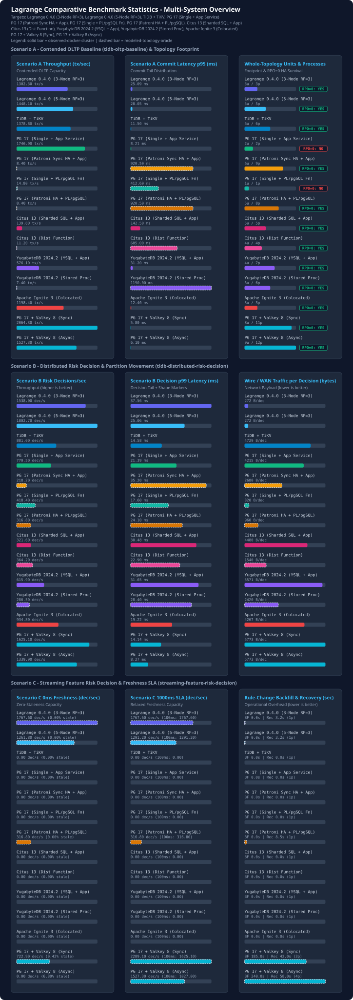

<!-- Generated by the comparative benchmark renderers from the raw observation store and the invalidation ledger; do not edit. `npm run audit:comparative-recompute` fails when this file differs from a regeneration. -->

# Comparative benchmarks

This page lists every comparative claim the benchmark pages have advertised, one cell per configuration and scenario. A cell shows the admission status the evidence supports and the reason codes behind it; a number appears only for a cell admitted from retained observations.

Scenario definitions and the Scenario A semantic gate are contracts, not results: see the related pages below.

Every comparative result published before 2026-11-01 was withdrawn: the records are retained as forensic evidence and the reasons are recorded in the append-only [invalidation ledger](../../data/tidb-comparison/invalidations.ndjson) and the [defect ledger](../../solve/quests/comparative-benchmark-evidence-repair/evidence/defect-ledger.md).

## Cell status vocabulary

- `valid-observed`: admitted from retained v2 observations
- `product-failure`: the product ran and failed; failure counts are shown
- `invalid-measurement`: evidence exists but cannot support the claim (reason codes name why)
- `blocked`: cannot be measured until a named prerequisite exists
- `unsupported`: the configuration cannot express this claim
- `not-measured`: no observation exists

## Advertised configurations

Configuration labels describe what the deployer starts.

| Configuration | Scenario A | Scenario B | Scenario C |
| --- | --- | --- | --- |
| Lagrange 0.4.0 (3 nodes) | invalid-measurement (closed-loop-throughput, constant-phase-or-byte, dataset-unverified, emulated-product, forensic-record-not-admissible, health-substitute, invalidated:inv-0001, invalidated:inv-0003, invalidated:inv-0006, label-hash-identity, non-canonical-workload, timeout-counted-as-success, unverified-response-envelope) | blocked (closed-loop-throughput, compiled-risk-service-missing, constant-phase-or-byte, dataset-unverified, emulated-product, invalidated:inv-0003, invalidated:inv-0006, label-hash-identity, non-canonical-workload) | invalid-measurement (closed-loop-throughput, constant-phase-or-byte, dataset-unverified, emulated-product, forensic-record-not-admissible, freshness-not-observed, invalidated:inv-0003, invalidated:inv-0004, invalidated:inv-0006, label-hash-identity, non-canonical-workload) |
| Lagrange 0.4.0 (5 nodes, RF=3 configured) | invalid-measurement (closed-loop-throughput, constant-phase-or-byte, dataset-unverified, emulated-product, forensic-record-not-admissible, health-substitute, invalidated:inv-0001, invalidated:inv-0003, invalidated:inv-0006, label-hash-identity, non-canonical-workload, timeout-counted-as-success, unverified-response-envelope) | blocked (closed-loop-throughput, compiled-risk-service-missing, constant-phase-or-byte, dataset-unverified, emulated-product, invalidated:inv-0003, invalidated:inv-0006, label-hash-identity, non-canonical-workload) | invalid-measurement (closed-loop-throughput, constant-phase-or-byte, dataset-unverified, emulated-product, forensic-record-not-admissible, freshness-not-observed, invalidated:inv-0003, invalidated:inv-0004, invalidated:inv-0006, label-hash-identity, non-canonical-workload) |
| TiDB + TiKV v8.5.8 | invalid-measurement (closed-loop-throughput, constant-phase-or-byte, dataset-unverified, emulated-product, forensic-record-not-admissible, invalidated:inv-0003, invalidated:inv-0006, label-hash-identity, non-canonical-workload) | invalid-measurement (closed-loop-throughput, constant-phase-or-byte, dataset-unverified, emulated-product, forensic-record-not-admissible, invalidated:inv-0003, invalidated:inv-0006, label-hash-identity, non-canonical-workload) | invalid-measurement (closed-loop-throughput, constant-phase-or-byte, dataset-unverified, emulated-product, forensic-record-not-admissible, freshness-not-observed, invalidated:inv-0003, invalidated:inv-0004, invalidated:inv-0006, label-hash-identity, non-canonical-workload) |
| PostgreSQL 17 (single primary) | invalid-measurement (closed-loop-throughput, constant-phase-or-byte, dataset-unverified, emulated-product, forensic-record-not-admissible, invalidated:inv-0003, invalidated:inv-0005, invalidated:inv-0006, label-hash-identity, label-not-observed, non-canonical-workload) | invalid-measurement (closed-loop-throughput, constant-phase-or-byte, dataset-unverified, emulated-product, forensic-record-not-admissible, invalidated:inv-0003, invalidated:inv-0005, invalidated:inv-0006, label-hash-identity, label-not-observed, non-canonical-workload) | invalid-measurement (closed-loop-throughput, constant-phase-or-byte, dataset-unverified, emulated-product, forensic-record-not-admissible, freshness-not-observed, invalidated:inv-0003, invalidated:inv-0004, invalidated:inv-0005, invalidated:inv-0006, label-hash-identity, label-not-observed, non-canonical-workload) |
| PostgreSQL 17 (primary + 2 streaming standbys, synchronous_standby_names) | invalid-measurement (closed-loop-throughput, constant-phase-or-byte, dataset-unverified, emulated-product, forensic-record-not-admissible, invalidated:inv-0003, invalidated:inv-0005, invalidated:inv-0006, label-hash-identity, label-not-observed, non-canonical-workload) | invalid-measurement (closed-loop-throughput, constant-phase-or-byte, dataset-unverified, emulated-product, forensic-record-not-admissible, invalidated:inv-0003, invalidated:inv-0005, invalidated:inv-0006, label-hash-identity, label-not-observed, non-canonical-workload) | invalid-measurement (closed-loop-throughput, constant-phase-or-byte, dataset-unverified, emulated-product, forensic-record-not-admissible, freshness-not-observed, invalidated:inv-0003, invalidated:inv-0004, invalidated:inv-0005, invalidated:inv-0006, label-hash-identity, label-not-observed, non-canonical-workload) |
| PostgreSQL 17 (single primary, PL/pgSQL function) | invalid-measurement (closed-loop-throughput, constant-phase-or-byte, dataset-unverified, emulated-product, forensic-record-not-admissible, invalidated:inv-0003, invalidated:inv-0006, label-hash-identity, non-canonical-workload) | invalid-measurement (closed-loop-throughput, constant-phase-or-byte, dataset-unverified, emulated-product, forensic-record-not-admissible, invalidated:inv-0003, invalidated:inv-0006, label-hash-identity, non-canonical-workload) | invalid-measurement (closed-loop-throughput, constant-phase-or-byte, dataset-unverified, emulated-product, forensic-record-not-admissible, freshness-not-observed, invalidated:inv-0003, invalidated:inv-0004, invalidated:inv-0006, label-hash-identity, non-canonical-workload) |
| PostgreSQL 17 (primary + 2 streaming standbys, synchronous_standby_names), PL/pgSQL function | invalid-measurement (closed-loop-throughput, constant-phase-or-byte, dataset-unverified, emulated-product, forensic-record-not-admissible, invalidated:inv-0003, invalidated:inv-0005, invalidated:inv-0006, label-hash-identity, label-not-observed, non-canonical-workload) | invalid-measurement (closed-loop-throughput, constant-phase-or-byte, dataset-unverified, emulated-product, forensic-record-not-admissible, invalidated:inv-0003, invalidated:inv-0005, invalidated:inv-0006, label-hash-identity, label-not-observed, non-canonical-workload) | invalid-measurement (closed-loop-throughput, constant-phase-or-byte, dataset-unverified, emulated-product, forensic-record-not-admissible, freshness-not-observed, invalidated:inv-0003, invalidated:inv-0004, invalidated:inv-0005, invalidated:inv-0006, label-hash-identity, label-not-observed, non-canonical-workload) |
| Citus 13 (Sharded SQL RF=3 + App Service) | invalid-measurement (closed-loop-throughput, constant-phase-or-byte, emulated-product, forensic-record-not-admissible, invalidated:inv-0006, label-hash-identity, non-canonical-workload) | invalid-measurement (closed-loop-throughput, constant-phase-or-byte, emulated-product, forensic-record-not-admissible, invalidated:inv-0006, label-hash-identity, non-canonical-workload) | invalid-measurement (closed-loop-throughput, constant-phase-or-byte, emulated-product, forensic-record-not-admissible, invalidated:inv-0006, label-hash-identity, non-canonical-workload) |
| Citus 13 (Colocated Tables + Distributed Function RF=3) | invalid-measurement (closed-loop-throughput, constant-phase-or-byte, emulated-product, forensic-record-not-admissible, invalidated:inv-0006, label-hash-identity, non-canonical-workload) | invalid-measurement (closed-loop-throughput, constant-phase-or-byte, emulated-product, forensic-record-not-admissible, invalidated:inv-0006, label-hash-identity, non-canonical-workload) | invalid-measurement (closed-loop-throughput, constant-phase-or-byte, emulated-product, forensic-record-not-admissible, invalidated:inv-0006, label-hash-identity, non-canonical-workload) |
| YugabyteDB 2024.2 (YSQL RF=3 + App Service) | invalid-measurement (closed-loop-throughput, constant-phase-or-byte, emulated-product, forensic-record-not-admissible, invalidated:inv-0006, label-hash-identity, non-canonical-workload) | invalid-measurement (closed-loop-throughput, constant-phase-or-byte, emulated-product, forensic-record-not-admissible, invalidated:inv-0006, label-hash-identity, non-canonical-workload) | invalid-measurement (closed-loop-throughput, constant-phase-or-byte, emulated-product, forensic-record-not-admissible, invalidated:inv-0006, label-hash-identity, non-canonical-workload) |
| YugabyteDB 2024.2 (YSQL Stored Procedure RF=3) | invalid-measurement (closed-loop-throughput, constant-phase-or-byte, emulated-product, forensic-record-not-admissible, invalidated:inv-0006, label-hash-identity, non-canonical-workload) | invalid-measurement (closed-loop-throughput, constant-phase-or-byte, emulated-product, forensic-record-not-admissible, invalidated:inv-0006, label-hash-identity, non-canonical-workload) | invalid-measurement (closed-loop-throughput, constant-phase-or-byte, emulated-product, forensic-record-not-admissible, invalidated:inv-0006, label-hash-identity, non-canonical-workload) |
| Apache Ignite 3 (JobTarget.colocated RF=3) | invalid-measurement (closed-loop-throughput, constant-phase-or-byte, emulated-product, forensic-record-not-admissible, invalidated:inv-0006, label-hash-identity, non-canonical-workload) | invalid-measurement (closed-loop-throughput, constant-phase-or-byte, emulated-product, forensic-record-not-admissible, invalidated:inv-0006, label-hash-identity, non-canonical-workload) | invalid-measurement (closed-loop-throughput, constant-phase-or-byte, emulated-product, forensic-record-not-admissible, invalidated:inv-0006, label-hash-identity, non-canonical-workload) |
| PostgreSQL 17 + Valkey 8 (Sync Write-Through + App Service) | invalid-measurement (closed-loop-throughput, constant-phase-or-byte, emulated-product, forensic-record-not-admissible, invalidated:inv-0006, label-hash-identity, non-canonical-workload) | invalid-measurement (closed-loop-throughput, constant-phase-or-byte, emulated-product, forensic-record-not-admissible, invalidated:inv-0006, label-hash-identity, non-canonical-workload) | invalid-measurement (closed-loop-throughput, constant-phase-or-byte, emulated-product, forensic-record-not-admissible, invalidated:inv-0006, label-hash-identity, non-canonical-workload) |
| PostgreSQL 17 + Valkey 8 (Async CDC Stream + App Service) | invalid-measurement (closed-loop-throughput, constant-phase-or-byte, emulated-product, forensic-record-not-admissible, invalidated:inv-0006, label-hash-identity, non-canonical-workload) | invalid-measurement (closed-loop-throughput, constant-phase-or-byte, emulated-product, forensic-record-not-admissible, invalidated:inv-0006, label-hash-identity, non-canonical-workload) | unsupported (async-stream-cannot-serve-0ms-freshness, closed-loop-throughput, constant-phase-or-byte, emulated-product, invalidated:inv-0006, label-hash-identity, non-canonical-workload) |

## Scenario A smoke runs

The named smoke profile scenario-a-smoke-v1: the canonical workload executed end to end with per-request correctness and complete accounting. A smoke cell never carries throughput, latency quantiles or a ratio.

| Configuration | Scenario A smoke |
| --- | --- |
| Lagrange 0.4.0 (3 nodes) | not-measured (no-observation) |
| TiDB + TiKV v8.5.8 | not-measured (no-observation) |
| PostgreSQL 17 (single primary) | not-measured (no-observation) |

## Per-phase time breakdown

Phase timings are admitted only from observed spans.

| Configuration | phase-breakdown |
| --- | --- |
| scenarioA: pg-single-primary | invalid-measurement (closed-loop-throughput, constant-phase-or-byte, dataset-unverified, emulated-product, forensic-record-not-admissible, invalidated:inv-0003, invalidated:inv-0005, invalidated:inv-0006, label-hash-identity, label-not-observed, non-canonical-workload) |
| scenarioA: pg-patroni-sync-ha-rf3 | invalid-measurement (closed-loop-throughput, constant-phase-or-byte, dataset-unverified, emulated-product, forensic-record-not-admissible, invalidated:inv-0003, invalidated:inv-0005, invalidated:inv-0006, label-hash-identity, label-not-observed, non-canonical-workload) |
| scenarioA: tidb-tikv | invalid-measurement (closed-loop-throughput, constant-phase-or-byte, dataset-unverified, emulated-product, forensic-record-not-admissible, invalidated:inv-0003, invalidated:inv-0006, label-hash-identity, non-canonical-workload) |
| scenarioA: lagrange-5node-rf3 | invalid-measurement (closed-loop-throughput, constant-phase-or-byte, dataset-unverified, emulated-product, forensic-record-not-admissible, health-substitute, invalidated:inv-0001, invalidated:inv-0003, invalidated:inv-0006, label-hash-identity, non-canonical-workload, timeout-counted-as-success, unverified-response-envelope) |
| scenarioA: lagrange | invalid-measurement (closed-loop-throughput, constant-phase-or-byte, dataset-unverified, emulated-product, forensic-record-not-admissible, health-substitute, invalidated:inv-0001, invalidated:inv-0003, invalidated:inv-0006, label-hash-identity, non-canonical-workload, timeout-counted-as-success, unverified-response-envelope) |
| scenarioB: lagrange-5node-rf3 | blocked (closed-loop-throughput, compiled-risk-service-missing, constant-phase-or-byte, dataset-unverified, emulated-product, invalidated:inv-0003, invalidated:inv-0006, label-hash-identity, non-canonical-workload) |
| scenarioB: pg-plpgsql-sync-ha-rf3 | invalid-measurement (closed-loop-throughput, constant-phase-or-byte, dataset-unverified, emulated-product, forensic-record-not-admissible, invalidated:inv-0003, invalidated:inv-0005, invalidated:inv-0006, label-hash-identity, label-not-observed, non-canonical-workload) |
| scenarioB: tidb-tikv | invalid-measurement (closed-loop-throughput, constant-phase-or-byte, dataset-unverified, emulated-product, forensic-record-not-admissible, invalidated:inv-0003, invalidated:inv-0006, label-hash-identity, non-canonical-workload) |
| scenarioC: lagrange-5node-rf3 | invalid-measurement (closed-loop-throughput, constant-phase-or-byte, dataset-unverified, emulated-product, forensic-record-not-admissible, freshness-not-observed, invalidated:inv-0003, invalidated:inv-0004, invalidated:inv-0006, label-hash-identity, non-canonical-workload) |
| scenarioC: lagrange | invalid-measurement (closed-loop-throughput, constant-phase-or-byte, dataset-unverified, emulated-product, forensic-record-not-admissible, freshness-not-observed, invalidated:inv-0003, invalidated:inv-0004, invalidated:inv-0006, label-hash-identity, non-canonical-workload) |
| scenarioC: pg-plpgsql-sync-ha-rf3 | invalid-measurement (closed-loop-throughput, constant-phase-or-byte, dataset-unverified, emulated-product, forensic-record-not-admissible, freshness-not-observed, invalidated:inv-0003, invalidated:inv-0004, invalidated:inv-0005, invalidated:inv-0006, label-hash-identity, label-not-observed, non-canonical-workload) |
| scenarioC: tidb-tikv | not-measured (no-observation) |

## Related pages

- [Scenario A/B/C definitions](tidb-reference-scenarios.md)
- [Scenario A semantic evidence gate](tidb-reference-semantic-gate.md)
- [Paired measurement owner](tidb-reference-paired-owner.md)
- [TiDB comparison history (forensic records)](tidb-comparison-progress.md)
- [PostgreSQL comparison](postgresql-comparison-progress.md)
- [Citus comparison](citus-comparison-progress.md)
- [YugabyteDB and Apache Ignite comparison](yugabyte-ignite-comparison-progress.md)
- [Scenario C: streaming feature store](scenario-c-feature-store-progress.md)
- [Three-to-five-node scale-out](scaleout-3to5-node-rf3-progress.md)
- [Partition granularity sweep](partition-granularity-sweep-progress.md)
- [Scenario B under network delay](scenario-b-rtt-working-set-crossover.md)
- [Partition movement and Scenario C at scale](movement-and-scenario-c-scaling-progress.md)
- [Lagrange milestones](lagrange-metrics-evolution.md)
- [Reproduction guide](cloud-reproduction-guide.md)
- [Per-phase time breakdown](scenario-setup-time-breakdown.svg)

## Sources

- `data/tidb-comparison/raw-observations.ndjson` sha256:be8cc03e7abe44b18ff869e2470debe8800724f973fae7bbd9116e401911f56f
- `data/tidb-comparison/forensic/raw-observations-86e795c44.ndjson` sha256:79698d1b6cd709d227c9712e75c3471243ee99f473212c495ad15c6c1e96f32e
- `data/tidb-comparison/invalidations.ndjson` sha256:20a3bf4fcc44c4116ce0166850c694e1c37946fcae27277fb0bc418fd2822972
