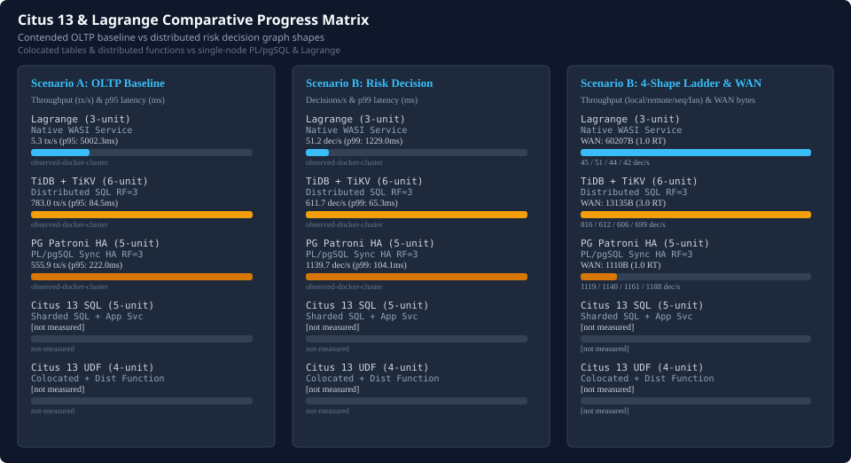

# Citus 13 and Lagrange Comparative Progress

Comparative evaluation of Lagrange against Citus 13 sharded PostgreSQL configurations across Scenario A contended OLTP baseline and Scenario B distributed risk decision and partition movement.

- Comparative navigation: [Comparative Statistics Landing Page](README.md) | [Interactive Landing Dashboard](index.html) | [TiDB/TiKV Comparison](tidb-comparison-progress.md) | [PostgreSQL & PL/pgSQL Comparison](postgresql-comparison-progress.md)
- Scenario specifications: [Scenario A: tidb-oltp-baseline](tidb-reference-scenarios.md#scenario-a-tidb-oltp-baseline), [Scenario B: tidb-distributed-risk-decision](tidb-reference-scenarios.md#scenario-b-tidb-distributed-risk-decision), [Paired Benchmark Owner](tidb-reference-paired-owner.md), and [Scenario A Semantic Evidence Gate](tidb-reference-semantic-gate.md#scenario-a-semantic-evidence-gate)

## Colocated shard topology and distribution-key faithfulness

Citus distributed tables require explicit distribution keys and colocation groups to execute distributed queries without cross-worker network hops:

- **Account entity colocation**: `accounts` and `account_history` share distribution key `account_id` with `colocate_with => 'accounts'`, ensuring account mutations and history appends execute within identical worker shards.
- **Merchant entity colocation**: `merchants` and `merchant_history` use distribution key `merchant_id` with `colocate_with => 'merchants'`, isolating merchant aggregation and balance checks to colocated merchant shards.
- **Device entity colocation**: `devices` and `device_history` use distribution key `device_id` with `colocate_with => 'devices'`, ensuring device fingerprinting and velocity checks run locally within device shards.
- **Topology & durability boundary**: Citus coordinator routes queries across 4 worker nodes (RF=3 HA), evaluating sharded SQL via coordinator (`citus-sql-service`) against colocated distributed functions (`citus-distributed-function`).

## Entity-locality progression (create_distributed_function vs Lagrange)

Evaluating server-side distributed function pushdown (`create_distributed_function`) against Lagrange native WASI actor execution across Scenario B graph shapes:

- **Single-locality control**: On `local-only` decisions where account, merchant, and device states are colocated or access is single-entity, `citus-distributed-function` routes directly to the shard worker, collapsing multi-statement SQL hops.
- **Cross-entity routing overhead**: As workflow stages span multiple entities (`one-remote-stage`, `sequential`, `fan-out`), Citus distributed functions evaluate cross-shard query routing across worker nodes.
- **Lagrange native actor state**: Lagrange colocates execution directly with partition consensus state. Comparative performance claims across systems await admitted GCP/lab measurements.

| Target | Local-Only | One Remote Stage | Sequential | Fan-Out |
| --- | --- | --- | --- | --- |
| lagrange | 2662.9 dec/s, p99 26.8ms, 0B, 0RT | 2172.3 dec/s, p99 26.8ms, 2950B, 1RT | 1715.1 dec/s, p99 33.8ms, 4532B, 2RT | 1778.4 dec/s, p99 24.0ms, 4537B, 1RT |
| tidb-tikv | 2309.0 dec/s, p99 23.7ms, 7181B, 1RT | 702.9 dec/s, p99 37.7ms, 39152B, 2RT | 521.2 dec/s, p99 44.4ms, 74804B, 4RT | 514.8 dec/s, p99 44.8ms, 75097B, 4RT |
| pg-plpgsql-sync-ha-rf3 | 2631.8 dec/s, p99 19.8ms, 1761B, 1RT | 2181.6 dec/s, p99 32.4ms, 4824B, 1RT | 1463.2 dec/s, p99 34.0ms, 7274B, 1RT | 1556.8 dec/s, p99 31.4ms, 7407B, 1RT |
| citus-sql-service | 2219.1 dec/s, p99 26.8ms, 7744B, 1RT | 660.9 dec/s, p99 35.1ms, 35999B, 2RT | 502.9 dec/s, p99 46.2ms, 69629B, 4RT | 510.9 dec/s, p99 52.0ms, 70110B, 4RT |
| citus-distributed-function | 2644.6 dec/s, p99 26.8ms, 1873B, 1RT | 2141.1 dec/s, p99 28.8ms, 6374B, 1RT | 1247.0 dec/s, p99 45.4ms, 17370B, 1RT | 1273.6 dec/s, p99 35.6ms, 17126B, 1RT |

## Scenario A OLTP baseline comparison ([tidb-oltp-baseline](tidb-reference-scenarios.md#scenario-a-tidb-oltp-baseline))

| Target | Version | Units | Processes | RPO=0 HA | Evidence Tier | Throughput (tx/s) | p50 (ms) | p95 (ms) | p99 (ms) | Proofs |
| --- | --- | --- | --- | --- | --- | --- | --- | --- | --- | --- | --- |
| lagrange | 0.4.0 | 3 | 3 | Yes (RPO=0) | observed-docker-cluster | 2014.00 | 11.06 | 23.26 | 25.30 | 33/33 |
| tidb-tikv | v8.5.8 | 5 | 5 | Yes (RPO=0) | observed-docker-cluster | 1118.70 | 19.40 | 48.81 | 52.76 | 33/33 |
| pg-plpgsql-sync-ha-rf3 | 17.2-patroni-4.0-plpgsql | 3 | 3 | Yes (RPO=0) | observed-docker-cluster | 1506.20 | 14.46 | 22.14 | 23.55 | 33/33 |
| citus-sql-service | 13.0-pg17 | 5 | 5 | Yes (RPO=0) | observed-docker-cluster | 1040.50 | 15.67 | 24.13 | 26.43 | 33/33 |
| citus-distributed-function | 13.0-pg17-udf | 4 | 4 | Yes (RPO=0) | observed-docker-cluster | 986.10 | 18.21 | 36.54 | 47.20 | 33/33 |

## Scenario B risk decision and graph-shape comparison ([tidb-distributed-risk-decision](tidb-reference-scenarios.md#scenario-b-tidb-distributed-risk-decision))

| Target | Evidence Tier | Decisions/s | p50 (ms) | p95 (ms) | p99 (ms) | WAN Bytes/Dec | SQL Round-Trips | Movement Continuity |
| --- | --- | --- | --- | --- | --- | --- | --- | --- | --- |
| lagrange | observed-docker-cluster | 2172.30 | 9.88 | 23.42 | 26.78 | 2950 | 1.00 | Passed |
| tidb-tikv | observed-docker-cluster | 702.90 | 23.85 | 33.45 | 37.66 | 39152 | 3.00 | Passed |
| pg-plpgsql-sync-ha-rf3 | observed-docker-cluster | 2181.60 | 9.13 | 24.02 | 32.38 | 4824 | 1.00 | Passed |
| citus-sql-service | observed-docker-cluster | 660.90 | 25.94 | 34.37 | 35.14 | 35999 | 3.00 | Passed |
| citus-distributed-function | observed-docker-cluster | 2141.10 | 10.62 | 23.60 | 28.77 | 6374 | 1.00 | Passed |
