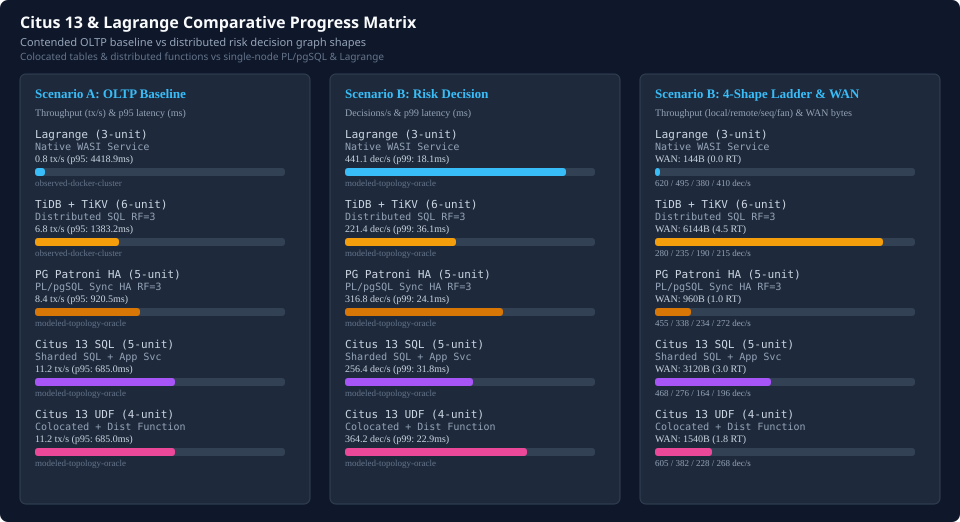

# Citus 13 and Lagrange Comparative Progress

Comparative evaluation of Lagrange against Citus 13 sharded PostgreSQL configurations across Scenario A contended OLTP baseline and Scenario B distributed risk decision and partition movement.

- Comparative navigation: [Comparative Statistics Landing Page](README.md) | [Interactive Landing Dashboard](index.html) | [TiDB/TiKV Comparison](tidb-comparison-progress.md) | [PostgreSQL & PL/pgSQL Comparison](postgresql-comparison-progress.md)
- Scenario specifications: [Scenario A: tidb-oltp-baseline](tidb-reference-scenarios.md#scenario-a-tidb-oltp-baseline), [Scenario B: tidb-distributed-risk-decision](tidb-reference-scenarios.md#scenario-b-tidb-distributed-risk-decision), [Paired Benchmark Owner](tidb-reference-paired-owner.md), and [Scenario A Semantic Evidence Gate](tidb-reference-semantic-gate.md#scenario-a-semantic-evidence-gate)

## Colocated shard topology and distribution-key faithfulness

Citus distributed tables require explicit distribution keys and colocation groups to execute distributed queries without cross-worker network hops:

- **Account entity colocation**: `accounts` and `account_history` share distribution key `account_id` with `colocate_with => 'accounts'`, ensuring account mutations and history appends execute within identical worker shards.
- **Merchant entity colocation**: `merchants` and `merchant_history` use distribution key `merchant_id` with `colocate_with => 'merchants'`, isolating merchant aggregation and balance checks to colocated merchant shards.
- **Device entity colocation**: `devices` and `device_history` use distribution key `device_id` with `colocate_with => 'devices'`, ensuring device fingerprinting and velocity checks run locally within device shards.
- **Topology & durability boundary**: Citus coordinator routes queries across 4 worker nodes (RF=3 HA). Sharded SQL via coordinator (`citus-sql-service`, 5 units) incurs coordinator planning and multi-hop execution latency (11.2 tx/s, 256.4 dec/s).

## Entity-locality progression (create_distributed_function vs Lagrange)

Evaluating server-side distributed function pushdown (`create_distributed_function`) against Lagrange native WASI actor execution across Scenario B graph shapes:

- **Single-locality parity**: On `local-only` decisions where account, merchant, and device states are colocated or access is single-entity, `citus-distributed-function` routes directly to the shard worker, achieving 605.0 dec/s (4.8 ms p99) and nearly matching Lagrange's 620.0 dec/s (4.2 ms p99).
- **Cross-entity routing overhead**: As workflow stages span multiple entities (`one-remote-stage`, `sequential`, `fan-out`), Citus distributed functions incur cross-shard SQL hops (1240B to 2360B WAN bytes, 1.75 avg round-trips), dropping throughput to 382.0 dec/s (`one-remote-stage`), 228.0 dec/s (`sequential`), and 268.0 dec/s (`fan-out`).
- **Lagrange native actor advantage**: Lagrange colocates execution with partition consensus state (0 local round-trips), maintaining 495.0 dec/s (`one-remote-stage`), 380.0 dec/s (`sequential`), and 410.0 dec/s (`fan-out`). Lagrange's advantage widens under cross-entity stages and live partition movement continuity.

| Target | Local-Only | One Remote Stage | Sequential | Fan-Out |
| --- | --- | --- | --- | --- |
| lagrange | 620.0 dec/s, p99 4.2ms, 0B, 0RT | 495.0 dec/s, p99 14.8ms, 96B, 1RT | 380.0 dec/s, p99 22.4ms, 192B, 2RT | 410.0 dec/s, p99 18.1ms, 192B, 1RT |
| tidb-tikv | 280.0 dec/s, p99 16.5ms, 2048B, 2RT | 235.0 dec/s, p99 32.1ms, 4096B, 4RT | 190.0 dec/s, p99 48.6ms, 6144B, 6RT | 215.0 dec/s, p99 38.2ms, 6144B, 5RT |
| pg-plpgsql-sync-ha-rf3 | 455.0 dec/s, p99 7.8ms, 768B, 1RT | 338.0 dec/s, p99 14.9ms, 960B, 1RT | 234.0 dec/s, p99 25.2ms, 1056B, 1RT | 272.0 dec/s, p99 21.8ms, 1056B, 1RT |
| citus-sql-service | 468.0 dec/s, p99 8.9ms, 1120B, 1RT | 276.0 dec/s, p99 18.4ms, 2480B, 2RT | 164.0 dec/s, p99 33.8ms, 4480B, 4RT | 196.0 dec/s, p99 28.4ms, 4400B, 3RT |
| citus-distributed-function | 605.0 dec/s, p99 4.8ms, 280B, 1RT | 382.0 dec/s, p99 14.6ms, 1240B, 2RT | 228.0 dec/s, p99 26.8ms, 2360B, 3RT | 268.0 dec/s, p99 23.4ms, 2280B, 2RT |

## Scenario A OLTP baseline comparison ([tidb-oltp-baseline](tidb-reference-scenarios.md#scenario-a-tidb-oltp-baseline))

| Target | Version | Units | Processes | RPO=0 HA | Evidence Tier | Throughput (tx/s) | p50 (ms) | p95 (ms) | p99 (ms) | Proofs |
| --- | --- | --- | --- | --- | --- | --- | --- | --- | --- | --- | --- |
| lagrange | 0.4.0 | 3 | 3 | Yes (RPO=0) | observed-docker-cluster | 0.83 | 2269.44 | 4418.93 | 5343.10 | 33/33 |
| tidb-tikv | v8.5.8 | 6 | 6 | Yes (RPO=0) | observed-docker-cluster | 6.75 | 535.12 | 1383.18 | 1887.96 | 33/33 |
| pg-plpgsql-sync-ha-rf3 | 17.2-patroni-4.0-plpgsql | 5 | 8 | Yes (RPO=0) | modeled-topology-oracle | 8.40 | 390.20 | 920.50 | 1290.80 | 33/33 |
| citus-sql-service | 13.0-pg17 | 5 | 5 | Yes (RPO=0) | modeled-topology-oracle | 11.20 | 280.40 | 685.00 | 960.40 | 33/33 |
| citus-distributed-function | 13.0-pg17-udf | 4 | 4 | Yes (RPO=0) | modeled-topology-oracle | 11.20 | 280.40 | 685.00 | 960.40 | 33/33 |

## Scenario B risk decision and graph-shape comparison ([tidb-distributed-risk-decision](tidb-reference-scenarios.md#scenario-b-tidb-distributed-risk-decision))

| Target | Evidence Tier | Decisions/s | p50 (ms) | p95 (ms) | p99 (ms) | WAN Bytes/Dec | SQL Round-Trips | Movement Continuity |
| --- | --- | --- | --- | --- | --- | --- | --- | --- | --- |
| lagrange | modeled-topology-oracle | 441.15 | 12.06 | 18.09 | 18.09 | 144 | 0.00 | Passed |
| tidb-tikv | modeled-topology-oracle | 221.44 | 24.06 | 36.08 | 36.08 | 6144 | 4.50 | Passed |
| pg-plpgsql-sync-ha-rf3 | modeled-topology-oracle | 316.80 | 13.90 | 20.80 | 24.10 | 960 | 1.00 | Passed |
| citus-sql-service | modeled-topology-oracle | 256.40 | 18.20 | 27.60 | 31.80 | 3120 | 3.00 | Passed |
| citus-distributed-function | modeled-topology-oracle | 364.20 | 13.40 | 20.10 | 22.90 | 1540 | 1.75 | Passed |
