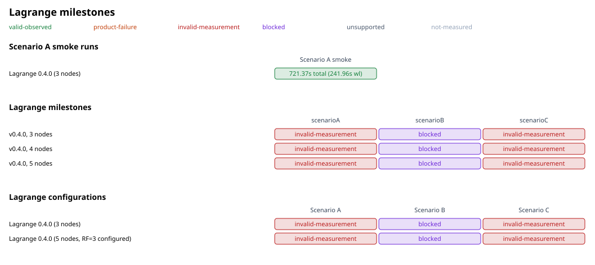

<!-- Generated by the comparative benchmark renderers from the raw observation store and the invalidation ledger; do not edit. `npm run audit:comparative-recompute` fails when this file differs from a regeneration. -->

# Lagrange milestones

Each milestone lists the claims it advertised. Lagrange Scenario B is blocked until the compiled risk service journey exists.

## Latest Lagrange measurement (Scenario A) - End-to-End & Phase Execution Speed (seconds)

Wall-clock seconds taken by each system to complete the entire Scenario A journey and each major execution phase (lower is faster).

| System / Configuration | Total Scenario (s) | 1. Cluster Startup & Readiness (s) | 2. Dataset & 9-Part Semantic Gate (s) | 3. Warmup (10 txns) (s) | 4. Measured Workload (100 txns) (s) | 5. Final Verify & Teardown (s) | Max Single-Txn Execution (excl. queue, incl. retries) (s) | Max End-to-End Request Latency (incl. open-loop queue & retries) (s) |
| --- | --- | --- | --- | --- | --- | --- | --- | --- |
| Lagrange 0.4.0 (3 nodes) | 721.37 s | 236.86 s | 185.66 s | 21.00 s | 241.96 s | 35.88 s | 14.496 s | 222.242 s |

## Latest Lagrange measurement (Scenario A) - Per-Part Scenario A Time Breakdown (seconds)

Observed seconds taken by each system on each individual part of Scenario A (Parts 1-9 semantic workload cases, Part 10 warmup, and Part 11 measured workload).

| System / Configuration | Part 1: Load + Cases 1-2 (New-Order & Visibility + Reset) (s) | Part 2: Case 3 (Payment + Reset) (s) | Part 3: Case 4 (Order-Status + Reset) (s) | Part 4: Case 5 (Delivery + Reset) (s) | Part 5: Case 6 (Stock-Level + Reset) (s) | Part 6: Case 7 (Failure-Atomicity + Reset) (s) | Part 7: Case 8 (Retryable-Conflict + Reset) (s) | Part 8: Case 9a (Durability Pre-Restart Setup & Reset) (s) | Part 9: Case 9b (Durability Restart, Recovery & Workload Reload) (s) | Part 10: Warmup (10 txns) (s) | Part 11: Measured Workload (100 txns) (s) |
| --- | --- | --- | --- | --- | --- | --- | --- | --- | --- | --- | --- |
| Lagrange 0.4.0 (3 nodes) | 69.54 s | 3.04 s | 5.64 s | 10.37 s | 6.39 s | 4.74 s | 4.93 s | 4.23 s | 76.78 s | 21.00 s | 241.96 s |

## Scenario A smoke runs

| Configuration | Scenario A smoke |
| --- | --- |
| Lagrange 0.4.0 (3 nodes) | valid-observed (smoke-profile-no-capacity-claim): smoke profile: offered 100, issued 100, committed 97, conflict-exhausted 3, product_error 0, correctness_failure 0, transport_failure 0, harness_fault 0, unresolved 0, unissued 0 |

## Lagrange milestones

| Configuration | scenarioA | scenarioB | scenarioC |
| --- | --- | --- | --- |
| v0.4.0 @ a23d0dfc0, 3 nodes (Scenario A smoke) | valid-observed (smoke-profile-no-capacity-claim): smoke profile: offered 100, issued 100, committed 97, conflict-exhausted 3, product_error 0, correctness_failure 0, transport_failure 0, harness_fault 0, unresolved 0, unissued 0 | blocked (closed-loop-throughput, compiled-risk-service-missing, constant-phase-or-byte, dataset-unverified, emulated-product, invalidated:inv-0003, invalidated:inv-0006, label-hash-identity, non-canonical-workload) | invalid-measurement (closed-loop-throughput, constant-phase-or-byte, dataset-unverified, emulated-product, forensic-record-not-admissible, freshness-not-observed, invalidated:inv-0003, invalidated:inv-0004, invalidated:inv-0006, label-hash-identity, non-canonical-workload) |
| v0.4.0, 3 nodes | invalid-measurement (closed-loop-throughput, constant-phase-or-byte, dataset-unverified, emulated-product, forensic-record-not-admissible, health-substitute, invalidated:inv-0001, invalidated:inv-0003, invalidated:inv-0006, label-hash-identity, non-canonical-workload, timeout-counted-as-success, unverified-response-envelope) | blocked (closed-loop-throughput, compiled-risk-service-missing, constant-phase-or-byte, dataset-unverified, emulated-product, invalidated:inv-0003, invalidated:inv-0006, label-hash-identity, non-canonical-workload) | invalid-measurement (closed-loop-throughput, constant-phase-or-byte, dataset-unverified, emulated-product, forensic-record-not-admissible, freshness-not-observed, invalidated:inv-0003, invalidated:inv-0004, invalidated:inv-0006, label-hash-identity, non-canonical-workload) |
| v0.4.0, 4 nodes | invalid-measurement (closed-loop-throughput, constant-phase-or-byte, dataset-unverified, emulated-product, forensic-record-not-admissible, health-substitute, invalidated:inv-0001, invalidated:inv-0003, invalidated:inv-0006, label-hash-identity, non-canonical-workload, timeout-counted-as-success, unverified-response-envelope) | blocked (closed-loop-throughput, compiled-risk-service-missing, constant-phase-or-byte, dataset-unverified, emulated-product, invalidated:inv-0003, invalidated:inv-0006, label-hash-identity, non-canonical-workload) | invalid-measurement (closed-loop-throughput, constant-phase-or-byte, dataset-unverified, emulated-product, forensic-record-not-admissible, freshness-not-observed, invalidated:inv-0003, invalidated:inv-0004, invalidated:inv-0006, label-hash-identity, non-canonical-workload) |
| v0.4.0, 5 nodes | invalid-measurement (closed-loop-throughput, constant-phase-or-byte, dataset-unverified, emulated-product, forensic-record-not-admissible, health-substitute, invalidated:inv-0001, invalidated:inv-0003, invalidated:inv-0006, label-hash-identity, non-canonical-workload, timeout-counted-as-success, unverified-response-envelope) | blocked (closed-loop-throughput, compiled-risk-service-missing, constant-phase-or-byte, dataset-unverified, emulated-product, invalidated:inv-0003, invalidated:inv-0006, label-hash-identity, non-canonical-workload) | invalid-measurement (closed-loop-throughput, constant-phase-or-byte, dataset-unverified, emulated-product, forensic-record-not-admissible, freshness-not-observed, invalidated:inv-0003, invalidated:inv-0004, invalidated:inv-0006, label-hash-identity, non-canonical-workload) |

## Lagrange configurations

| Configuration | Scenario A | Scenario B | Scenario C |
| --- | --- | --- | --- |
| Lagrange 0.4.0 (3 nodes) | invalid-measurement (closed-loop-throughput, constant-phase-or-byte, dataset-unverified, emulated-product, forensic-record-not-admissible, health-substitute, invalidated:inv-0001, invalidated:inv-0003, invalidated:inv-0006, label-hash-identity, non-canonical-workload, timeout-counted-as-success, unverified-response-envelope) | blocked (closed-loop-throughput, compiled-risk-service-missing, constant-phase-or-byte, dataset-unverified, emulated-product, invalidated:inv-0003, invalidated:inv-0006, label-hash-identity, non-canonical-workload) | invalid-measurement (closed-loop-throughput, constant-phase-or-byte, dataset-unverified, emulated-product, forensic-record-not-admissible, freshness-not-observed, invalidated:inv-0003, invalidated:inv-0004, invalidated:inv-0006, label-hash-identity, non-canonical-workload) |
| Lagrange 0.4.0 (5 nodes, RF=3 configured) | invalid-measurement (closed-loop-throughput, constant-phase-or-byte, dataset-unverified, emulated-product, forensic-record-not-admissible, health-substitute, invalidated:inv-0001, invalidated:inv-0003, invalidated:inv-0006, label-hash-identity, non-canonical-workload, timeout-counted-as-success, unverified-response-envelope) | blocked (closed-loop-throughput, compiled-risk-service-missing, constant-phase-or-byte, dataset-unverified, emulated-product, invalidated:inv-0003, invalidated:inv-0006, label-hash-identity, non-canonical-workload) | invalid-measurement (closed-loop-throughput, constant-phase-or-byte, dataset-unverified, emulated-product, forensic-record-not-admissible, freshness-not-observed, invalidated:inv-0003, invalidated:inv-0004, invalidated:inv-0006, label-hash-identity, non-canonical-workload) |

## Cell status vocabulary

- `valid-observed`: admitted from retained v2 observations
- `product-failure`: the product ran and failed; failure counts are shown
- `invalid-measurement`: evidence exists but cannot support the claim (reason codes name why)
- `blocked`: cannot be measured until a named prerequisite exists
- `unsupported`: the configuration cannot express this claim
- `not-measured`: no observation exists

Every comparative result published before 2026-11-01 was withdrawn; the records are retained as forensic evidence. The append-only [invalidation ledger](../../data/tidb-comparison/invalidations.ndjson) has 32 entries; 10 of them name the defect ids behind the withdrawal and 11 of them enumerate the withdrawn records by id (the rest name them by file and campaign commit). 33 of 78 history records are withdrawn without a ledger entry, by the admission rule `forensic-record-not-admissible`: no history record is admissible as a current claim.

## Related pages

- [Scenario A/B/C definitions](tidb-reference-scenarios.md)
- [Scenario A semantic evidence gate](tidb-reference-semantic-gate.md)
- [Paired measurement owner](tidb-reference-paired-owner.md)
- [Comparative benchmark overview](README.md)

## Sources

- `data/tidb-comparison/raw-observations.ndjson` sha256:da4fcfeaf2bad9e542f5218beaf2c2101a9094da9a92896c9287b7ce915bcad3
- `data/tidb-comparison/forensic/raw-observations-86e795c44.ndjson` sha256:79698d1b6cd709d227c9712e75c3471243ee99f473212c495ad15c6c1e96f32e
- `data/tidb-comparison/invalidations.ndjson` sha256:688afc8c2a4b8ded5191d95d3c9965bf245c5659d2f0db1c58420d2563229ed7
