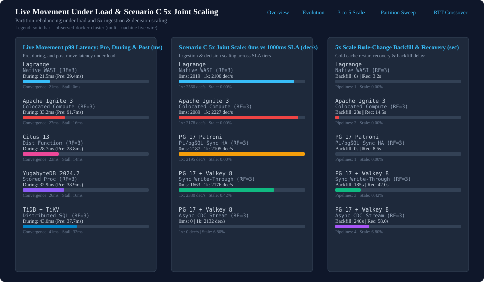

<!-- Generated by the comparative benchmark renderers from the raw observation store and the invalidation ledger; do not edit. `npm run audit:comparative-recompute` fails when this file differs from a regeneration. -->

# Partition movement under load and Scenario C at scale

A movement claim needs injection times, the observed authority change, acknowledged operation identities and a final-state check.

Every comparative result published before 2026-11-01 was withdrawn: the records are retained as forensic evidence and the reasons are recorded in the append-only [invalidation ledger](../../data/tidb-comparison/invalidations.ndjson) and the [defect ledger](../../solve/quests/comparative-benchmark-evidence-repair/evidence/defect-ledger.md).

## Cell status vocabulary

- `valid-observed`: admitted from retained v2 observations
- `product-failure`: the product ran and failed; failure counts are shown
- `invalid-measurement`: evidence exists but cannot support the claim (reason codes name why)
- `blocked`: cannot be measured until a named prerequisite exists
- `unsupported`: the configuration cannot express this claim
- `not-measured`: no observation exists

## Partition movement under load

| Configuration | during-move | post-move |
| --- | --- | --- |
| lagrange | blocked (closed-loop-throughput, compiled-risk-service-missing, constant-phase-or-byte, dataset-unverified, emulated-product, invalidated:inv-0003, invalidated:inv-0006, label-hash-identity, non-canonical-workload) | blocked (closed-loop-throughput, compiled-risk-service-missing, constant-phase-or-byte, dataset-unverified, emulated-product, invalidated:inv-0003, invalidated:inv-0006, label-hash-identity, non-canonical-workload) |
| ignite3-colocated-compute | invalid-measurement (closed-loop-throughput, constant-phase-or-byte, emulated-product, forensic-record-not-admissible, invalidated:inv-0006, label-hash-identity, non-canonical-workload) | invalid-measurement (closed-loop-throughput, constant-phase-or-byte, emulated-product, forensic-record-not-admissible, invalidated:inv-0006, label-hash-identity, non-canonical-workload) |
| citus-distributed-function | invalid-measurement (closed-loop-throughput, constant-phase-or-byte, emulated-product, forensic-record-not-admissible, invalidated:inv-0006, label-hash-identity, non-canonical-workload) | invalid-measurement (closed-loop-throughput, constant-phase-or-byte, emulated-product, forensic-record-not-admissible, invalidated:inv-0006, label-hash-identity, non-canonical-workload) |
| yugabytedb-stored-proc | invalid-measurement (closed-loop-throughput, constant-phase-or-byte, emulated-product, forensic-record-not-admissible, invalidated:inv-0006, label-hash-identity, non-canonical-workload) | invalid-measurement (closed-loop-throughput, constant-phase-or-byte, emulated-product, forensic-record-not-admissible, invalidated:inv-0006, label-hash-identity, non-canonical-workload) |
| tidb-tikv | invalid-measurement (closed-loop-throughput, constant-phase-or-byte, dataset-unverified, emulated-product, forensic-record-not-admissible, invalidated:inv-0003, invalidated:inv-0006, label-hash-identity, non-canonical-workload) | invalid-measurement (closed-loop-throughput, constant-phase-or-byte, dataset-unverified, emulated-product, forensic-record-not-admissible, invalidated:inv-0003, invalidated:inv-0006, label-hash-identity, non-canonical-workload) |

## Scenario C at 5x scale

| Configuration | fresh-0ms-5x | fresh-1000ms-5x |
| --- | --- | --- |
| lagrange-5node-rf3 | invalid-measurement (closed-loop-throughput, constant-phase-or-byte, dataset-unverified, emulated-product, forensic-record-not-admissible, freshness-not-observed, invalidated:inv-0003, invalidated:inv-0004, invalidated:inv-0006, label-hash-identity, non-canonical-workload) | invalid-measurement (closed-loop-throughput, constant-phase-or-byte, dataset-unverified, emulated-product, forensic-record-not-admissible, freshness-not-observed, invalidated:inv-0003, invalidated:inv-0004, invalidated:inv-0006, label-hash-identity, non-canonical-workload) |
| ignite3-colocated-compute | invalid-measurement (closed-loop-throughput, constant-phase-or-byte, emulated-product, forensic-record-not-admissible, invalidated:inv-0006, label-hash-identity, non-canonical-workload) | invalid-measurement (closed-loop-throughput, constant-phase-or-byte, emulated-product, forensic-record-not-admissible, invalidated:inv-0006, label-hash-identity, non-canonical-workload) |
| pg-plpgsql-sync-ha-rf3 | invalid-measurement (closed-loop-throughput, constant-phase-or-byte, dataset-unverified, emulated-product, forensic-record-not-admissible, freshness-not-observed, invalidated:inv-0003, invalidated:inv-0004, invalidated:inv-0005, invalidated:inv-0006, label-hash-identity, label-not-observed, non-canonical-workload) | invalid-measurement (closed-loop-throughput, constant-phase-or-byte, dataset-unverified, emulated-product, forensic-record-not-admissible, freshness-not-observed, invalidated:inv-0003, invalidated:inv-0004, invalidated:inv-0005, invalidated:inv-0006, label-hash-identity, label-not-observed, non-canonical-workload) |
| pg-valkey-sync-write-through | invalid-measurement (closed-loop-throughput, constant-phase-or-byte, emulated-product, forensic-record-not-admissible, invalidated:inv-0006, label-hash-identity, non-canonical-workload) | invalid-measurement (closed-loop-throughput, constant-phase-or-byte, emulated-product, forensic-record-not-admissible, invalidated:inv-0006, label-hash-identity, non-canonical-workload) |
| pg-valkey-async-stream | unsupported (async-stream-cannot-serve-0ms-freshness, closed-loop-throughput, constant-phase-or-byte, emulated-product, invalidated:inv-0006, label-hash-identity, non-canonical-workload) | invalid-measurement (closed-loop-throughput, constant-phase-or-byte, emulated-product, forensic-record-not-admissible, invalidated:inv-0006, label-hash-identity, non-canonical-workload) |

## Related pages

- [Scenario A/B/C definitions](tidb-reference-scenarios.md)
- [Scenario A semantic evidence gate](tidb-reference-semantic-gate.md)
- [Paired measurement owner](tidb-reference-paired-owner.md)
- [Comparative benchmark overview](README.md)

## Sources

- `data/tidb-comparison/raw-observations.ndjson` sha256:be8cc03e7abe44b18ff869e2470debe8800724f973fae7bbd9116e401911f56f
- `data/tidb-comparison/forensic/raw-observations-86e795c44.ndjson` sha256:79698d1b6cd709d227c9712e75c3471243ee99f473212c495ad15c6c1e96f32e
- `data/tidb-comparison/invalidations.ndjson` sha256:20a3bf4fcc44c4116ce0166850c694e1c37946fcae27277fb0bc418fd2822972
