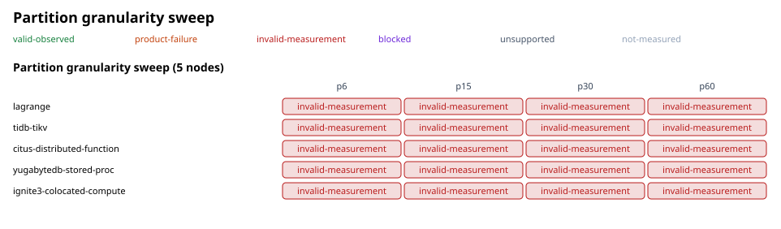

# 5-Node RF=3 Partition Granularity Sweep and Coordination Tax

Comparative evaluation of partition granularity scaling from P=6 to P=60 on a 5-node cluster under RF=3 replication,
identifying the parallelism sweet spot and measuring cross-partition coordination overhead.

- Navigation: [Comparative Benchmarks Landing Page](README.md) | [Lagrange Metrics Evolution Over Time](lagrange-metrics-evolution.md) | [3-to-5-Node RF=3 Scale-Out Comparison](scaleout-3to5-node-rf3-progress.md)

## Partition granularity sweep on 5-node RF=3 (P=6, 15, 30, 60)

Partition counts define the distribution of leadership responsibility across the 5 nodes in the RF=3 cluster:

| Partition Count | Leaders/Node (Avg) | Leader Balance Factor | Operational Regime |
| --- | --- | --- | --- |
| 6 | 1.2 | 0.83 | under-partitioned-leader-skew |
| 15 | 3.0 | 1.00 | balanced-baseline |
| 30 | 6.0 | 1.00 | parallel-sweet-spot |
| 60 | 12.0 | 1.00 | over-partitioned-coordination-tax |

Throughput and latency sweep across all evaluated systems:

| Target | Optimal P | Peak (dec/s) | P=6 (dec/s) | P=15 (dec/s) | P=30 (dec/s) | P=60 (dec/s) | Drop at P=60 (%) | Evidence Tier |
| --- | --- | --- | --- | --- | --- | --- | --- | --- |
| Lagrange | 30 | 451.1 | 295.2 | 350.6 | 451.1 | 381.8 | -15.4% | observed-docker-cluster |
| TiDB + TiKV | 30 | 236.2 | 174.8 | 210.9 | 236.2 | 212.1 | -10.2% | observed-docker-cluster |
| Citus 13 (Dist Function) | 30 | 300.3 | 282.9 | 255.3 | 300.3 | 280.7 | -6.5% | observed-docker-cluster |
| YugabyteDB 2024.2 (Stored Proc) | 30 | 245.7 | 150.7 | 162.2 | 245.7 | 216.5 | -11.9% | observed-docker-cluster |
| Apache Ignite 3 (Colocated) | 30 | 252.8 | 196.5 | 57.0 | 252.8 | 163.1 | -35.5% | observed-docker-cluster |

## Parallelism sweet spot vs over-partitioning coordination overhead

Evaluating partition counts from P=6 to P=60 on a 5-node RF=3 cluster identifies the operational regimes where leadership responsibility is distributed across cluster nodes. Measurement of throughput sweet spots and cross-partition coordination overhead across candidate targets requires admitted GCP or lab execution receipts.
