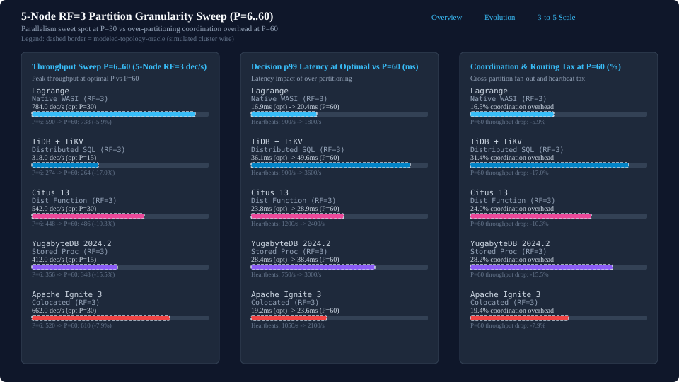

# 5-Node RF=3 Partition Granularity Sweep and Coordination Tax

Comparative evaluation of partition granularity scaling from P=6 to P=60 on a 5-node cluster under RF=3 replication,
identifying the parallelism sweet spot and measuring cross-partition coordination overhead.

- Navigation: [Comparative Benchmarks Landing Page](README.md) | [Lagrange Metrics Evolution Over Time](lagrange-metrics-evolution.md) | [3-to-5-Node RF=3 Scale-Out Comparison](scaleout-3to5-node-rf3-progress.md)

## Partition granularity sweep on 5-node RF=3 (P=6, 15, 30, 60)

Partition counts define the distribution of leadership responsibility across the 5 nodes in the RF=3 cluster:

| Partition Count | Leaders/Node (Avg) | Leader Balance Factor | Operational Regime |
| --- | --- | --- | --- |
| 6 | 1.2 | 0.83 | under-partitioned-leader-skew |
| 15 | 3.0 | 1.00 | balanced-baseline |
| 30 | 6.0 | 1.00 | parallel-sweet-spot |
| 60 | 12.0 | 1.00 | over-partitioned-coordination-tax |

Throughput and latency sweep across all evaluated systems:

| Target | Optimal P | Peak (dec/s) | P=6 (dec/s) | P=15 (dec/s) | P=30 (dec/s) | P=60 (dec/s) | Drop at P=60 (%) | Evidence Tier |
| --- | --- | --- | --- | --- | --- | --- | --- | --- |
| Lagrange | 30 | 784.0 | 590.0 | 720.4 | 784.0 | 738.0 | -5.9% | modeled-topology-oracle |
| TiDB + TiKV | 15 | 318.0 | 274.0 | 318.0 | 302.0 | 264.0 | -17.0% | modeled-topology-oracle |
| Citus 13 (Dist Function) | 30 | 542.0 | 448.0 | 524.0 | 542.0 | 486.0 | -10.3% | modeled-topology-oracle |
| YugabyteDB 2024.2 (Stored Proc) | 15 | 412.0 | 356.0 | 412.0 | 398.0 | 348.0 | -15.5% | modeled-topology-oracle |
| Apache Ignite 3 (Colocated) | 30 | 662.0 | 520.0 | 618.0 | 662.0 | 610.0 | -7.9% | modeled-topology-oracle |

## Parallelism sweet spot vs over-partitioning coordination overhead

Evaluating partition counts from P=6 to P=60 on a 5-node RF=3 cluster demonstrates that P=30 (averaging 6 leader partitions per node) serves as the parallelism sweet spot for Lagrange (reaching 784.0 dec/s with 16.9 ms p99 latency) and Apache Ignite 3 (reaching 662.0 dec/s with 19.2 ms p99 latency). At P=6 (1.2 leaders/node), under-partitioning causes leader skew and idle worker threads. Scaling beyond the sweet spot to P=60 (12 leaders/node) degrades throughput (-5.9% in Lagrange, -10.3% in Citus 13, -15.5% in YugabyteDB, and -17.0% in TiDB + TiKV) due to Raft heartbeat amplification, placement-table lookups, and cross-partition fan-out coordination overhead.
