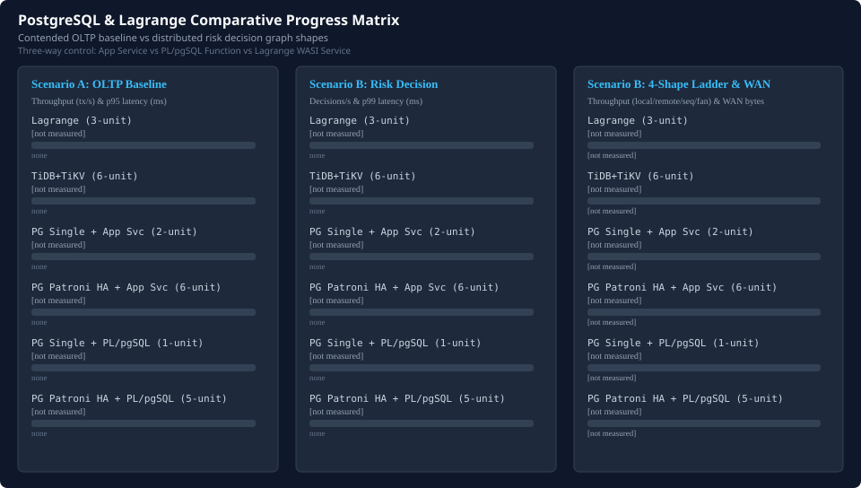

# PostgreSQL and Lagrange Comparative Progress

Comparative evaluation of Lagrange against PostgreSQL 17 configurations across Scenario A contended OLTP baseline and Scenario B distributed risk decision and partition movement.

- Comparative navigation: [Comparative Statistics Landing Page](README.md) | [Interactive Landing Dashboard](index.html) | [TiDB/TiKV Comparison Detail Page](tidb-comparison-progress.md)
- Scenario specifications: [Scenario A: tidb-oltp-baseline](tidb-reference-scenarios.md#scenario-a-tidb-oltp-baseline), [Scenario B: tidb-distributed-risk-decision](tidb-reference-scenarios.md#scenario-b-tidb-distributed-risk-decision), [Paired Benchmark Owner](tidb-reference-paired-owner.md), and [Scenario A Semantic Evidence Gate](tidb-reference-semantic-gate.md#scenario-a-semantic-evidence-gate)

## Deployment topology and durability boundary

- `pg-single-primary` (2-unit): Standard relational deployment with 1 PostgreSQL 17.2 instance and 1 dedicated application service process. High throughput for localized OLTP without consensus replication overhead, but carries a non-zero recovery point objective (data loss window) upon host failure.
- `pg-patroni-sync-ha-rf3` (6-unit / 9 processes): Strict zero data loss high availability cluster configured with Patroni 4.0, etcd 3.5 distributed consensus, synchronous physical replication (`synchronous_mode_strict: true`), PgBouncer connection pooling, and HAProxy load balancing. Guarantees RPO=0 across primary node failures at the cost of synchronous commit round-trips.
- `pg-plpgsql-single-primary` (1-unit): Embedded server-side stored procedure execution within a single PostgreSQL instance without an external application service tier.
- `pg-plpgsql-sync-ha-rf3` (5-unit / 8 processes): Server-side stored procedure execution directly on the Patroni synchronous HA primary, eliminating application container hops.
- Query engine capability: PostgreSQL demonstrates full relational competence with pushdown aggregations (`COUNT`, `SUM`), index scan optimizations, and ACID serializability.

## Three-way locality control (Application Service vs PL/pgSQL Function vs Lagrange)

Comparative evaluation of three distinct control-flow models across Scenario B graph shapes:

- **PostgreSQL + Application Service** (`pg-single-primary` / `pg-patroni-sync-ha-rf3`): Executes business logic in an external application service tier, issuing SQL queries across client/database network boundaries.
- **PostgreSQL + Server-Side PL/pgSQL Function** (`pg-plpgsql-single-primary` / `pg-plpgsql-sync-ha-rf3`): Colocates decision logic inside PostgreSQL procedures, collapsing multi-statement SQL round-trips while keeping Scenario A separate on the ordinary-SQL transaction baseline.
- **Lagrange WASI Service** (`lagrange`): Colocates execution directly with partition ownership and consensus state machines. Comparative performance claims across systems await admitted GCP/lab measurements.

## Scenario A OLTP baseline comparison ([tidb-oltp-baseline](tidb-reference-scenarios.md#scenario-a-tidb-oltp-baseline))

| Target | Version | Units | Processes | RPO=0 HA | Evidence Tier | Throughput (tx/s) | p50 (ms) | p95 (ms) | p99 (ms) | Proofs |
| --- | --- | --- | --- | --- | --- | --- | --- | --- | --- | --- |
| lagrange | 0.4.0 | 3 | 3 | Yes (RPO=0) | none | [not measured] | [not measured] | [not measured] | [not measured] | 0/33 |
| tidb-tikv | v8.5.8 | 6 | 6 | Yes (RPO=0) | none | [not measured] | [not measured] | [not measured] | [not measured] | 0/33 |
| pg-single-primary | 17.2 | 2 | 2 | No (data-loss window) | none | [not measured] | [not measured] | [not measured] | [not measured] | 0/33 |
| pg-patroni-sync-ha-rf3 | 17.2-patroni-4.0 | 6 | 9 | Yes (RPO=0) | none | [not measured] | [not measured] | [not measured] | [not measured] | 0/33 |
| pg-plpgsql-single-primary | 17.2-plpgsql | 1 | 1 | No (data-loss window) | none | [not measured] | [not measured] | [not measured] | [not measured] | 0/33 |
| pg-plpgsql-sync-ha-rf3 | 17.2-patroni-4.0-plpgsql | 5 | 8 | Yes (RPO=0) | none | [not measured] | [not measured] | [not measured] | [not measured] | 0/33 |

## Scenario B risk decision and graph-shape comparison ([tidb-distributed-risk-decision](tidb-reference-scenarios.md#scenario-b-tidb-distributed-risk-decision))

| Target | Evidence Tier | Decisions/s | p50 (ms) | p95 (ms) | p99 (ms) | WAN Bytes/Dec | SQL Round-Trips | Movement Continuity |
| --- | --- | --- | --- | --- | --- | --- | --- | --- |
| lagrange | none | [not measured] | [not measured] | [not measured] | [not measured] | [not measured] | [not measured] | [not measured] |
| tidb-tikv | none | [not measured] | [not measured] | [not measured] | [not measured] | [not measured] | [not measured] | [not measured] |
| pg-single-primary | none | [not measured] | [not measured] | [not measured] | [not measured] | [not measured] | [not measured] | [not measured] |
| pg-patroni-sync-ha-rf3 | none | [not measured] | [not measured] | [not measured] | [not measured] | [not measured] | [not measured] | [not measured] |
| pg-plpgsql-single-primary | none | [not measured] | [not measured] | [not measured] | [not measured] | [not measured] | [not measured] | [not measured] |
| pg-plpgsql-sync-ha-rf3 | none | [not measured] | [not measured] | [not measured] | [not measured] | [not measured] | [not measured] | [not measured] |

## Scenario B four-shape latency and throughput ladder

| Target | Local-Only | One Remote Stage | Sequential | Fan-Out |
| --- | --- | --- | --- | --- |
| lagrange | [not measured] | [not measured] | [not measured] | [not measured] |
| tidb-tikv | [not measured] | [not measured] | [not measured] | [not measured] |
| pg-single-primary | [not measured] | [not measured] | [not measured] | [not measured] |
| pg-patroni-sync-ha-rf3 | [not measured] | [not measured] | [not measured] | [not measured] |
| pg-plpgsql-single-primary | [not measured] | [not measured] | [not measured] | [not measured] |
| pg-plpgsql-sync-ha-rf3 | [not measured] | [not measured] | [not measured] | [not measured] |
