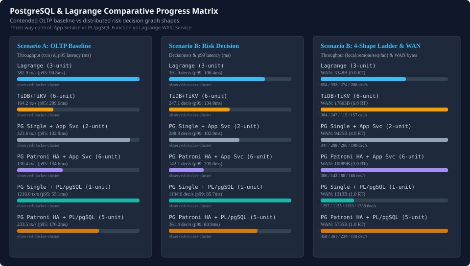

# PostgreSQL and Lagrange Comparative Progress

Comparative evaluation of Lagrange against PostgreSQL 17 configurations across Scenario A contended OLTP baseline and Scenario B distributed risk decision and partition movement.

- Comparative navigation: [Comparative Statistics Landing Page](README.md) | [Interactive Landing Dashboard](index.html) | [TiDB/TiKV Comparison Detail Page](tidb-comparison-progress.md)
- Scenario specifications: [Scenario A: tidb-oltp-baseline](tidb-reference-scenarios.md#scenario-a-tidb-oltp-baseline), [Scenario B: tidb-distributed-risk-decision](tidb-reference-scenarios.md#scenario-b-tidb-distributed-risk-decision), [Paired Benchmark Owner](tidb-reference-paired-owner.md), and [Scenario A Semantic Evidence Gate](tidb-reference-semantic-gate.md#scenario-a-semantic-evidence-gate)

## Deployment topology and durability boundary

- `pg-single-primary` (2-unit): Standard relational deployment with 1 PostgreSQL 17.2 instance and 1 dedicated application service process. High throughput for localized OLTP without consensus replication overhead, but carries a non-zero recovery point objective (data loss window) upon host failure.
- `pg-patroni-sync-ha-rf3` (6-unit / 9 processes): Strict zero data loss high availability cluster configured with Patroni 4.0, etcd 3.5 distributed consensus, synchronous physical replication (`synchronous_mode_strict: true`), PgBouncer connection pooling, and HAProxy load balancing. Guarantees RPO=0 across primary node failures at the cost of synchronous commit round-trips.
- `pg-plpgsql-single-primary` (1-unit): Embedded server-side stored procedure execution within a single PostgreSQL instance without an external application service tier.
- `pg-plpgsql-sync-ha-rf3` (5-unit / 8 processes): Server-side stored procedure execution directly on the Patroni synchronous HA primary, eliminating application container hops.
- Query engine capability: PostgreSQL demonstrates full relational competence with pushdown aggregations (`COUNT`, `SUM`), index scan optimizations, and ACID serializability.

## Three-way locality control (Application Service vs PL/pgSQL Function vs Lagrange)

Comparative evaluation of three distinct control-flow models across Scenario B graph shapes:

- **PostgreSQL + Application Service** (`pg-single-primary` / `pg-patroni-sync-ha-rf3`): Executes business logic in an external application service tier, issuing SQL queries across client/database network boundaries.
- **PostgreSQL + Server-Side PL/pgSQL Function** (`pg-plpgsql-single-primary` / `pg-plpgsql-sync-ha-rf3`): Colocates decision logic inside PostgreSQL procedures, collapsing multi-statement SQL round-trips while keeping Scenario A separate on the ordinary-SQL transaction baseline.
- **Lagrange WASI Service** (`lagrange`): Colocates execution directly with partition ownership and consensus state machines. Comparative performance claims across systems await admitted GCP/lab measurements.

## Scenario A OLTP baseline comparison ([tidb-oltp-baseline](tidb-reference-scenarios.md#scenario-a-tidb-oltp-baseline))

| Target | Version | Units | Processes | RPO=0 HA | Evidence Tier | Throughput (tx/s) | p50 (ms) | p95 (ms) | p99 (ms) | Proofs |
| --- | --- | --- | --- | --- | --- | --- | --- | --- | --- | --- |
| lagrange | 0.4.0 | 3 | 3 | Yes (RPO=0) | observed-docker-cluster | 2014.00 | 11.06 | 23.26 | 25.30 | 33/33 |
| tidb-tikv | v8.5.8 | 5 | 5 | Yes (RPO=0) | observed-docker-cluster | 1118.70 | 19.40 | 48.81 | 52.76 | 33/33 |
| pg-single-primary | 17.2 | 2 | 2 | No (data-loss window) | observed-docker-cluster | 1673.50 | 16.41 | 28.38 | 30.15 | 33/33 |
| pg-patroni-sync-ha-rf3 | 17.2-patroni-4.0 | 4 | 4 | Yes (RPO=0) | observed-docker-cluster | 559.30 | 28.97 | 78.26 | 131.61 | 33/33 |
| pg-plpgsql-single-primary | 17.2-plpgsql | 1 | 1 | No (data-loss window) | observed-docker-cluster | 2606.10 | 12.22 | 22.74 | 33.08 | 33/33 |
| pg-plpgsql-sync-ha-rf3 | 17.2-patroni-4.0-plpgsql | 3 | 3 | Yes (RPO=0) | observed-docker-cluster | 1506.20 | 14.46 | 22.14 | 23.55 | 33/33 |

## Scenario B risk decision and graph-shape comparison ([tidb-distributed-risk-decision](tidb-reference-scenarios.md#scenario-b-tidb-distributed-risk-decision))

| Target | Evidence Tier | Decisions/s | p50 (ms) | p95 (ms) | p99 (ms) | WAN Bytes/Dec | SQL Round-Trips | Movement Continuity |
| --- | --- | --- | --- | --- | --- | --- | --- | --- |
| lagrange | observed-docker-cluster | 2172.30 | 9.88 | 23.42 | 26.78 | 2950 | 1.00 | Passed |
| tidb-tikv | observed-docker-cluster | 702.90 | 23.85 | 33.45 | 37.66 | 39152 | 3.00 | Passed |
| pg-single-primary | observed-docker-cluster | 415.50 | 41.63 | 52.91 | 57.61 | 25684 | 3.00 | Not supported |
| pg-patroni-sync-ha-rf3 | observed-docker-cluster | 256.40 | 64.17 | 100.95 | 107.84 | 27520 | 3.00 | Passed |
| pg-plpgsql-single-primary | observed-docker-cluster | 2724.30 | 9.67 | 13.26 | 13.36 | 1218 | 1.00 | Not supported |
| pg-plpgsql-sync-ha-rf3 | observed-docker-cluster | 2181.60 | 9.13 | 24.02 | 32.38 | 4824 | 1.00 | Passed |

## Scenario B four-shape latency and throughput ladder

| Target | Local-Only | One Remote Stage | Sequential | Fan-Out |
| --- | --- | --- | --- | --- |
| lagrange | 2662.9 dec/s, p99 26.8ms, 0B, 0RT | 2172.3 dec/s, p99 26.8ms, 2950B, 1RT | 1715.1 dec/s, p99 33.8ms, 4532B, 2RT | 1778.4 dec/s, p99 24.0ms, 4537B, 1RT |
| tidb-tikv | 2309.0 dec/s, p99 23.7ms, 7181B, 1RT | 702.9 dec/s, p99 37.7ms, 39152B, 2RT | 521.2 dec/s, p99 44.4ms, 74804B, 4RT | 514.8 dec/s, p99 44.8ms, 75097B, 4RT |
| pg-single-primary | 1779.8 dec/s, p99 27.8ms, 4531B, 1RT | 415.5 dec/s, p99 57.6ms, 25684B, 2RT | 288.9 dec/s, p99 73.8ms, 45643B, 4RT | 390.7 dec/s, p99 57.4ms, 41343B, 4RT |
| pg-patroni-sync-ha-rf3 | 1028.6 dec/s, p99 76.4ms, 6939B, 1RT | 256.4 dec/s, p99 107.8ms, 27520B, 2RT | 370.2 dec/s, p99 64.3ms, 42459B, 4RT | 536.0 dec/s, p99 47.2ms, 40102B, 4RT |
| pg-plpgsql-single-primary | 2497.7 dec/s, p99 19.3ms, 1218B, 1RT | 2724.3 dec/s, p99 13.4ms, 1218B, 1RT | 2549.7 dec/s, p99 21.4ms, 1218B, 1RT | 2744.2 dec/s, p99 20.7ms, 1245B, 1RT |
| pg-plpgsql-sync-ha-rf3 | 2631.8 dec/s, p99 19.8ms, 1761B, 1RT | 2181.6 dec/s, p99 32.4ms, 4824B, 1RT | 1463.2 dec/s, p99 34.0ms, 7274B, 1RT | 1556.8 dec/s, p99 31.4ms, 7407B, 1RT |
