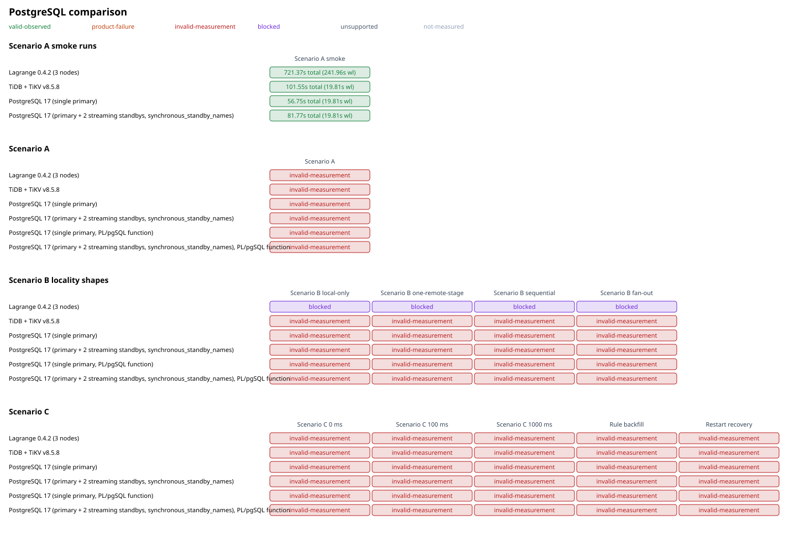

<!-- Generated by the comparative benchmark renderers from the raw observation store and the invalidation ledger; do not edit. `npm run audit:comparative-recompute` fails when this file differs from a regeneration. -->

# PostgreSQL comparison

PostgreSQL variants: single primary, and a primary with two streaming standbys under synchronous_standby_names, each with client-side SQL or a PL/pgSQL function.

## Latest comparative systems measurements (Scenario A)

Admitted v2 measurements across Lagrange, TiDB, and PostgreSQL configurations.

| Configuration | Status | Semantic Gate Proofs | Offered | Issued | Committed | Conflict-Exhausted | Product Error | Correctness Failure | Transport Failure | Harness Fault | Unresolved | Unissued | Run ID |
| --- | --- | --- | --- | --- | --- | --- | --- | --- | --- | --- | --- | --- | --- |
| Lagrange 0.4.0 (3 nodes) | valid-observed (smoke-profile-no-capacity-claim) | 33 | 100 | 100 | 97 | 3 | 0 | 0 | 0 | 0 | 0 | 0 | bench-gcp-lagrange-smoke-a23d0dfc0-20261124-r001 |
| TiDB + TiKV v8.5.8 | valid-observed (smoke-profile-no-capacity-claim) | 33 | 100 | 100 | 100 | 0 | 0 | 0 | 0 | 0 | 0 | 0 | bench-gcp-3sys-smoke-44eeb290a-20261124-r002 |
| PostgreSQL 17 (single primary) | valid-observed (smoke-profile-no-capacity-claim) | 33 | 100 | 100 | 100 | 0 | 0 | 0 | 0 | 0 | 0 | 0 | bench-gcp-3sys-smoke-44eeb290a-20261124-r003 |
| PostgreSQL 17 (primary + 2 streaming standbys, synchronous_standby_names) | valid-observed (smoke-profile-no-capacity-claim) | 33 | 100 | 100 | 100 | 0 | 0 | 0 | 0 | 0 | 0 | 0 | bench-gcp-pg-ha-smoke-44eeb290a-20261124-r001 |

## Scenario A smoke runs

PostgreSQL variants as the deployer starts them, with Lagrange and TiDB.

| Configuration | Scenario A smoke |
| --- | --- |
| Lagrange 0.4.0 (3 nodes) | valid-observed (smoke-profile-no-capacity-claim): smoke profile: offered 100, issued 100, committed 97, conflict-exhausted 3, product_error 0, correctness_failure 0, transport_failure 0, harness_fault 0, unresolved 0, unissued 0 |
| TiDB + TiKV v8.5.8 | valid-observed (smoke-profile-no-capacity-claim): smoke profile: offered 100, issued 100, committed 100, conflict-exhausted 0, product_error 0, correctness_failure 0, transport_failure 0, harness_fault 0, unresolved 0, unissued 0 |
| PostgreSQL 17 (single primary) | valid-observed (smoke-profile-no-capacity-claim): smoke profile: offered 100, issued 100, committed 100, conflict-exhausted 0, product_error 0, correctness_failure 0, transport_failure 0, harness_fault 0, unresolved 0, unissued 0 |
| PostgreSQL 17 (primary + 2 streaming standbys, synchronous_standby_names) | valid-observed (smoke-profile-no-capacity-claim): smoke profile: offered 100, issued 100, committed 100, conflict-exhausted 0, product_error 0, correctness_failure 0, transport_failure 0, harness_fault 0, unresolved 0, unissued 0 |

## Scenario A

PostgreSQL variants as the deployer starts them, with Lagrange and TiDB.

| Configuration | Scenario A |
| --- | --- |
| Lagrange 0.4.0 (3 nodes) | invalid-measurement (closed-loop-throughput, constant-phase-or-byte, dataset-unverified, emulated-product, forensic-record-not-admissible, health-substitute, invalidated:inv-0001, invalidated:inv-0003, invalidated:inv-0006, label-hash-identity, non-canonical-workload, timeout-counted-as-success, unverified-response-envelope) |
| TiDB + TiKV v8.5.8 | invalid-measurement (closed-loop-throughput, constant-phase-or-byte, dataset-unverified, emulated-product, forensic-record-not-admissible, invalidated:inv-0003, invalidated:inv-0006, label-hash-identity, non-canonical-workload) |
| PostgreSQL 17 (single primary) | invalid-measurement (closed-loop-throughput, constant-phase-or-byte, dataset-unverified, emulated-product, forensic-record-not-admissible, invalidated:inv-0003, invalidated:inv-0005, invalidated:inv-0006, label-hash-identity, label-not-observed, non-canonical-workload) |
| PostgreSQL 17 (primary + 2 streaming standbys, synchronous_standby_names) | invalid-measurement (closed-loop-throughput, constant-phase-or-byte, dataset-unverified, emulated-product, forensic-record-not-admissible, invalidated:inv-0003, invalidated:inv-0005, invalidated:inv-0006, label-hash-identity, label-not-observed, non-canonical-workload) |
| PostgreSQL 17 (single primary, PL/pgSQL function) | invalid-measurement (closed-loop-throughput, constant-phase-or-byte, dataset-unverified, emulated-product, forensic-record-not-admissible, invalidated:inv-0003, invalidated:inv-0006, label-hash-identity, non-canonical-workload) |
| PostgreSQL 17 (primary + 2 streaming standbys, synchronous_standby_names), PL/pgSQL function | invalid-measurement (closed-loop-throughput, constant-phase-or-byte, dataset-unverified, emulated-product, forensic-record-not-admissible, invalidated:inv-0003, invalidated:inv-0005, invalidated:inv-0006, label-hash-identity, label-not-observed, non-canonical-workload) |

## Scenario B locality shapes

PostgreSQL variants as the deployer starts them, with Lagrange and TiDB.

| Configuration | Scenario B local-only | Scenario B one-remote-stage | Scenario B sequential | Scenario B fan-out |
| --- | --- | --- | --- | --- |
| Lagrange 0.4.0 (3 nodes) | blocked (closed-loop-throughput, compiled-risk-service-missing, constant-phase-or-byte, dataset-unverified, emulated-product, invalidated:inv-0003, invalidated:inv-0006, label-hash-identity, non-canonical-workload) | blocked (closed-loop-throughput, compiled-risk-service-missing, constant-phase-or-byte, dataset-unverified, emulated-product, invalidated:inv-0003, invalidated:inv-0006, label-hash-identity, non-canonical-workload) | blocked (closed-loop-throughput, compiled-risk-service-missing, constant-phase-or-byte, dataset-unverified, emulated-product, invalidated:inv-0003, invalidated:inv-0006, label-hash-identity, non-canonical-workload) | blocked (closed-loop-throughput, compiled-risk-service-missing, constant-phase-or-byte, dataset-unverified, emulated-product, invalidated:inv-0003, invalidated:inv-0006, label-hash-identity, non-canonical-workload) |
| TiDB + TiKV v8.5.8 | invalid-measurement (closed-loop-throughput, constant-phase-or-byte, dataset-unverified, emulated-product, forensic-record-not-admissible, invalidated:inv-0003, invalidated:inv-0006, label-hash-identity, non-canonical-workload) | invalid-measurement (closed-loop-throughput, constant-phase-or-byte, dataset-unverified, emulated-product, forensic-record-not-admissible, invalidated:inv-0003, invalidated:inv-0006, label-hash-identity, non-canonical-workload) | invalid-measurement (closed-loop-throughput, constant-phase-or-byte, dataset-unverified, emulated-product, forensic-record-not-admissible, invalidated:inv-0003, invalidated:inv-0006, label-hash-identity, non-canonical-workload) | invalid-measurement (closed-loop-throughput, constant-phase-or-byte, dataset-unverified, emulated-product, forensic-record-not-admissible, invalidated:inv-0003, invalidated:inv-0006, label-hash-identity, non-canonical-workload) |
| PostgreSQL 17 (single primary) | invalid-measurement (closed-loop-throughput, constant-phase-or-byte, dataset-unverified, emulated-product, forensic-record-not-admissible, invalidated:inv-0003, invalidated:inv-0005, invalidated:inv-0006, label-hash-identity, label-not-observed, non-canonical-workload) | invalid-measurement (closed-loop-throughput, constant-phase-or-byte, dataset-unverified, emulated-product, forensic-record-not-admissible, invalidated:inv-0003, invalidated:inv-0005, invalidated:inv-0006, label-hash-identity, label-not-observed, non-canonical-workload) | invalid-measurement (closed-loop-throughput, constant-phase-or-byte, dataset-unverified, emulated-product, forensic-record-not-admissible, invalidated:inv-0003, invalidated:inv-0005, invalidated:inv-0006, label-hash-identity, label-not-observed, non-canonical-workload) | invalid-measurement (closed-loop-throughput, constant-phase-or-byte, dataset-unverified, emulated-product, forensic-record-not-admissible, invalidated:inv-0003, invalidated:inv-0005, invalidated:inv-0006, label-hash-identity, label-not-observed, non-canonical-workload) |
| PostgreSQL 17 (primary + 2 streaming standbys, synchronous_standby_names) | invalid-measurement (closed-loop-throughput, constant-phase-or-byte, dataset-unverified, emulated-product, forensic-record-not-admissible, invalidated:inv-0003, invalidated:inv-0005, invalidated:inv-0006, label-hash-identity, label-not-observed, non-canonical-workload) | invalid-measurement (closed-loop-throughput, constant-phase-or-byte, dataset-unverified, emulated-product, forensic-record-not-admissible, invalidated:inv-0003, invalidated:inv-0005, invalidated:inv-0006, label-hash-identity, label-not-observed, non-canonical-workload) | invalid-measurement (closed-loop-throughput, constant-phase-or-byte, dataset-unverified, emulated-product, forensic-record-not-admissible, invalidated:inv-0003, invalidated:inv-0005, invalidated:inv-0006, label-hash-identity, label-not-observed, non-canonical-workload) | invalid-measurement (closed-loop-throughput, constant-phase-or-byte, dataset-unverified, emulated-product, forensic-record-not-admissible, invalidated:inv-0003, invalidated:inv-0005, invalidated:inv-0006, label-hash-identity, label-not-observed, non-canonical-workload) |
| PostgreSQL 17 (single primary, PL/pgSQL function) | invalid-measurement (closed-loop-throughput, constant-phase-or-byte, dataset-unverified, emulated-product, forensic-record-not-admissible, invalidated:inv-0003, invalidated:inv-0006, label-hash-identity, non-canonical-workload) | invalid-measurement (closed-loop-throughput, constant-phase-or-byte, dataset-unverified, emulated-product, forensic-record-not-admissible, invalidated:inv-0003, invalidated:inv-0006, label-hash-identity, non-canonical-workload) | invalid-measurement (closed-loop-throughput, constant-phase-or-byte, dataset-unverified, emulated-product, forensic-record-not-admissible, invalidated:inv-0003, invalidated:inv-0006, label-hash-identity, non-canonical-workload) | invalid-measurement (closed-loop-throughput, constant-phase-or-byte, dataset-unverified, emulated-product, forensic-record-not-admissible, invalidated:inv-0003, invalidated:inv-0006, label-hash-identity, non-canonical-workload) |
| PostgreSQL 17 (primary + 2 streaming standbys, synchronous_standby_names), PL/pgSQL function | invalid-measurement (closed-loop-throughput, constant-phase-or-byte, dataset-unverified, emulated-product, forensic-record-not-admissible, invalidated:inv-0003, invalidated:inv-0005, invalidated:inv-0006, label-hash-identity, label-not-observed, non-canonical-workload) | invalid-measurement (closed-loop-throughput, constant-phase-or-byte, dataset-unverified, emulated-product, forensic-record-not-admissible, invalidated:inv-0003, invalidated:inv-0005, invalidated:inv-0006, label-hash-identity, label-not-observed, non-canonical-workload) | invalid-measurement (closed-loop-throughput, constant-phase-or-byte, dataset-unverified, emulated-product, forensic-record-not-admissible, invalidated:inv-0003, invalidated:inv-0005, invalidated:inv-0006, label-hash-identity, label-not-observed, non-canonical-workload) | invalid-measurement (closed-loop-throughput, constant-phase-or-byte, dataset-unverified, emulated-product, forensic-record-not-admissible, invalidated:inv-0003, invalidated:inv-0005, invalidated:inv-0006, label-hash-identity, label-not-observed, non-canonical-workload) |

## Scenario C

PostgreSQL variants as the deployer starts them, with Lagrange and TiDB.

| Configuration | Scenario C 0 ms | Scenario C 100 ms | Scenario C 1000 ms | Rule backfill | Restart recovery |
| --- | --- | --- | --- | --- | --- |
| Lagrange 0.4.0 (3 nodes) | invalid-measurement (closed-loop-throughput, constant-phase-or-byte, dataset-unverified, emulated-product, forensic-record-not-admissible, freshness-not-observed, invalidated:inv-0003, invalidated:inv-0004, invalidated:inv-0006, label-hash-identity, non-canonical-workload) | invalid-measurement (closed-loop-throughput, constant-phase-or-byte, dataset-unverified, emulated-product, forensic-record-not-admissible, freshness-not-observed, invalidated:inv-0003, invalidated:inv-0004, invalidated:inv-0006, label-hash-identity, non-canonical-workload) | invalid-measurement (closed-loop-throughput, constant-phase-or-byte, dataset-unverified, emulated-product, forensic-record-not-admissible, freshness-not-observed, invalidated:inv-0003, invalidated:inv-0004, invalidated:inv-0006, label-hash-identity, non-canonical-workload) | invalid-measurement (closed-loop-throughput, constant-phase-or-byte, dataset-unverified, emulated-product, forensic-record-not-admissible, freshness-not-observed, invalidated:inv-0003, invalidated:inv-0004, invalidated:inv-0006, label-hash-identity, non-canonical-workload) | invalid-measurement (closed-loop-throughput, constant-phase-or-byte, dataset-unverified, emulated-product, forensic-record-not-admissible, freshness-not-observed, invalidated:inv-0003, invalidated:inv-0004, invalidated:inv-0006, label-hash-identity, non-canonical-workload) |
| TiDB + TiKV v8.5.8 | invalid-measurement (closed-loop-throughput, constant-phase-or-byte, dataset-unverified, emulated-product, forensic-record-not-admissible, freshness-not-observed, invalidated:inv-0003, invalidated:inv-0004, invalidated:inv-0006, label-hash-identity, non-canonical-workload) | invalid-measurement (closed-loop-throughput, constant-phase-or-byte, dataset-unverified, emulated-product, forensic-record-not-admissible, freshness-not-observed, invalidated:inv-0003, invalidated:inv-0004, invalidated:inv-0006, label-hash-identity, non-canonical-workload) | invalid-measurement (closed-loop-throughput, constant-phase-or-byte, dataset-unverified, emulated-product, forensic-record-not-admissible, freshness-not-observed, invalidated:inv-0003, invalidated:inv-0004, invalidated:inv-0006, label-hash-identity, non-canonical-workload) | invalid-measurement (closed-loop-throughput, constant-phase-or-byte, dataset-unverified, emulated-product, forensic-record-not-admissible, freshness-not-observed, invalidated:inv-0003, invalidated:inv-0004, invalidated:inv-0006, label-hash-identity, non-canonical-workload) | invalid-measurement (closed-loop-throughput, constant-phase-or-byte, dataset-unverified, emulated-product, forensic-record-not-admissible, freshness-not-observed, invalidated:inv-0003, invalidated:inv-0004, invalidated:inv-0006, label-hash-identity, non-canonical-workload) |
| PostgreSQL 17 (single primary) | invalid-measurement (closed-loop-throughput, constant-phase-or-byte, dataset-unverified, emulated-product, forensic-record-not-admissible, freshness-not-observed, invalidated:inv-0003, invalidated:inv-0004, invalidated:inv-0005, invalidated:inv-0006, label-hash-identity, label-not-observed, non-canonical-workload) | invalid-measurement (closed-loop-throughput, constant-phase-or-byte, dataset-unverified, emulated-product, forensic-record-not-admissible, freshness-not-observed, invalidated:inv-0003, invalidated:inv-0004, invalidated:inv-0005, invalidated:inv-0006, label-hash-identity, label-not-observed, non-canonical-workload) | invalid-measurement (closed-loop-throughput, constant-phase-or-byte, dataset-unverified, emulated-product, forensic-record-not-admissible, freshness-not-observed, invalidated:inv-0003, invalidated:inv-0004, invalidated:inv-0005, invalidated:inv-0006, label-hash-identity, label-not-observed, non-canonical-workload) | invalid-measurement (closed-loop-throughput, constant-phase-or-byte, dataset-unverified, emulated-product, forensic-record-not-admissible, freshness-not-observed, invalidated:inv-0003, invalidated:inv-0004, invalidated:inv-0005, invalidated:inv-0006, label-hash-identity, label-not-observed, non-canonical-workload) | invalid-measurement (closed-loop-throughput, constant-phase-or-byte, dataset-unverified, emulated-product, forensic-record-not-admissible, freshness-not-observed, invalidated:inv-0003, invalidated:inv-0004, invalidated:inv-0005, invalidated:inv-0006, label-hash-identity, label-not-observed, non-canonical-workload) |
| PostgreSQL 17 (primary + 2 streaming standbys, synchronous_standby_names) | invalid-measurement (closed-loop-throughput, constant-phase-or-byte, dataset-unverified, emulated-product, forensic-record-not-admissible, freshness-not-observed, invalidated:inv-0003, invalidated:inv-0004, invalidated:inv-0005, invalidated:inv-0006, label-hash-identity, label-not-observed, non-canonical-workload) | invalid-measurement (closed-loop-throughput, constant-phase-or-byte, dataset-unverified, emulated-product, forensic-record-not-admissible, freshness-not-observed, invalidated:inv-0003, invalidated:inv-0004, invalidated:inv-0005, invalidated:inv-0006, label-hash-identity, label-not-observed, non-canonical-workload) | invalid-measurement (closed-loop-throughput, constant-phase-or-byte, dataset-unverified, emulated-product, forensic-record-not-admissible, freshness-not-observed, invalidated:inv-0003, invalidated:inv-0004, invalidated:inv-0005, invalidated:inv-0006, label-hash-identity, label-not-observed, non-canonical-workload) | invalid-measurement (closed-loop-throughput, constant-phase-or-byte, dataset-unverified, emulated-product, forensic-record-not-admissible, freshness-not-observed, invalidated:inv-0003, invalidated:inv-0004, invalidated:inv-0005, invalidated:inv-0006, label-hash-identity, label-not-observed, non-canonical-workload) | invalid-measurement (closed-loop-throughput, constant-phase-or-byte, dataset-unverified, emulated-product, forensic-record-not-admissible, freshness-not-observed, invalidated:inv-0003, invalidated:inv-0004, invalidated:inv-0005, invalidated:inv-0006, label-hash-identity, label-not-observed, non-canonical-workload) |
| PostgreSQL 17 (single primary, PL/pgSQL function) | invalid-measurement (closed-loop-throughput, constant-phase-or-byte, dataset-unverified, emulated-product, forensic-record-not-admissible, freshness-not-observed, invalidated:inv-0003, invalidated:inv-0004, invalidated:inv-0006, label-hash-identity, non-canonical-workload) | invalid-measurement (closed-loop-throughput, constant-phase-or-byte, dataset-unverified, emulated-product, forensic-record-not-admissible, freshness-not-observed, invalidated:inv-0003, invalidated:inv-0004, invalidated:inv-0006, label-hash-identity, non-canonical-workload) | invalid-measurement (closed-loop-throughput, constant-phase-or-byte, dataset-unverified, emulated-product, forensic-record-not-admissible, freshness-not-observed, invalidated:inv-0003, invalidated:inv-0004, invalidated:inv-0006, label-hash-identity, non-canonical-workload) | invalid-measurement (closed-loop-throughput, constant-phase-or-byte, dataset-unverified, emulated-product, forensic-record-not-admissible, freshness-not-observed, invalidated:inv-0003, invalidated:inv-0004, invalidated:inv-0006, label-hash-identity, non-canonical-workload) | invalid-measurement (closed-loop-throughput, constant-phase-or-byte, dataset-unverified, emulated-product, forensic-record-not-admissible, freshness-not-observed, invalidated:inv-0003, invalidated:inv-0004, invalidated:inv-0006, label-hash-identity, non-canonical-workload) |
| PostgreSQL 17 (primary + 2 streaming standbys, synchronous_standby_names), PL/pgSQL function | invalid-measurement (closed-loop-throughput, constant-phase-or-byte, dataset-unverified, emulated-product, forensic-record-not-admissible, freshness-not-observed, invalidated:inv-0003, invalidated:inv-0004, invalidated:inv-0005, invalidated:inv-0006, label-hash-identity, label-not-observed, non-canonical-workload) | invalid-measurement (closed-loop-throughput, constant-phase-or-byte, dataset-unverified, emulated-product, forensic-record-not-admissible, freshness-not-observed, invalidated:inv-0003, invalidated:inv-0004, invalidated:inv-0005, invalidated:inv-0006, label-hash-identity, label-not-observed, non-canonical-workload) | invalid-measurement (closed-loop-throughput, constant-phase-or-byte, dataset-unverified, emulated-product, forensic-record-not-admissible, freshness-not-observed, invalidated:inv-0003, invalidated:inv-0004, invalidated:inv-0005, invalidated:inv-0006, label-hash-identity, label-not-observed, non-canonical-workload) | invalid-measurement (closed-loop-throughput, constant-phase-or-byte, dataset-unverified, emulated-product, forensic-record-not-admissible, freshness-not-observed, invalidated:inv-0003, invalidated:inv-0004, invalidated:inv-0005, invalidated:inv-0006, label-hash-identity, label-not-observed, non-canonical-workload) | invalid-measurement (closed-loop-throughput, constant-phase-or-byte, dataset-unverified, emulated-product, forensic-record-not-admissible, freshness-not-observed, invalidated:inv-0003, invalidated:inv-0004, invalidated:inv-0005, invalidated:inv-0006, label-hash-identity, label-not-observed, non-canonical-workload) |

## Cell status vocabulary

- `valid-observed`: admitted from retained v2 observations
- `product-failure`: the product ran and failed; failure counts are shown
- `invalid-measurement`: evidence exists but cannot support the claim (reason codes name why)
- `blocked`: cannot be measured until a named prerequisite exists
- `unsupported`: the configuration cannot express this claim
- `not-measured`: no observation exists

Every comparative result published before 2026-11-01 was withdrawn; the records are retained as forensic evidence. The append-only [invalidation ledger](../../data/tidb-comparison/invalidations.ndjson) has 31 entries; 10 of them name the defect ids behind the withdrawal and 10 of them enumerate the withdrawn records by id (the rest name them by file and campaign commit). 33 of 76 history records are withdrawn without a ledger entry, by the admission rule `forensic-record-not-admissible`: no history record is admissible as a current claim.

## Related pages

- [Scenario A/B/C definitions](tidb-reference-scenarios.md)
- [Scenario A semantic evidence gate](tidb-reference-semantic-gate.md)
- [Paired measurement owner](tidb-reference-paired-owner.md)
- [Comparative benchmark overview](README.md)

## Sources

- `data/tidb-comparison/raw-observations.ndjson` sha256:da4fcfeaf2bad9e542f5218beaf2c2101a9094da9a92896c9287b7ce915bcad3
- `data/tidb-comparison/forensic/raw-observations-86e795c44.ndjson` sha256:79698d1b6cd709d227c9712e75c3471243ee99f473212c495ad15c6c1e96f32e
- `data/tidb-comparison/invalidations.ndjson` sha256:454765469cea50f7edda0d7bd9efd731b6101ff8c06a2397265adcc6f5a4c521
