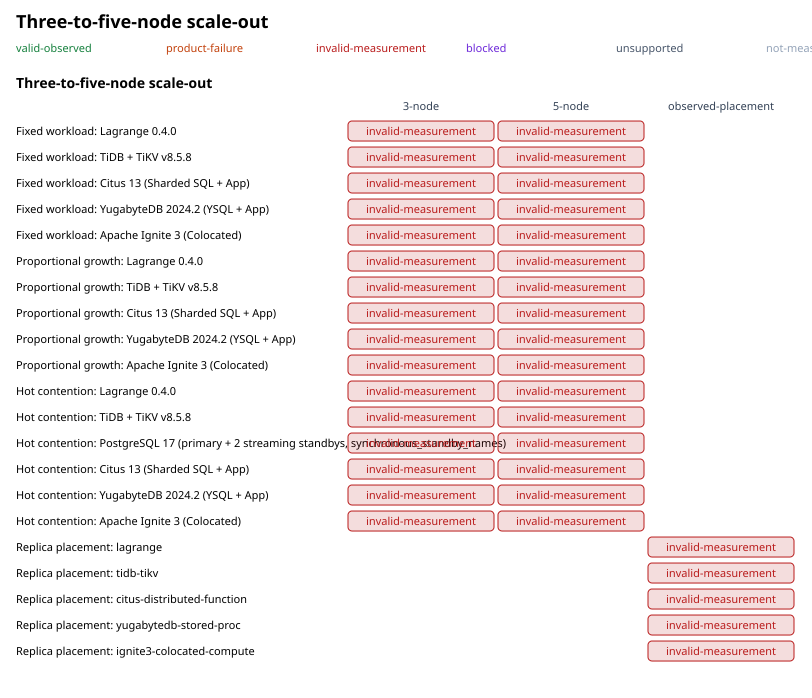

<!-- Generated by the comparative benchmark renderers from the raw observation store and the invalidation ledger; do not edit. `npm run audit:comparative-recompute` fails when this file differs from a regeneration. -->

# Three-to-five-node scale-out

A scale-out claim needs Scenario A runs at both node counts with observed process placement; replica placement needs its own observation and is never derived from the replication factor.

Every comparative result published before 2026-11-01 was withdrawn; the records are retained as forensic evidence. The append-only [invalidation ledger](../../data/tidb-comparison/invalidations.ndjson) has 10 entries; 8 of them name the defect ids behind the withdrawal and 6 of them enumerate the withdrawn records by id (the rest name them by file and campaign commit). 5 of 20 history records are withdrawn without a ledger entry, by the admission rule `forensic-record-not-admissible`: no history record is admissible as a current claim.

## Cell status vocabulary

- `valid-observed`: admitted from retained v2 observations
- `product-failure`: the product ran and failed; failure counts are shown
- `invalid-measurement`: evidence exists but cannot support the claim (reason codes name why)
- `blocked`: cannot be measured until a named prerequisite exists
- `unsupported`: the configuration cannot express this claim
- `not-measured`: no observation exists

## Three-to-five-node scale-out

| Configuration | 3-node | 5-node |
| --- | --- | --- |
| Fixed workload: Lagrange 0.4.0 | invalid-measurement (closed-loop-throughput, constant-phase-or-byte, dataset-unverified, emulated-product, forensic-record-not-admissible, invalidated:inv-0002, invalidated:inv-0003, invalidated:inv-0006, label-hash-identity, non-canonical-workload, wrong-dispatch-family) | invalid-measurement (closed-loop-throughput, constant-phase-or-byte, dataset-unverified, emulated-product, forensic-record-not-admissible, invalidated:inv-0002, invalidated:inv-0003, invalidated:inv-0006, label-hash-identity, non-canonical-workload, wrong-dispatch-family) |
| Fixed workload: TiDB + TiKV v8.5.8 | invalid-measurement (closed-loop-throughput, constant-phase-or-byte, dataset-unverified, emulated-product, forensic-record-not-admissible, invalidated:inv-0002, invalidated:inv-0003, invalidated:inv-0006, label-hash-identity, non-canonical-workload, wrong-dispatch-family) | invalid-measurement (closed-loop-throughput, constant-phase-or-byte, dataset-unverified, emulated-product, forensic-record-not-admissible, invalidated:inv-0002, invalidated:inv-0003, invalidated:inv-0006, label-hash-identity, non-canonical-workload, wrong-dispatch-family) |
| Fixed workload: Citus 13 (Sharded SQL + App) | invalid-measurement (closed-loop-throughput, constant-phase-or-byte, emulated-product, forensic-record-not-admissible, invalidated:inv-0006, label-hash-identity, non-canonical-workload) | invalid-measurement (closed-loop-throughput, constant-phase-or-byte, emulated-product, forensic-record-not-admissible, invalidated:inv-0006, label-hash-identity, non-canonical-workload) |
| Fixed workload: YugabyteDB 2024.2 (YSQL + App) | invalid-measurement (closed-loop-throughput, constant-phase-or-byte, emulated-product, forensic-record-not-admissible, invalidated:inv-0006, label-hash-identity, non-canonical-workload) | invalid-measurement (closed-loop-throughput, constant-phase-or-byte, emulated-product, forensic-record-not-admissible, invalidated:inv-0006, label-hash-identity, non-canonical-workload) |
| Fixed workload: Apache Ignite 3 (Colocated) | invalid-measurement (closed-loop-throughput, constant-phase-or-byte, emulated-product, forensic-record-not-admissible, invalidated:inv-0006, label-hash-identity, non-canonical-workload) | invalid-measurement (closed-loop-throughput, constant-phase-or-byte, emulated-product, forensic-record-not-admissible, invalidated:inv-0006, label-hash-identity, non-canonical-workload) |
| Proportional growth: Lagrange 0.4.0 | invalid-measurement (closed-loop-throughput, constant-phase-or-byte, dataset-unverified, emulated-product, forensic-record-not-admissible, invalidated:inv-0002, invalidated:inv-0003, invalidated:inv-0006, label-hash-identity, non-canonical-workload, wrong-dispatch-family) | invalid-measurement (closed-loop-throughput, constant-phase-or-byte, dataset-unverified, emulated-product, forensic-record-not-admissible, invalidated:inv-0002, invalidated:inv-0003, invalidated:inv-0006, label-hash-identity, non-canonical-workload, wrong-dispatch-family) |
| Proportional growth: TiDB + TiKV v8.5.8 | invalid-measurement (closed-loop-throughput, constant-phase-or-byte, dataset-unverified, emulated-product, forensic-record-not-admissible, invalidated:inv-0002, invalidated:inv-0003, invalidated:inv-0006, label-hash-identity, non-canonical-workload, wrong-dispatch-family) | invalid-measurement (closed-loop-throughput, constant-phase-or-byte, dataset-unverified, emulated-product, forensic-record-not-admissible, invalidated:inv-0002, invalidated:inv-0003, invalidated:inv-0006, label-hash-identity, non-canonical-workload, wrong-dispatch-family) |
| Proportional growth: Citus 13 (Sharded SQL + App) | invalid-measurement (closed-loop-throughput, constant-phase-or-byte, emulated-product, forensic-record-not-admissible, invalidated:inv-0006, label-hash-identity, non-canonical-workload) | invalid-measurement (closed-loop-throughput, constant-phase-or-byte, emulated-product, forensic-record-not-admissible, invalidated:inv-0006, label-hash-identity, non-canonical-workload) |
| Proportional growth: YugabyteDB 2024.2 (YSQL + App) | invalid-measurement (closed-loop-throughput, constant-phase-or-byte, emulated-product, forensic-record-not-admissible, invalidated:inv-0006, label-hash-identity, non-canonical-workload) | invalid-measurement (closed-loop-throughput, constant-phase-or-byte, emulated-product, forensic-record-not-admissible, invalidated:inv-0006, label-hash-identity, non-canonical-workload) |
| Proportional growth: Apache Ignite 3 (Colocated) | invalid-measurement (closed-loop-throughput, constant-phase-or-byte, emulated-product, forensic-record-not-admissible, invalidated:inv-0006, label-hash-identity, non-canonical-workload) | invalid-measurement (closed-loop-throughput, constant-phase-or-byte, emulated-product, forensic-record-not-admissible, invalidated:inv-0006, label-hash-identity, non-canonical-workload) |
| Hot contention: Lagrange 0.4.0 | invalid-measurement (closed-loop-throughput, constant-phase-or-byte, dataset-unverified, emulated-product, forensic-record-not-admissible, invalidated:inv-0002, invalidated:inv-0003, invalidated:inv-0006, label-hash-identity, non-canonical-workload, wrong-dispatch-family) | invalid-measurement (closed-loop-throughput, constant-phase-or-byte, dataset-unverified, emulated-product, forensic-record-not-admissible, invalidated:inv-0002, invalidated:inv-0003, invalidated:inv-0006, label-hash-identity, non-canonical-workload, wrong-dispatch-family) |
| Hot contention: TiDB + TiKV v8.5.8 | invalid-measurement (closed-loop-throughput, constant-phase-or-byte, dataset-unverified, emulated-product, forensic-record-not-admissible, invalidated:inv-0002, invalidated:inv-0003, invalidated:inv-0006, label-hash-identity, non-canonical-workload, wrong-dispatch-family) | invalid-measurement (closed-loop-throughput, constant-phase-or-byte, dataset-unverified, emulated-product, forensic-record-not-admissible, invalidated:inv-0002, invalidated:inv-0003, invalidated:inv-0006, label-hash-identity, non-canonical-workload, wrong-dispatch-family) |
| Hot contention: PostgreSQL 17 (primary + 2 streaming standbys, synchronous_standby_names) | invalid-measurement (closed-loop-throughput, constant-phase-or-byte, dataset-unverified, emulated-product, forensic-record-not-admissible, invalidated:inv-0002, invalidated:inv-0003, invalidated:inv-0005, invalidated:inv-0006, label-hash-identity, label-not-observed, non-canonical-workload, wrong-dispatch-family) | invalid-measurement (closed-loop-throughput, constant-phase-or-byte, dataset-unverified, emulated-product, forensic-record-not-admissible, invalidated:inv-0002, invalidated:inv-0003, invalidated:inv-0005, invalidated:inv-0006, label-hash-identity, label-not-observed, non-canonical-workload, wrong-dispatch-family) |
| Hot contention: Citus 13 (Sharded SQL + App) | invalid-measurement (closed-loop-throughput, constant-phase-or-byte, emulated-product, forensic-record-not-admissible, invalidated:inv-0006, label-hash-identity, non-canonical-workload) | invalid-measurement (closed-loop-throughput, constant-phase-or-byte, emulated-product, forensic-record-not-admissible, invalidated:inv-0006, label-hash-identity, non-canonical-workload) |
| Hot contention: YugabyteDB 2024.2 (YSQL + App) | invalid-measurement (closed-loop-throughput, constant-phase-or-byte, emulated-product, forensic-record-not-admissible, invalidated:inv-0006, label-hash-identity, non-canonical-workload) | invalid-measurement (closed-loop-throughput, constant-phase-or-byte, emulated-product, forensic-record-not-admissible, invalidated:inv-0006, label-hash-identity, non-canonical-workload) |
| Hot contention: Apache Ignite 3 (Colocated) | invalid-measurement (closed-loop-throughput, constant-phase-or-byte, emulated-product, forensic-record-not-admissible, invalidated:inv-0006, label-hash-identity, non-canonical-workload) | invalid-measurement (closed-loop-throughput, constant-phase-or-byte, emulated-product, forensic-record-not-admissible, invalidated:inv-0006, label-hash-identity, non-canonical-workload) |

## Observed replica placement (5 nodes, RF=3)

| Configuration | observed-placement |
| --- | --- |
| Replica placement: lagrange | invalid-measurement (closed-loop-throughput, constant-phase-or-byte, dataset-unverified, emulated-product, forensic-record-not-admissible, invalidated:inv-0003, invalidated:inv-0006, label-hash-identity, non-canonical-workload) |
| Replica placement: tidb-tikv | invalid-measurement (closed-loop-throughput, constant-phase-or-byte, dataset-unverified, emulated-product, forensic-record-not-admissible, invalidated:inv-0003, invalidated:inv-0006, label-hash-identity, non-canonical-workload) |
| Replica placement: citus-distributed-function | invalid-measurement (closed-loop-throughput, constant-phase-or-byte, emulated-product, forensic-record-not-admissible, invalidated:inv-0006, label-hash-identity, non-canonical-workload) |
| Replica placement: yugabytedb-stored-proc | invalid-measurement (closed-loop-throughput, constant-phase-or-byte, emulated-product, forensic-record-not-admissible, invalidated:inv-0006, label-hash-identity, non-canonical-workload) |
| Replica placement: ignite3-colocated-compute | invalid-measurement (closed-loop-throughput, constant-phase-or-byte, emulated-product, forensic-record-not-admissible, invalidated:inv-0006, label-hash-identity, non-canonical-workload) |

## Related pages

- [Scenario A/B/C definitions](tidb-reference-scenarios.md)
- [Scenario A semantic evidence gate](tidb-reference-semantic-gate.md)
- [Paired measurement owner](tidb-reference-paired-owner.md)
- [Comparative benchmark overview](README.md)

## Sources

- `data/tidb-comparison/raw-observations.ndjson` sha256:f1490d1f002f36f9cb9d18feb3bf0f2fd5a4c381ae333b348a42faa6207f1549
- `data/tidb-comparison/forensic/raw-observations-86e795c44.ndjson` sha256:79698d1b6cd709d227c9712e75c3471243ee99f473212c495ad15c6c1e96f32e
- `data/tidb-comparison/invalidations.ndjson` sha256:8acfd06a63ea8ab1e9f8a7f75fe3a69100a9703c8ff48e02d5ec77307c9dc49e
