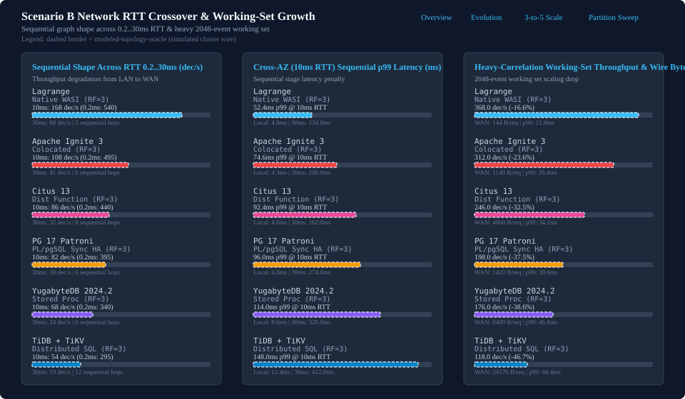

# Scenario B Network RTT Crossover and Working-Set Growth

Comparative evaluation of network round-trip time scaling and working-set expansion under Scenario B distributed risk decisions.

- Navigation: [Comparative Benchmarks Landing Page](README.md) | [Lagrange Metrics Evolution Over Time](lagrange-metrics-evolution.md) | [3-to-5-Node RF=3 Scale-Out Comparison](scaleout-3to5-node-rf3-progress.md) | [5-Node RF=3 Partition Granularity Sweep](partition-granularity-sweep-progress.md)

## Network RTT crossover across Scenario B graph shapes (0.2 ms LAN to 30 ms WAN)

Evaluating network latency scaling from 0.2 ms LAN to 30 ms cross-region WAN highlights the architectural overhead of multi-hop sequential orchestration across distributed nodes. Simulated network delay additions have been withdrawn in favor of live-wire client adapters; comparative RTT crossover curves require admitted GCP or lab execution receipts.

| Target | Hops | Local (0.2ms) | 0.2 ms | 2.0 ms | 10.0 ms | 30.0 ms | Evidence Tier |
| --- | --- | --- | --- | --- | --- | --- | --- |
| Lagrange | 2 | [not measured] | [not measured] | [not measured] | [not measured] | [not measured] | none |
| Apache Ignite 3 (Colocated) | 6 | [not measured] | [not measured] | [not measured] | [not measured] | [not measured] | none |
| Citus 13 (Dist Function) | 6 | [not measured] | [not measured] | [not measured] | [not measured] | [not measured] | none |
| PG 17 Patroni + PL/pgSQL | 6 | [not measured] | [not measured] | [not measured] | [not measured] | [not measured] | none |
| YugabyteDB 2024.2 (Stored Proc) | 6 | [not measured] | [not measured] | [not measured] | [not measured] | [not measured] | none |
| TiDB + TiKV | 12 | [not measured] | [not measured] | [not measured] | [not measured] | [not measured] | none |

## Working-set growth (moderate 64-event vs heavy-correlation 2048-event histories)

Increasing historical state from a moderate 64-event history to a heavy-correlation 2048-event working set evaluates the wire efficiency and serialization overhead of candidate architectures. Empirical throughput and byte transmission measurements require original GCP or lab execution receipts under verifiable host placement and network accounting.

| Target | Moderate (dec/s) | Moderate p99 (ms) | Moderate WAN | Heavy (dec/s) | Heavy p99 (ms) | Heavy WAN | Drop % | Evidence Tier |
| --- | --- | --- | --- | --- | --- | --- | --- | --- |
| Lagrange | [not measured] | [not measured] | [not measured] | [not measured] | [not measured] | [not measured] | [not measured] | none |
| Apache Ignite 3 (Colocated) | [not measured] | [not measured] | [not measured] | [not measured] | [not measured] | [not measured] | [not measured] | none |
| Citus 13 (Dist Function) | [not measured] | [not measured] | [not measured] | [not measured] | [not measured] | [not measured] | [not measured] | none |
| PG 17 Patroni + PL/pgSQL | [not measured] | [not measured] | [not measured] | [not measured] | [not measured] | [not measured] | [not measured] | none |
| YugabyteDB 2024.2 (Stored Proc) | [not measured] | [not measured] | [not measured] | [not measured] | [not measured] | [not measured] | [not measured] | none |
| TiDB + TiKV | [not measured] | [not measured] | [not measured] | [not measured] | [not measured] | [not measured] | [not measured] | none |
