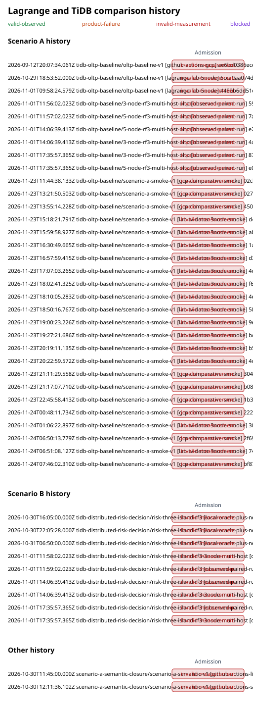

<!-- Generated by the comparative benchmark renderers from the raw observation store and the invalidation ledger; do not edit. `npm run audit:comparative-recompute` fails when this file differs from a regeneration. -->

# Lagrange and TiDB comparison history

The history holds 76 records over 53 combinations. History records are forensic: none is admitted as a current result.

## Scenario A history

Definition: tidb-reference-scenarios.md#scenario-a-tidb-oltp-baseline. Latest record per combination.

| Configuration | Admission |
| --- | --- |
| 2026-09-12T20:07:34.061Z tidb-oltp-baseline/oltp-baseline-v1 [github-actions-gcp] ae6bd0386ece | invalid-measurement (closed-loop-throughput, forensic-record-not-admissible, invalidated:inv-0013, non-canonical-workload) |
| 2026-10-29T18:53:52.000Z tidb-oltp-baseline/oltp-baseline-v1 [lagrange-lab-5node] 6cca9aa074d2 | invalid-measurement (closed-loop-throughput, forensic-record-not-admissible, invalidated:inv-0013, non-canonical-workload) |
| 2026-11-01T09:58:24.579Z tidb-oltp-baseline/oltp-baseline-v1 [lagrange-lab-5node] 4452b6dd51e2 | invalid-measurement (closed-loop-throughput, forensic-record-not-admissible, invalidated:inv-0013, non-canonical-workload) |
| 2026-11-01T11:56:02.023Z tidb-oltp-baseline/3-node-rf3-multi-host-oltp [observed-paired-run] 59a7afbf1b8e | invalid-measurement (fabricated-history-metrics, forensic-record-not-admissible, invalidated:inv-0008) |
| 2026-11-01T11:57:02.023Z tidb-oltp-baseline/5-node-rf3-multi-host-oltp [observed-paired-run] 7aaf3fda8eca | invalid-measurement (fabricated-history-metrics, forensic-record-not-admissible, invalidated:inv-0008) |
| 2026-11-01T14:06:39.413Z tidb-oltp-baseline/5-node-rf3-multi-host-oltp [observed-paired-run] e2b828ec15de | invalid-measurement (fabricated-history-metrics, forensic-record-not-admissible, invalidated:inv-0008) |
| 2026-11-01T14:06:39.413Z tidb-oltp-baseline/3-node-rf3-multi-host-oltp [observed-paired-run] 4ae39281b8b5 | invalid-measurement (fabricated-history-metrics, forensic-record-not-admissible, invalidated:inv-0008) |
| 2026-11-01T17:35:57.365Z tidb-oltp-baseline/3-node-rf3-multi-host-oltp [observed-paired-run] 87b6a4711010 | invalid-measurement (fabricated-history-metrics, forensic-record-not-admissible, invalidated:inv-0008) |
| 2026-11-01T17:35:57.365Z tidb-oltp-baseline/5-node-rf3-multi-host-oltp [observed-paired-run] e07746af4c34 | invalid-measurement (fabricated-history-metrics, forensic-record-not-admissible, invalidated:inv-0008) |
| 2026-11-23T11:44:38.133Z tidb-oltp-baseline/scenario-a-smoke-v1 [gcp-comparative-smoke] 64824b73b691 | invalid-measurement (forensic-record-not-admissible) |
| 2026-11-23T13:21:50.503Z tidb-oltp-baseline/scenario-a-smoke-v1 [gcp-comparative-smoke] cf1f6b42a67a | invalid-measurement (forensic-record-not-admissible) |
| 2026-11-23T13:55:14.228Z tidb-oltp-baseline/scenario-a-smoke-v1 [gcp-comparative-smoke] 621ac1a02a7c | invalid-measurement (forensic-record-not-admissible) |
| 2026-11-23T15:18:21.791Z tidb-oltp-baseline/scenario-a-smoke-v1 [lab-tv-dator-3node-smoke] d4fa5d60c0d8 | invalid-measurement (forensic-record-not-admissible) |
| 2026-11-23T15:59:58.927Z tidb-oltp-baseline/scenario-a-smoke-v1 [lab-tv-dator-3node-smoke] 96250df882bd | invalid-measurement (forensic-record-not-admissible) |
| 2026-11-23T16:30:49.665Z tidb-oltp-baseline/scenario-a-smoke-v1 [lab-tv-dator-3node-smoke] f738baede535 | invalid-measurement (forensic-record-not-admissible) |
| 2026-11-23T16:57:59.415Z tidb-oltp-baseline/scenario-a-smoke-v1 [lab-tv-dator-3node-smoke] 507f9b45cdae | invalid-measurement (forensic-record-not-admissible) |
| 2026-11-23T17:07:03.265Z tidb-oltp-baseline/scenario-a-smoke-v1 [lab-tv-dator-3node-smoke] 04ebde78fd0b | invalid-measurement (forensic-record-not-admissible) |
| 2026-11-23T18:02:41.325Z tidb-oltp-baseline/scenario-a-smoke-v1 [lab-tv-dator-3node-smoke] 3d72ac1a8a82 | invalid-measurement (forensic-record-not-admissible) |
| 2026-11-23T18:10:05.283Z tidb-oltp-baseline/scenario-a-smoke-v1 [lab-tv-dator-3node-smoke] aea602027ee3 | invalid-measurement (forensic-record-not-admissible) |
| 2026-11-23T18:50:16.767Z tidb-oltp-baseline/scenario-a-smoke-v1 [lab-tv-dator-3node-smoke] cc3b47695785 | invalid-measurement (forensic-record-not-admissible) |
| 2026-11-23T19:00:23.226Z tidb-oltp-baseline/scenario-a-smoke-v1 [lab-tv-dator-3node-smoke] 36f26c77015f | invalid-measurement (forensic-record-not-admissible) |
| 2026-11-23T19:27:21.686Z tidb-oltp-baseline/scenario-a-smoke-v1 [lab-tv-dator-3node-smoke] 0029536b22eb | invalid-measurement (forensic-record-not-admissible) |
| 2026-11-23T20:19:11.135Z tidb-oltp-baseline/scenario-a-smoke-v1 [lab-tv-dator-3node-smoke] ce4af67b8bcf | invalid-measurement (forensic-record-not-admissible) |
| 2026-11-23T20:22:59.572Z tidb-oltp-baseline/scenario-a-smoke-v1 [lab-tv-dator-3node-smoke] 7e0015cbe6c1 | invalid-measurement (forensic-record-not-admissible) |
| 2026-11-23T21:11:29.558Z tidb-oltp-baseline/scenario-a-smoke-v1 [gcp-comparative-smoke] b9560df660cb | invalid-measurement (forensic-record-not-admissible) |
| 2026-11-23T21:17:07.710Z tidb-oltp-baseline/scenario-a-smoke-v1 [gcp-comparative-smoke] 6dffd9f7a122 | invalid-measurement (forensic-record-not-admissible) |
| 2026-11-23T22:45:58.413Z tidb-oltp-baseline/scenario-a-smoke-v1 [gcp-comparative-smoke] f95f2b252c96 | invalid-measurement (forensic-record-not-admissible) |
| 2026-11-24T00:48:11.734Z tidb-oltp-baseline/scenario-a-smoke-v1 [gcp-comparative-smoke] bb0fa9c981e5 | invalid-measurement (forensic-record-not-admissible) |
| 2026-11-24T01:06:22.897Z tidb-oltp-baseline/scenario-a-smoke-v1 [lab-tv-dator-3node-smoke] 30e6cbe8b7d9 | invalid-measurement (forensic-record-not-admissible) |
| 2026-11-24T06:50:13.779Z tidb-oltp-baseline/scenario-a-smoke-v1 [gcp-comparative-smoke] 5c72d58d7de2 | invalid-measurement (forensic-record-not-admissible) |
| 2026-11-24T06:51:08.127Z tidb-oltp-baseline/scenario-a-smoke-v1 [lab-tv-dator-3node-smoke] c615d53b8e5a | invalid-measurement (forensic-record-not-admissible) |
| 2026-11-24T07:46:02.310Z tidb-oltp-baseline/scenario-a-smoke-v1 [gcp-comparative-smoke] aee92bfd5e87 | invalid-measurement (forensic-record-not-admissible) |
| 2026-11-24T10:23:32.217Z tidb-oltp-baseline/scenario-a-smoke-v1 [gcp-comparative-smoke] 4f4cedfa33c1 | invalid-measurement (forensic-record-not-admissible) |
| 2026-11-24T10:41:57.132Z tidb-oltp-baseline/scenario-a-smoke-v1 [lab-tv-dator-3node-smoke] 7d78e043b47c | invalid-measurement (forensic-record-not-admissible) |
| 2026-11-24T14:04:10.909Z tidb-oltp-baseline/scenario-a-smoke-v1 [lab-tv-dator-3node-smoke] a0a8fc341a01 | invalid-measurement (forensic-record-not-admissible) |
| 2026-11-24T14:08:01.744Z tidb-oltp-baseline/scenario-a-smoke-v1 [gcp-comparative-smoke] ccd1d19926f0 | invalid-measurement (forensic-record-not-admissible) |
| 2026-11-24T15:30:21.543Z tidb-oltp-baseline/scenario-a-smoke-v1 [gcp-comparative-smoke] 0fb866df5fa1 | invalid-measurement (forensic-record-not-admissible) |
| 2026-11-24T15:32:27.735Z tidb-oltp-baseline/scenario-a-smoke-v1 [lab-tv-dator-3node-smoke] c35d4046bfd9 | invalid-measurement (forensic-record-not-admissible) |
| 2026-11-24T18:16:14.464Z tidb-oltp-baseline/scenario-a-smoke-v1 [lab-tv-dator-3node-smoke] c2b582b1badb | invalid-measurement (forensic-record-not-admissible) |
| 2026-11-24T18:16:56.989Z tidb-oltp-baseline/scenario-a-smoke-v1 [gcp-comparative-smoke] ccb1f190eb1a | invalid-measurement (forensic-record-not-admissible) |
| 2026-11-24T19:57:43.996Z tidb-oltp-baseline/scenario-a-smoke-v1 [lab-tv-dator-3node-smoke] f1a3930965ce | invalid-measurement (forensic-record-not-admissible) |
| 2026-11-24T20:36:11.050Z tidb-oltp-baseline/scenario-a-smoke-v1 [gcp-comparative-smoke] 5d7823cf7bb2 | invalid-measurement (forensic-record-not-admissible) |

## Scenario B history

Definition: tidb-reference-scenarios.md#scenario-b-tidb-distributed-risk-decision. Latest record per combination.

| Configuration | Admission |
| --- | --- |
| 2026-10-30T16:05:00.000Z tidb-distributed-risk-decision/risk-three-island-rf3 [local-oracle-plus-network-model] d7e5bccaf87e | invalid-measurement (forensic-record-not-admissible, invalidated:inv-0007, local-oracle-not-comparison-target) |
| 2026-10-30T22:05:28.000Z tidb-distributed-risk-decision/risk-three-island-rf3 [local-oracle-plus-network-model] 830ca7fa2d21 | invalid-measurement (forensic-record-not-admissible, invalidated:inv-0007, local-oracle-not-comparison-target) |
| 2026-10-31T06:50:00.000Z tidb-distributed-risk-decision/risk-three-island-rf3 [local-oracle-plus-network-model] e1009e0265fe | invalid-measurement (forensic-record-not-admissible, invalidated:inv-0007, local-oracle-not-comparison-target) |
| 2026-11-01T11:58:02.023Z tidb-distributed-risk-decision/risk-three-island-rf3-3node-multi-host [observed-paired-run] eee2d296135d | invalid-measurement (fabricated-history-metrics, forensic-record-not-admissible, invalidated:inv-0008) |
| 2026-11-01T11:59:02.023Z tidb-distributed-risk-decision/risk-three-island-rf3 [observed-paired-run] 0beb212c88a5 | invalid-measurement (fabricated-history-metrics, forensic-record-not-admissible, invalidated:inv-0008) |
| 2026-11-01T14:06:39.413Z tidb-distributed-risk-decision/risk-three-island-rf3 [observed-paired-run] b31fb159033f | invalid-measurement (fabricated-history-metrics, forensic-record-not-admissible, invalidated:inv-0008) |
| 2026-11-01T14:06:39.413Z tidb-distributed-risk-decision/risk-three-island-rf3-3node-multi-host [observed-paired-run] 73f64646115c | invalid-measurement (fabricated-history-metrics, forensic-record-not-admissible, invalidated:inv-0008) |
| 2026-11-01T17:35:57.365Z tidb-distributed-risk-decision/risk-three-island-rf3 [observed-paired-run] 26ab7ee09c74 | invalid-measurement (fabricated-history-metrics, forensic-record-not-admissible, invalidated:inv-0008) |
| 2026-11-01T17:35:57.365Z tidb-distributed-risk-decision/risk-three-island-rf3-3node-multi-host [observed-paired-run] 0f785ddf2ebd | invalid-measurement (fabricated-history-metrics, forensic-record-not-admissible, invalidated:inv-0008) |

## Other history

Latest record per combination.

| Configuration | Admission |
| --- | --- |
| 2026-10-30T11:45:00.000Z scenario-a-semantic-closure/scenario-a-semantic-v1 [github-actions-live] 66d08c67e9e3 | invalid-measurement (closed-loop-throughput, forensic-record-not-admissible, invalidated:inv-0013, non-canonical-workload) |
| 2026-10-30T12:11:36.102Z scenario-a-semantic-closure/scenario-a-semantic-v1 [github-actions-semantic-closure] 0157b6d79ab0 | invalid-measurement (closed-loop-throughput, forensic-record-not-admissible, invalidated:inv-0013, non-canonical-workload) |

## Cell status vocabulary

- `valid-observed`: admitted from retained v2 observations
- `product-failure`: the product ran and failed; failure counts are shown
- `invalid-measurement`: evidence exists but cannot support the claim (reason codes name why)
- `blocked`: cannot be measured until a named prerequisite exists
- `unsupported`: the configuration cannot express this claim
- `not-measured`: no observation exists

Every comparative result published before 2026-11-01 was withdrawn; the records are retained as forensic evidence. The append-only [invalidation ledger](../../data/tidb-comparison/invalidations.ndjson) has 31 entries; 10 of them name the defect ids behind the withdrawal and 10 of them enumerate the withdrawn records by id (the rest name them by file and campaign commit). 33 of 76 history records are withdrawn without a ledger entry, by the admission rule `forensic-record-not-admissible`: no history record is admissible as a current claim.

## Sources

- `data/tidb-comparison/progress-summary.json` sha256:cde933af7af4e6566063219847732dd9c8f84332ee553a91401b9bb399400cfa
