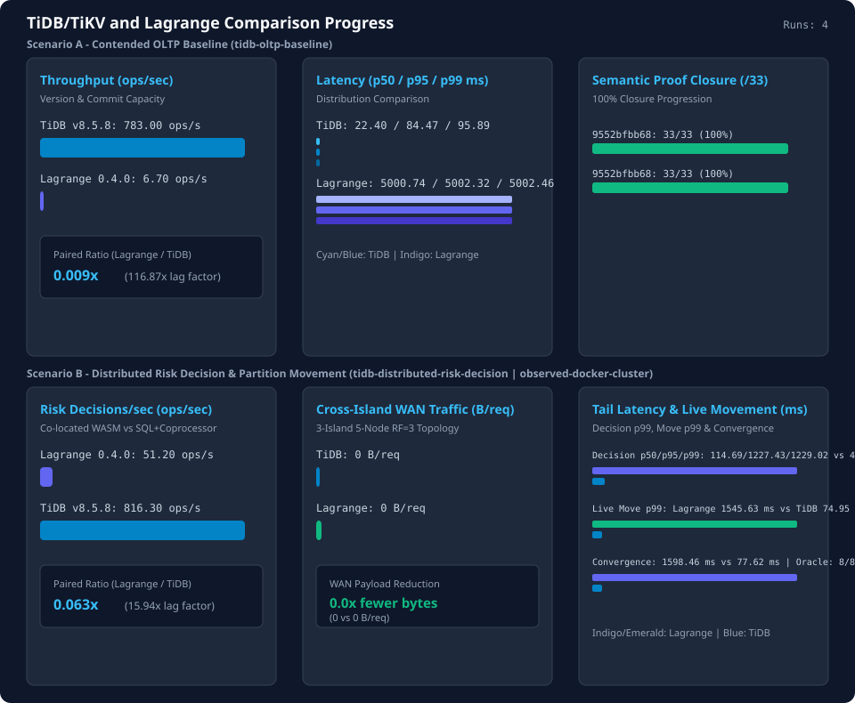

<!-- Generated by the comparative benchmark renderers from the raw observation store and the invalidation ledger; do not edit. `npm run audit:comparative-recompute` fails when this file differs from a regeneration. -->

# Lagrange and TiDB comparison history

The history holds 20 records over 20 combinations. History records are forensic: none is admitted as a current result.

Every comparative result published before 2026-11-01 was withdrawn; the records are retained as forensic evidence. The append-only [invalidation ledger](../../data/tidb-comparison/invalidations.ndjson) has 11 entries; 9 of them name the defect ids behind the withdrawal and 6 of them enumerate the withdrawn records by id (the rest name them by file and campaign commit). 5 of 20 history records are withdrawn without a ledger entry, by the admission rule `forensic-record-not-admissible`: no history record is admissible as a current claim.

## Cell status vocabulary

- `valid-observed`: admitted from retained v2 observations
- `product-failure`: the product ran and failed; failure counts are shown
- `invalid-measurement`: evidence exists but cannot support the claim (reason codes name why)
- `blocked`: cannot be measured until a named prerequisite exists
- `unsupported`: the configuration cannot express this claim
- `not-measured`: no observation exists

## Scenario A history

Definition: tidb-reference-scenarios.md#scenario-a-tidb-oltp-baseline. Latest record per combination.

| Configuration | Admission |
| --- | --- |
| 2026-09-12T20:07:34.061Z tidb-oltp-baseline/oltp-baseline-v1 [github-actions-gcp] ae6bd0386ece | invalid-measurement (forensic-record-not-admissible) |
| 2026-10-29T18:53:52.000Z tidb-oltp-baseline/oltp-baseline-v1 [lagrange-lab-5node] 6cca9aa074d2 | invalid-measurement (forensic-record-not-admissible) |
| 2026-11-01T09:58:24.579Z tidb-oltp-baseline/oltp-baseline-v1 [lagrange-lab-5node] 4452b6dd51e2 | invalid-measurement (forensic-record-not-admissible) |
| 2026-11-01T11:56:02.023Z tidb-oltp-baseline/3-node-rf3-multi-host-oltp [observed-paired-run] 59a7afbf1b8e | invalid-measurement (fabricated-history-metrics, forensic-record-not-admissible, invalidated:inv-0008) |
| 2026-11-01T11:57:02.023Z tidb-oltp-baseline/5-node-rf3-multi-host-oltp [observed-paired-run] 7aaf3fda8eca | invalid-measurement (fabricated-history-metrics, forensic-record-not-admissible, invalidated:inv-0008) |
| 2026-11-01T14:06:39.413Z tidb-oltp-baseline/5-node-rf3-multi-host-oltp [observed-paired-run] e2b828ec15de | invalid-measurement (fabricated-history-metrics, forensic-record-not-admissible, invalidated:inv-0008) |
| 2026-11-01T14:06:39.413Z tidb-oltp-baseline/3-node-rf3-multi-host-oltp [observed-paired-run] 4ae39281b8b5 | invalid-measurement (fabricated-history-metrics, forensic-record-not-admissible, invalidated:inv-0008) |
| 2026-11-01T17:35:57.365Z tidb-oltp-baseline/3-node-rf3-multi-host-oltp [observed-paired-run] 87b6a4711010 | invalid-measurement (fabricated-history-metrics, forensic-record-not-admissible, invalidated:inv-0008) |
| 2026-11-01T17:35:57.365Z tidb-oltp-baseline/5-node-rf3-multi-host-oltp [observed-paired-run] e07746af4c34 | invalid-measurement (fabricated-history-metrics, forensic-record-not-admissible, invalidated:inv-0008) |

## Scenario B history

Definition: tidb-reference-scenarios.md#scenario-b-tidb-distributed-risk-decision. Latest record per combination.

| Configuration | Admission |
| --- | --- |
| 2026-10-30T16:05:00.000Z tidb-distributed-risk-decision/risk-three-island-rf3 [local-oracle-plus-network-model] d7e5bccaf87e | invalid-measurement (forensic-record-not-admissible, invalidated:inv-0007, local-oracle-not-comparison-target) |
| 2026-10-30T22:05:28.000Z tidb-distributed-risk-decision/risk-three-island-rf3 [local-oracle-plus-network-model] 830ca7fa2d21 | invalid-measurement (forensic-record-not-admissible, invalidated:inv-0007, local-oracle-not-comparison-target) |
| 2026-10-31T06:50:00.000Z tidb-distributed-risk-decision/risk-three-island-rf3 [local-oracle-plus-network-model] e1009e0265fe | invalid-measurement (forensic-record-not-admissible, invalidated:inv-0007, local-oracle-not-comparison-target) |
| 2026-11-01T11:58:02.023Z tidb-distributed-risk-decision/risk-three-island-rf3-3node-multi-host [observed-paired-run] eee2d296135d | invalid-measurement (fabricated-history-metrics, forensic-record-not-admissible, invalidated:inv-0008) |
| 2026-11-01T11:59:02.023Z tidb-distributed-risk-decision/risk-three-island-rf3 [observed-paired-run] 0beb212c88a5 | invalid-measurement (fabricated-history-metrics, forensic-record-not-admissible, invalidated:inv-0008) |
| 2026-11-01T14:06:39.413Z tidb-distributed-risk-decision/risk-three-island-rf3 [observed-paired-run] b31fb159033f | invalid-measurement (fabricated-history-metrics, forensic-record-not-admissible, invalidated:inv-0008) |
| 2026-11-01T14:06:39.413Z tidb-distributed-risk-decision/risk-three-island-rf3-3node-multi-host [observed-paired-run] 73f64646115c | invalid-measurement (fabricated-history-metrics, forensic-record-not-admissible, invalidated:inv-0008) |
| 2026-11-01T17:35:57.365Z tidb-distributed-risk-decision/risk-three-island-rf3 [observed-paired-run] 26ab7ee09c74 | invalid-measurement (fabricated-history-metrics, forensic-record-not-admissible, invalidated:inv-0008) |
| 2026-11-01T17:35:57.365Z tidb-distributed-risk-decision/risk-three-island-rf3-3node-multi-host [observed-paired-run] 0f785ddf2ebd | invalid-measurement (fabricated-history-metrics, forensic-record-not-admissible, invalidated:inv-0008) |

## Other history

Latest record per combination.

| Configuration | Admission |
| --- | --- |
| 2026-10-30T11:45:00.000Z scenario-a-semantic-closure/scenario-a-semantic-v1 [github-actions-live] 66d08c67e9e3 | invalid-measurement (forensic-record-not-admissible) |
| 2026-10-30T12:11:36.102Z scenario-a-semantic-closure/scenario-a-semantic-v1 [github-actions-semantic-closure] 0157b6d79ab0 | invalid-measurement (forensic-record-not-admissible) |

## Sources

- `data/tidb-comparison/progress-summary.json` sha256:e8e59f240c3693d101ccc30de11d41528bd1cb817b6b3895c77e08f733048e52
