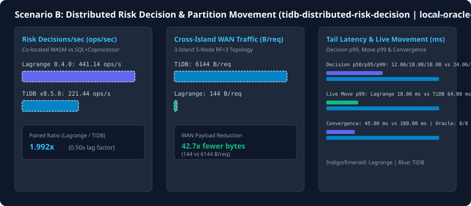

# TiDB/TiKV and Lagrange Comparison Progress

This page is generated deterministically from [`data/tidb-comparison/history.ndjson`](../../data/tidb-comparison/history.ndjson) and [`data/tidb-comparison/progress-summary.json`](../../data/tidb-comparison/progress-summary.json), persisting results for every combination of comparison framework version/commit, scenario profile, and both compared systems' versions and commit hashes.

- Static HTML dashboard: [`tidb-comparison-progress.html`](tidb-comparison-progress.html)
- Scenario specifications: [Scenario A (`tidb-oltp-baseline`)](tidb-reference-scenarios.md#scenario-a-tidb-oltp-baseline), [Scenario B (`tidb-distributed-risk-decision`)](tidb-reference-scenarios.md#scenario-b-tidb-distributed-risk-decision), [Paired Benchmark Owner](tidb-reference-paired-owner.md), and [Scenario A Semantic Evidence Gate (`scenario-a-semantic-closure`)](tidb-reference-semantic-gate.md#scenario-a-semantic-evidence-gate)

## Recorded version and commit combinations

| Recorded (UTC) | Framework Version & Commit | Scenario / Profile | Lagrange Version & Commit | TiDB/TiKV Version & Commit | Combination Digest |
| --- | --- | --- | --- | --- | --- |
| 2026-09-12T20:07:34.061Z | 0.2.0 (b0b2f9abcc) | [tidb-oltp-baseline](tidb-reference-scenarios.md#scenario-a-tidb-oltp-baseline) / oltp-baseline-v1 | n/a (unknown) | v8.5.8 (pingcap/ti) | a7953090e8e50102 |
| 2026-10-29T18:53:52.000Z | 0.3.0 (8039e45f2a) | [tidb-oltp-baseline](tidb-reference-scenarios.md#scenario-a-tidb-oltp-baseline) / oltp-baseline-v1 | 0.3.0 (8039e45f2a) | v8.5.8 (pingcap/ti) | bf82fab206b7901b |
| 2026-10-30T11:45:00.000Z | 0.3.0 (66d054c9c9) | [scenario-a-semantic-closure](tidb-reference-semantic-gate.md#scenario-a-semantic-evidence-gate) / scenario-a-semantic-v1 | n/a (unknown) | v8.5.8 (pingcap/ti) | b7bc651037235b53 |
| 2026-10-30T12:11:36.102Z | 0.3.0 (27af74dc7b) | [scenario-a-semantic-closure](tidb-reference-semantic-gate.md#scenario-a-semantic-evidence-gate) / scenario-a-semantic-v1 | n/a (unknown) | v8.5.8 (pingcap/ti) | d9bd6c6b6bbf07d5 |
| 2026-10-30T16:05:00.000Z | 0.3.0 (2d416de6e5) | [tidb-distributed-risk-decision](tidb-reference-scenarios.md#scenario-b-tidb-distributed-risk-decision) / risk-three-island-rf3 | 0.3.0 (2d416de6e5) | v8.5.8 (pingcap/ti) | 026e356c0f4566e3 |
| 2026-10-30T22:05:28.000Z | 0.3.3 (b41d4ccec4) | [tidb-distributed-risk-decision](tidb-reference-scenarios.md#scenario-b-tidb-distributed-risk-decision) / risk-three-island-rf3 | 0.3.3 (b41d4ccec4) | v8.5.8 (pingcap/ti) | ca6c388f5aa25a5c |
| 2026-10-31T06:50:00.000Z | 0.4.0 (7565d8c09a) | [tidb-distributed-risk-decision](tidb-reference-scenarios.md#scenario-b-tidb-distributed-risk-decision) / risk-three-island-rf3 | 0.4.0 (7565d8c09a) | v8.5.8 (pingcap/ti) | 22e27b67459af19b |

## Throughput, latency, and semantic proof progression

| Recorded (UTC) | Scenario | Lagrange ops/s (p50 / p95 / p99 ms) | TiDB/TiKV ops/s (p50 / p95 / p99 ms) | Throughput Ratio (Lagrange / TiDB) | Semantic Proofs (Lagrange / TiDB) |
| --- | --- | --- | --- | --- | --- |
| 2026-09-12T20:07:34.061Z | [tidb-oltp-baseline](tidb-reference-scenarios.md#scenario-a-tidb-oltp-baseline) | 0.00 (0.00 / 0.00 / 0.00) | 6.75 (535.12 / 1383.18 / 1887.96) | 0.00x (0.00x lag) | 0/33 vs 11/33 |
| 2026-10-29T18:53:52.000Z | [tidb-oltp-baseline](tidb-reference-scenarios.md#scenario-a-tidb-oltp-baseline) | 0.83 (2269.44 / 4418.93 / 5343.10) | 6.75 (535.12 / 1383.18 / 1887.96) | 0.122x (8.17x lag) | 4/33 vs 11/33 |
| 2026-10-30T11:45:00.000Z | [scenario-a-semantic-closure](tidb-reference-semantic-gate.md#scenario-a-semantic-evidence-gate) | 0.00 (0.00 / 0.00 / 0.00) | 6.75 (535.12 / 1383.18 / 1887.96) | 0.00x (0.00x lag) | 0/33 vs 16/33 |
| 2026-10-30T12:11:36.102Z | [scenario-a-semantic-closure](tidb-reference-semantic-gate.md#scenario-a-semantic-evidence-gate) | 0.00 (0.00 / 0.00 / 0.00) | 6.75 (535.12 / 1383.18 / 1887.96) | 0.00x (0.00x lag) | 0/33 vs 33/33 |
| 2026-10-30T16:05:00.000Z | [tidb-distributed-risk-decision](tidb-reference-scenarios.md#scenario-b-tidb-distributed-risk-decision) | 441.15 (12.06 / 18.09 / 18.09) | 221.44 (24.06 / 36.08 / 36.08) | 1.992x (0.50x lag) | 8/8 vs 8/8 |
| 2026-10-30T22:05:28.000Z | [tidb-distributed-risk-decision](tidb-reference-scenarios.md#scenario-b-tidb-distributed-risk-decision) | 440.59 (12.06 / 18.09 / 18.09) | 221.38 (24.06 / 36.08 / 36.08) | 1.990x (0.50x lag) | 8/8 vs 8/8 |
| 2026-10-31T06:50:00.000Z | [tidb-distributed-risk-decision](tidb-reference-scenarios.md#scenario-b-tidb-distributed-risk-decision) | 441.14 (12.06 / 18.08 / 18.08) | 221.44 (24.06 / 36.07 / 36.07) | 1.992x (0.50x lag) | 8/8 vs 8/8 |

## Progress deltas over time

| Recorded (UTC) | Framework Commit | Lagrange ops/s Delta (prev / first) | TiDB ops/s Delta (prev / first) | Ratio Delta (prev) | Lag Factor Delta (prev) | TiDB Proofs Delta (prev) |
| --- | --- | --- | --- | --- | --- | --- |
| 2026-09-12T20:07:34.061Z | b0b2f9abcc | 0.00 / 0.00 | 0.00 / 0.00 | 0.00 | 0.00 | 0.00 |
| 2026-10-29T18:53:52.000Z | 8039e45f2a | 0.00 / 0.00 | 0.00 / 0.00 | 0.00 | 0.00 | 0 |
| 2026-10-30T11:45:00.000Z | 66d054c9c9 | 0.00 / 0.00 | 0.00 / 0.00 | 0.00 | 0.00 | 0.00 |
| 2026-10-30T12:11:36.102Z | 27af74dc7b | 0.00 / 0.00 | 0.00 / 0.00 | 0.00 | 0.00 | +17 |
| 2026-10-30T16:05:00.000Z | 2d416de6e5 | 0.00 / 0.00 | 0.00 / 0.00 | 0.00 | 0.00 | 0.00 |
| 2026-10-30T22:05:28.000Z | b41d4ccec4 | -0.56 / -0.56 | -0.07 / -0.07 | -0.002 | +0.00 | 0 |
| 2026-10-31T06:50:00.000Z | 7565d8c09a | +0.55 / -0.01 | +0.07 / 0.00 | +0.002 | -0.00 | 0 |

## Scenario B distributed risk & movement scorecard ([tidb-distributed-risk-decision](tidb-reference-scenarios.md#scenario-b-tidb-distributed-risk-decision))

> **Provenance notice (`local-oracle-plus-network-model` | `contract-model-non-comparable`):** This series combines local JavaScript request-oracle execution with stage-delay and payload-multiplier formulas (`stages * oneWayMs` vs `stages * 2 * oneWayMs`, `stages * 96 B` vs `stages * 4096 B`) and is classified as a non-comparable modeled hypothesis rather than live cluster wire execution.

| Recorded (UTC) | Profile | Lagrange Cross-Island Bytes/Req | TiDB Cross-Island Bytes/Req | Lagrange Move p99 (ms) | TiDB Move p99 (ms) | Convergence (Lagrange vs TiDB ms) |
| --- | --- | --- | --- | --- | --- | --- |
| 2026-10-30T16:05:00.000Z | [risk-three-island-rf3](tidb-reference-scenarios.md#scenario-b-tidb-distributed-risk-decision) | 144 | 6144 | 18.00 | 64.00 | 45.00 vs 180.00 |
| 2026-10-30T22:05:28.000Z | [risk-three-island-rf3](tidb-reference-scenarios.md#scenario-b-tidb-distributed-risk-decision) | 144 | 6144 | 18.00 | 64.00 | 45.00 vs 180.00 |
| 2026-10-31T06:50:00.000Z | [risk-three-island-rf3](tidb-reference-scenarios.md#scenario-b-tidb-distributed-risk-decision) | 144 | 6144 | 18.00 | 64.00 | 45.00 vs 180.00 |
