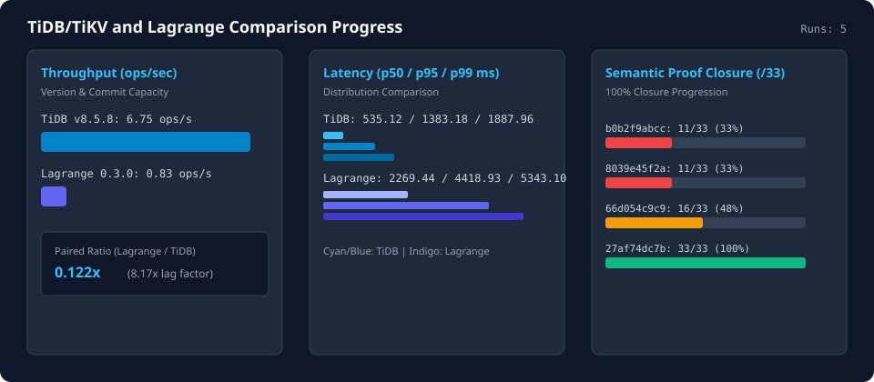

# TiDB/TiKV and Lagrange Comparison Progress

This page is generated deterministically from [`data/tidb-comparison/history.ndjson`](../../data/tidb-comparison/history.ndjson) and [`data/tidb-comparison/progress-summary.json`](../../data/tidb-comparison/progress-summary.json), persisting results for every combination of comparison framework version/commit, scenario profile, and both compared systems' versions and commit hashes.

- Static HTML dashboard: [`tidb-comparison-progress.html`](tidb-comparison-progress.html)
- Scenario specifications: [`tidb-reference-scenarios.md`](tidb-reference-scenarios.md), [`tidb-reference-paired-owner.md`](tidb-reference-paired-owner.md), and [`tidb-reference-semantic-gate.md`](tidb-reference-semantic-gate.md)

## Recorded version and commit combinations

| Recorded (UTC) | Framework Version & Commit | Scenario / Profile | Lagrange Version & Commit | TiDB/TiKV Version & Commit | Combination Digest |
| --- | --- | --- | --- | --- | --- |
| 2026-09-12T20:07:34.061Z | 0.2.0 (b0b2f9abcc) | tidb-oltp-baseline / oltp-baseline-v1 | n/a (unknown) | v8.5.8 (pingcap/ti) | a7953090e8e50102 |
| 2026-10-29T18:53:52.000Z | 0.3.0 (8039e45f2a) | tidb-oltp-baseline / oltp-baseline-v1 | 0.3.0 (8039e45f2a) | v8.5.8 (pingcap/ti) | bf82fab206b7901b |
| 2026-10-30T11:45:00.000Z | 0.3.0 (66d054c9c9) | scenario-a-semantic-closure / scenario-a-semantic-v1 | n/a (unknown) | v8.5.8 (pingcap/ti) | b7bc651037235b53 |
| 2026-10-30T12:11:36.102Z | 0.3.0 (27af74dc7b) | scenario-a-semantic-closure / scenario-a-semantic-v1 | n/a (unknown) | v8.5.8 (pingcap/ti) | d9bd6c6b6bbf07d5 |

## Throughput, latency, and semantic proof progression

| Recorded (UTC) | Scenario | Lagrange ops/s (p50 / p95 / p99 ms) | TiDB/TiKV ops/s (p50 / p95 / p99 ms) | Throughput Ratio (Lagrange / TiDB) | Semantic Proofs (Lagrange / TiDB) |
| --- | --- | --- | --- | --- | --- |
| 2026-09-12T20:07:34.061Z | tidb-oltp-baseline | 0.00 (0.00 / 0.00 / 0.00) | 6.75 (535.12 / 1383.18 / 1887.96) | 0.00x (0.00x lag) | 0/33 vs 11/33 |
| 2026-10-29T18:53:52.000Z | tidb-oltp-baseline | 0.83 (2269.44 / 4418.93 / 5343.10) | 6.75 (535.12 / 1383.18 / 1887.96) | 0.122x (8.17x lag) | 4/33 vs 11/33 |
| 2026-10-30T11:45:00.000Z | scenario-a-semantic-closure | 0.00 (0.00 / 0.00 / 0.00) | 6.75 (535.12 / 1383.18 / 1887.96) | 0.00x (0.00x lag) | 0/33 vs 16/33 |
| 2026-10-30T12:11:36.102Z | scenario-a-semantic-closure | 0.00 (0.00 / 0.00 / 0.00) | 6.75 (535.12 / 1383.18 / 1887.96) | 0.00x (0.00x lag) | 0/33 vs 33/33 |

## Progress deltas over time

| Recorded (UTC) | Framework Commit | Lagrange ops/s Delta (prev / first) | TiDB ops/s Delta (prev / first) | Ratio Delta (prev) | Lag Factor Delta (prev) | TiDB Proofs Delta (prev) |
| --- | --- | --- | --- | --- | --- | --- |
| 2026-09-12T20:07:34.061Z | b0b2f9abcc | 0.00 / 0.00 | 0.00 / 0.00 | 0.00 | 0.00 | 0.00 |
| 2026-10-29T18:53:52.000Z | 8039e45f2a | 0.00 / 0.00 | 0.00 / 0.00 | 0.00 | 0.00 | 0 |
| 2026-10-30T11:45:00.000Z | 66d054c9c9 | 0.00 / 0.00 | 0.00 / 0.00 | 0.00 | 0.00 | 0.00 |
| 2026-10-30T12:11:36.102Z | 27af74dc7b | 0.00 / 0.00 | 0.00 / 0.00 | 0.00 | 0.00 | +17 |
