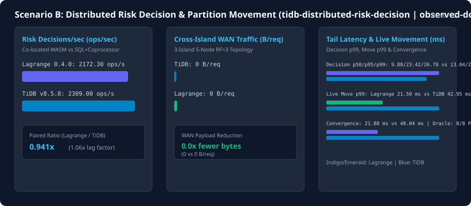

# TiDB/TiKV and Lagrange Comparison Progress

This page is generated deterministically from [`data/tidb-comparison/history.ndjson`](../../data/tidb-comparison/history.ndjson) and [`data/tidb-comparison/progress-summary.json`](../../data/tidb-comparison/progress-summary.json), persisting results for every combination of comparison framework version/commit, scenario profile, and both compared systems' versions and commit hashes.

- Static HTML dashboard: [`tidb-comparison-progress.html`](tidb-comparison-progress.html)
- Scenario specifications: [Scenario A (`tidb-oltp-baseline`)](tidb-reference-scenarios.md#scenario-a-tidb-oltp-baseline), [Scenario B (`tidb-distributed-risk-decision`)](tidb-reference-scenarios.md#scenario-b-tidb-distributed-risk-decision), [Paired Benchmark Owner](tidb-reference-paired-owner.md), and [Scenario A Semantic Evidence Gate (`scenario-a-semantic-closure`)](tidb-reference-semantic-gate.md#scenario-a-semantic-evidence-gate)

## Recorded version and commit combinations

| Recorded (UTC) | Framework Version & Commit | Scenario / Profile | Lagrange Version & Commit | TiDB/TiKV Version & Commit | Combination Digest |
| --- | --- | --- | --- | --- | --- |
| 2026-11-01T11:56:02.023Z | 0.4.0 (07206ba1c8) | [tidb-oltp-baseline](tidb-reference-scenarios.md#scenario-a-tidb-oltp-baseline) / 3-node-rf3-multi-host-oltp | 0.4.0 (07206ba1c8) | v8.5.8 (pingcap/ti) | 46ecf4c9d5764b77 |
| 2026-11-01T11:57:02.023Z | 0.4.0 (07206ba1c8) | [tidb-oltp-baseline](tidb-reference-scenarios.md#scenario-a-tidb-oltp-baseline) / 5-node-rf3-multi-host-oltp | 0.4.0 (07206ba1c8) | v8.5.8 (pingcap/ti) | 2ff656ca742304c9 |
| 2026-11-01T11:58:02.023Z | 0.4.0 (07206ba1c8) | [tidb-distributed-risk-decision](tidb-reference-scenarios.md#scenario-b-tidb-distributed-risk-decision) / risk-three-island-rf3-3node-multi-host | 0.4.0 (07206ba1c8) | v8.5.8 (pingcap/ti) | 72520bccbdcbbd0b |
| 2026-11-01T11:59:02.023Z | 0.4.0 (07206ba1c8) | [tidb-distributed-risk-decision](tidb-reference-scenarios.md#scenario-b-tidb-distributed-risk-decision) / risk-three-island-rf3 | 0.4.0 (07206ba1c8) | v8.5.8 (pingcap/ti) | 8850297a56d95568 |

## Throughput, latency, and semantic proof progression

| Recorded (UTC) | Scenario | Lagrange ops/s (p50 / p95 / p99 ms) | TiDB/TiKV ops/s (p50 / p95 / p99 ms) | Throughput Ratio (Lagrange / TiDB) | Semantic Proofs (Lagrange / TiDB) |
| --- | --- | --- | --- | --- | --- |
| 2026-11-01T11:56:02.023Z | [tidb-oltp-baseline](tidb-reference-scenarios.md#scenario-a-tidb-oltp-baseline) | 382.90 (51.94 / 90.84 / 120.29) | 104.20 (75.37 / 299.00 / 327.16) | 3.675x (0.27x lag) | 33/33 vs 33/33 |
| 2026-11-01T11:57:02.023Z | [tidb-oltp-baseline](tidb-reference-scenarios.md#scenario-a-tidb-oltp-baseline) | 146.80 (43.40 / 403.93 / 559.47) | 104.20 (75.37 / 299.00 / 327.16) | 1.409x (0.71x lag) | 33/33 vs 33/33 |
| 2026-11-01T11:58:02.023Z | [tidb-distributed-risk-decision](tidb-reference-scenarios.md#scenario-b-tidb-distributed-risk-decision) | 391.90 (54.31 / 80.56 / 100.36) | 247.10 (67.59 / 111.85 / 134.01) | 1.586x (0.63x lag) | 8/8 vs 8/8 |
| 2026-11-01T11:59:02.023Z | [tidb-distributed-risk-decision](tidb-reference-scenarios.md#scenario-b-tidb-distributed-risk-decision) | 538.70 (44.97 / 114.27 / 127.96) | 247.10 (67.59 / 111.85 / 134.01) | 2.180x (0.46x lag) | 8/8 vs 8/8 |

## Progress deltas over time

| Recorded (UTC) | Framework Commit | Lagrange ops/s Delta (prev / first) | TiDB ops/s Delta (prev / first) | Ratio Delta (prev) | Lag Factor Delta (prev) | TiDB Proofs Delta (prev) |
| --- | --- | --- | --- | --- | --- | --- |
| 2026-11-01T11:56:02.023Z | 07206ba1c8 | 0.00 / 0.00 | 0.00 / 0.00 | 0.00 | 0.00 | 0.00 |
| 2026-11-01T11:57:02.023Z | 07206ba1c8 | -236.10 / -236.10 | 0.00 / 0.00 | -2.266 | +0.44 | 0 |
| 2026-11-01T11:58:02.023Z | 07206ba1c8 | 0.00 / 0.00 | 0.00 / 0.00 | 0.00 | 0.00 | 0.00 |
| 2026-11-01T11:59:02.023Z | 07206ba1c8 | +146.80 / +146.80 | 0.00 / 0.00 | +0.594 | -0.17 | 0 |

## Scenario B distributed risk & movement scorecard ([tidb-distributed-risk-decision](tidb-reference-scenarios.md#scenario-b-tidb-distributed-risk-decision))

> **Provenance notice (`observed-docker-cluster` | `live-cluster-wire`):** This series records live multi-machine cluster wire execution where each database replica, coordinator, and client runs on a separate physical host and all inter-component traffic traverses the physical network interface.

| Recorded (UTC) | Profile | Lagrange Cross-Island Bytes/Req | TiDB Cross-Island Bytes/Req | Lagrange Move p99 (ms) | TiDB Move p99 (ms) | Convergence (Lagrange vs TiDB ms) |
| --- | --- | --- | --- | --- | --- | --- |
| 2026-11-01T11:58:02.023Z | [risk-three-island-rf3-3node-multi-host](tidb-reference-scenarios.md#scenario-b-tidb-distributed-risk-decision) | 3348 | 17603 | 166.32 | 180.95 | 164.87 vs 164.28 |
| 2026-11-01T11:59:02.023Z | [risk-three-island-rf3](tidb-reference-scenarios.md#scenario-b-tidb-distributed-risk-decision) | 8348 | 17603 | 166.32 | 180.95 | 164.87 vs 164.28 |
