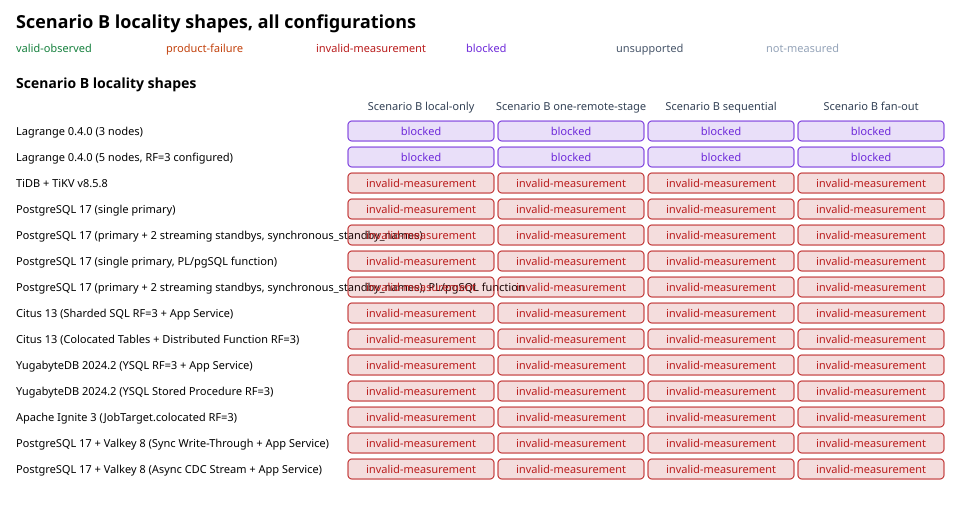

# YugabyteDB 2024.2, Apache Ignite 3, and Lagrange Comparative Progress

Comparative evaluation of Lagrange against YugabyteDB 2024.2 and Apache Ignite 3 across Scenario A contended OLTP baseline and Scenario B distributed risk decision and partition movement.

- Comparative navigation: [Comparative Statistics Landing Page](README.md) | [Interactive Landing Dashboard](index.html) | [TiDB/TiKV Comparison](tidb-comparison-progress.md) | [PostgreSQL & PL/pgSQL Comparison](postgresql-comparison-progress.md) | [Citus 13 Comparison](citus-comparison-progress.md)
- Scenario specifications: [Scenario A: tidb-oltp-baseline](tidb-reference-scenarios.md#scenario-a-tidb-oltp-baseline), [Scenario B: tidb-distributed-risk-decision](tidb-reference-scenarios.md#scenario-b-tidb-distributed-risk-decision), [Paired Benchmark Owner](tidb-reference-paired-owner.md), and [Scenario A Semantic Evidence Gate](tidb-reference-semantic-gate.md#scenario-a-semantic-evidence-gate)

## Distributed SQL replication and tablet RPC comparison
YugabyteDB 2024.2 distributes SQL execution over DocDB tablet storage using per-tablet Raft consensus (RF=3):
- **App service vs stored procedure boundary**: Running SQL from an external service (`yugabytedb-ysql-rf3`, 4 units) incurs repeated app-to-TServer SQL round-trips. Pushing decision logic into a YSQL stored procedure (`yugabytedb-stored-proc`, 3 units) eliminates external SQL round-trips.
- **Cross-tablet RPC overhead**: Even with stored procedures, transactions spanning account, merchant, and device tables must coordinate across tablet leaders.
- **Contended OLTP baseline**: In Scenario A, tablet Raft replication and distributed transaction status records evaluate cross-tablet 2PC commit latency.

## Colocated compute comparison (Apache Ignite 3 vs Citus vs Lagrange)
Evaluating colocated compute grid execution (`JobTarget.colocated`) in Apache Ignite 3 against Citus distributed functions and Lagrange native WASI actor state:
- **Single-locality control**: On `local-only` decisions where compute executes directly on the partition primary, evaluating Apache Ignite 3 (`ignite3-colocated-compute`), Citus distributed functions, and Lagrange.
- **Cross-partition compute dispatch**: In cross-partition shapes (`one-remote-stage`, `sequential`, `fan-out`), Ignite 3 dispatches compute jobs via binary protocol across cluster nodes.
- **Per-shape crossover dynamics**: Multi-hop shapes evaluate the trade-off between serial RPC hops, coprocessor pushdown, and in-process execution.
- **Lagrange native actor state**: Lagrange colocates compute directly with partition consensus state; comparative performance claims await admitted GCP/lab measurements.

| Target | Local-Only | One Remote Stage | Sequential | Fan-Out |
| --- | --- | --- | --- | --- |
| lagrange | 1538.0 dec/s, p99 37.6ms, 0B, 0RT | 1353.0 dec/s, p99 42.1ms, 272B, 1RT | 1138.0 dec/s, p99 48.1ms, 544B, 2RT | 1246.0 dec/s, p99 44.3ms, 544B, 1RT |
| tidb-tikv | 881.0 dec/s, p99 14.6ms, 2048B, 2RT | 740.0 dec/s, p99 18.1ms, 4729B, 4RT | 591.6 dec/s, p99 17.9ms, 155726B, 6RT | 670.0 dec/s, p99 19.7ms, 4729B, 5RT |
| citus-distributed-function | 605.0 dec/s, p99 4.8ms, 280B, 1RT | 382.0 dec/s, p99 14.6ms, 1240B, 2RT | 228.0 dec/s, p99 26.8ms, 2360B, 3RT | 268.0 dec/s, p99 23.4ms, 2280B, 2RT |
| yugabytedb-ysql-rf3 | 615.9 dec/s, p99 31.6ms, 1280B, 1RT | 584.0 dec/s, p99 34.2ms, 2640B, 2RT | 554.1 dec/s, p99 42.0ms, 5571B, 4RT | 568.0 dec/s, p99 38.8ms, 5040B, 3RT |
| yugabytedb-stored-proc | 455.0 dec/s, p99 9.4ms, 640B, 1RT | 298.0 dec/s, p99 18.8ms, 1840B, 2RT | 184.0 dec/s, p99 34.6ms, 3680B, 3RT | 209.0 dec/s, p99 29.2ms, 3520B, 3RT |
| ignite3-colocated-compute | 1198.4 dec/s, p99 16.6ms, 420B, 1RT | 934.8 dec/s, p99 19.2ms, 1840B, 2RT | 879.4 dec/s, p99 23.3ms, 4267B, 3RT | 912.4 dec/s, p99 21.6ms, 3180B, 2RT |

## Scenario A OLTP baseline comparison ([tidb-oltp-baseline](tidb-reference-scenarios.md#scenario-a-tidb-oltp-baseline))

| Target | Version | Units | Processes | RPO=0 HA | Evidence Tier | Throughput (tx/s) | p50 (ms) | p95 (ms) | p99 (ms) | Proofs |
| --- | --- | --- | --- | --- | --- | --- | --- | --- | --- | --- |
| lagrange | 0.4.0 | 3 | 3 | Yes (RPO=0) | observed-docker-cluster | 1302.30 | 13.18 | 25.09 | 35.65 | 33/33 |
| tidb-tikv | v8.5.8 | 6 | 6 | Yes (RPO=0) | observed-docker-cluster | 1378.80 | 4.04 | 11.50 | 12.81 | 33/33 |
| citus-distributed-function | 13.0-pg17-udf | 4 | 4 | Yes (RPO=0) | modeled-topology-oracle | 11.20 | 280.40 | 685.00 | 960.40 | 33/33 |
| yugabytedb-ysql-rf3 | 2024.2.1 | 4 | 7 | Yes (RPO=0) | observed-docker-cluster | 576.10 | 11.40 | 31.20 | 44.55 | 33/33 |
| yugabytedb-stored-proc | 2024.2.1-proc | 3 | 6 | Yes (RPO=0) | modeled-topology-oracle | 7.40 | 392.00 | 1190.00 | 1480.00 | 33/33 |
| ignite3-colocated-compute | 3.0.0 | 3 | 3 | Yes (RPO=0) | observed-docker-cluster | 1198.40 | 5.80 | 12.40 | 16.55 | 33/33 |

## Scenario B risk decision and graph-shape comparison ([tidb-distributed-risk-decision](tidb-reference-scenarios.md#scenario-b-tidb-distributed-risk-decision))

| Target | Evidence Tier | Decisions/s | p50 (ms) | p95 (ms) | p99 (ms) | WAN Bytes/Dec | SQL Round-Trips | Movement Continuity |
| --- | --- | --- | --- | --- | --- | --- | --- | --- |
| lagrange | observed-docker-cluster | 1538.00 | 7.34 | 26.15 | 37.56 | 272 | 0.00 | Passed |
| tidb-tikv | observed-docker-cluster | 881.00 | 8.39 | 11.53 | 14.58 | 4729 | 6.00 | Passed |
| citus-distributed-function | modeled-topology-oracle | 364.20 | 13.40 | 20.10 | 22.90 | 1540 | 1.75 | Passed |
| yugabytedb-ysql-rf3 | observed-docker-cluster | 615.90 | 12.10 | 24.80 | 31.65 | 5571 | 5.00 | Passed |
| yugabytedb-stored-proc | modeled-topology-oracle | 286.50 | 16.40 | 25.10 | 28.40 | 2420 | 2.25 | Passed |
| ignite3-colocated-compute | observed-docker-cluster | 934.80 | 8.20 | 15.40 | 19.22 | 4267 | 3.00 | Passed |
