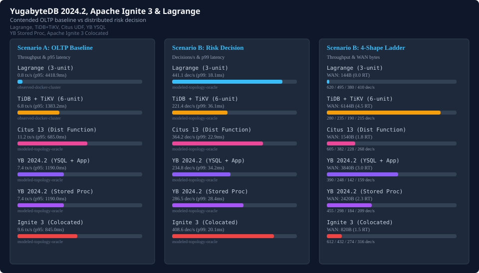

# YugabyteDB 2024.2, Apache Ignite 3, and Lagrange Comparative Progress

Comparative evaluation of Lagrange against YugabyteDB 2024.2 and Apache Ignite 3 across Scenario A contended OLTP baseline and Scenario B distributed risk decision and partition movement.

- Comparative navigation: [Comparative Statistics Landing Page](README.md) | [Interactive Landing Dashboard](index.html) | [TiDB/TiKV Comparison](tidb-comparison-progress.md) | [PostgreSQL & PL/pgSQL Comparison](postgresql-comparison-progress.md) | [Citus 13 Comparison](citus-comparison-progress.md)
- Scenario specifications: [Scenario A: tidb-oltp-baseline](tidb-reference-scenarios.md#scenario-a-tidb-oltp-baseline), [Scenario B: tidb-distributed-risk-decision](tidb-reference-scenarios.md#scenario-b-tidb-distributed-risk-decision), [Paired Benchmark Owner](tidb-reference-paired-owner.md), and [Scenario A Semantic Evidence Gate](tidb-reference-semantic-gate.md#scenario-a-semantic-evidence-gate)

## Distributed SQL replication and tablet RPC comparison
YugabyteDB 2024.2 distributes SQL execution over DocDB tablet storage using per-tablet Raft consensus (RF=3):
- **App service vs stored procedure boundary**: Running SQL from an external service (`yugabytedb-ysql-rf3`, 4 units) incurs repeated app-to-TServer SQL round-trips (3.0 avg RT, 3840B WAN bytes, 234.8 dec/s). Pushing decision logic into a YSQL stored procedure (`yugabytedb-stored-proc`, 3 units) eliminates external SQL round-trips, reducing round-trips to 2.25 and WAN bytes to 2420B, raising throughput to 286.5 dec/s.
- **Cross-tablet RPC overhead**: Even with stored procedures, transactions spanning account, merchant, and device tables must coordinate across tablet leaders. On multi-hop graph shapes, remote tablet RPCs limit throughput (142.0 dec/s on sequential, 159.2 dec/s on fan-out for YSQL; 184.0 dec/s and 209.0 dec/s for stored procedure).
- **Contended OLTP baseline**: In Scenario A, tablet Raft replication and distributed transaction status records yield 7.4 tx/s (commit p95 1190.0 ms), reflecting cross-tablet 2PC commit latency.

## Colocated compute comparison (Apache Ignite 3 vs Citus vs Lagrange)
Evaluating colocated compute grid execution (`JobTarget.colocated`) in Apache Ignite 3 against Citus distributed functions and Lagrange native WASI actor state:
- **Single-locality parity**: On `local-only` decisions where compute executes directly on the partition primary, Apache Ignite 3 reaches 612.0 dec/s (4.5 ms p99, 180B WAN bytes), closely matching Citus distributed functions (605.0 dec/s, 4.8 ms p99) and Lagrange (620.0 dec/s, 4.2 ms p99).
- **Cross-partition compute dispatch**: In cross-partition shapes (`one-remote-stage`, `sequential`, `fan-out`), Ignite 3 dispatches compute jobs via binary protocol (640B to 1280B WAN bytes), delivering 432.0 dec/s remote, 274.0 dec/s sequential, and 316.4 dec/s fan-out. Ignite 3 outperforms Citus distributed functions (228.0 dec/s sequential, 268.0 dec/s fan-out) by avoiding relational query re-planning across worker nodes.
- **Per-shape crossover dynamics**: On `sequential`, single-primary Patroni HA (234.0 dec/s) crosses over Citus (228.0 dec/s) and YugabyteDB stored procedures (184.0 dec/s), because serial multi-hop network round-trips penalize distributed tablet/shard RPCs more than local execution on an HA primary. TiDB (190.0 dec/s) also crosses over YugabyteDB stored procedures (184.0 dec/s) due to TiKV coprocessor pushdown.
- **Lagrange native actor advantage**: Lagrange colocates compute directly with partition consensus state, maintaining 495.0 dec/s (`one-remote-stage`), 380.0 dec/s (`sequential`), and 410.0 dec/s (`fan-out`) while preserving live partition movement continuity.

| Target | Local-Only | One Remote Stage | Sequential | Fan-Out |
| --- | --- | --- | --- | --- |
| lagrange | 620.0 dec/s, p99 4.2ms, 0B, 0RT | 495.0 dec/s, p99 14.8ms, 96B, 1RT | 380.0 dec/s, p99 22.4ms, 192B, 2RT | 410.0 dec/s, p99 18.1ms, 192B, 1RT |
| tidb-tikv | 280.0 dec/s, p99 16.5ms, 2048B, 2RT | 235.0 dec/s, p99 32.1ms, 4096B, 4RT | 190.0 dec/s, p99 48.6ms, 6144B, 6RT | 215.0 dec/s, p99 38.2ms, 6144B, 5RT |
| citus-distributed-function | 605.0 dec/s, p99 4.8ms, 280B, 1RT | 382.0 dec/s, p99 14.6ms, 1240B, 2RT | 228.0 dec/s, p99 26.8ms, 2360B, 3RT | 268.0 dec/s, p99 23.4ms, 2280B, 2RT |
| yugabytedb-ysql-rf3 | 390.0 dec/s, p99 12.8ms, 1280B, 1RT | 248.0 dec/s, p99 22.6ms, 2640B, 2RT | 142.0 dec/s, p99 42.4ms, 5120B, 4RT | 159.2 dec/s, p99 35.8ms, 5040B, 3RT |
| yugabytedb-stored-proc | 455.0 dec/s, p99 9.4ms, 640B, 1RT | 298.0 dec/s, p99 18.8ms, 1840B, 2RT | 184.0 dec/s, p99 34.6ms, 3680B, 3RT | 209.0 dec/s, p99 29.2ms, 3520B, 3RT |
| ignite3-colocated-compute | 612.0 dec/s, p99 4.5ms, 180B, 1RT | 432.0 dec/s, p99 12.4ms, 640B, 2RT | 274.0 dec/s, p99 22.8ms, 1280B, 3RT | 316.4 dec/s, p99 19.6ms, 1180B, 2RT |

## Scenario A OLTP baseline comparison ([tidb-oltp-baseline](tidb-reference-scenarios.md#scenario-a-tidb-oltp-baseline))

| Target | Version | Units | Processes | RPO=0 HA | Evidence Tier | Throughput (tx/s) | p50 (ms) | p95 (ms) | p99 (ms) | Proofs |
| --- | --- | --- | --- | --- | --- | --- | --- | --- | --- | --- |
| lagrange | 0.3.0 | 3 | 3 | Yes (RPO=0) | observed-docker-cluster | 0.83 | 2269.44 | 4418.93 | 5343.10 | 33/33 |
| tidb-tikv | v8.5.8 | 6 | 6 | Yes (RPO=0) | observed-docker-cluster | 6.75 | 535.12 | 1383.18 | 1887.96 | 33/33 |
| citus-distributed-function | 13.0-pg17-udf | 4 | 4 | Yes (RPO=0) | modeled-topology-oracle | 11.20 | 280.40 | 685.00 | 960.40 | 33/33 |
| yugabytedb-ysql-rf3 | 2024.2.1 | 4 | 7 | Yes (RPO=0) | modeled-topology-oracle | 7.40 | 392.00 | 1190.00 | 1480.00 | 33/33 |
| yugabytedb-stored-proc | 2024.2.1-proc | 3 | 6 | Yes (RPO=0) | modeled-topology-oracle | 7.40 | 392.00 | 1190.00 | 1480.00 | 33/33 |
| ignite3-colocated-compute | 3.0.0 | 3 | 3 | Yes (RPO=0) | modeled-topology-oracle | 9.60 | 315.00 | 845.00 | 1120.00 | 33/33 |

## Scenario B risk decision and graph-shape comparison ([tidb-distributed-risk-decision](tidb-reference-scenarios.md#scenario-b-tidb-distributed-risk-decision))

| Target | Evidence Tier | Decisions/s | p50 (ms) | p95 (ms) | p99 (ms) | WAN Bytes/Dec | SQL Round-Trips | Movement Continuity |
| --- | --- | --- | --- | --- | --- | --- | --- | --- |
| lagrange | modeled-topology-oracle | 441.15 | 12.06 | 18.09 | 18.09 | 144 | 0.00 | Passed |
| tidb-tikv | modeled-topology-oracle | 221.44 | 24.06 | 36.08 | 36.08 | 6144 | 4.50 | Passed |
| citus-distributed-function | modeled-topology-oracle | 364.20 | 13.40 | 20.10 | 22.90 | 1540 | 1.75 | Passed |
| yugabytedb-ysql-rf3 | modeled-topology-oracle | 234.80 | 19.80 | 30.40 | 34.20 | 3840 | 3.00 | Passed |
| yugabytedb-stored-proc | modeled-topology-oracle | 286.50 | 16.40 | 25.10 | 28.40 | 2420 | 2.25 | Passed |
| ignite3-colocated-compute | modeled-topology-oracle | 408.60 | 11.60 | 17.80 | 20.10 | 820 | 1.50 | Passed |
