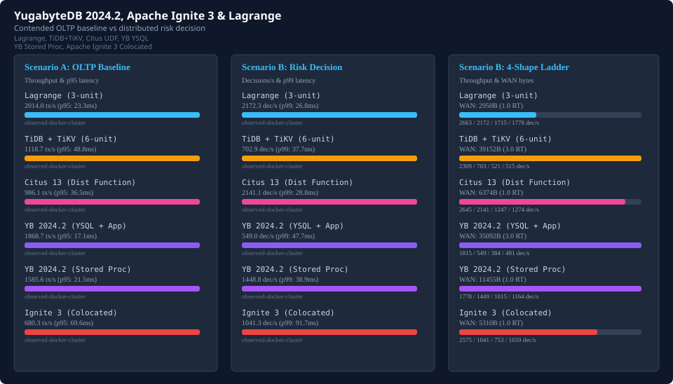

<!-- Generated by the comparative benchmark renderers from the raw observation store and the invalidation ledger; do not edit. `npm run audit:comparative-recompute` fails when this file differs from a regeneration. -->

# YugabyteDB and Apache Ignite comparison

Advertised YugabyteDB and Ignite configurations. No YugabyteDB or Ignite deployment has been executed by the comparative benchmark runner.

Every comparative result published before 2026-11-01 was withdrawn; the records are retained as forensic evidence. The append-only [invalidation ledger](../../data/tidb-comparison/invalidations.ndjson) has 11 entries; 9 of them name the defect ids behind the withdrawal and 6 of them enumerate the withdrawn records by id (the rest name them by file and campaign commit). 5 of 20 history records are withdrawn without a ledger entry, by the admission rule `forensic-record-not-admissible`: no history record is admissible as a current claim.

## Cell status vocabulary

- `valid-observed`: admitted from retained v2 observations
- `product-failure`: the product ran and failed; failure counts are shown
- `invalid-measurement`: evidence exists but cannot support the claim (reason codes name why)
- `blocked`: cannot be measured until a named prerequisite exists
- `unsupported`: the configuration cannot express this claim
- `not-measured`: no observation exists

## Scenario A

YugabyteDB YSQL with client-side SQL or a stored procedure; Ignite 3 colocated compute.

| Configuration | Scenario A |
| --- | --- |
| YugabyteDB 2024.2 (YSQL RF=3 + App Service) | invalid-measurement (closed-loop-throughput, constant-phase-or-byte, emulated-product, forensic-record-not-admissible, invalidated:inv-0006, label-hash-identity, non-canonical-workload) |
| YugabyteDB 2024.2 (YSQL Stored Procedure RF=3) | invalid-measurement (closed-loop-throughput, constant-phase-or-byte, emulated-product, forensic-record-not-admissible, invalidated:inv-0006, label-hash-identity, non-canonical-workload) |
| Apache Ignite 3 (JobTarget.colocated RF=3) | invalid-measurement (closed-loop-throughput, constant-phase-or-byte, emulated-product, forensic-record-not-admissible, invalidated:inv-0006, label-hash-identity, non-canonical-workload) |

## Scenario B locality shapes

YugabyteDB YSQL with client-side SQL or a stored procedure; Ignite 3 colocated compute.

| Configuration | Scenario B local-only | Scenario B one-remote-stage | Scenario B sequential | Scenario B fan-out |
| --- | --- | --- | --- | --- |
| YugabyteDB 2024.2 (YSQL RF=3 + App Service) | invalid-measurement (closed-loop-throughput, constant-phase-or-byte, emulated-product, forensic-record-not-admissible, invalidated:inv-0006, label-hash-identity, non-canonical-workload) | invalid-measurement (closed-loop-throughput, constant-phase-or-byte, emulated-product, forensic-record-not-admissible, invalidated:inv-0006, label-hash-identity, non-canonical-workload) | invalid-measurement (closed-loop-throughput, constant-phase-or-byte, emulated-product, forensic-record-not-admissible, invalidated:inv-0006, label-hash-identity, non-canonical-workload) | invalid-measurement (closed-loop-throughput, constant-phase-or-byte, emulated-product, forensic-record-not-admissible, invalidated:inv-0006, label-hash-identity, non-canonical-workload) |
| YugabyteDB 2024.2 (YSQL Stored Procedure RF=3) | invalid-measurement (closed-loop-throughput, constant-phase-or-byte, emulated-product, forensic-record-not-admissible, invalidated:inv-0006, label-hash-identity, non-canonical-workload) | invalid-measurement (closed-loop-throughput, constant-phase-or-byte, emulated-product, forensic-record-not-admissible, invalidated:inv-0006, label-hash-identity, non-canonical-workload) | invalid-measurement (closed-loop-throughput, constant-phase-or-byte, emulated-product, forensic-record-not-admissible, invalidated:inv-0006, label-hash-identity, non-canonical-workload) | invalid-measurement (closed-loop-throughput, constant-phase-or-byte, emulated-product, forensic-record-not-admissible, invalidated:inv-0006, label-hash-identity, non-canonical-workload) |
| Apache Ignite 3 (JobTarget.colocated RF=3) | invalid-measurement (closed-loop-throughput, constant-phase-or-byte, emulated-product, forensic-record-not-admissible, invalidated:inv-0006, label-hash-identity, non-canonical-workload) | invalid-measurement (closed-loop-throughput, constant-phase-or-byte, emulated-product, forensic-record-not-admissible, invalidated:inv-0006, label-hash-identity, non-canonical-workload) | invalid-measurement (closed-loop-throughput, constant-phase-or-byte, emulated-product, forensic-record-not-admissible, invalidated:inv-0006, label-hash-identity, non-canonical-workload) | invalid-measurement (closed-loop-throughput, constant-phase-or-byte, emulated-product, forensic-record-not-admissible, invalidated:inv-0006, label-hash-identity, non-canonical-workload) |

## Scenario C

YugabyteDB YSQL with client-side SQL or a stored procedure; Ignite 3 colocated compute.

| Configuration | Scenario C 0 ms | Scenario C 100 ms | Scenario C 1000 ms | Rule backfill | Restart recovery |
| --- | --- | --- | --- | --- | --- |
| YugabyteDB 2024.2 (YSQL RF=3 + App Service) | invalid-measurement (closed-loop-throughput, constant-phase-or-byte, emulated-product, forensic-record-not-admissible, invalidated:inv-0006, label-hash-identity, non-canonical-workload) | invalid-measurement (closed-loop-throughput, constant-phase-or-byte, emulated-product, forensic-record-not-admissible, invalidated:inv-0006, label-hash-identity, non-canonical-workload) | invalid-measurement (closed-loop-throughput, constant-phase-or-byte, emulated-product, forensic-record-not-admissible, invalidated:inv-0006, label-hash-identity, non-canonical-workload) | invalid-measurement (closed-loop-throughput, constant-phase-or-byte, emulated-product, forensic-record-not-admissible, invalidated:inv-0006, label-hash-identity, non-canonical-workload) | invalid-measurement (closed-loop-throughput, constant-phase-or-byte, emulated-product, forensic-record-not-admissible, invalidated:inv-0006, label-hash-identity, non-canonical-workload) |
| YugabyteDB 2024.2 (YSQL Stored Procedure RF=3) | invalid-measurement (closed-loop-throughput, constant-phase-or-byte, emulated-product, forensic-record-not-admissible, invalidated:inv-0006, label-hash-identity, non-canonical-workload) | invalid-measurement (closed-loop-throughput, constant-phase-or-byte, emulated-product, forensic-record-not-admissible, invalidated:inv-0006, label-hash-identity, non-canonical-workload) | invalid-measurement (closed-loop-throughput, constant-phase-or-byte, emulated-product, forensic-record-not-admissible, invalidated:inv-0006, label-hash-identity, non-canonical-workload) | invalid-measurement (closed-loop-throughput, constant-phase-or-byte, emulated-product, forensic-record-not-admissible, invalidated:inv-0006, label-hash-identity, non-canonical-workload) | invalid-measurement (closed-loop-throughput, constant-phase-or-byte, emulated-product, forensic-record-not-admissible, invalidated:inv-0006, label-hash-identity, non-canonical-workload) |
| Apache Ignite 3 (JobTarget.colocated RF=3) | invalid-measurement (closed-loop-throughput, constant-phase-or-byte, emulated-product, forensic-record-not-admissible, invalidated:inv-0006, label-hash-identity, non-canonical-workload) | invalid-measurement (closed-loop-throughput, constant-phase-or-byte, emulated-product, forensic-record-not-admissible, invalidated:inv-0006, label-hash-identity, non-canonical-workload) | invalid-measurement (closed-loop-throughput, constant-phase-or-byte, emulated-product, forensic-record-not-admissible, invalidated:inv-0006, label-hash-identity, non-canonical-workload) | invalid-measurement (closed-loop-throughput, constant-phase-or-byte, emulated-product, forensic-record-not-admissible, invalidated:inv-0006, label-hash-identity, non-canonical-workload) | invalid-measurement (closed-loop-throughput, constant-phase-or-byte, emulated-product, forensic-record-not-admissible, invalidated:inv-0006, label-hash-identity, non-canonical-workload) |

## Related pages

- [Scenario A/B/C definitions](tidb-reference-scenarios.md)
- [Scenario A semantic evidence gate](tidb-reference-semantic-gate.md)
- [Paired measurement owner](tidb-reference-paired-owner.md)
- [Comparative benchmark overview](README.md)
- [Scenario B shapes, all configurations](scenario-b-shape-crossover.svg)

## Sources

- `data/tidb-comparison/raw-observations.ndjson` sha256:f1490d1f002f36f9cb9d18feb3bf0f2fd5a4c381ae333b348a42faa6207f1549
- `data/tidb-comparison/forensic/raw-observations-86e795c44.ndjson` sha256:79698d1b6cd709d227c9712e75c3471243ee99f473212c495ad15c6c1e96f32e
- `data/tidb-comparison/invalidations.ndjson` sha256:609f9bc220557054e7308ca3c87487806571d6362b4d30e6cea389cdecf2f0b5
