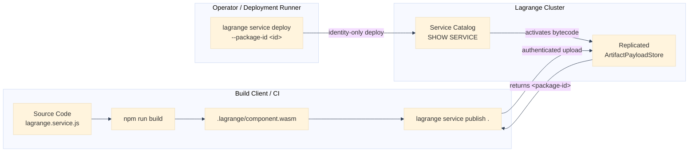

# First Hour With Lagrange

This tutorial guides you through your first hour with Lagrange: starting a persistent
cluster node, seeding sample data, scaffolding and building a data-local service,
publishing and deploying it by immutable identity, invoking it over authenticated HTTP,
updating the service behind a stable endpoint, cleanly resetting state, and adopting
the remote deployment pattern.

## Prerequisites

Before starting, ensure your system meets the platform requirements:

- **Node.js**: Version 22.12.0 or newer (`node --version`)
- **Platform**: Linux (x86_64, aarch64) or macOS (Apple Silicon, x86_64)
- **Tools**: `curl`, `git`, and `npm`

Verify your Node.js runtime:

```bash
node --version
```

If you are working from a repository checkout, install project dependencies:

```bash
git clone https://github.com/psvensson/lagrange
cd lagrange
npm install
```

> [!NOTE]
> The repository includes a self-contained test demo (`npm run demo:account-summary`)
> which starts and stops its own in-process ephemeral node. While useful for automated
> checks, that in-process demo terminates upon completion. For developing and testing
> your own services, you will run a persistent node as shown below.

---

## 1. Start a Persistent Disposable Node

Configure the environment for your local development node. Lagrange exposes three
primary network surfaces:
- **REST / HTTP Ingress**: `REST_API_PORT=8080` (health probes and service endpoints)
- **Admin WebSocket**: `ADMIN_WS_PORT=8081` (operator stream and cluster diagnostics)
- **Transport WebSocket**: `TRANSPORT_WS_PORT=8082` (inter-node cluster transport)
- **PostgreSQL Wire Protocol**: `PGPORT=5432` on `PGHOST=127.0.0.1`

Export the credential and network configuration in your terminal session:

```bash
export PGHOST=127.0.0.1
export PGPORT=5432
export PGUSER=postgres
export PGPASSWORD=lagrange-dev-password
export REST_API_PORT=8080
export ADMIN_WS_PORT=8081
export TRANSPORT_WS_PORT=8082
export DATA_DIR=/tmp/lagrange-first-hour
```

Create the disposable data directory and start the persistent node:

```bash
mkdir -p "$DATA_DIR"
DATA_DIR="$DATA_DIR" npm start
```

Keep this process running in the background or in a dedicated terminal window.

### Verify Node Readiness

In another terminal, verify that the node has initialized and passed its readiness
probes:

```bash
curl -fsS http://127.0.0.1:8080/livez
curl -fsS http://127.0.0.1:8080/startupz
curl -fsS http://127.0.0.1:8080/readyz
```

When `/readyz` responds with HTTP 200 `{"status":"ok"}`, the node's SQLite storage,
consensus group, and PostgreSQL-wire listener are active and ready to accept traffic.

---

## 2. Create and Seed the Fixture Table

Lagrange stores user data in ordinary partitioned relational tables. Create an
`account_activity` table and seed rows for two separate accounts (`account_id = 101`
and `account_id = 202`) via public PostgreSQL wire.

Using standard `psql` (or any PostgreSQL client):

```bash
psql -h "$PGHOST" -p "$PGPORT" -U "$PGUSER" -d postgres <<'SQL'
CREATE TABLE account_activity (
  id INTEGER PRIMARY KEY,
  account_id INTEGER,
  amount_cents INTEGER
);

INSERT INTO account_activity (id, account_id, amount_cents) VALUES
  (1, 101, 1500),
  (2, 101, 2500),
  (3, 202, 4200),
  (4, 202, 1800);
SQL
```

Alternatively, if `psql` is not installed on your host, execute the same statements
using a one-line Node.js script:

```bash
node -e '
const pg = require("pg");
const client = new pg.Client();
async function seed() {
  await client.connect();
  await client.query(`
    CREATE TABLE account_activity (
      id INTEGER PRIMARY KEY,
      account_id INTEGER,
      amount_cents INTEGER
    );
    INSERT INTO account_activity (id, account_id, amount_cents) VALUES
      (1, 101, 1500),
      (2, 101, 2500),
      (3, 202, 4200),
      (4, 202, 1800);
  `);
  await client.end();
}
seed().catch(console.error);
'
```

---

## 3. Scaffold a New Service

Use the CLI to generate a code-first service project:

```bash
npx lagrange service init my-service
cd my-service
```

This generates a project structure separating developer-authored code from
compiler-generated deployment artifacts:

```text
my-service/
├── authoring/                 <- Vendored guest-safe authoring library
├── lagrange.service.js        <- Editable: service declarations and operations
├── package.json               <- Editable: project scripts and engines
├── src/
│   └── handler.js             <- Editable: endpoint business logic (host unit-testable)
├── test/
│   └── handler.test.js        <- Editable: unit tests with mocked collaborators
└── .lagrange/                 <- Compiler-generated build outputs
```

### Developer-Editable Files

- `lagrange.service.js`: Declares the service identity, HTTP endpoints (`http.post('/amounts/summary', ...)`),
  and distributed data-local operations (`distributed({ statement: sql`...`, run, reduce })`).
- `src/` directory (e.g. `handler.js`): Houses the request handling logic (`handleAmountSummary(request, {call, json}, operation)`).
  This module has no WASM toolchain dependencies, making it fast and easy to test on the host.
- `test/` directory: Contains unit tests validating handler logic using plain JavaScript mocks.

Test the scaffolded handler on your host immediately:

```bash
npm test
```

### Compiler-Generated Files (`.lagrange/`)

When compiled, Lagrange writes deterministic records under `.lagrange/`:
- `.lagrange/entry.js`: Component entry point bridging WASI host imports to your service definition.
- `.lagrange/runtime-types.d.ts`: Editor typings derived from your SQL queries and service contract.
- `.lagrange/deployment/`: Deterministic deployment manifests (`manifest.json`), bindings (`bindings.json`),
  and outbound call authorization policies (`access-policy.json`).
- `.lagrange/component.wasm`: The compiled WebAssembly bytecode component.

> [!IMPORTANT]
> Never manually edit files inside `.lagrange/`. They are generated deterministically by the
> compiler and will be overwritten during each build.

---

## 4. Build, Publish, and Deploy

Lagrange strictly enforces a clean three-phase deployment lifecycle:
1. **Build**: Compiles source code into a verified WebAssembly component.
2. **Publish**: Ingests and seals component bytes into the replicated `ArtifactPayloadStore`.
3. **Deploy**: Installs and activates a registered immutable identity.

### Step 4a: Build the Component

Execute the build script:

```bash
npm run build
```

This runs `lagrange service generate . && lagrange service build .`, creating the compiled
WASM component at `.lagrange/component.wasm`.

### Step 4b: Publish into the Replicated Artifact Store

Publish the built package into the cluster's replicated `ArtifactPayloadStore`:

```bash
npx lagrange service publish .
```

The CLI connects to the cluster, validates the component descriptor, streams the payload
chunks, and verifies the final SHA-256 digest. Upon durable replication, the cluster
returns a registered immutable package identity, for example:

```text
Published artifact package: pkg_01jbc45d6e7f8a9b0c1d2e3f4a
Descriptor digest: sha256:d41d8cd98f00b204e9800998ecf8427e...
```

Save this `<package-id>` for deployment.

### Step 4c: Deploy by Registered Immutable Identity

Deploy the service to the cluster using its registered package ID and an idempotency key:

```bash
npx lagrange service deploy --package-id pkg_01jbc45d6e7f8a9b0c1d2e3f4a --idempotency-key deploy-key-v1
```

> [!TIP]
> Notice that `deploy` does **not** read your local filesystem, source files, or `.lagrange/`
> directory. It requires only cluster credentials, the registered package identity, and an
> explicit idempotency key.

---

## 5. Inspect Service Readiness

Inspect the deployment status through the CLI:

```bash
npx lagrange service inspect pkg_01jbc45d6e7f8a9b0c1d2e3f4a
```

Or query the service catalog directly through SQL:

```sql
SHOW SERVICE 'my-service';
```

Expected output confirms the service is installed and ready:

```text
 service_name | desired_state | rollout_state | revision_id | package_id
--------------+---------------+---------------+-------------+-------------------------------
 my-service   | installed     | active        | rev_01...   | pkg_01jbc45d6e7f8a9b0c1d2e3f4a
```

---

## 6. Invoke Over Authenticated JSON HTTP

Lagrange routes inbound HTTP traffic to the active service revision. Invoke the
`/amounts/summary` endpoint over authenticated JSON HTTP for both test accounts.

### Query Account 101

```bash
curl -fsS -u postgres:lagrange-dev-password \
  -H 'content-type: application/json' \
  -d '{"accountId": 101}' \
  http://127.0.0.1:8080/amounts/summary
```

Expected output (Account 101 has two transactions: 1500 + 2500 cents):

```json
{
  "accountId": 101,
  "contributingShards": 1,
  "totalCents": 4000,
  "transactions": 2
}
```

### Query Account 202

```bash
curl -fsS -u postgres:lagrange-dev-password \
  -H 'content-type: application/json' \
  -d '{"accountId": 202}' \
  http://127.0.0.1:8080/amounts/summary
```

Expected output (Account 202 has two transactions: 4200 + 1800 cents):

```json
{
  "accountId": 202,
  "contributingShards": 1,
  "totalCents": 6000,
  "transactions": 2
}
```

Observe that the service filters partition rows directly on the storage host, emits numeric
partials, and combines them in the reducer before returning distinct, correctly filtered JSON
responses.

---

## 7. Update the Service Behind the Same Stable Endpoint

To change business logic, update your code, rebuild, publish the new revision, and deploy
it. The public HTTP route `/amounts/summary` remains completely stable.

### Modify the Rule

Open your handler file (`src/` directory, e.g. `handler.js`) and enrich the response object with a
currency indicator and formatted amount:

```javascript
export function handleAmountSummary(request, {call, json}, operation) {
  const rawBody = typeof request.body === 'string' && request.body ?
    request.body : (request.body ? JSON.stringify(request.body) : '{}');
  const body = JSON.parse(rawBody);
  const summary = call(operation, {accountId: body.accountId ?? null});

  return json({
    ...summary,
    currency: 'USD',
    formattedTotal: `$${(summary.totalCents / 100).toFixed(2)}`,
  }, 200);
}
```

Verify your unit test passes:

```bash
npm test
```

### Rebuild and Publish New Revision

Compile the updated component:

```bash
npm run build
```

Publish the new component to obtain a new package ID:

```bash
npx lagrange service publish .
```

Output:

```text
Published artifact package: pkg_02kcd56e7f8a9b0c1d2e3f4b
```

### Deploy to the Stable Endpoint

Deploy the new revision using a new idempotency key:

```bash
npx lagrange service deploy --package-id pkg_02kcd56e7f8a9b0c1d2e3f4b --idempotency-key deploy-key-v2
```

The cluster transitions the `/amounts/summary` endpoint to the new revision without downtime.
In-flight requests complete against the prior revision, and subsequent requests immediately
reach the new revision.

### Re-Invoke the Stable Endpoint

Invoke the exact same endpoint URL again:

```bash
curl -fsS -u postgres:lagrange-dev-password \
  -H 'content-type: application/json' \
  -d '{"accountId": 101}' \
  http://127.0.0.1:8080/amounts/summary
```

Updated response:

```json
{
  "accountId": 101,
  "contributingShards": 1,
  "totalCents": 4000,
  "transactions": 2,
  "currency": "USD",
  "formattedTotal": "$40.00"
}
```

---

## 8. Inspect Diagnostics and Reset State

### Diagnostics and Error Inspection

If a service deployment or invocation encounters an issue:
- **Inspect Service Errors**: Run `SHOW SERVICE 'my-service'` to inspect the `latest_failure_id`
  and rollout details.
- **Admin Diagnostics Stream**: Connect to `ws://127.0.0.1:8081/api/admin/stream` to receive
  real-time node events, CDC notifications, and dispatch logs.
- **Node Probes**: Check `http://127.0.0.1:8080/readyz` to ensure cluster health and quorum availability.

### Clean Repeatable Reset

When testing is complete, cleanly stop the persistent node and remove its disposable data:

```bash
# 1. Stop the node process
kill $NODE_PID   # or press Ctrl+C in the terminal running npm start

# 2. Remove the disposable directory to ensure a clean slate for future runs
rm -rf "$DATA_DIR"
```

Because the entire cluster state (SQLite partitions, Raft consensus logs, and artifact store)
lives inside `$DATA_DIR`, deleting this directory completely resets the node to a clean state.

---

## 9. Remote Client Deployment Pattern

In real production environments, build systems and production clusters run on distinct
machines. Lagrange's architecture explicitly decouples the build environment from the
cluster hosts:



1. **Build Client (e.g. CI / GitHub Actions)**:
   - Contains Node.js toolchains, dependencies, and source files.
   - Runs `npm run build` and `npx lagrange service publish .`.
   - The publisher uploads the component bytes to the cluster's `ArtifactPayloadStore` and outputs
     an immutable `<package-id>`.
   - The build client can immediately wipe its workspace or shut down.
2. **Deploy Client (e.g. CD runner, Kubernetes job, or operator laptop)**:
   - **Has no project files, source code, or shared filesystem.**
   - Only requires connection credentials (`PGHOST`, `PGPORT`, `PGUSER`, `PGPASSWORD`) and the `<package-id>`.
   - Runs `npx lagrange service deploy --package-id <package-id> --idempotency-key <key>`.
3. **Cluster Activation**:
   - Cluster nodes stream the verified, sealed bytecode directly from the replicated `ArtifactPayloadStore`.
   - No local volume mounting, container registry dependencies, or shared NFS mounts are required.

For a guide on deploying Lagrange to an existing Kubernetes cluster via Helm and running cloud benchmarks, see [Kubernetes Deployment and Cloud Benchmarks](../kubernetes-and-cloud-benchmarks.md).

---

## Continue

- [Kubernetes Deployment and Cloud Benchmarks](../kubernetes-and-cloud-benchmarks.md)
- [JavaScript Service Reference](../reference/javascript-service-reference.md)
- [The Lagrange Native Programming Model](../native-programming-model.md)
- [Execution Semantics](../execution-semantics.md)
- [Evaluating Lagrange](../evaluate.md)
- [Migration and Adoption](../migration.md)
- [Architecture Index](../../architecture/INDEX.md)
