# Rewrite A Hot Path For Lagrange

You have a service that pulls rows out of the database to compute a small
answer. This tutorial moves that hot path into a Lagrange service - a
partition function and a reducer authored together in one component - and
invokes it through the current code-first authoring API and canonical deployment
lifecycle.

The example is a movie-ranking endpoint over the MovieLens 100k dataset. It
is useful because it provides a realistic, honest comparison: a database can
compute `AVG` and `COUNT` per movie efficiently, and an application service
can apply a Bayesian confidence adjustment and choose the top ten. The
comparison therefore does not depend on an intentionally bad baseline.

## The Requirement

For each movie, calculate:

```text
bayesianMean = (average × count + priorMean × priorWeight)
               / (count + priorWeight)
score = bayesianMean - confidencePenalty / sqrt(count)
```

Return the ten movies with the highest score.

The formula deliberately mixes data operations and application policy:

- `AVG` and `COUNT` are natural database work;
- the prior and confidence penalty are application choices;
- the formula should be versioned, tested, and deployed like application code; and
- only the top candidates need to leave each shard.

## Comparing All Three Baselines Honestly

To evaluate data-local computation fairly, compare three possible implementations:

### Baseline 1: Full Scoring and Selection Inside SQL

If the scoring algorithm is purely mathematical and supported by standard SQL functions,
the entire operation can be expressed in a single SQL query:

```sql
SELECT movie_id,
       ((AVG(rating) * COUNT(*) + 3.5 * 25) / (COUNT(*) + 25)) -
       (0.5 / SQRT(COUNT(*))) AS score
FROM ratings
GROUP BY movie_id
ORDER BY score DESC
LIMIT 10;
```

**Evaluation:**
- When an arithmetic calculation can be completely expressed in standard SQL and the policy
  rarely changes, plain SQL top-N is extremely efficient.
- The storage engine aggregates rows, calculates scores, maintains a top-10 heap, and returns
  **only 10 rows** over the network.
- *When plain SQL is sufficient:* If the logic requires no custom libraries, no external lookups,
  and no versioned business models, plain SQL top-N is often the best choice. Lagrange does not
  force you to rewrite simple SQL queries into WASM.

### Baseline 2: SQL Aggregation Plus Application Policy

A common conventional architecture asks the database to group first, while the application
service computes the Bayesian adjustment:

```js
export async function topMovies(pool, policy) {
  const {rows} = await pool.query(`
    SELECT movie_id,
           AVG(rating) AS average,
           COUNT(*) AS rating_count
    FROM ratings
    GROUP BY movie_id
  `);

  return rows
    .map((row) => {
      const average = Number(row.average);
      const count = Number(row.rating_count);
      const bayesianMean =
        (average * count + policy.priorMean * policy.priorWeight) /
        (count + policy.priorWeight);
      const score =
        bayesianMean - policy.confidencePenalty / Math.sqrt(count);

      return {movieId: row.movie_id, count, average, score};
    })
    .sort((left, right) => right.score - left.score)
    .slice(0, policy.limit);
}
```

**Evaluation:**
- This avoids transferring every raw rating (100,000 rows).
- However, the database must return an aggregate row for **every movie** (~1,682 movies in MovieLens 100k)
  across the network to the application server.
- The application server scores all candidates and immediately discards ~1,672 of them to keep 10.

### Baseline 3: Lagrange Partition Functions and Reduction

With Lagrange, the application scoring policy executes directly beside each data partition.
Each partition leader scores its local ratings and emits only its local top 10 candidates.
The reducer then merges at most `num_shards × 10` candidates to produce the global top 10.

**When Code-First Partition Functions Help:**
- **Custom or evolving policy:** When scoring logic involves proprietary algorithms, complex rules,
  or custom libraries that cannot be written in SQL or stored procedures.
- **Developer workflow:** When business logic needs to be authored in JavaScript/TypeScript,
  unit-tested on developer laptops (`npm test`), and deployed through CI/CD pipelines without
  requiring database administrator permissions or custom server extension installations.
- **Bounded network exchange:** When computing custom logic near each partition eliminates the need
  to stream thousands or millions of intermediate aggregates across the network.

---

## Authoring the Service with the Code-First API

Lagrange uses a code-first JavaScript API (`defineService`, `distributed`, `http.post`, `sql`).
You author one service descriptor declaring the HTTP endpoint and the data-local operation.

### `lagrange.service.js`

```javascript
import {defineService} from './authoring/define-service.js';
import {distributed} from './authoring/distributed-operation.js';
import {http} from './authoring/request-handler.js';
import {sql} from './authoring/sql-template.js';

const PRIOR_MEAN = 3.5;
const PRIOR_WEIGHT = 25;
const CONFIDENCE_PENALTY = 0.5;
const TOP_K_LIMIT = 10;

/**
 * Partition-local execution: groups rows locally on the partition leader host,
 * calculates the Bayesian score for local movies, and emits only the local top K candidates.
 */
function rankRun(rows, runArguments, {emit}) {
  const limit = runArguments?.limit ?? TOP_K_LIMIT;
  const groups = new Map();

  // 1. Group local rows on this partition leader
  for (const row of rows) {
    const movieId = Number(row.movie_id);
    const rating = Number(row.rating);
    const group = groups.get(movieId) ?? {sum: 0, count: 0};
    group.sum += rating;
    group.count += 1;
    groups.set(movieId, group);
  }

  // 2. Score candidates locally
  const candidates = [];
  for (const [movieId, {sum, count}] of groups) {
    const average = sum / count;
    const bayesianMean =
      (average * count + PRIOR_MEAN * PRIOR_WEIGHT) / (count + PRIOR_WEIGHT);
    const score =
      bayesianMean - CONFIDENCE_PENALTY / Math.sqrt(count);
    candidates.push({movieId, score});
  }

  // 3. Sort local candidates
  candidates.sort((left, right) => right.score - left.score);

  // 4. Emit ONLY the local top K as numeric partials under shard-disjoint keys
  for (const candidate of candidates.slice(0, limit)) {
    emit(`score:${candidate.movieId}`, candidate.score);
  }

  return {considered: candidates.length};
}

/**
 * Global reduction: merges candidate partials from all shards and returns the global top K.
 */
function rankReduce(partials, runArguments) {
  const limit = runArguments?.limit ?? TOP_K_LIMIT;
  const candidates = [];

  for (const [key, score] of partials) {
    const [, movieId] = String(key).split(':');
    candidates.push({movieId: Number(movieId), score: Number(score)});
  }

  candidates.sort((left, right) => right.score - left.score);
  return candidates.slice(0, limit);
}

// Declare the distributed operation with a literal SQL selector
const rankTopMovies = distributed({
  statement: sql`SELECT movie_id, rating FROM ratings`,
  run: rankRun,
  reduce: rankReduce,
});

export default defineService({
  name: 'movie-ranking',
  version: '0.1.0',
  operations: {
    rankTopMovies,
  },
  handlers: {
    topMovies: http.post('/movies/top', {
      calls: [rankTopMovies],
      handle: (request, context) => {
        const body = typeof request.body === 'string' && request.body ?
          JSON.parse(request.body) : (request.body || {});
        const results = context.call(rankTopMovies, {limit: body.limit ?? 10});
        return context.json(results, 200);
      },
    }),
  },
});
```

### Key Contract Rules

1. **Plain Object Rows:** Rows passed into `run(rows, args, {emit})` are plain JavaScript objects
   with properties matching the SELECT statement (`row.movie_id`, `row.rating`). No low-level
   WIT wrappers or tag decoding are needed.
2. **Numeric Partials Only:** Every value passed to `emit(key, value)` must be a finite number.
   The Bayesian score is emitted directly.
3. **Shard-Disjoint Keys:** Ratings partitioned by movie ID ensure that all ratings for a given
   movie reside on one shard, avoiding key collisions. Emitting the same key from multiple shards
   is rejected by the coordinator.
4. **Fixed SELECT Statements:** The selector `sql`SELECT movie_id, rating FROM ratings`` is fixed
   at deployment time. Dynamic parameters (such as `limit`) are passed via call arguments.

---

## Canonical Build, Publish, and Deploy Lifecycle

Deploying the service follows the canonical three-step lifecycle:

```mermaid
%%{init: {'theme':'base','themeVariables':{'background':'#ffffff','lineColor':'#334155','textColor':'#0f172a'}}}%%
flowchart LR
  SRC["Source Code<br/>lagrange.service.js"] -->|npm run build| WASM[".lagrange/component.wasm"]
  WASM -->|lagrange service publish .| STORE["Replicated<br/>ArtifactPayloadStore"]
  STORE -->|returns &lt;package-id&gt;| PUB["Package ID"]
  PUB -->|lagrange service deploy --package-id &lt;id&gt;| ACT["Active Deployment"]

  classDef default fill:#dbeafe,stroke:#1e40af,color:#0b2545
  classDef accent fill:#dcfce7,stroke:#166534,color:#052e16
  classDef store fill:#fef3c7,stroke:#b45309,color:#451a03
  class STORE store
  class ACT accent
```



### 1. Build the Component

```bash
npm run build
```

This generates `.lagrange/component.wasm` along with deterministic deployment records under `.lagrange/deployment/`.

### 2. Publish the Artifact

```bash
npx lagrange service publish .
```

The CLI connects to the cluster's replicated `ArtifactPayloadStore`, validates the component
descriptor, and seals the artifact bytes. Upon completion, it outputs the registered immutable
package ID:

```text
Published artifact package: pkg_01jbc45d6e7f8a9b0c1d2e3f4a
```

### 3. Deploy by Registered Identity

Deploy the service to the cluster using the immutable package ID:

```bash
npx lagrange service deploy --package-id pkg_01jbc45d6e7f8a9b0c1d2e3f4a --idempotency-key deploy-key-v1
```

The deployment command requires only cluster credentials, the registered package ID, and an
idempotency key. It does not read local files or container mounts.

---

## Invoking the Service

### Over Authenticated HTTP

```bash
curl -fsS -u postgres:lagrange-dev-password \
  -H 'content-type: application/json' \
  -d '{"limit": 10}' \
  http://127.0.0.1:8080/movies/top
```

Response:

```json
[
  {"movieId": 318, "score": 4.41},
  {"movieId": 858, "score": 4.38},
  {"movieId": 50,  "score": 4.34},
  {"movieId": 527, "score": 4.31},
  {"movieId": 1198,"score": 4.29},
  {"movieId": 260, "score": 4.28},
  {"movieId": 1196,"score": 4.26},
  {"movieId": 1210,"score": 4.24},
  {"movieId": 589, "score": 4.22},
  {"movieId": 2028,"score": 4.21}
]
```

### Over Authenticated PostgreSQL Wire

You can also invoke the distributed operation directly over PostgreSQL wire:

```sql
CALL BINDING 'movie-ranking--call--rank-top-movies' (
  '{"limit": 10}'
);
```

---

## What Improves

### Transfer Shape

Let:
- `N` be the total number of ratings (100,000);
- `M` be the number of distinct movies (1,682);
- `R` be the number of participating shards (e.g. 6); and
- `K` be the requested top-N limit (10).

| Implementation | Values Crossing Database/Service Boundary | MovieLens 100k Count |
| --- | --- | ---: |
| Naive Application Aggregation | `N` raw rows | 100,000 rows |
| Grouped SQL Baseline | `M` aggregate rows | 1,682 rows |
| Full SQL Top-N | `K` final rows | 10 rows |
| Lagrange Partition Reduction | At most `R × K` numeric partials | ≤ 60 partials |

### Latency and Efficiency

- **Reduced Serialization:** Instead of serializing, transmitting, and parsing 1,682 movie
  aggregate objects, only `R × K` numbers cross the network to the reducer.
- **Parallel Local Execution:** Shards on distinct partition leaders execute in parallel,
  utilizing multi-core storage nodes effectively.
- **Honest Boundary:** If an arithmetic computation is simple and static, plain SQL top-N
  is the simplest solution. Lagrange is designed for workloads where business logic, application
  libraries, or multi-step transformations require custom code to execute near data.

---

## Continue

- [JavaScript Service Reference](../reference/javascript-service-reference.md)
- [Execution Semantics](../execution-semantics.md)
- [The Lagrange Native Programming Model](../native-programming-model.md)
- [Minimal Deployment Surface](../../architecture/minimal-deployment-surface.md)
- [MovieLens Affinity Example](../../examples/service-data-affinity/README.md)
