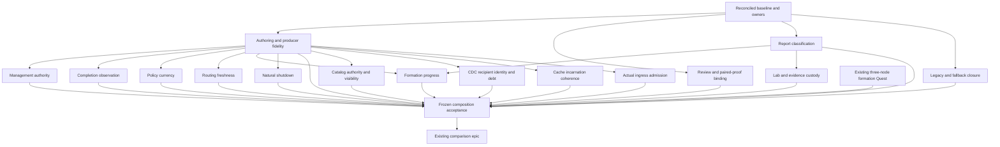

# Canonical authority and reliable formation

This continues `operation-integrity-and-reliable-formation`. A fresh cluster must
complete the existing public formation and user-table journey through one
canonical authority for each permission, completion, policy and routing decision.
Recovery retains obligations and progresses; startup and shutdown own their
resources. The authoring and proof workflow must catch invented contracts and
invalid evidence before integration.

## Reliable application operations (candidate, 23 November 2026)

The [epic candidate](operation-integrity-and-reliable-formation/reliable-application-operations-candidate.md)
turns the architecture review into six unsealed Quest proposals and two reused
work units. Its [start note](operation-integrity-and-reliable-formation/reliable-application-operations-start-here.md)
routes reconciliation through the incumbent owners. It preserves all twelve
alpha packages, implementation-safety P1-P6, existing seals and the approved
formation/smoke/comparison sequence. This is proposed decomposition, not adoption,
a new writer assignment, runtime acceptance or a second integration queue.
Continue already authorized work under the current summary and actual owner
records; reconcile the candidate against that work before starting a new unit.

## Usable alpha completion (approved 22 November 2026)

The user approved the [twelve-package completion plan](operation-integrity-and-reliable-formation/usable-alpha-completion.md)
for making the implemented SQL and WASI product usable through its public
interfaces, retained-storage recovery and measured resource limits. It is a
delivery sequence within this epic and the existing feature owners; their
acceptance, release allocation and original evidence remain authoritative.
The [implementing-agent start note](operation-integrity-and-reliable-formation/usable-alpha-start-here.md)
connects that plan to the ongoing takeover and the currently observed
withheld-dispatch repair. Resolve live refs and active assignments before using
its dated source checkpoint. Continue the current bounded unit and preserve its
writer; this adoption does not replace the integration owner's current summary,
start a runtime task or lab run, change a sealed predicate, or establish a pass.

## Implementation safety (adopted 22 November 2026)

The user authorized verification and adoption of the
[implementation-safety plan](operation-integrity-and-reliable-formation/implementation-safety-proposal.md)
and [agent start note](operation-integrity-and-reliable-formation/implementation-safety-start-here.md)
through [PR #236](https://github.com/psvensson/lagrange/pull/236). Its six required
packages turn the source review at 6a292acfd into bounded prevention work through
the existing owners, preserving the approved ES6 and alpha constraints.
The current integration summary and actual owner records continue to govern
sequencing, assignments and proof; documentation adoption establishes no runtime
acceptance.

Reconciled candidate and branch state on 23 November 2026 (against accepted
change-selection base `0dbed1718c2d07c1fcb8bbe56b87ac41763c262c`, current
check-base `49495f7e47ff7fc03d2a1bbdf92ab92e9fc09778`, `origin/main`
`4f37cc542f4bbf13c810732b8c8431a94d6e2dfd`, prior composed checkpoints
`6b853f17c` -> `01479ee15` -> `a3dcbe8c7` -> `b85ba7950` -> `0d0ea2283`, and
current Wave 3 composed runtime candidate
`1484164de90e24e1b4a213f48ea90794ceb2fb20`; below, `takeover/reports/...` and
`takeover/lab/...` refer to retained external takeover artifacts under
`/mnt/data/peter/projects/lagrange-takeover-20261121/`):

| Package / Directive | Pushed Owner Branch & Verified HEAD | Original Lab Receipts (Red -> Green) | Independent Verification | Integration Candidate Merge & Composed Lab Proof |
| --- | --- | --- | --- | --- |
| Package 1 & 2 (Finite Public Capability Matrix & No-Synthetic-Success Acceptance Paths) | `work/acceptance-paths-no-synthetic-success-20261122` @ `20551d859a7e2f6a58fdeb477ef8411a0df9a71f` | Red `861a043f8e62573606f849460c37a16320bd5100` (`takeover/lab/package2-red-witness`, `status=1`, 0/2 pass) -> green `20551d859a7e2f6a58fdeb477ef8411a0df9a71f` (`takeover/lab/package2-green-verify`, `status=0`, 3/3 pass, 20 assertions) | `APPROVE` (`subagent:60f8aa68`, `takeover/reports/verify-package2-acceptance-paths.md`) | Merged at `926dcc40c9822d5a66c28c72ccb4448e4425c282`; `takeover/lab/merger-3/Batch-AB-926dcc40c-tv-dator` (`status=1`, 13/13 recorded pass, 452 assertions) + `takeover/lab/merger-3/Batch-AB-rem15-926dcc40c-tv-dator` (`status=0`, 21/21 pass, 1,037 assertions) |
| Package 3 (Formation Core Repairs: SERVICES Read Lifetime, Named Writes, Write-Kernel Tenure Fence, Task I Withheld-Dispatch Re-Drive, Ruling #5 Entity `REMOVE`, W1/T2 Term-Only Tenure, S0 Owner-Fact Read, Stream 3 Raft Frames, Stream 5 Topology Guard, Stream 6 Receipt Fakes) | Historical merged inputs: `19cd99e27` (`work/services-read-lifetime-20261121`, ref retired from remote) & `ee42a0618` (`work/named-write-participant-binding-20261121`, ref retired from remote); current pushed refs: `work/write-kernel-tenure-fence-20261121` @ `0a88745f6d1072e00c209d2793b3b2e55a3e76c2`; `work/owner-fact-read-20261121` @ `4393a1b5deb3ff58823f8891802376da45eae81a`; `work/retained-ledger-observation-repair-20261121` @ `8c7e29eb970d6a258e7d0df6158af743cf3c6d41`; `work/raft-frame-delivery-20261121` @ `838ac3827719ec99ff827c92b6c60ecc69d9327b`; `work/topology-guard-owner-fact-20261121` @ `20153410c3f4fd40a3f9d9df4a3583fcb6866c6d`; `work/line-regression-receipt-fakes-20261121` @ `d133a70499b85ed0a660f51a510b73f80214cbaf` | Task I red `b3985c9e7` -> `a24193648` (`takeover/lab/merger-3/W1C-S0-combined-a24193648-tv-dator`, `status=1`, 18/19 pass, 1 fail on `cdc-owner-fact-receiver-read-point.test.js`, 529 assertions) -> green `8fb42e534` (`takeover/lab/merger-3/S0-read-point-8fb42e534`, `status=0`, 1/1 pass, 100 assertions); Batch A+B (`takeover/lab/merger-3/Batch-AB-926dcc40c-tv-dator` `status=1` 13/13 + `takeover/lab/merger-3/Batch-AB-rem15-926dcc40c-tv-dator` `status=0` 21/21, 1,037 assertions) | `APPROVE` (`subagent:03c101df`, `subagent:6878b755`, `subagent:b2fc57c7`, `subagent:7f864feb`, `subagent:66d31106`; `takeover/reports/verify-composed-candidate-8fb42e534.md`, `takeover/reports/verify-withheld-dispatch-redrive.md`, `takeover/reports/verify-w1-corrective-and-t2.md`) | Merged through `8fb42e534` and `926dcc40c`; re-verified at `27812b18d` (`takeover/lab/merger-3/Batch-G-Directive6-27812b18d`, `status=0`, 25/25 pass, 601 assertions) and on composed candidate `6b853f17c` (`takeover/lab/merger-3/Batch-KG-Composed-6b853f17c`, `status=0`, 43/43 pass, 1,417 assertions) |
| Package 4 & Directive 5 (Stream 2b Pure `raft.readStatus()` Exceptional Identity-Registry Failure & Composed Boundary) | `work/raft-owner-authority-20261121` @ `16b07d691f6ebc851bfc576bfc5481e4ca0b4d2e` (above `5d343c3e7654afbc0f7f824664d4490837dfbaad` and `b1114d70b`) | Initial pure-status red `af151b09f4ed994f4600c563306ff0531e95fec2` (`takeover/lab/raftowner3-pure-read-red`, `status=1`, 0/1 pass) -> green `5d343c3e7` (`takeover/lab/raftowner3-green-5d343c3e7`, `status=0`, 32/32 pass, 599 assertions); Directive 5 red `ed6431061995ff8268fe7ea1a6d444a4f6d7a21b` (`takeover/lab/pure-status-directive5-red`, `status=1`) -> green `16b07d691` (`takeover/lab/pure-status-directive5-green`, `status=0`, 12/12 pass, 224 assertions) | `APPROVE` (`subagent:7f864feb`, `takeover/reports/verify-pure-raft-status-read.md` §5 & §7) | Merged at `b313edf471d335f35d7ad8428630525d35ea8d27` (`takeover/lab/merger-3/Batch-E-b313edf47-tv-dator`, `status=0`, 13/13 pass, 3,539 assertions) and `7a7795e545ea2007d1701db17133bae33d300d0b` (`takeover/lab/merger-3/Batch-H-Directive5-7a7795e54`, `status=0`, 3/3 pass, 22 assertions); re-verified in `Batch-KG-Composed-6b853f17c` (`status=0`) |
| Package 4 & Directive 7 (Stream 7 Single-Scheduler Placement Stage 3a/3b & Reconciled Proof Transfer Table) | `work/placement-owner-repair-20261121` @ `da1ddd95ceebe55d1d9a38641fa41e10ac2be0a3` (above `91acd1d363519b883e7c89810971664e7df01921` and `8e84e2801`) | `takeover/lab/por-s3b-b6-c476ad4c-a1-adam-laptop` (`status=0`, 1/1), `takeover/lab/por-s3b-final-ce590e1f-a1-tv-dator` (`status=1`, 149/168 pass; 19 pre-S0/base-debt reds dispositioned in §4), `takeover/lab/por-s3b-b12-91acd1d3-a1-tv-dator` (`status=1`, 1/2) & `takeover/lab/por-s3b-b13-91acd1d3-a1-tv-dator` (`status=1`, 4/7); reconciled List O/S citations in `solve/quests/replica-placement-admission-owner/evidence/transition.md` | `APPROVE` (`subagent:25c09bda`, `takeover/reports/verify-placement-stage3-closure.md` §6 & §7) | Merged at `ea2df2b2286403a5085bedf681f28d6e0e2b27a6` (`takeover/lab/merger-3/Batch-C-r2-e4fa40035-tv-dator`: `status=1`, 13/14 pass, 1 fail on `message-group-membership-operation-lane.test.js` subtest 5, 465 assertions) and `048b714841b16a90b63a21e574d898b5bd616f67`; placement witnesses green in `Batch-KG-Composed-6b853f17c` (`status=0`) |
| Package 5 & Directive 3 (PostgreSQL Wire `Describe` Contract, Numeric Unary Expressions & Quest Evidence Seal) | `work/postgres-wire-description-contract-20261122` @ `84b2f7adf1fc5c5af3fd582b949080de6ea48aad` (above `6ed3626a190e5f2794074ce2f3405f8ec0c7ee47` and `c6ddedcc1ef85dfb995cbb5fa08ffa6b0118a4b4`; sealed `solve/quests/postgres-wire-description-contract/evidence/receipt.json` & `log.ndjson`) | Initial red `c9815adc7c58a5268bda5c6fe3106e9905241ca1` (`takeover/lab/package5-red-witness`, `status=1`, 0/1 pass) -> green `c1b6bb3a0` (`takeover/lab/package5-verify-final`, `status=0`, 31/31 pass, 5,125 assertions) & `c6ddedcc1` (`takeover/lab/package5-conditions-verify`, `status=0`, 9/9 pass, 701 assertions); Directive 3 red `6adc66d607d913a397debc9ddfc709dcf61504de` (`takeover/lab/package5-unary-red`, `status=1`) -> green `6ed3626a1` (`takeover/lab/package5-unary-green`, `status=0`, 10/10 pass, 705 assertions) | `APPROVE` (`subagent:7bda0874`, `takeover/reports/verify-package5-pgwire-describe.md` §3 & §4) | Merged at `e4fa40035`, `3b0f72387`, and `5b8a95079ea07171c3b451712746a011620681ec`; verified in `Batch-G-Directive6-27812b18d`, `Batch-I-Directives12-92df7f1c0`, `Batch-J-Followups-6a292acfd`, and `Batch-KG-Composed-6b853f17c` (`status=0`) |
| Package 5, Findings 1 & 2, P1/P2/P5, and Findings 3A & 4 Follow-Up (Locking Reads: Sequential Multi-Statement Replay Lock Checks, Complete Production/Test Capability Boundary on `partition-locking-read-reservation.js`, Reciprocal Committed Exclusion & Quest Evidence Seal) | `work/locking-read-authoritative-reservations-20261122` @ `54892561c6c3d381e0003b0b989905bde1ba9669` (code `106f33faeb14ba9c226f420703f50c220e7e7e64`, reviewed `639fea5355fcf1f7d238dbbd433064e3d6d00ad3`, above `ccd2fe4dfeda19eef546b6c7d94438b95ccc5a39`, `f607d58a4`, `9355f516d`, `c39c505b4`, `7d36f1030`; sealed `solve/quests/locking-read-authoritative-reservations/evidence/receipt.json` & `log.ndjson`, `solve.js probe` `metric 0 target 0 done=true`) | Initial red `f04a462e2` -> green `7d36f1030` (7/7, 367); Findings 1 & 2 red `cf0cad5d0` -> green `c39c505b4`/`9355f516d` (7/7, 370); P1/P2/P5 red `7ad55475f` -> green `f607d58a4` (16/16, 503); Findings 3A & 4 red `a2356f3c45cd38da8fc2596f419b104503f326af` (`tv-dator` pid `3729884`, 10/13 pass, 3 fail on Witness 3d, 4b, 5) -> green `106f33faeb14ba9c226f420703f50c220e7e7e64` (`tv-dator` pid `3738506`, 20/20 pass, 626 assertions) | `APPROVE` (`subagent:e9afe79f`, `takeover/reports/verify-package5-locking-read-reservations.md` §3 & §4; P1/P2/P5 `subagent:320c8c19-694f-4a91-994e-8c631d70ae01`, board `#29`; Findings 3A & 4 `@verifier-v2`, `subagent:verifier-v2`, board `#50`) | Merged at `cabd211fb`, `6a292acfd`, `ef0daa774`, and `0af3f4ca0`; re-verified in `Batch-L-Composed-a3dcbe8c7` (`status=0`, `locking-read-authoritative-reservations.test.js` 13/13 + `locking-read-execution-lifecycle.test.js` 22/22 + `queryable-core-j4-locking-read-journey.test.js` 8/8 + `sql-query-engine-distributed-transactions.test.js` 139/139 + `scenario-a-deep-stack-throughput-and-latency.test.js` 3/3) |
| Package 6, Directives 1 & 2, P1/P3/P5, and Findings 3C/3D/3E Follow-Up (Global Secondary Indexes: Durable GSI Dataset Identity Recovery, `FORMATION_NOT_LATCHED` Deferred Retry Custody, `__idx_*` DDL Admission & Self-Check Invalidation, Independent-Cache CDC Convergence) | `work/global-index-production-integration-20261122` @ `22ba510b48efca5c849714f1b723c78962639e27` (above `15df0eb087085dcea4b32b005d9321310d9112d5`, `9bd7fbd1b32295de9edca93e215adf86c391b327`, `5c7f59061e937a5c3a1c51632b3623b3d408877b`) | Local construction red `913bea8a0` -> green `5c7f59061` (9/9, 591); Directives 1 & 2 red `8cc1928fb` -> green `9bd7fbd1b` (10/10, 657 + 4/4, 586); P1/P3/P5 red `169c6a736` -> green `15df0eb08` (38/38, 5,316); Findings 3C/3D/3E red `c63236e0fe` -> green `22ba510b48efca5c849714f1b723c78962639e27` (`adam-laptop` pid `187843`, 26/26 pass, 4,805 assertions) | `APPROVE` (`subagent:c8630dc6`, `takeover/reports/verify-package6-global-index-production.md` §4 & §5; P1/P3/P5 `@verifier` board `#34`; Findings 3C/3D/3E `@verifier-v2` board `#55`) | Merged at `7df3f7a09`, `92df7f1c0`, `715ad2c56`, and `34699e2d8`; re-verified in `Batch-L-Composed-a3dcbe8c7` (`status=0`, all 10 `test/index-management/*.test.js` pass incl. construction 152 + tx1-distributed 104 + J3 73 + J5 136, plus `partition-statement-admission.test.js` 14 + `replicated-sql-determinism-three-replica.test.js` 2 + `schema-provisioning-*`) |
| Package 7, Findings 3A/3B, P4/P5, and Findings 3B & 3F Follow-Up (Live Queries: `cdcEventEpoch` Snapshot Supersession & `CATCHING_UP` Settlement Gate, Uncertain Subscribe/Unsubscribe `RETIRING` Custody, Ordered Per-Subscriber Retry/Overflow Shipping & Bounded Model) | `work/generic-live-query-data-plane-20261122` @ `609e390233ed4e2294b6ee4f6a494978f44568b2` (above `9490f2080772ccb0377abffcdf1ca6ada6520eeb`, `e2cbf293956ffecccc67d8f4486db156a4cb794d`, `49001f9a2731f719bcdf95f76d4457bdebe4b855`) | Initial red `3619a5066` -> green `49001f9a2` (8/8, 620); Findings 3A & 3B red `5624058e6` -> green `e2cbf2939` (8/8, 615); P4/P5 red `50ebf3d43` -> green `9490f2080` (12/12, 673); Findings 3B & 3F red `a305ea712223b4857485f5e3b6fdf2347a8256eb` -> green `609e390233ed4e2294b6ee4f6a494978f44568b2` (`adams-gamla`, 12/12 pass, 666 assertions) | `APPROVE` (`subagent:57aa8ab8`, `takeover/reports/verify-package7-live-query.md` §4 & §5; P4/P5 `@verifier` board `#26`; Findings 3B & 3F `@verifier-v2` board `#51`) | Merged at `6a751762a`, `05f2f244a`, `e95312797`, and `27c24e557`; re-verified in `Batch-L-Composed-a3dcbe8c7` (`status=0`, J6 16 + remote-cdc-lifecycle 12 + startup-wiring 8 + generic-push-data-plane 65 + group 21 + manager 89 + service 87) |
| Package 8, 10 & 11 (WASI / Compiled Hono Service Cell, Retained-Storage Restart/Recovery & Installed Consumer CLI/PGWire Lifecycle) | Integrated on `work/integration-candidate-20261121` @ `7df3f7a098297818a4ed853578ae97bf9ac113fd` | `takeover/lab/merger-3/Batch-D-r2-7df3f7a09-tv-dator` (`status=0`, 11/11 pass, 485 assertions: `developer-journey-j1-j2-j3` 18/18, `h5-compiled-public-hono-journey` 2/2, `q2-call-selector-typed-parameter-narrowing` 4/4, `q4-call-bounded-structured-partials` 7/7, `q5-service-cell-v2-default-multi-operation` 68/68, `seed-restart-recovery-gate` 86/86, `transaction-coordinator-restart` 1/1, `service-install-lifecycle-cli-pgwire` 5/5) | Recorded in `takeover/reports/integration-merge-record.md` §29 | Verified on composed candidate at `7df3f7a098297818a4ed853578ae97bf9ac113fd`; `q3-call-shard-paged-execution.test.js` re-verified in `Batch-KG-Composed-6b853f17c` and `Batch-L-Composed-a3dcbe8c7` (`adams-gamla` external-toolchain lane, 7 assertions, `status=0`) |
| Package 9, Directive 4 & Finding 5 (Retained Read-View Generation Custody, Opening-Window Retirement, Close-Failure Custody, Failed First-Acquisition Idle Reaper Timer & Quest Evidence Seal) | `work/retained-read-view-generation-custody-20261122` @ `7d3b8ba73049925e88919625b818ecdf3461dfbd` (above `0fc58152607ae1aee1cbb0d10f05202c4ebc73ad`, `182921ec18843ff059a21171869d7f36d626d802`, and `264288b79b28860ca38921640af5856e2f588c95`; sealed `solve/quests/retained-read-view-generation-custody/evidence/receipt.json` & `log.ndjson`) | Initial red `fd3b9aee766b3d99027c5a16f70a8a7698c729ff` (`takeover/lab/pkg9-red-1`, `status=1`, 0/1 pass) -> green `264288b79` (`takeover/lab/pkg9-green-c1-2`, `status=0`, 2/2 pass, 13 assertions); Directive 4 red `2fb745967e571a8b379fada4e0cf5612a9217ea8` (`takeover/lab/pkg9-opening-red`, `status=1`) -> green `182921ec1` (`takeover/lab/pkg9-opening-green-2`, `status=0`, 2/2 pass, 14 assertions); Finding 5 red `2c878cc5d93a3fc3cf4ca8fa001a9c2976378dc3` (`takeover/lab/pkg9-timer-red`, `status=1`) -> green `0fc581526` / `7d3b8ba73` (`takeover/lab/pkg9-timer-green`, `status=0`, 2/2 pass, 14 assertions) | `APPROVE` (`subagent:66d31106`, `takeover/reports/verify-package9-retained-read-view-custody.md` §3, §4 & §5) | Merged at `2c8a83225`, `d277ba732`, and `024a801dfc7d979015cfcf6df7130ec9a06e7c73`; re-verified in `Batch-G-Directive6-27812b18d`, `Batch-I-Directives12-92df7f1c0`, `Batch-J-Followups-6a292acfd`, `Batch-KG-Composed-6b853f17c`, and `Batch-L-Composed-a3dcbe8c7` (`status=0`) |
| Directive 6 & Phase 2 Composed Proof (Four Composition Findings, W1/T2 Interactions, Implementation Safety P1-P6 & Findings 3A-3F/4 Composed Candidate) | `work/integration-candidate-20261121` @ `a3dcbe8c742a0b25551fdb145a6b5a877d0a3aa9` -> docs `21211c5e5240a793d1c7d8d726a65f393c0cfe3f` (above `34699e2d8`, `27c24e557`, `0af3f4ca0`, `b1dc343e4`, `01479ee15`, `6b853f17c`) | Prior `Batch-G-Directive6-27812b18d` (25/25, 601) and `Batch-KG-Composed-6b853f17c` (43/43, 1,417); current `takeover/lab/merger-3/Batch-L-Composed-a3dcbe8c7` (`status=0`, `LAGRANGE_RETRY_FAILED_ONCE=0`, **62/62 pass, 0 fail, 2,720 assertions**: `adam-laptop` pid `193137` 22/22 [865], `adams-gamla` pid `2502354` 15/15 [482], `tv-dator` pid `3746327` 25/25 [1,373]); static/contract/lint/depcruise clean (`107` contracts, `83` coupled pairs, `2,806` classified tests, `0` depcruise violations across `6,411` modules / `32,141` edges, `scenario-a` guard PASS, all 3 sealed quest probes `done=true`); P6 factual report producer `scripts/checks/lab-evidence-report.js` executed directly on `Batch-L-Composed-a3dcbe8c7` -> `ADMITTED` (`PUSHED_MATCH`) with 4/4 real negative controls `REFUSED` (below) | Final board `APPROVE` recorded (`@verifier-v2` board `#60`, `request_id=06de1987-e2ed-46db-b551-f987a6a20da1`, approving `a3dcbe8c742a0b25551fdb145a6b5a877d0a3aa9` / `21211c5e5240a793d1c7d8d726a65f393c0cfe3f`, 332/332 controller re-run + P6 + NC1-NC4; prior checkpoint `6b853f17c` `#39`/`#41`; `-v2` inputs `#50`/`#51`/`#55`) | Verified directly on composed integration candidate `a3dcbe8c742a0b25551fdb145a6b5a877d0a3aa9` across all 3 physical lab hosts (`adam-laptop`, `adams-gamla`, `tv-dator`) covering Locking/TX1 Findings 3A & 4, Live-Query Findings 3B & 3F, GSI Findings 3C/3D/3E, P6 `lab-evidence-report.test.js` (9/9), all Batch-G/H/I/J/KG witnesses, and `user-table-metadata-fanout.integration.test.js` |
| Package 12 (Historical GCP Measurements vs. Current-Candidate Acceptance) | Historical 3-node GCP artifacts (`f580579a5`); prior image `a3dcbe8c7` (`@sha256:6bb474dd...`); current Wave 3 candidate image `europe-north1-docker.pkg.dev/something-2e584/boardroom/lagrange@sha256:8f7179ccf751a23c5804431dfdc18eab5028b48f710142631022272da89c8ac5` (`1484164de` / `a4c08f302`, `imageId sha256:2c8a5c72...`, `contentIdentity sha256:befc707ae266b888818b27f94b6d54a2a57fd6e327a84463401ac6e06e8bcc02`, `bootedSrcFingerprint=d46a184a35770ade`) | Developer smoke (`npm run test:smoke` PASS 1/1); locked 3-host physical diagnostic (`takeover/lab/smoke-1484164de/smoke-result.json` over 139-276 ms Wi-Fi RTT: 3/3 `/readyz` 45.7-47.9s vs 74.1-104.1s on `a3dcbe8c7`, `FORMED` 49.6s, `sys-postgres-wire` 58.1s, 10/10 priority RF3 65.7s, attempt-1 `SELECT 1` / `CREATE TABLE` + user partition RF3 / `INSERT` / `SELECT ... FOR UPDATE` / `UPDATE`); GCP `diag-gcp-formation.log` (`1484164de`): cold 3-node formation cleared unmodified `240.0s` deadline in **`195.0s`** (`-49.3s / -20.2%` vs `244.3s` on `a3dcbe8c7`, **`45.0s` margin**: `4.4s` start + **`66.8s`** `nodeReady[0]` + `2.6s` join/membership + `6.9s` `publicPgWireReady` + `0.9s` `leadersReady` + **`96.2s`** 46-partition RF3 + `10.4s` `probeWriteReadback` + `5.5s` `inspectProducts`); official GCP `--targets lagrange --profile smoke` (`takeover/lab/gcp-bench-1484164de/run-lagrange-smoke.log`) then failed immediately post-formation at `real-product-deployer-lagrange.js:673` (`GET :8081/api/admin/diagnostics/partitions` -> `curl: (63) Maximum file size exceeded`, `2,391,572` bytes vs `1,048,576`-byte `--max-filesize`, `"replicaOperations": 2,314,957` bytes = `96.8%`) | Recorded in `takeover/reports/integration-merge-record.md` §38 & §41; comparator arms (`tidb-tikv`, `pg-single-primary`) avoided on early bailout; full GCP teardown verified at `2026-11-23T09:58:48Z` (`takeover/lab/gcp-bench-1484164de/teardown-proof.txt`: 0 instances, 0 disks, 0 firewall rules) | Wave 3 Q5 cleared unmodified 240s GCP formation (`195.0s`, 45s margin) and immediately exposed the 2.39 MB `/api/admin/diagnostics/partitions` payload bug blocking `readPartitions(ctx, seedHost)` before the benchmark workload could execute; semantic workload execution, paired GCP comparative measurement, and 3 consecutive local formation passes within 420s remain open |

### Precise Smoke, Corpus, Local Formation & GCP Comparative Status (Checkpoint `1484164de` / `a4c08f302`)

| Gate / Measurement | Measured Scope & Exact Status |
| --- | --- |
| `84 selected files, 4,318 assertions, no retries` (`Batch-M-Composed-1484164de`, expanding `Batch-L-Composed-a3dcbe8c7` `62/62`, `2,720` assertions) | **Reported Wave 3 composed regression proof passed** (`status=0`, `LAGRANGE_RETRY_FAILED_ONCE=0` across `adam-laptop` 45/45 [2,918], `adams-gamla` 38/38 [1,387], `tv-dator` 1/1 [13], runtime SHA `1484164de90e24e1b4a213f48ea90794ceb2fb20`; pre-existing unowned red fixtures excluded after base-commit reproduction: `cdc-owner-fact-hosted-replica.test.js`, `raft-rs-node-inbound-drain-scaling.integration.test.js`, and `node-join-convergence-slo.integration.test.js` subtest 2 reproducing identically on `b85ba7950`). |
| `Classification audit covering 2,808 tests` (`npm run audit:shards`) | **Classification audit passed** (`unit=2438 integration=132 bootstrap=231 convergence-probe=3 packaging=4`; `audit:impact-contracts` `107`/`83`, `test:deps` `6420`/`32223` `0` violations, `test:cycles` `0/0`; note pre-existing `check-unused-exports.js` ratchet at `1346` vs baseline `1316` from `2026-11-21` / IC base `1344`); **full 2,808-file classified corpus execution remains a separate open gate** (not executed by this checkpoint). |
| `npm run test:smoke` (`developer-smoke-proof`) | **Developer smoke passed** on composed `1484164de` (`PASS 1, FAIL 0, NOT_RUN 0`, `developer-smoke-proof-2026-11-23T09-06-12-580Z.report.json`) and on prior `a3dcbe8c7`. |
| `Three-host physical run with readiness, priority replication, public SQL, and transaction staging` (`takeover/lab/smoke-1484164de`) | **Useful physical SQL/formation diagnostic on `1484164de` succeeded within its stated scope** (over 139-276 ms Wi-Fi RTT: 3/3 `/readyz` in 45.7-47.9s, `FORMED` 49.6s, `sys-postgres-wire` 58.1s, 10/10 priority partitions RF3 65.7s, user partition RF3 + attempt-1 `SELECT 1` / `CREATE TABLE` / `INSERT` / `SELECT ... FOR UPDATE` / `UPDATE` + readback `100 -> 200`; 46-partition background spread reached 15/46 at 110-232s with concurrent DDL, and `complete: true, unclosed: []` cleanup). |
| `Three consecutive original-profile local formation passes within 420s` (`fresh-formation-user-table-routability` on `local-three-node.json`) | **Not established by this checkpoint; retained as an explicit open acceptance obligation.** |
| `Official GCP --targets lagrange --profile smoke` (`bench-gcp-lagrange-smoke-1484164de-20261123`, unmodified `240.0s` `formationDeadlineMs`) | **Cold 3-node formation cleared unmodified `240.0s` (`diag-gcp-formation.log`: `195.0s`, `45.0s` margin, vs `244.3s` on `a3dcbe8c7`), then FAILED immediately post-formation before the benchmark workload** at `test/distributed/harness/real-product-deployer-lagrange.js:673` (`readPartitions(ctx, seedHost)` -> `GET :8081/api/admin/diagnostics/partitions`: `identity_unverified`, `curl: (63) Maximum file size exceeded` vs `1,048,576`-byte `--max-filesize` in `real-product-remote-shell.js:309`). Payload grew from `756,465` bytes pre-spread to `2,333,611` bytes after 46/46 RF3 and **`2,391,572` bytes** (`2.39 MB`, `"replicaOperations": 2,314,957` bytes = `96.8%`) post-inspect. After fixing the diagnostics payload size, smoke benchmark execution and repeated comparative measurements still follow. |
| `Paired GCP comparative measurement` (`lagrange`, `tidb-tikv`, `pg-single-primary`) | **Not yet executed successfully**; comparator arms were avoided after first-arm early bailout on `identity_unverified`, and full GCP teardown was verified (`2026-11-23T09:58:48Z`, `0` instances, `0` disks, `0` firewall rules). |

### P6 Lab Evidence & Branch Admission Report (`Batch-M-Composed-1484164de` & prior `Batch-L-Composed-a3dcbe8c7`, generated by `scripts/checks/lab-evidence-report.js`)

Original artifacts: `takeover/lab/merger-3/Batch-M-Composed-1484164de/{p6-report.md,p6-report.json,host-manifests.json,expected-host.json,topology.json,selection.json,exit.json,test-results-*.ndjson,*.log}` (retained predecessor: `takeover/lab/merger-3/Batch-L-Composed-a3dcbe8c7/...`).

| Field | Value |
| --- | --- |
| Outcome | `ADMITTED` |
| Claimed SHA (Runtime Composition) | `1484164de90e24e1b4a213f48ea90794ceb2fb20` |
| Observed HEAD at Runtime Proof | `1484164de90e24e1b4a213f48ea90794ceb2fb20` (`work/integration-candidate-20261121`) |
| Observed Target Ref | `HEAD` -> `1484164de90e24e1b4a213f48ea90794ceb2fb20` |
| Remote Ref State | `origin` `refs/heads/work/integration-candidate-20261121`: `PUSHED_MATCH` (`1484164de90e24e1b4a213f48ea90794ceb2fb20`) |
| Origin Main SHA | `4f37cc542f4bbf13c810732b8c8431a94d6e2dfd` |
| Claim Kind | `composed-lab-proof` |
| Topology & Cache Isolation | `multi-host-three-lab-hosts` nodes=3 isolatedNodeCaches=true sharedCache=false |
| Verified Totals | files=84 pass=84 fail=0 assertions=4318 |

Per-Host Execution, Runtime, Artifact & Configuration Facts (`lockGraphSha256=b529c1d729f95683aa94049998b23508836a8fdcc5e5ec4d92f2284b9f4abdf1`, `nodePath=/home/peter/.nvm/versions/node/v22.23.2/bin/node`, `raft-rs-wasm` checked-in artifact `vendor/raft-rs-wasm/pkg/raft_wasm_bg.wasm`):

| Job | Host | Placement Head | PID | Env | Runtime | Backend | Artifact | Results |
| --- | --- | --- | --- | --- | --- | --- | --- | --- |
| Batch-M-Composed-1484164de | `adam-laptop` | `1484164de90e24e1b4a213f48ea90794ceb2fb20` | `424263` | `factor:2.1 mode:local retry:0 timeout: lanecap:7 base:49495f7e47ff7fc03d2a1bbdf92ab92e9fc09778` | `v22.23.2` (kernel `7.0.0-34-generic`, Docker `29.1.3`) | `raft-rs-wasm-0.7.0/better-sqlite3/sqlite-3.49.2` | `sha256:afac4cabf03c5b61009ee64527961bc4d2e10540f1efca6de299efc793de0f1e` | 45/45 (fail=0, assertions=2918) |
| Batch-M-Composed-1484164de | `adams-gamla` | `1484164de90e24e1b4a213f48ea90794ceb2fb20` | `2560530` | `factor:2.2 mode:local retry:0 timeout: lanecap:3 base:49495f7e47ff7fc03d2a1bbdf92ab92e9fc09778` | `v22.23.2` (kernel `6.14.0-37-generic`, Docker `29.1.3`) | `raft-rs-wasm-0.7.0/better-sqlite3/sqlite-3.49.2` | `sha256:afac4cabf03c5b61009ee64527961bc4d2e10540f1efca6de299efc793de0f1e` | 38/38 (fail=0, assertions=1387) |
| Batch-M-Composed-1484164de | `tv-dator` | `1484164de90e24e1b4a213f48ea90794ceb2fb20` | `3845674` | `factor:1.6 mode:local retry:0 timeout: lanecap:11 base:49495f7e47ff7fc03d2a1bbdf92ab92e9fc09778` | `v22.23.2` (kernel `6.8.0-138-generic`, Docker `29.10.0`) | `raft-rs-wasm-0.7.0/better-sqlite3/sqlite-3.49.2` | `sha256:afac4cabf03c5b61009ee64527961bc4d2e10540f1efca6de299efc793de0f1e` | 1/1 (fail=0, assertions=13) |

Live P6 negative controls executed against `Batch-M-Composed-1484164de` (and previously against `Batch-L-Composed-a3dcbe8c7` after Finding 4C hardening on `scripts/checks/lab-evidence-report*.js`; `test/scripts/lab-evidence-report.test.js` 10/10 pass; all 5 live negative controls exit `1` with `outcome=REFUSED`):
- **NC1 (mismatched claimed SHA `a3dcbe8c7`)**: `REFUSED` (`target_ref_sha_mismatch`, `remote_ref_not_pushed`, `selection_sha_mismatch`, `execution_sha_mismatch`, `unbacked_merged_result`, `host_manifest_sha_mismatch`, `host_artifact_mismatch`, `required_file_missing_or_failed`).
- **NC2 (missing `--host-manifest`)**: `REFUSED` (`host_manifest_missing`, `required_file_missing_or_failed`).
- **NC3 (`--claim-kind cross-node-cdc-propagation` with `sharedCache=true`)**: `REFUSED` (`shared_cache_substitution_refused`).
- **NC4 (corrupted artifact digest on `adam-laptop`)**: `REFUSED` (`host_artifact_mismatch`).
- **NC5 (Finding 4C: missing `adam-laptop` placement log and per-host NDJSON while merged `test-results.ndjson` still claims all 84 rows)**: `REFUSED` (`unbacked_merged_result`, `required_file_missing_or_failed`).

### Q1-Q8 Reliable Application Operations Reconciliation & Disposition (23 November 2026)

Reconciled against [reliable-application-operations-candidate.md](operation-integrity-and-reliable-formation/reliable-application-operations-candidate.md) (`6007d9ec74f7c89b68dbe8345ca6322607406429`, 6 unsealed scaffold quests plus reused Q5 and Q7 records; `node scripts/solve.js probe --id <id>` reports unavailable/non-measuring with zero placeholder receipts for each new scaffold):

| Unit | Quest ID | Owner / Branch / Host | Disposition & Current Evidence |
| --- | --- | --- | --- |
| `Q1` | `gsi-creation-effect-ownership` | `@gsi-owner-v3` on `work/global-index-production-integration-20261122` @ `0c1b1ca41041f050a8c7ff900e65a6a3dd17b098` (`adam-laptop`) | Completed bounded repair (Finding 4A): `APPROVE`d (`@verifier-p6`, board `#98`/`#99`), merged into `work/integration-candidate-20261121` at `993779be3`, and re-verified in `Batch-M-Composed-1484164de` (`global-index-production-construction.test.js` 163 assertions, `global-index-production-tx1-distributed.test.js` 183 assertions, `global-secondary-index-{lifecycle,routing}.test.js`, `schema-provisioning-*`; scaffold unsealed with 0 placeholder receipts). |
| `Q2` | `gsi-completion-handoff-recovery` | `@gsi-owner-v3` on `work/global-index-production-integration-20261122` @ `0c1b1ca41041f050a8c7ff900e65a6a3dd17b098` (`adam-laptop`) | Completed bounded repair (Finding 4B): `APPROVE`d (`@verifier-p6`, board `#98`/`#99`), merged at `993779be3`, and re-verified in `Batch-M-Composed-1484164de` (recovery over original durable `SUCCEEDED` state without client `CREATE` or status-induced progress plus drop/replace fencing; scaffold unsealed with 0 placeholder receipts). |
| `Q3` | `remote-cdc-shutdown-cleanup-custody` | `@live-query-v3` on `work/generic-live-query-data-plane-20261122` @ `e343336e337af6cb5a2f21002746c5bd172b8fc8` (`adams-gamla`) | Completed bounded repair (Finding 4D): independently `APPROVE`d (`@verifier-p6`, board `#87`: RED `57df55314` failed `0/1`, GREEN `e343336e3` passed `11/11`, 697 assertions, 0 retries), merged at `04f48d2e1`, and re-verified in `Batch-M-Composed-1484164de` (`live-query-remote-cdc-lifecycle.test.js` 14 assertions, `queryable-core-j6-live-query-journey.test.js` 16 assertions, `live-query-{generic-push-data-plane,group,manager,service,startup-wiring}.test.js`; scaffold unsealed). |
| `Q4` | `service-inspect-achieved-readiness` | `@service-readiness` on `work/service-inspect-achieved-readiness-20261123` @ `ba1e19abe1ca2fdf491aa055f96e8f0bfde2781b` (`adams-gamla`) | Completed bounded repair: independently `APPROVE`d (`@verifier-p6`, board `#102`/`#103`), merged at `17dcd8b41`, and re-verified in `Batch-M-Composed-1484164de` (`service-installation-readiness.test.js` 5 assertions, `service-inspect-achieved-readiness.integration.test.js` 2 assertions, `service-installation-reconciler-setup.test.js` 8 assertions, `service-install-lifecycle-cli.test.js` 10 assertions, `developer-journey-j1-j2-j3.integration.test.js` 18 assertions, `service-install-lifecycle-cli-pgwire.integration.test.js` 5 assertions; scaffold unsealed). |
| `Q5` | `fresh-formation-user-table-routability` | `@formation-perf` on `work/formation-perf-20261123` @ `2d34f790e7b159bb2eb6c4e1dabf3fd000ac4e29` (fixing `fb5423e3f` / `27c633a37`, `tv-dator`) | Completed Wave 3 causal optimization & regression closure on reused existing Quest record: `Batch-M` at `0d0ea2283` caught a deterministic Directive 5 quiet-drain identity regression in `raft-status-pure-read.test.js` subtest 10 (`CORE_OK` instead of `HOST_FAILURE`), fixed in `2d34f790e` (plus `commitDurably` pragma fix; 121/121 `tv-dator` pass, 8,140 assertions), merged at `1484164de`, and re-verified in `Batch-M-Composed-1484164de` (`84/84` pass, 4,318 assertions, 0 retries). Re-running GCP smoke (`240.0s`) and 3 consecutive local formation passes (`420.0s`) on `1484164de` remains open. |
| `Q6` | `application-operating-envelope` | Existing runtime/stabilization owners (`Q08-Q11`, alpha packages `4`/`9`) | Scaffold registered (0.5 operating-envelope qualification; missing receipt is unavailable measurement pending frozen workload baseline after 0.4.1 `Q1-Q5`/`Q7` integration). |
| `Q7` | `quest-evidence-and-candidate-binding` | `@verifier-p6` on `work/integration-candidate-20261121` @ `3825e8c2c` / `95f6e67a7` / `1484164de` | Completed bounded repair (Finding 4C) on reused existing Quest record: `scripts/checks/lab-evidence-report*.js` derives required-file coverage strictly from validated original per-host logs/NDJSON with single-attempt enforcement (`10/10` pass incl. NC5 unit cases; `Batch-L-Composed-a3dcbe8c7` and `Batch-M-Composed-1484164de` `ADMITTED`, live NC1-NC5 `REFUSED`). |
| `Q8` | `installed-application-retained-restart` | Existing J1-J3/H5, stabilization J8/Q17, and feature-recovery owners | Scaffold registered (0.5 composed application qualification; consumes `Q1-Q4`/`Q6`/`Q7` after 0.4.1 integration; missing receipt is unavailable measurement). |

## Core integration handoff, 21 November 2026

| Decision on resume | Current evidence and next action |
| --- | --- |
| Integration | Integration WIP `wip/core-three-repairs-composed-20261121` at `9e4d38b4a` contains the reviewed executor, named-write participant binding, native placement custody diagnostic and both supported removal witnesses. Accepted change-selection base is `0dbed1718`. Fast static passed on `ef73dbe98` in 90,878 ms. Ten formerly failing strict files passed on `6e9141549` (1,343 assertions). The collected candidate still needs strict selection, fast static, full classified and physical verification. |
| Named control-plane writes | On `8e6a15398`, reservation SQL bound to its native participant and foreign-qualified writes were refused before delivery. Independent review approved the change. Four files passed on the same host that reproduced the bad routing (749 assertions). On composition `266cd3928` all seven selected read, identity, reservation and caller files passed on tv-dator (343 assertions), including the complete write-identity file. [Scoped runs and full output](https://github.com/psvensson/lagrange/releases/download/solve-evidence/fresh-formation-user-table-routability--formation-composed-identity-and-retained-removal-nov21.tar.gz). |
| Placement restoration | On `7fbdd5057` all ten native removal cases passed on adam-laptop. Both supported restoration paths retained the current blocker after committed BUSY and retired the original sender and receiver obligations on release. Freshly observed contention issued zero proposals. Independent review approved these removal controls. In the separate retained-repair suite at `e9de22eb1`, 41 of 45 cases passed. Four cases observed two qualified authority reads where one was expected. Recovery after an unavailable read and leadership-change wake delivery remain under investigation. [Scoped runs and full output](https://github.com/psvensson/lagrange/releases/download/solve-evidence/fresh-formation-user-table-routability--formation-composed-identity-and-retained-removal-nov21.tar.gz). |
| SERVICES read lifetime | Independent review approved `19cd99e27` for the executor and nested transport. On `d193d4fa8` the seven-file selection passed with 469 assertions on adams-gamla. The native suite retained the same pending response past a probe, routed to a late healthy alternate, honored real session exclusions and cleaned up after loss, cancellation and shutdown. The physical trace still lacks the original inner grant for query 19. Verify formation on the frozen composition. [Review and execution originals](../quests/fresh-formation-user-table-routability/log.ndjson). |
| Latest physical result | **0/3 consecutive passes.** Run `3ed87e16` on `60fe32768` missed formation. At 117.249 s four priority partitions still lacked spread. Later failed reads left final spread and quietness unknown. CREATE and COUNT succeeded by 515.549 s **from scenario start**. INSERT and readback succeeded through all three hosts. |
| Compatibility and closure evidence (Q11) | Four live paths remain in the measured composition: pre-fingerprint placement replay, repository mutation submission by available method, placement delivery through `sendToAddress`, and remote ledger routing from the first SERVICES row. The November 10 receipt is historical. Its six-file existence check establishes fixture availability only. Q11 and the actual runtime owners must prove deletion and migration on the collected source before Q12 can consume current closure. |
| Gates to smoke and comparison | After the owner repairs and review, freeze one composition. Run the focused witnesses and strict selection, fast static, and the full classified corpus required for publication by changes to proof selection, runners and placement. Three consecutive physical trials on that candidate must satisfy the existing 420 s bound, spread, quiet window, SQL, observation and cleanup predicates. Then run comparative smoke, followed by the Lagrange GCP measurement. |

The native placement owner owns the settled-receipt lookup and format boundary.
It must validate immutable command identity, return the original receipt while
new writes are paused, and preserve outstanding durable data from older
formats. The retained-repair owner must finalize outward custody after entry
settlement. An unavailable authority read leaves a reconsideration owed
through an identified dependency event or bounded continuation, with no
duplicate proposal and no activity after shutdown.

The repository mutation owner must migrate structured operation writes to
`submitMutation` and prove refusal without effects when that required
capability is missing. The placement delivery and route owners must migrate
all callers to the canonical delivery envelope and current ledger leader
discovery. Exercise an unresolved route, genuine later leader publication,
and independent sender obligation retirement.

Q11's proof owner must distinguish the checked classification labels, the
finite source search and the six witness paths from measured owner results.
Admission of a behavior claim requires applicable original executions and
rejection of missing or failed runs. Keep the original seal and receipt as
historical evidence. The [existing Q11 record](../quests/repository-legacy-fallback-closure/quest.json)
owns these obligations.

The placement owner also has an open lifecycle question. Determine whether a
later learner can reuse a replica ID while historical promotion credit is
still visible. Ordinary partition ADD and REPLACE require a null input replica ID and derive the new ID from the committed partition, apply index and operation ordinal. The existing lost-disk CREATE witness refuses to reopen its old replica. Complete the inquiry for a supported demotion, founder reconstruction or other preserved identity before assigning a generation-scoping repair.

Three-host diagnostic `3ed87e16` finished on `60fe32768`. At 5.026 seconds
all three serving lanes were open, each priority partition had one of the
three required placements, and operations were active. At 117.249 seconds
four priority partitions still lacked spread. The last 19 polls could not
establish spread or quiet. The run recorded 88 read failures in 31 polls,
and one final view also reported serve-ineligible. CREATE and COUNT succeeded
at 515.549 seconds from scenario start. INSERT and readback succeeded on all three nodes. The
learner-address and projection checks passed. All three containers were
removed. The first failed SERVICES read and a 222 ms success used the same
stream and payload sizes. Two retries of the failed read added 39,360 bytes
of seed responses and acknowledgements. The executor now retains an eligible response across routing probes. Its native
witness and remaining physical gate are recorded in the current table above. Keep the stale-connected and lost-reply
controls, original deadline, and independent read authority.
[Original report, per-node logs, physical host placement and kernel TCP samples](https://github.com/psvensson/lagrange/releases/download/solve-evidence/fresh-formation-user-table-routability--formation-three-host-3ed87e16-peerbytes-nov21.tar.gz).

The preceding diagnostic `eca9c75a` measured early SERVICES reads
on `174398543`. Its predecessors `bd3bfd82` and `4ef9154c` ran on
`e3e0164d6` and `3d910d700` respectively. The previous integration was preserved on
`wip/core-formation-followup-20261121`. The current branch is in the table above. Its reviewed components and active
repairs have distinct proof in the two Quest logs. Resolve the remote
branch tip before resuming. The shared candidate
`candidate/reconciliation-20261119` remains at `edbf84c2d`, and the
remote main tip observed at 04:34 UTC is `0dbed1718`. Its only change
since `5edfcadb5` is one nightly formation-health trend record. The
nightly ran the MovieLens formation scenario at `5edfcadb5` and reported
`schema_admission_blocked`; no schema-state detail or spread observation
was recorded. The next composition uses the current main tip for its
change selection. [Nightly run](https://github.com/psvensson/lagrange/actions/runs/44860862628).
The
complete original dirty checkout is preserved at `b914991bd`.
Development and measurement of the core system take precedence over new
product features. The consecutive physical pass count is **0/3**.

Two independent reviews found the same recovery error in different owners.
The publication writer retains the callback for the old CDC service together
with the statement. After replacement the callback can keep sending the
original entry to the retired service. The placement ledger can tell a sender
it has taken custody of entry E2 while its slot still contains E1. In each
case a caller can finish its turn without a live owner able to carry out the
remaining work. For both repairs, hold the original answer, replace or contend
for the owner, and require the same entry to settle through the live owner.
Then submit the next legitimate change. The publication tests additionally
corrupt the actual returned value. The placement tests deliver a matching
entry number with a different partition or a refusal from another command.
The source reviews held `1421ac153` and `0f1eaa080`, respectively. Neither
case has been identified as the cause of the first physical SERVICES timeout.

The next ledger repair must make duplicate observations of an unchanged busy
owner issue zero additional proposals, and a genuine release must permit one
recovery in either reply order. Source review rejected `2313712ce` for
issuing another BUSY proposal on an unchanged blocker and missing an actual
copy-capacity release after the reply. Test visible durable settlement and
A-to-B-to-A rerouting of an unknown write independently. The native
publication witness on `fb33fce0c` passed 15 cases and failed both new
replacement and malformed-reply controls. The named-write owner is binding
SQL and CDC settlement to the original participant and its durable result.
[Publication evidence and reviews](../quests/fresh-formation-user-table-routability/log.ndjson)
· [Placement evidence and review](../quests/strict-operation-outcomes/log.ndjson).

On `616197e10`, all 65 files in the complement to the strict selection
passed on tv-dator (3,108 assertions). The three-process public journey
passed in 39.049 seconds on `e88fb401f`. The guarded ledger witnesses
passed on `602f2db60` and `9225805bb`, including one durable FAILED write
in either timeout/executor order. Fast static passed against accepted main
on `a2a3b83d3` in 89.632 seconds. The 85-file strict selection and the
three-host service gate still need a passing composition.
[65-file original](https://github.com/psvensson/lagrange/releases/download/solve-evidence/fresh-formation-user-table-routability--composed-core-complement-6161-nov21.tar.gz),
[public SQL and writer-order originals](https://github.com/psvensson/lagrange/releases/download/solve-evidence/strict-operation-outcomes--guarded-ledger-fixtures-and-public-sql-nov21.tar.gz),
[static original](https://github.com/psvensson/lagrange/releases/download/solve-evidence/fresh-formation-user-table-routability--composed-static-a2a3-5522-nov21.tar.gz).

The workflow owner now treats a wake as a request to inspect the current
operation. At `41e0bf0f3` on tv-dator, an unavailable SERVICES read caused
the owner to consume the successor wake and report a fictitious dispatch.
With the correction at `4f7fa56f3`, repeated observations left the
progress version and history unchanged. When the ACTIVE publication
arrived, the same SQLite ADD settled once, with no additional CREATE.
The matched file passed 287 assertions; four files on adam-laptop and
seven on adams-gamla passed 672 and 511 respectively. The operation row
was readable throughout those tests. A second file-backed SQLite witness
at `29cd457e5` reproduced a lost wake on typed deferral, a late wake that
advanced a replacement, and fresh work after deadline or shutdown. At
`953d705f8`, the same six cases passed on tv-dator, including healthy
current and complete-absence controls. On adam-laptop three files
passed (198 assertions). Indefinitely hung storage is outside this
finite-read proof.
[Timer authority originals](https://github.com/psvensson/lagrange/releases/download/solve-evidence/strict-operation-outcomes--active-timer-operation-authority-29cd-953d-nov21.tar.gz).
[Original and corrected runs](https://github.com/psvensson/lagrange/releases/download/solve-evidence/strict-operation-outcomes--concrete-progress-observation-paired-nov21.tar.gz).

The accepted-main range ending at `012acdd6b` passed fast static
against `0dbed1718` in 89.032 seconds on adams-gamla. The initial
request could not provision the source. The [original requests and selected range](https://github.com/psvensson/lagrange/releases/download/solve-evidence/fresh-formation-user-table-routability--core-static-012acdd6b-nov21.tar.gz) retain both outcomes. The whole duplication check at
`dbf6fdc9c` passed with 35 groups / 1,109 lines in source and scripts
and 609 / 21,780 in tests. At `76755d478`, the three-process public SQL
journey passed on tv-dator in 36.824 seconds. The named three-host gate
is still at zero of three consecutive passes.
[Static original](https://github.com/psvensson/lagrange/releases/download/solve-evidence/fresh-formation-user-table-routability--core-static-4007-nov21.tar.gz),
[duplication original](https://github.com/psvensson/lagrange/releases/download/solve-evidence/fresh-formation-user-table-routability--core-duplication-dbf6-nov21.tar.gz),
[public SQL original](https://github.com/psvensson/lagrange/releases/download/solve-evidence/fresh-formation-user-table-routability--public-sql-7675-and-reservation-c393-nov21.tar.gz).

The reviewed removal and progress changes are integrated at `8b9fdbf37`.
Twenty of 21 affected files passed across the three lab machines. Two
cases in the remaining scheduling file failed. One observed a third REMOVE
after the incumbent cleared; its witness expected one initial delivery
and one resend. The other observed the injected restoration described
below. The REPLACE dispatch owner is tracing the resend ordering, and the
placement ledger owner is validating restoration at apply. The three-host
diagnostic on the same runtime at `e3e0164d6` failed formation and SQL
routability. The field comparison below identifies the next measurement.
[Combined results](https://github.com/psvensson/lagrange/releases/download/solve-evidence/fresh-formation-user-table-routability--combined-removal-core-8b9f-nov21.tar.gz).

The 85-file strict selection still needs a completed run. The one-CPU
calibration at `76755d478` exercised two selected files with one lane.
On adam-laptop the thermal watchdog stopped request `4319a3db` after 20.67
seconds, before a completed classified result. On adams-gamla request
`a43befa1` completed the two files in 63.127 seconds.
[Calibration originals](https://github.com/psvensson/lagrange/releases/download/solve-evidence/strict-operation-outcomes--strict-onecpu-calibration-nov21.tar.gz).

Removal planning, delayed replies and missing-row recovery have different evidence.

* Planning checks the entity's competing operations before it has a row
  of its own. Dispatch verifies its existing committed subject and the
  same quorum policy. The original conflation blocked healthy moves at
  `538bd3330`. With explicit entity identity in the historical fixture,
  all three companion files passed at `1d5f91e68` on adam-laptop (365
  assertions). The two callers still need joint proof with the committed
  recovery path.
* A reply to a stranded REMOVE can arrive after its row changes. On the
  matched adams-gamla host the first correction passed the earlier
  generation and history cases (74 assertions). Independent review then
  traced a missing condition in the zero-row path. The response and
  persistence owners must bind both accepted and rejected replies to the
  sent row through the conditional write and preserve a replacement row
  or a conflicting terminal outcome. At `3e3057074`, the three matched
  tv-dator files passed (545 assertions) after seven failures at
  `f29022aa1`. The subsequent completion initially lost its preimage in
  the concrete workflow override. `9559f439f` carries it through both
  the terminal write and rejection by the in-memory mirror. All four
  tv-dator files (1,221 assertions) and three adams-gamla companions
  (497) passed; a same-generation FAILED winner is preserved.
  [Concrete completion and mirror originals](https://github.com/psvensson/lagrange/releases/download/solve-evidence/strict-operation-outcomes--historical-remove-owner-proof-9559-nov21.tar.gz).
  [Delayed-reply and healthy placement runs](https://github.com/psvensson/lagrange/releases/download/solve-evidence/strict-operation-outcomes--post-reply-f290-3e30-prospective-1d5f-nov21.tar.gz).
  [Removal and post-reply originals](https://github.com/psvensson/lagrange/releases/download/solve-evidence/strict-operation-outcomes--remove-prospective-and-original-postreply-limits-nov21.tar.gz).
* Normal native placement and restoration of a missing operation row
  disagree about entity occupancy. In the fault-injection run the
  repository restored a peer after the removal check and before its
  network effect. The test uses an in-memory SQLite operation ledger and
  a real rs-raft replica group. A file-backed ledger through the placement
  apply transaction is the outstanding recovery witness. Both the zero-change update and the reservation repair
  can reach restoration. The placement-ledger owner must decide at the
  committed insert, preserve legitimate CL-017 restorations and resume a
  refused repair after the holder clears. Reconstruction of an
  absent row after process loss needs its own durable source. The
  physical trial has no established instance of the injected deletion.
  [Original placement and reinsertion order](https://github.com/psvensson/lagrange/releases/download/solve-evidence/fresh-formation-user-table-routability--placement-plan-and-injected-reinsert-c366-nov21.tar.gz).

| Decision | Current evidence | Next owner action |
| --- | --- | --- |
| Which service may CREATE publish or retire? | At `369c45e64` the three-process public SQL journey passed on tv-dator in 37.808 seconds. On composed `9e7184a3b` it passed on adam-laptop in 53.200 seconds. All three installed guards recorded zero admin calls. | Preserve this public check when a change affects construction, delivery or worker cleanup. |
| Which operation may a caller replay? | The native CREATE owner now refuses a durably FAILED creation and replays a matching ACTIVE creation. The composed terminal-replay file at `e7e978450` checks that the exact failed attempt releases its lane for its successor. | Preserve the distinction between a confirmed terminal row and an unreadable or mismatched result through reconstruction. |
| When may placement retire an existing learner? | The 24 native retirement assertions passed on `e89e3dccf` and on `e7e978450`. The cases cover a newer boot or replica birth, late promotion, a neutral durable SUPERSEDED result and continued custody of an uncertain dispatched REMOVE. | Check neutral retirement and release through the normal dispatch and recensus path when composing further changes. |
| Does the whole cluster meet the service goal? | On `3d910d700ea350b0cfcfc6b7695cdc80a40a5a33`, the original 53 classified files and 12 affected files passed across the three lab hosts (3,757 assertions, no retries). The full range from accepted main passed fast static in 57.100 seconds on tv-dator, request `42135768-4ebb-4f35-9822-5b2eac1749dd`. Physical runs `4ef9154c` on that commit and `bd3bfd82` on `e3e0164d6` failed the 420-second formation bound and SQL routability. | Trace the missing SERVICES reply and the unresolved membership publication described below. Three consecutive accepted formations on the same candidate and named hosts precede comparative smoke. |

On `4ef9154c`, all three serving lanes opened after 3.930 seconds. The
last formation poll ended at 420.001 seconds. Two control snapshots were
unreadable and the third reported operations in flight. There were 32 polls
and 33 read failures. The harness sent CREATE and COUNT through its seed
SQL connection. Provisioning reported unreachable quorum for
`tbl-5aa54f3c91d485c621cb384f40619318-p1`, and COUNT failed. The public
write/readback gate remained unmet. All three containers were removed.
[Physical report and node logs](https://github.com/psvensson/lagrange/releases/download/solve-evidence/fresh-formation-user-table-routability--formation-three-host-4ef9154c-nov21.tar.gz).

On `bd3bfd82` a node ran on each of tv-dator, adam-laptop and adams-gamla.
All three serving lanes first opened at 3.565 seconds. The last formation
poll ended at 420.003 seconds. The report counted 33 polls and 49 read
failures, and recorded a persistent priority-spread disagreement for
`sql_transaction_participants-p1` on `8dbffb60`. The subsequent diagnostic
CREATE first returned pending and then an expired workflow ownership lease.
COUNT saw zero active services for quorum two and reported
`no_active_addressed_services`. The public INSERT/readback gate remained
unmet. Teardown removed all three containers. Both reports classified the
run as `BLOCK_EVIDENCE_INCOMPLETE`; both also contain the failed SQL
operation. The consecutive physical pass count remains **0/3**.
[Diagnostic report, configuration, playback and full node logs](https://github.com/psvensson/lagrange/releases/download/solve-evidence/fresh-formation-user-table-routability--formation-three-host-bd3bfd82-nov21.tar.gz).

The two runs expose a shared request path. In both, a joining query executor
spent three attempts reading `services-p1` from the seed before a SERVICES
snapshot failed. The first such read failures came at 01:57:19.047 UTC
and 04:56:16.304 UTC respectively. In the second run, the sender logged
missing ACKs for `b37a0044-30be-47b8-8dc5-f75bb2b450d1` and
`2c452efb-136c-4513-b8a1-96a7d29d9d01` on connection
`d027bc8f-b773-45f4-ad5d-4b36bacf1414` to the seed's `services-p1-r1`.
The seed fetched a CDC row on that replica between the two warnings.
Only the sender logged these envelope IDs. The receiver's processing stage
and the query identity behind either envelope remain unknown. Placement
also continued after a snapshot timed out. At 05:00:39 UTC the target of
ADD `pl-sql_transactions-p1-185-0` refused CREATE because its authoritative
prior-existence read deferred.

The table provisioner on the seed later reported zero eligible targets and
`unavailable_stale` for `membership-publication:3:6f00d4f0758f90acad8dfbb6`.
This server-side observation at 05:04:04.045 UTC followed the end of the
public SQL check at 05:04:01.790 UTC. Earlier, the publication writer
reported unknown outcomes for this exact row. Entry
`dwrite-participant-b1c92f973c4528af` spent 27,588 ms across 34 deliveries
with 11 lost answers. A later entry `dwrite-participant-5930935f6d3f4e46`
spent 27,151 ms across 38 deliveries with 12 lost answers. Its final
participant refused a proposal during cutover. Earlier proposal and
commit outcomes remain unresolved.

The public CREATE had three distinct provisioning observations. At
05:02:51.551 UTC the first reported zero provisionable targets. The next
attempt obtained three reservations for the same partition, from ledger
admission `445` with operation ordinals `0`, `1` and `2`. The seed
handled CREATE for ordinal 0 and `25527364` handled ordinal 1. The
second node observed the seed's founder as leader in term 1. At
05:03:28.889 the provisioner timed out waiting for service metadata for
ordinal 2, replica `replace-replica-4464bb718124c00e96d65162d81c453a`
on `8dbffb60`. The eventual stale publication observation therefore
cannot explain the entire CREATE. The formation owner must preserve these
three admissions across a retry and trace the third founder from dispatch
to service metadata. The public COUNT saw zero active addressed services.

The SQL writer log also distinguishes the writer call from the participant
entry. Its first two operation IDs differed but shared idempotency key
`cpw-41e99b998c88bcbdeed5c6681680ab16`. The third used
`cpw-4619653b64068a2df373c1e9d2c89b42`. Applying the production
participant-entry derivation to each key and `control_plane_publications-p1`
gives exactly the two entry IDs above. These records do not include the
mutation contents or durable application order. Test a lost answer
followed by the same publication contents, then a changed acknowledgement
set for the same epoch. An older delayed write must preserve the later
acknowledgement after reopening the database. The existing concurrent
acknowledgement test substitutes the durable store; the field question
needs the actual apply and readback paths.
[Entry identity](../../src/query/distributed/distributed-write-coordinator.js) ·
[Existing acknowledgement test](../../test/control-plane/membership-publication-coordinator-tail-final-test-cases.js) ·
[Three-host original](https://github.com/psvensson/lagrange/releases/download/solve-evidence/fresh-formation-user-table-routability--formation-three-host-bd3bfd82-nov21.tar.gz).

On `0e7cd4406` two independent publication coordinators reproduced a
durable ordering defect through CDC and a file-backed PartitionService.
Whichever writer arrived late erased the other node's confirmed ACK. A
late ACK also changed a superseded publication back to `ACK_PENDING`.
All three checks failed on the reopened SQLite state. The write owner
must now condition an acknowledgement on the exact stored revision, merge
after contention, and refuse an unconfirmed write. Same-entry replay and
new-revision admission require distinct controls. The physical runs did
not record the apply order of these writes.
[Original managed run](https://github.com/psvensson/lagrange/releases/download/solve-evidence/fresh-formation-user-table-routability--publication-ack-native-original-0e7c-nov21.tar.gz).

Independent reviews held `a38ead1b8` and `ff1a075bd`. A conditional
update can detect a changed row and still overwrite its new meaning on
retry. For example, a delayed ACK carries the old membership summary.
Merging that whole row by timestamp can erase a refresh that committed
while the ACK was in flight. The three ordinary callers persist an ACK,
a new publication, or a metadata refresh. Each must keep its original
intent through retry. The native checks delay each producer in turn and compare the reopened
ACK set, lifecycle, placement metadata and closure history to both
acknowledged operations.
[Publication coordinator](../../src/control-plane/membership-publication-coordinator-persist.js)
· [Reconciliation producer](../../src/control-plane/membership-publication-coordinator-reconcile.js).

On `ff1a075bd`, a full-row decoder converted JSON text in the SQL
comparison predicate to objects and arrays that SQLite could not bind.
On `9f38fc8d2`, preserving the stored scalar values and attaching the
reconciliation fixture to its actual leader let the native tests reach
both competing writes. Six cases passed, including both ACK orders and
supersession. A delayed ACK, a delayed refresh and a serial ACK still
lost fields. These are the three discriminating failures for the intent
repair. A fourth failure compared the normalized empty ID to null at
the final absence check. The generic predicate controls on `dbedf08b7`
passed 48 assertions on tv-dator.
[Native SQLite and consumer originals](https://github.com/psvensson/lagrange/releases/download/solve-evidence/fresh-formation-user-table-routability--publication-lifecycle-native-and-consumers-nov21.tar.gz)
· [Matched ordering and predicate originals](https://github.com/psvensson/lagrange/releases/download/solve-evidence/fresh-formation-user-table-routability--publication-intent-order-9f38-nov21.tar.gz).

Two distinct writers can also refresh the same membership field across a
leadership change. On `b9a589fbe`, the older intent erased the winner both
when the newer value was already visible and when it committed during the
conditional write. On `fd89509fe` both cases preserved the winner, returned
an unresolved answer to the stale writer and allowed a freshly derived
intent to progress. All twelve native cases and sixteen wait-bound assertions
passed on adams-gamla. The broad coordinator run on adam-laptop still failed.
Its retained ACK readback passed. Case 87 exposed an OPEN row with every ACK
present and closure still owed. On `2c9b7ef07`, case 13 persisted that closure without replaying it.
On `536eeb097`, the real CDC shutdown file passed all 24 assertions. The
broader coordinator fixtures and these repairs are composed at `1421ac153`.
[Closure and shutdown originals](https://github.com/psvensson/lagrange/releases/download/solve-evidence/fresh-formation-user-table-routability--publication-cdc-and-open-closure-nov21.tar.gz).
[Managed originals](https://github.com/psvensson/lagrange/releases/download/solve-evidence/fresh-formation-user-table-routability--publication-competing-refresh-and-ack-readback-nov21.tar.gz).

The prevention rule for publication is that a retry keeps the original
operation's meaning. An ACK adds a member to the existing evidence for that
revision. A refresh changes only the fields it was authorized to derive.
A competing change to the same field requires a fresh decision. An atomic
storage comparison detects interference. The publication owner determines
which changes can safely coexist. Kubernetes describes the same distinction
between detecting a lost update and resolving conflicting field ownership.
[Kubernetes API concurrency](https://kubernetes.io/docs/reference/using-api/api-concepts/) ·
[Kubernetes field conflicts](https://kubernetes.io/docs/reference/using-api/server-side-apply/).

Across the three node logs in each complete recording, the query executor
reported the following unresolved write deliveries. Each line with the exact
message `Partition write outcome still unknown when its delivery budget was spent`
is one exhausted executor invocation. `deliveries` counts submissions to
the router, including redirects. Several invocations may carry the same entry.

| Physical run | Exhausted write invocations | Distinct entry IDs | Router submissions in these invocations | Lost answers | Publication queue deferrals for unavailable authoritative reads |
| --- | ---: | ---: | ---: | ---: | ---: |
| `4ef9154c` | 104 | 55 | 529 | 278 | 352 |
| `bd3bfd82` | 111 | 55 | 901 | 413 | 99 |

Each run touched six partitions in this count. The earlier run logged
58 of its exhausted write invocations on `replica_operations-p1` and 37
on `nodes-p1`. The newer run logged 65 and 31 respectively. In both
runs the first exhausted SERVICES read preceded the first publication
queue deferral. This puts retry traffic on the investigation path while
leaving the cause of the first missing reply open. A router submission
alone provides no evidence of a wire send, durable proposal or commit.
The counts apply to exhausted invocations throughout the recording,
including work after the formation bound.
[Executor counter owner](../../src/query/query-executor-unknown-outcome.js) ·
[Earlier original](https://github.com/psvensson/lagrange/releases/download/solve-evidence/fresh-formation-user-table-routability--formation-three-host-4ef9154c-nov21.tar.gz) ·
[Later original](https://github.com/psvensson/lagrange/releases/download/solve-evidence/fresh-formation-user-table-routability--formation-three-host-bd3bfd82-nov21.tar.gz).

For each sampled logical entry, count the initiating owner turns, executor
submissions, received frames and applied commands separately. One way to
test whether retries sustain load after the initial delay is to hold and
then release one reply. The original logical work must reconcile, an older
turn must leave the new owner alone, and the next legitimate write must
still progress. Cross-layer retry multiplication has been observed in
other services. The two Lagrange recordings measure attempts and uncertain
answers, and a causal overload claim still needs the paired observation.
[Amazon Builders’ Library](https://aws.amazon.com/builders-library/timeouts-retries-and-backoff-with-jitter/) ·
[Google SRE, Addressing Cascading Failures](https://sre.google/sre-book/addressing-cascading-failures/).

Physical diagnostic `eca9c75a` recorded 29 polls and 74 failed control
reads. The serving lanes first opened at 7.499 seconds. Formation missed
its 420-second bound. Two pending CREATE answers and a final timeout
consumed the public query budget before COUNT. The final log scan took
280.376 seconds after the public phase. The harness reported an incomplete
seed log tail and a refused management tunnel during teardown. The other
two containers were removed normally. The integration owner recovered the
stopped seed's full log independently, removed its exact container and
verified absence. The original incomplete stream and the later recovery
are both retained. [Physical report, logs and TCP observations](https://github.com/psvensson/lagrange/releases/download/solve-evidence/fresh-formation-user-table-routability--formation-three-host-eca9c75a-trace-nov21.tar.gz).

In `eca9c75a`, query 12 on adam-laptop sent wire request
`1c5bd0d9-6c81-4edf-9d09-8e086abb7511` at 05:37:11.711 UTC. The seed
parsed it, dispatched it and completed its response write in one local
millisecond. The caller expired the ACK wait at 05:37:12.713 and parsed both
frames on the original connection at 05:37:18.237. All three replies to
this read eventually arrived after their waiters retired. Query 10, with
wire ID `dae77259-b241-45f6-9afc-18334e912729`, succeeded on the same
connection with a nearly identical ACK budget. The other joining node
completed a SERVICES read against the seed during the delay.

At 05:42:34 UTC a kernel observation on tv-dator recorded 304,080 bytes
in the TCP send queue toward adam-laptop, including 291,048 unsent bytes.
It sampled a later connection. The hosts routed peer traffic over Wi-Fi.
The early application trace does not identify which frames occupied the
link, when their bytes reached the other kernel or who issued the failed
read. Both queries 12 and 13 failed before the first recorder warning.
The recorder queries partition services on each reachable node and bulk
reads the operation ledger on its anchor. Its 250 ms timer joins an
outstanding capture. The harness also streams Docker logs over these
hosts’ network throughout a physical trial. Attribute those bytes separately
from database peer bytes. [Playback owner](../../test/distributed/harness/playback-recorder.js)
· [Physical log capture](../../test/distributed/harness/cluster-class-lifecycle-base.js)
· [Node socket write semantics](https://nodejs.org/api/net.html#socketwritedata-encoding-callback).

The transport and query owners will measure encoded bytes by message family
on the exact connection leading into a failed and a successful read, including
the caller origin where known. The membership-publication and write owners
will reconcile the entry and epoch across durable apply, cutover release and
the provisioner's next authoritative read. The 420-second formation bound,
quiet window and public SQL predicates continue to apply.

In the earlier `4ef9154c` trial, the final ledger row for
`pl-nodes-p1-333-0` contains PENDING, SENDING
and FAILED. Its founding entry has no CREATE membership stamp, and every
receiver admission field is null. While the stamp was unavailable, the
sender deferred dispatch. The ledger later recorded a SENDING timeout
with 256,812 ms of the operation budget remaining. At the measured candidate both PENDING and SENDING
had a 30-second step limit. A different operation, `pl-sql_write_operations-p1-195-0`, crossed
a local PENDING timeout, then the same CREATE reached ACTIVE and completed.
Its duplicate timeout callbacks produced no second durable change. Three other ADDs from the same run persisted CREATING, SENDING, SYNCING
and ACTIVE in that order on one receiver attempt. All three eventually
completed. A repeated or late dispatch must preserve the phase that
already committed.

Three contracts link the physical symptoms to the current repairs.

* Placement compares the exact entity type and ID, and the original operation
  phase and budget, before it sends or retires a replica. The initial native
  witness reproduced opposing arrival orders. A separate held-read witness at
  `df9b13db9` then showed that different entity types with the same ID shared
  an in-flight gateway answer. The corrected reader keys each query by its
  full bound parameters. On composed `d6426da99`, the SQLite repository,
  required entity observations and committed retirement wakes passed together
  (three files, 677 assertions). The earlier REPLACE wake test had supplied
  four SERVICES rows in answer to a query for one replica; the fixture now
  executes the actual SQL.
  [Composed placement proof](https://github.com/psvensson/lagrange/releases/download/solve-evidence/fresh-formation-user-table-routability--composed-entity-and-strict-d642-nov21.tar.gz).
* User-partition provisioning owns a new proposal, a replay of a previously
  sent command, and the adoption of an existing founder set differently.
  Managed native SQLite cases at `32e5ff51a` reproduced direct and lost
  temporary refusals, expired fresh submission, and adoption of incomplete or
  unproved founders. At `629449eda`, six files passed (770 assertions),
  including public split and merge construction with their own durable
  workflow identities. A founder can grant custody only through the admission
  evidence in its original creation record. `5f20429e4` reproduced two
  late-history violations across the native and SQL readers. The SQL owner
  repaired both at `7024f677d`. Four affected files passed on two hosts
  (191 assertions), and a separate three-process public SQL journey passed
  on tv-dator in 37.658 seconds. Ten additional caller files passed on the
  same source across adam-laptop and adams-gamla (571 assertions).
  [Split, merge and query caller results](https://github.com/psvensson/lagrange/releases/download/solve-evidence/fresh-formation-user-table-routability--founder-7024-caller-census-nov21.tar.gz).
  Recovery of an unresolved native proposal
  across the loss of the proposing process remains unmeasured.
  [Founding and caller identity originals](https://github.com/psvensson/lagrange/releases/download/solve-evidence/fresh-formation-user-table-routability--founding-identity-sqlite-6294-nov21.tar.gz).
* A timeout and a late reply must settle the operation they observed. At
  `7898f95a6`, a separate coordinator committed FAILED in shared SQLite
  before the late CREATE reply. Dispatch reported the durable failure without
  sending REMOVE. Five files passed on two hosts. At `0ae5f1dfb`, the three
  previously failing epoch and ownership consumer files passed with 381
  assertions. At `dfa871208`, one stale PENDING timeout failed a fresh
  SENDING row. A second schedule preserved SENDING but counted a refused
  write as a timeout. The initial deferred-read test stopped before its
  intended race. The corrected original reached the conditional write.
  At `a19dcce06`, the owner compared the expired operation at the actual
  SQLite write and retained the unchanged REPLACE positive. A separate
  periodic sweep could still enter lifecycle recovery after a required
  exact operation read failed. On `e789948f3` that sweep durably changed
  SENDING to FAILED. At `8cee2237e` all 22 native cases passed, including
  the held and restored read. The ledger census now schedules work and the
  exact current operation authorizes its owner turn.
  [Timeout predecessor outputs](https://github.com/psvensson/lagrange/releases/download/solve-evidence/fresh-formation-user-table-routability--timeout-point-matched-predecessors-nov21.tar.gz).

  A current operation row alone cannot authorize failing a REPLACE while
  its target is unreadable. With the same test on tv-dator, `cb34fb5ee`
  recorded FAILED while the target was unavailable. At `12e6388ab`, the
  row stayed pending during the outage and a wrong-host answer. Once the
  exact target became ACTIVE and CDC aligned it, the workflow progressed.
  On the retained terminal-write path, `92849a8ce` also failed a REPLACE
  while its target was unconfirmed. At `506f8dea7`, all 23 native cases
  passed, including recovery through the same guarded write once complete
  target absence was established. Two ADD controls completed when target
  authority returned but still failed their final cache timestamp check.
  Verify the source of the canonical service version and that a second
  unavailable read cannot lose an already-scheduled successor wake.
  [Matched target and retained repair originals](https://github.com/psvensson/lagrange/releases/download/solve-evidence/strict-operation-outcomes--core-timeout-repair-orders-nov21.tar.gz).

The separate 65-file composition run on `3b929de6a` passed 61 files and
reported 3,100 assertions. The four failures cover the native point-read
witness, growth-promotion mutation ingress, the self-move read-pressure
probe, and interception of a refused ledger hold release. Exercise the
production read and conditional mutation paths for each outstanding control.
The registered 85-file strict selection ran on `95676fa6d`.
Requests 5519 and 5520 both stopped at the worker CPU thermal limit during
the classified run. The ordinary managed runner subsequently completed the
same disjoint selections. On adam-laptop 20 of 23 files passed, and on
adams-gamla 54 of 62 passed (7,247 total assertions reported). A source
trace through the failed files found recurring differences between test
setup and production authority. Several tests changed only a cache after
seeding SQLite or intercepted a positional SQL update after the producer had
moved to conditional mutation ingress. Check both the real conditional
write and the subsequent durable row when repairing these controls. On
`52dd113bb`, five focused growth, self-move and replay files passed (406
assertions). The follow-up at `ed5edb513` verified the unchanged terminal
precondition on both guarded submissions. Both files passed on adams-gamla
(36 assertions). At `8bcb583ca`, real service queries and a committed
competing operation restored the source-removal and scheduling controls
on adam-laptop (two files, 251 assertions). A matched recorder witness on
tv-dator still counted an idempotent terminal replay as another write.
[Source-removal and replay originals](https://github.com/psvensson/lagrange/releases/download/solve-evidence/fresh-formation-user-table-routability--source-removal-and-replay-control-nov21.tar.gz). The strict Quest's
historical receipt remains at four of six obligations.
[Interrupted managed requests](https://github.com/psvensson/lagrange/releases/download/solve-evidence/strict-operation-outcomes--strict-shard-9567-thermal-5519-5520-nov21.tar.gz)
and [completed classified selections](https://github.com/psvensson/lagrange/releases/download/solve-evidence/strict-operation-outcomes--strict85-9567-and-52dd-controls-nov21.tar.gz).
[Release control and 65-file composition output](https://github.com/psvensson/lagrange/releases/download/solve-evidence/strict-operation-outcomes--strict-release-a516-and-complement-3b929-nov21.tar.gz).

The bounded support-evidence correction is integrated on the WIP. The actual
upgrade and management owners refuse policy-only forward or resumed effects;
the public topology validator retains its typed refusal. At `42d9199f8`
both selected files passed on adams-gamla (273 assertions). The physical
upgrade and rollback qualification remains with the pilot owner.
[Support decision results](https://github.com/psvensson/lagrange/releases/download/solve-evidence/quest-evidence-and-candidate-binding--support-topology-capture-nov21.tar.gz).

On `e003b3c17`, managed job 5517 completed fast static from accepted main in
89.951 seconds. The first request, 5516, could not resolve the accepted base
in the worker mirror. Provisioning and verifying its tree cleared that
infrastructure failure. The later composed source still owes its own gate.
[Both original static requests](https://github.com/psvensson/lagrange/releases/download/solve-evidence/fresh-formation-user-table-routability--composed-static-e003b3c17-5516-5517-nov21.tar.gz).

The next composed trial still requires the original 420-second gate and
public SQL journey on three distinct hosts. Historical PostgreSQL and TiDB
smoke observations do not supply a Lagrange measurement. The registered
comparative profile also needs a separate load generator.

Three-host run `e5deee2a` on clean `9e7184a3b` exhausted the 420-second
formation bound and the 120-second public routability bound. The harness
recorded 32 read failures and removed all three containers. The last
observable ledger snapshot already had four failed ADDs. In the complete
target logs, two materialized CREATEs expired in the first bounded
learner-admission request. Two other CREATEs re-entered after transient
authority refusal and reached the runtime constructor without a membership
stamp. Both failure orders were reproduced on the managed lab. On
`e7e978450` the materialized learner remains owned after the caller expires
and a reconstructed ADD reads the original bootstrap stamp from its
operation. Two additional arrival orders now have managed controls.
At `d31cbc87b`, reconstruction requires the original founding history entry.
If its stamp is unavailable, the target retains the admitted worker and
rechecks when the ledger or lifecycle owner signals a change. At
`4e402178d`, a stationary committed voter can wake when its exact service
address arrives. The initial and resumed readiness checks require the same
attempt. The composed voter changes are on `3c5beb4e2`.

The physical traces expose a second boundary in the operation ledger.
For the same GROWTH_PROMOTE, SQLite persists the second replica in
`source_replica_id` and the ordered cohort in the founding history.
Both `e5deee2a` and `f540550c` recorded strict placement rejection after
dispatch reconstructed a different subject. Some operations later reached
ACTIVE. The repository, workflow and dispatch changes at `90b20be96`
carry the admitted cohort through writes and wake notifications. A malformed
promotion supplies no executable command or voter credit. Its live ledger
row still identifies the competing writer for a self-move. Growth consumes
zero copy slots, so independent copy admission can proceed. The original
three failing controls at `657f6d974` passed with the existing dispatch and
ledger controls on two managed hosts (five files, 100 assertions). Review
covers these decisions for the supported row schema and existing step-age
policy. Historical generation and retirement of voter credit still need
their item 04 evidence.

The November 2 permanent-read-outage witness required FAILED and removal
at expiry. At `f22dd7f35`, its finite outage recovered and its indefinite
outage reached the runner cutoff. On `254b7bd63`, the native target
preserves its exact materialized worker across authority loss and resumes
after authority returns. A readable conflicting founding operation still
causes guarded failure and completes removal. All four controls passed on
tv-dator and received independent review. The cleanup control supplies the
coordinator terminal operation. Its execution proves the target's behavior.

Run `f540550c` on clean `e7e978450` missed the same 420-second
gate. Serving lanes opened at 2.069 seconds. By expiry, two snapshot reads
were unavailable and a serving view was ineligible; the scenario recorded
37 failed reads. The subsequent public CREATE remained pending, then
timed out. Snapshot sampling stopped early, so the final available
database snapshot cannot establish the last ledger state. Coordinator logs
through the deadline identify 17 completed ADDs and five completed growth
operations. A prior-existence read refusal for `pl-tables-p1-182-0`
was followed by completion of that exact ADD and release of its reservation.
A different ADD, `pl-services-p1-291-0`, timed out in SENDING after
152,777 ms. Its target reported loss of custody ten seconds later.

This composition also encountered an immutable operation in a path that
mutates the workflow mirror. From seed startup through the original
deadline the three node logs contain 127 such errors across 13 operation
keys. The first occurred on the coordinator's remote handoff. The same
message is absent from the three preceding physical archives. The
bootstrap binding returns an immutable committed snapshot to a path that
updates the dispatch operation after a write. At `8115cabe7` both bootstrap paths pass one detached,
writable attempt to dispatch and retain the immutable committed result.
Real PENDING and SENDING acknowledgements plus the competing SQLite
terminal case passed. The three-process public SQL journey on `1500c51bf`
passed on tv-dator in 39.509 seconds. This uses one host.

The sender and target can both act while a partition CREATE is SENDING.
At `dc4a03ab4` three managed ADD controls reproduced a timeout writing
FAILED after receiver admission, including on terminal retry. At `f820cf708`
both receiver-first REPLACE cases reproduced the same error while the
source still voted. On `38d65557d` nine native cases passed on the same
host. The terminal write compares receiver admission and the workflow step
atomically. When the receiver wins, its original progress owner continues.
When the timeout wins, the target refuses the late CREATE. A confirmed
target failure still settles. A separate priority drain can propose
failure based on elapsed time before it reaches the ordinary timeout.
The workflow owner is checking both ADD and pre-removal REPLACE at that
decision, retaining the existing authority for positive target death.

The initial CREATE history entry also determines whether a copy counts
against placement capacity. The native placement census and the
coordinator previously searched later steps. On `e3de5590f` that allowed
a later GENESIS stamp to waive both copy limits and suppress a new FOUND.
On `1a79f4318` all three negatives and the true founder control passed.
The two corrected readers are composed on `d6f624497`. Review traced the
other readers and writers of this same field. The managed run included
five files and 64 assertions. Full-range static on the earlier composition
`0737f1343` passed in 56.611 seconds on tv-dator (request 5509).

The integration owner pins the priority repair with this composition,
runs the frozen classified selection and the affected native cases on the
lab, and verifies full-range static. The physical streak is zero of three.
The separate recovery-reporting candidate remains on its own WIP branch.
The formation Quest records original runs and the next three-host trials.

The prior three-host runs shared a failure to reach global quiet. Within
the original deadlines, `e068cbdc` completed 70 of 73 admitted ADDs with
zero REMOVE admissions. `57e4db30` completed 39 of 43 and admitted one
REMOVE. Both had repeated deliveries for the same logical ADD before the
first recorded admission-authority read timeout. The faster run had more
repeat deliveries and more unavailable control-owner replies. The
integration owner traces a delayed ADD by operation and target generation
through CREATE custody, committed-ledger read and control cutover. Credit
fresh work, joined work and committed clearing events only where the
originals identify them. The formation Quest retains the original reports
and the acceptance predicates. GCP comparison follows the physical
formation and smoke gates. Snapshot, backup and PITR keep their existing
milestone allocations.

## Current integration summary (20 November 2026 - reliability and agent usability)

This section records programme adoption and its dated starting position. Use
the [21 November integration handoff](#core-integration-handoff-21-november-2026)
for current source, measured results, and outstanding decisions.

- **Owner and checked source:** the current Codex root session owns integration,
  taking over the stopped Antigravity session. The clean starting candidate is
  `candidate/reconciliation-20261119` at
  `6c0bdff11f24e32459178e9d2c0d9f563e7cd790`. Remote candidate and remote main
  were checked on 20 November: main is
  `5edfcadb508f9a82783159026364d3005836cc5c`; local main is older
  (`428a27fc63fa3cf2af677a9e6a46444f8ac3125e`). Different ancestry does not
  establish a missing repair: extracted/cherry-picked content must be compared.
  Other worktrees are preserved, not reset or reassigned.
- **Governing sources:** rule-set revision 5; AGENTS, rules, router, Quest
  workflow, delegation, documentation lifecycle, and the user's 20 November
  reliability and agent usability programme. The programme's numbers below are
  references to obligations, not new Quest IDs or a second acceptance ledger.
- **Adopted bounded unit (01):** commit
  `f5d5d1c13d90fb58e3c5299d1e096fb53dfc7db1` reconciles this summary and the named active
  owner summaries, architecture entrypoint, locking-read explanation, capability
  source/projection, operations and migration guidance. Writable scope is those
  explanatory surfaces, `docs/execution-semantics.md`, the codec's input-typing
  JSDoc, and their existing evidence/review records. The latter two are explicit
  scope amendments for contradictions found in the same current guidance path.
  No runtime,
  test-selection, acceptance threshold, sealed predicate or historical receipt
  changes are authorized by this documentation unit. Source/proof repairs use
  their own bounded Quest or eligible direct route and independent review.
- **Credited implementation:** `530035262` through `6c0bdff11` contains the
  admission wait's entry/post-await deadline checks, removal of untyped-success
  exceptions from four reconciliation consumers, unknown growth-policy refusal,
  bounded worker-start observation, and completed-growth census compensation for
  delayed role projection. ES6 P1-P5 remain implemented component work. These
  are not newly assigned untouched defects and do not establish service acceptance.
- **Evidence ceiling:** the ES6 receipt reports 18 files / 1,428 assertions with
  zero failures. Item 07 must admit the original execution, source/runtime and
  composition applicability before this count supports a current acceptance
  claim. Original task-3804 output has confirmed the count, but omits those
  execution identities. Preserve the original receipt and failed physical results. The stopped
  task-3823 formation trial at `6c0bdff11` failed; reported 33/36 system-partition
  progress is not the complete formation predicate or a passing trial. Its original
  report first fails `a-serve-lane-open` with `control_snapshot_read_failed`;
  spread, quiet, user-table routability and observation integrity also fail.
- **First residuals:** the atomic persistence adapter and shared terminal/release
  helpers still admit weak result combinations (02). CREATE awaits initial
  admission before entering the bounded waiter (03). Release has equal outer
  and leaf RPC limits, but identical in-flight cutovers already coalesce; the
  handover's claim that each timeout immediately re-pauses requires correction
  against original logs. Completed-growth compensation needs identity/generation
  and retirement proof (04). Support-envelope builder defaults and simulated
  drills cannot certify physical support (07/14).
- **Execution and continuation:** the user's subsequent explicit local-shell
  authorization permits routine Unix commands, repository tooling and Git work
  here. Runtime testing remains on the lab machines, parallelized through the
  existing placement/resource owners. Root observes submitted runs by their actual request identity. No
  new runtime acceptance run is submitted by this adoption. Root owns documentation and
  composition; delegated documentation authors and an independent evidence
  reviewer work in disjoint scopes. Runtime investigations and proposed designs
  make no implementation or acceptance claim. One writer will own each coupled
  repair after its scope is recorded.

### Core verification and the next physical run

The immediate release work is formation, routable SQL and recovery of interrupted
operations. The comparison owner runs the lab smoke after the formation gate
holds on the same composition, then measures Lagrange on the authorized GCP
profile. Backup, restore and PITR retain their later milestone allocation.

- At `8ed84f88a` the formation observer enforces the original 420-second
  deadline on a completed observation. The original task-3823 recording
  shows 27 completed promotions at the last sample before the deadline, 30 at
  the next sample and 33 at the end of recording. All 60 polls reported
  operations in flight. The exact count at the deadline is unknown.
- The aggregate release deadline and detachable per-caller waits are on
  `witness/participant-release-lifetimes-20261120` at `5cc73e45e`.
  Managed request `3bce09eb-3cbe-4f32-b9c0-ad320cc926e3` ran both selected
  files on `tv-dator` and passed 23 runner assertions on that source. The
  preceding run passed both files but its collector misidentified the batch
  runner as a test. Its original failed postflight remains available under
  request `6d7114de-3e27-4f81-958d-93eaddeaa24d`.
- The strict outcome composition at `2ce889722` passed six managed SQLite
  and workflow suites on tv-dator (1,252 runner assertions). Independent
  review identified one remaining credit ambiguity when a terminal pre-write
  observation is unavailable. The repository owner must prove who committed
  the transition before reporting new progress.
- The formation witness at `fab05d1d9` requires a distinct INSERT through
  each node and reads the expected stored ID and value through a different
  node. The managed witness passed 34 assertions. The original public PG
  check and all three original node observations remain required.
- Physical run `fa71e599` at `0115084f7` failed. The final playback sample
  showed 41 active ADDs, 12 failed ADDs and one pending ADD. The coordinator
  logged the startup cleanup snapshot deferral 1,024 times across 13 operation
  IDs. The target logged the original refusal once. A diagnostic CREATE
  returned `LEDGER_TRANSITION_UNRESOLVED`. All three containers were removed.
  [Original report, logs, snapshots and configuration](https://github.com/psvensson/lagrange/releases/download/solve-evidence/fresh-formation-user-table-routability--formation-three-host-fa71e599-nov20.tar.gz)
- The target retained the first rejected authoritative cleanup read for the
  lifetime of the replica handler. CREATE, REMOVE and membership requests all
  awaited that rejection. The original lifecycle owner intentionally froze
  the first successful read to protect cleanup tokens. The adjacent CREATE
  recovery owner already re-arms after a failed read. At `1fcac4b05`, both
  use that recovery owner. The successful result stays frozen, and shutdown
  joins the admitted sweep. Four managed suites passed 339 assertions. A
  second three-host trial on that source reached the original deadline with
  operations still in flight. The last snapshot 4.488 seconds before expiry
  recorded 68 completed ADDs and 33 promotions. Across the 46 original
  system partitions, 13 still lacked a completed promotion at that sample.
  The exact counts at expiry are unknown. The startup snapshot refusal did
  not recur in the retained logs.
- In that trial, `e068cbdc`, SQL CREATE and COUNT succeeded after the
  formation deadline. The public PostgreSQL INSERT and readback succeeded,
  but INSERT failed through two nodes. The observer recorded six read
  failures. The three trial containers were removed. The release owner must
  trace the shared control-partition stalls across the leader change, and
  the SQL owner must locate the first failed per-node write. Preserve the
  original deadline, quiet window and per-node checks.
  [Original report, logs, snapshots and configuration](https://github.com/psvensson/lagrange/releases/download/solve-evidence/fresh-formation-user-table-routability--formation-three-host-e068cbdc-nov20.tar.gz)
- A separate native counterexample at `bd2c33ec5` found that the clean
  dependent release path could reopen after control authority shut down.
  The healthy control passed. At `b217da7ec` both release paths recheck
  control authority at resume. The four focused suites for release and
  startup cleanup passed 100 assertions on adam-laptop.
- All 38 reviewed strict-outcome source and witness digests match
  `8281e61d2` and `b217da7ec`. The broader 22-file fixture sweep on
  adams-gamla passed 15 files and failed seven on `b217da7ec`. The
  workflow, reservation and proof owners must reconcile those failures
  against the actual repository and conditional writes before integration.
- The integration owner must obtain three consecutive 420-second physical
  formation passes on one composition, then a successful lab smoke. The
  GCP comparison owner retains the Lagrange measurement.

### Current continuation after the third physical diagnostic

The public candidate `edbf84c2d` carries the corrected Quest continuations.
The integration branch `wip/core-runtime-composed-20261120` carries the
runtime repairs. For the two original malformed-outcome and synthetic-support
findings, this distinction determines which source an agent should reproduce.

- At `8281e61d2`, managed request `2378f3a8-3dc2-4ddf-982b-d8d13b6efe3a`
  passed 521 runner assertions through the real SQLite strict-outcome witness.
  Its reviewed partial receipt admits three of six obligations. The receiver
  still owes broad fixture coverage, historical controls and final composed
  review. At `98e2cc397`, all seven previously failing suites passed 265
  assertions on adam-laptop. CL-029 checks the typed ACTIVE advance and the
  exact applied SQLite CAS against SYNCING before source removal.
- Physical run `57e4db30-f269-468b-931e-46ce809818a5` measured `1bd94e2b3`
  on tv-dator, adam-laptop and adams-gamla. The last sample inside 420 seconds
  still had three incomplete operations. Eleven observation reads failed. A
  timeout on one admin request reset other requests on the same lane. The user
  table CREATE reported a schema-operations participant timeout and COUNT
  could not obtain routing metadata. All three trial containers were removed.
  The native control drain in this run cleared approximately 1.3 seconds after
  its refusal. Its timing alone cannot explain the missing formation progress.
  [Original report and node logs](https://github.com/psvensson/lagrange/releases/download/solve-evidence/fresh-formation-user-table-routability--formation-three-host-57e4db30-nov20.tar.gz)
- The direct admin read now shares one budget across connection and response.
  Its managed real-socket witness also covers independent waiters. CREATE
  finalization after participant release still needs proof against a replaced
  service and tracker. A composed run at `b4a5bb898` passed 45 of 53 files
  across three lab workers. Six failures involve workflow fixtures or their
  contracts. Two deterministic formation cadence assertions also failed.
  On the same worker, `200142a3` passes both. Selecting the later canonical
  gateway fixture on that exact source at `8ede43d60` reproduces both failures.
  Each pressure probe times both the gateway read and its nested SQL call.
  At `9ea3e4f90` the convergence fixture counts each underlying SQL read
  once. Both original bounds and the two neighboring fairness and holder-release
  files pass on tv-dator (32 assertions). Independent review approved this
  bounded fixture change.
  [Single-change control and original outputs](https://github.com/psvensson/lagrange/releases/download/solve-evidence/fresh-formation-user-table-routability--composed-cadence-gateway-pair-nov20.tar.gz). The passing
  physical streak is zero of three. Lab smoke and the GCP Lagrange arm follow
  the accepted formation gate.
  [Managed suite selections and outputs](https://github.com/psvensson/lagrange/releases/download/solve-evidence/strict-operation-outcomes--core-placement-outcome-composition-b4a5bb898-nov20.tar.gz).

The composed source at `58ec69a2a` includes the independently reviewed
CREATE recovery and complete operation census. At `d4f4c69cd` the native
growth controls observed an occupied placement during joint membership,
clearance after the terminal ledger write, and the next dispatch to a new
leader with the original placement target preserved. The active strict-outcome
assignment follows two effects through their existing owner: a new strict
retry joining an older timer and a remote target-progress wake after
planning. Both must revalidate the exact operation before sending.
[Managed recovery and census controls](https://github.com/psvensson/lagrange/releases/download/solve-evidence/strict-operation-outcomes--workflow-wake-strict-census-and-growth-d4f-nov20.tar.gz).

The same 53-file selection on `58ec69a2a` passed 51 files and failed two.
One convergence witness interpreted a fulfilled second REPLACE request at
virtual time 26,000 ms as a new admission. It passed on the CREATE parent
and reproduced on the strict-workflow parent on the same host. A same-run
SQLite trace at `a6e64ac98` shows that the seed hold, returned operation
ID and sole PENDING database row were identical before and after the
request. The workflow owner must distinguish valid same-intent reuse from
a conflicting target, and exercise the foreign-terminal reply against the
original holder under both conditions.
[Paired parent runs and original SQLite trace](https://github.com/psvensson/lagrange/releases/download/solve-evidence/strict-operation-outcomes--ledger-self-move-same-holder-trace-nov20.tar.gz).
The second failure is a direct CREATE caller in the growth
deadline fixture. Its success case omitted the registered release route.
[Original 53-file run](https://github.com/psvensson/lagrange/releases/download/solve-evidence/strict-operation-outcomes--core-composed-53-58ec-nov20.tar.gz).

Static verification also has a measured selection defect. In request #5499
the checker lost access to the base, printed a fatal Git error, and returned
success on zero changed JavaScript files. In #5500 the provisioned base
tree and full changed-path list matched the integration owner's digests.
On `0760d97d4` that measured range reached ESLint on 1,012 paths and
failed on 28 errors and seven file-size regressions. The change-selection
owner must surface mandatory Git read errors. The changing runtime and
test owners retain the measured lint and size repairs.
[Rejected range attempts](https://github.com/psvensson/lagrange/releases/download/solve-evidence/quest-evidence-and-candidate-binding--static-selection-unreadable-base-5498-5499-nov20.tar.gz)
and [measured range and original output](https://github.com/psvensson/lagrange/releases/download/solve-evidence/quest-evidence-and-candidate-binding--static-bound-range-5500-nov20.tar.gz).

### Physical formation and placement stability

At `dc021bf30` the existing embedded formation test passed on tv-dator in
39.971 seconds (20 assertions). Three real processes published membership,
settled operations, created a table, observed an empty COUNT, and read back
the inserts from every node. All three installed admin-observation guards
recorded zero calls. This is the single-host public SQL control for the
physical investigation. The 420-second three-host predicate still has a
passing streak of zero.
[Original managed result, three node logs and guards](https://github.com/psvensson/lagrange/releases/download/solve-evidence/fresh-formation-user-table-routability--e8-embedded-public-sql-dc021-nov20.tar.gz).

The same public journey on composed source `af9fd5d0a` failed after
265 seconds on tv-dator. The probe table had three service rows, zero
active addressed services, and two remote ADD operations timed out in
CREATING. The reported write failure followed the routing failure. A
November 5 trial of this same probe also failed to provision its partition.
The same two ADDs timed out in CREATING at `58ec69a2a`, before the CDC
change was integrated. In a focused native run at `729de1b2e`, the join
factory initialized its new partition service and registered it in the
handler. CREATE then compared the new instance with its prior empty slot,
and emitted neither SYNCING nor ACTIVE. The CREATE and join owners are
repairing this handoff. It must admit its own service, preserve a genuine
replacement, and retire an unfinished open under its exact identity.
[Intermediate public run](https://github.com/psvensson/lagrange/releases/download/solve-evidence/fresh-formation-user-table-routability--e8-public-formation-58ec-nov20.tar.gz)
and [original native factory failure](https://github.com/psvensson/lagrange/releases/download/solve-evidence/fresh-formation-user-table-routability--native-join-open-729de-original-nov20.tar.gz).
The management guard recorded zero calls on each node. Physical formation,
the subsequent smoke and the Lagrange GCP measurement remain open.
[Original failed public journey and worker logs](https://github.com/psvensson/lagrange/releases/download/solve-evidence/fresh-formation-user-table-routability--e8-public-formation-af9-nov20.tar.gz).

At `471a8e1f7`, the join factory handed publication to the caller.
The same public check passed on tv-dator in 38.839 seconds with 20
assertions and zero admin snapshot calls in all three processes.
The native controls exercised successful handoff, a concurrent replacement
and a rejected CDC subscription after the partition opened. The construction
owners still owe rejection of a factory that omits the handoff, the updated
constructor census, and independent review before composed fleet acceptance.
[Public SQL original](https://github.com/psvensson/lagrange/releases/download/solve-evidence/fresh-formation-user-table-routability--e8-public-join-construction-471-nov21.tar.gz)
and [native construction and snapshot controls](https://github.com/psvensson/lagrange/releases/download/solve-evidence/fresh-formation-user-table-routability--join-publication-and-compaction-controls-471-nov21.tar.gz).

The composed CREATE path at `1afe9cc02` repeated the public journey on
tv-dator in 38.685 seconds. All 20 assertions passed and all three admin
guards recorded zero calls. Nine affected fixture and construction files
passed 752 assertions on adam-laptop. Independent source review found two
remaining cases at the factory boundary. A callback can discard the newly
constructed handle before initialization, leaving no cleanup owner if CDC
subscription fails. A malformed factory can also return a service it never
handed over, causing cleanup to shut down an unrelated instance. The CREATE
owner must retain the exact instance before native initialization, then
exercise both disposal and preservation through CREATE, rejoin and snapshot.
[Three node logs, guard outputs and original classified run](https://github.com/psvensson/lagrange/releases/download/solve-evidence/fresh-formation-user-table-routability--e8-public-composed-1afe-nov21.tar.gz).

At `369c45e64` both production factories require acknowledgement of the
exact service before native initialization. The seed and join factories
attach the snapshot dispatcher to their own service. Independent review
traced CREATE, direct rejoin and snapshot reopening through cleanup and
shutdown. The same three-process public SQL check took 37.808 seconds and
all three guards recorded zero admin calls. The four native and wiring
files on adams-gamla passed 102 assertions, and the three join and workflow
files on adam-laptop passed 683. This closes the bounded construction
correction. Fleet formation retains its original predicate and zero streak.
[Managed public SQL original](https://github.com/psvensson/lagrange/releases/download/solve-evidence/fresh-formation-user-table-routability--e8-public-acknowledged-369c-nov21.tar.gz)
and [opposing native controls](https://github.com/psvensson/lagrange/releases/download/solve-evidence/fresh-formation-user-table-routability--native-construction-custody-b43-2d18-nov21.tar.gz).

Two other decisions can also confuse the scope of an observation. The
operation owner must distinguish a lane being occupied from evidence that
the caller's exact move already exists. On `7361ba4bb`, concurrent callers
for different moves received the same successful operation. A complete
SQLite-backed test also reproduced replay from cached state after an absent,
unavailable or foreign owner answer. Placement must separately distinguish
temporary ineligibility as a new target from the authority to remove an
existing member. Their causal evidence and clearing events belong to their
respective owners. For the composed candidate, verify the same subject can
recover, a different subject cannot consume its result, and a returning host
can resume without an ADD/REMOVE reversal. Then run the existing three-host
formation predicate before smoke and GCP measurement.

After repairing startup, run `e068cbdc` first observed six-partition spread at
36.629 seconds; run `57e4db30` observed it at 90.548 seconds. Each run
started 46 system partitions with a configured replica count of three. For
each non-priority ledger operation, take its creation through completion, or
only through its latest observed update if incomplete. Combine overlapping
intervals and clip them to the first spread observation and the original
420-second boundary. Non-priority work covered 383.194 of 383.371 remaining
seconds in the first run and all 329.452 remaining seconds in the second.
The longest uncovered gap was 122 ms. These recorded intervals preclude the
required five seconds of global quiet even if every admin read succeeds.
Public SQL remains an independent service criterion.
[First original](https://github.com/psvensson/lagrange/releases/download/solve-evidence/fresh-formation-user-table-routability--formation-three-host-e068cbdc-nov20.tar.gz)
and [second original](https://github.com/psvensson/lagrange/releases/download/solve-evidence/fresh-formation-user-table-routability--formation-three-host-57e4db30-nov20.tar.gz).

Across all retained ledger snapshots, `e068cbdc` admitted 73 ADDs by
the deadline. Seventy reached ACTIVE with a completion timestamp inside
the bound. It recorded zero REMOVE admissions. Run `57e4db30` admitted
43 ADDs and one REMOVE; 39 ADDs completed within the bound. In the first
run four ADDs had a leader decision of `authority_unavailable` with reason
`Message timeout` during the measured window (ten logged decisions). In
the second, eight ADDs had that outcome (twenty decisions). These counts
use distinct operation IDs from the ledger and one leader-side log event
type. A single reversal cannot explain both failures. On the next composed
run, retain the distribution of creation-to-completion time for distinct
ADDs alongside waits for authoritative reads, so delays in necessary work
remain visible even if the reversal disappears.

The second ledger also records an actual reversal on adam-laptop. ADD
`pl-contexts-p1-505-0` completed, then REMOVE `pl-contexts-p1-559-0` was
admitted 6.280 seconds later for the same replica. After the REMOVE committed,
ADD `pl-contexts-p1-619-0` targeted the same node again. The sampled node
incarnation remained 1. Its READY lease was expired 3.614 seconds before the
REMOVE admission and valid again in a sample 29.68 seconds afterward. The
admission records a repair but omits the precise deficit kind. The placement
source classifies a learner outside the READY set as dead; the component test
expects removal even when the lease expired by one millisecond. Compare the
exact decision-time input and current Raft membership before attributing this
physical REMOVE to that classification. A genuine failure and a changed
incarnation must still recover.

The placement and formation owners should follow the same operation IDs from
durable admission through dispatch, committed membership, terminal release and
recensus. Measure completed distinct target placements against outstanding
work, using the existing source/target slot limits and original physical
profile. Separate useful progress from retries and inverse moves. For example,
in the first run ADD `pl-package_registry_mappings-p1-909-0` spent 50.003 s
between SYNCING and ACTIVE. In the second, `pl-debug_breakpoints-p1-522-0`
spent 30.888 s there. Both full logs record repeated, same-operation
authority-read timeouts before the leader accepted the work. What occupied
that authority and how much time the duplicate delivery added remain open.

Managed native diagnostic `ac19b2e2-a695-47c8-a8b3-a50547c3f53d`
on tv-dator exercised three schedules against a committed SQLite node census
and actual Raft membership at `b990d1b18`. Timely renewal preserved the
learner. Delaying renewal until one millisecond after expiry admitted REMOVE.
Renewing the same incarnation while REMOVE was pending still led to removal
and another ADD on that host. A durable FAILED input allowed removal and
kept the host ineligible. Workflow completion and lease changes were
controlled inputs in this diagnostic.
[Original native TAP, transitions, runtime and artifact manifests](https://github.com/psvensson/lagrange/releases/download/solve-evidence/fresh-formation-user-table-routability--formation-learner-reversal-native-5496-nov20.tar.gz).

In the physical run, at 21:18:02.111Z, 1.125 s after the REMOVE admission,
the lease service on d8b38f9c explicitly skipped disconnecting 6998462b
because its transport was connected. The seed recorded the same decision
at 21:18:05.099Z. The decision-time NODES read for the REMOVE is missing.
The active lease owner already distinguishes expiry from disconnect. Its
guarded write matches node ID, observed lease and heartbeat before clearing
the lease and recording DISCONNECTED. Placement collapses those cases for
an existing learner and also uses the eligible-node set for voter repair.
[Physical node logs](https://github.com/psvensson/lagrange/releases/download/solve-evidence/fresh-formation-user-table-routability--formation-three-host-57e4db30-nov20.tar.gz).

The follow-up at `4b85cd2e2` exercised the production lease sweep and
HeartbeatService's SQLite write. Two cases failed. Placement admitted REMOVE
although the sweep kept the connected learner. An old observed lease also
disconnected a newer boot with the same heartbeat and expiry values. Two
controls passed. A later heartbeat in the same boot defeated the stale write,
and a true disconnect followed by a committed same-boot rejoin restored
eligibility. The heartbeat and placement owners share this correction.
[Original four-case run](https://github.com/psvensson/lagrange/releases/download/solve-evidence/fresh-formation-user-table-routability--formation-placement-owned-disconnect-4b85c-nov20.tar.gz).

At `c2def7ee9` the heartbeat writer conditions its single update on the
observed boot incarnation, lifecycle status and connection state as well as
the node ID and both watermarks. Independent review traced zero affected
rows through the lease sweep. On tv-dator the newer boot and same-boot
renewal both survived, and genuine disconnect followed by rejoin still
worked. The connected-learner placement case still failed. All five sweep
consumer files passed on adams-gamla (165 assertions).
[Guarded-write originals](https://github.com/psvensson/lagrange/releases/download/solve-evidence/fresh-formation-user-table-routability--formation-lease-disconnect-c2def-nov20.tar.gz).

The placement owner must preserve the exact existing replica across an overdue
renewal, keep the host ineligible for new work, and prove removal and recovery
after an owned disconnect or confirmed replica failure. Trace missing rows,
reconnection, changed incarnations and voter repair before choosing what
authorizes irreversible removal. Exercise the production guarded write racing
renewal, the committed wake and revalidation at the effect. Preserve voter
floor, per-host capacity, ledger exclusivity and original quiet window. The
remaining formation throughput investigation follows the completed operations
and the exact delayed authority request. Background work continues throughout.

The native two-schedule test at `68b868cc8` reproduced a second reversal
at the effect itself. A committed placement REMOVE for a learner remained
pending while native membership promoted the target. The delayed REMOVE
reached the registered handler and removed the voter. In the control, the
leader could remove a confirmed isolated learner while its host remained
unavailable. The placement owner must preserve the intended role and exact
replica through dispatch, membership change, local lifecycle cleanup and
reconstruction. Fixing the earlier eligibility decision alone leaves this
race reachable. Its frequency on the three-host runs is unknown.
[Native removal and true-loss controls](https://github.com/psvensson/lagrange/releases/download/solve-evidence/fresh-formation-user-table-routability--delayed-learner-removal-after-promotion-68b-nov20.tar.gz).

The same physical run records three failed ADDs. Two targeted 6998462b
and one targeted d8b38f9c. All three CREATE handlers logged
`release_fact_unavailable` with `missingFact=replica_release_reply` and the
same seed owner, 126d7916. Operation `pl-debug_breakpoints-p1-592-0` reached
durable FAILED 398.890 seconds after scenario start. The indices and contexts
operations failed at 449.034 and 473.402 seconds. At the CREATE boundary
`releaseFreshCreate` converts the typed missing reply into a generic exception.
A lost reply leaves the seed's effect unresolved. The activation owner must
preserve the exact materialized replica and resume its owed work, while a
proven terminal failure still permits cleanup. Pair same-service reply loss
and later recovery with explicit refusal, post-deadline delivery and successor
replacement. Source at `e48d8888a` passes the held-success and held-refusal
replacement cases. The broader run passed six of seven files and review
found remaining same-service read and deadline cases.
[Physical source logs and ledger](https://github.com/psvensson/lagrange/releases/download/solve-evidence/fresh-formation-user-table-routability--formation-three-host-57e4db30-nov20.tar.gz)
and [managed paired release and broader results](https://github.com/psvensson/lagrange/releases/download/solve-evidence/fresh-formation-user-table-routability--create-registered-release-custody-and-cone-nov20.tar.gz).

The composed CREATE at `0760d97d4` retains the materialized worker during
temporary uncertainty. All eight selected files passed on tv-dator and
adams-gamla (661 assertions, no retry). Independent review traced the
registered release route and finite recovery for the same service. A stale
success or refusal after local replacement could publish neither ACTIVE nor
FAILED. In the K3 native test the target persisted entries before its ACTIVE
write was refused, then the owner refused both attempts to reopen the lost
disk using the same replica ID. The test observes the target's log.
[Composed source, native custody and routing results](https://github.com/psvensson/lagrange/releases/download/solve-evidence/fresh-formation-user-table-routability--create-composed-registered-recovery-0760d-nov20.tar.gz).
The earlier router failures remain available in the
[original attempts](https://github.com/psvensson/lagrange/releases/download/solve-evidence/fresh-formation-user-table-routability--create-activation-registered-route-and-native-floor-nov20.tar.gz).

The CREATE admission owner requires an owner-RPC read. At `07b8787ea`
that read waited on a local partition query whose rows the contract could
never accept. At `2ca08690c` it calls the designated owner directly. The
remote success, refusal, unavailable route and same-host native cases pass,
as do the neighboring permitted read modes (ten files, 758 assertions).
Independent review covers removal of the unused wait. A permanently blocked
query *at the selected owner* and atomic fencing across NODES, SERVICES and
the operation ledger remain separate obligations.
[Original held-read controls and passing source](https://github.com/psvensson/lagrange/releases/download/solve-evidence/fresh-formation-user-table-routability--cdc-required-owner-held-local-2ca-nov20.tar.gz).

Both physical runs spent most recorded operation time on ADD. Summing each
ADD's own ledger step durations inside the original 420 seconds, SENDING and
SYNCING accounted for 390.7 and 528.0 of 1172.8 operation-seconds in
`e068cbdc`, and 419.1 and 428.4 of 1135.2 in `57e4db30`. Concurrent
operations contribute separately. Follow their actual transport, authority
and activation events before changing fleet scheduling. A controlled held-reply
experiment at `dc4ea4236` stopped in the embedded fixture's pre-start
OPEN_SESSION. It produced no observation of contention.
[Embedded setup failure](https://github.com/psvensson/lagrange/releases/download/solve-evidence/fresh-formation-user-table-routability--held-reply-before-engagement-nov20.tar.gz).

Historical counterparts include the repository's single terminal winner and
the formation repair that joined admission and its clearing event. The
current placement owner superseded older timer and dual-owner wake schemes.
Compare etcd's membership catch-up check and Kubernetes' conditional writes
when deciding which observation can authorize each effect.
[Terminal CAS](../quests/replica-operation-terminal-cas/quest.json),
[formation admission history](../quests/formation-barrier-spread-cure-admission-liveness/quest.json),
[current placement authority](../quests/replica-placement-admission-owner/quest.json),
[etcd learner design](https://etcd.io/docs/v3.5/learning/design-learner/) and
[Kubernetes API concurrency](https://kubernetes.io/docs/reference/using-api/api-concepts/).

On the composed `18d2d6482`, managed tv-dator request
`42d96bf9-6ad8-4837-be72-054a55e21503` ran the existing distributed SQL
differential oracle against SQLite 3.49.2. All 522 runner assertions passed
on their first attempt. The original artifact records the test executable,
loaded native SQLite binding, engine build and compile settings. In parallel,
five prepared-transaction and locking-read control files passed on adam-laptop.
Four exercise native participant paths. The J4 locking-read journey uses a
participant delivery double. Public SQL on three physical nodes and the
comparative workload still need their own measured outcomes.
[SQL oracle originals](https://github.com/psvensson/lagrange/releases/download/solve-evidence/fresh-formation-user-table-routability--base-sql-oracle-original-5497-nov20.tar.gz)
and [prepared and locking-read controls](https://github.com/psvensson/lagrange/releases/download/solve-evidence/fresh-formation-user-table-routability--prepared-path-and-locking-controls-nov20.tar.gz).

### Programme adoption and dependency order

Content reconciliation of main's recent extracted repairs is source-only:
PR230 parser/membership/bulk cleanup, PR231 typed codec, PR232 PreVote recovery,
PR233 real SQLite fixture and PR234 CONNECTING-abort handling are present in the
candidate, sometimes with later extensions. The codec's omitted Boolean JSDoc
is corrected in this unit. The candidate's real CONNECTING-abort witness lacks
main's explicit no-attachment assertion; item 07 must reconcile that proof
difference rather than treating the suites as byte-identical. No main repair
is assigned again merely because `git cherry` reports different patch identity.

The existing owners below retain acceptance. Every item must be accepted in its
assigned milestone or explicitly superseded by a user-authorized scope decision.
An assignment, source guard, component closure or later version label does not
discharge a service claim. The ordered release queue remains 0.4.1, 0.5, then
the existing 0.6-0.9 predecessors of 1.0. Independent preparation may precede
publication; it cannot bypass acceptance dependencies. Recovery, ordinary
diagnostics, retries and user backup/restore/PITR are AGPL product obligations.

| Item | Existing owner / acceptance home | Next bounded result and dependencies |
| --- | --- | --- |
| 01 | This epic; documentation lifecycle; `RM-0.2.9-published-operating-contract` | Correct the finite current guidance surface and content reconciliation; distinguish implementation, measurement and support. 0.4.1. |
| 02 | OperationWorkflowOwner / ReplicaOperationRepository; WP1/4/5/8 | After 01, census persistence, terminal/progress consumers and release fixtures; close recognized result combinations through real SQLite construction, competing writers, lost replies and interrupted release. 0.4.1. |
| 03 | ReplicaHandler admission/release, dispatch/recovery, merge worker, bulk transport; WP6/D7 | Consume 02 where relevant; trace original budgets, cancellation, continuing obligations and identity-fenced cleanup across create/release, lanes, merge, bulk and public adapters. 0.4.1 corrections; full supported envelope in 0.5. |
| 04 | ReplicaPlacementOwner, membership and placement/formation Quests | Consume 02/03; prove durable intent, reconstructed attempts/holds, completed-growth generation scope and canonical clearing-event wakes. Physical drain stays in 09. 0.4.1. |
| 05 | TX1, locking reservations, participant apply and CDC debt | Consume 02/03 and ES6 P1/P2/P4; prove prepare-first single/multi-participant composition, durable decision before fanout, replay and reopened-state conflict recovery. Retired one-phase path stays retired. 0.4.1 corrections; 0.5 supported-path qualification. |
| 06 | Parser/renderer/codec/catalog/planner/merge/live-query; coordinator-sqlite-merge | Consume 01 and D1-D3; census public parameters through metadata/replay; same recorded SQLite build/settings for the differential oracle, independent PG expectations. 0.4.1 corrections; existing 0.5 query acceptance. |
| 07 | quest-evidence-and-candidate-binding, proof-authority, classified runners and support-envelope owner | With 01-06, admit original runs and faithful fixtures; reject synthetic/default physical evidence, missing phases and known-bad results. 0.4.1 and each later capability. |
| 08 | ES6 and [code navigability](code-navigability-and-mistake-resistance.md); gated [core convergence](core-architecture-convergence.md) | Consume 01 and changing owners; explicit interfaces and reserved fresh-agent repair, policy, resume and duplicate-removal tasks. Historical WP9 exercises count only with applicable original setup/evidence. 0.4.1 current boundaries; 0.5 broader work. |
| 09 | canonical-authority-formation-acceptance, fresh-formation-user-table-routability and stabilization | Consume relevant 02-08 proofs; one pinned composition, affected checks and existing full gates, three consecutive physical successes and comparative smoke. 0.4.1 formation; 0.5 full journey/pilot also consumes 11-14 and existing security/locality/API prerequisites. |
| 10 | [Developer journey and measured comparisons](developer-journey-and-measured-comparisons.md), graduated comparative specification | After 07/09 and semantic gates, admit small smoke, then both full public WASM/conventional and Scenario A TiDB/TiKV comparisons on real supported systems. Scenario B retains 2.0. 0.5. |
| 11 | [Stabilization](release-0-2-7-stabilization.md), Raft/CDC/transaction/outcome retention owners | After 02-05/07, bound all retained-state classes, safe horizons, physical bytes/replay and admission; prove two compaction cycles, reconstruction and resumption after finite blockers. 0.5; stronger 1.0 qualification. |
| 12 | Public SQL/request and statement-outcome owners, TX1, PG and embedded facade | After 02/05/07 and 11 retirement contract, define canonical scoped mutation identity, exact-intent replay/refusal, fenced lookup and retired-identity rejection through real clients. New capability in 0.5. |
| 13 | CLI/management/diagnostics, pilot-operational-view and installed developer journey | After 01/07/09 and relevant mechanisms, one supported start/join/inspect/diagnose/drain/stop/reconcile route with certainty, debt and safe continuation; measured thirty-minute public onboarding. 0.5, extended with recovery. |
| 14 | supported-upgrade-and-recovery-envelope and pilot Q12 dependencies | After 07/09/11-13 and existing Q6/Q7/Q8-Q9/Q11 prerequisites, qualify exact artifact pairs and restart/full-stop/rolling/mixed-version/rollback cells with real drills. 0.5 named pairs; 1.0 policy. |
| 15 | `RM-1.0-consistent-snapshot-api`; partition/TX/catalog/topology owners | After 05/07/11/12 and format contracts, bound a coherent cluster barrier/cut, pins and interruption recovery; independent restore oracle rejects fractured cuts. Establish bounded core specification first. 1.0. |
| 16 | `RM-1.0-user-recovery-mechanisms`; core recovery/storage/artifact/management owners | After 15/11-13, establish bounded recovery spec; complete-manifest-last backup and fresh-deployment restore from retained artifacts alone, including failures, identity exclusion and measured bounds. 1.0. |
| 17 | Same recovery owner; durable history/TX1/retention | After 15/16 and archive contract, transaction-consistent target mapping, contiguous verified history, bounded archive debt and restartable recovery; reject gaps and unavailable targets. 1.0. |
| 18 | `RM-1.0-support-contract`; topology/durability/certification/release owners | After all applicable items and existing release prerequisites, freeze and measure workload/topology/resource/recovery envelope and operational procedures. Separate process-crash from power-loss evidence. 1.0. |

**Next action:** the explanatory adoption passed independent review and its
documentation checks; this does not close all of item 01 or the programme.
The initial witnesses and generated metadata are pinned at
`58a2080337b56b4e5f97bcb54da59f57b94e6611`. Managed request
`3883b67b-2d12-459c-a08e-d8a5f64b4ebe`
([lab issue 5482](https://github.com/psvensson/lagrange-lab/issues/5482)) was
completed with exit 1 and execution scope closed after 50.556 seconds. Both
physical shards reached behavioral red: strict outcomes on `tv-dator` (eight
malformed-result cases; ordinary transition, thrown-reply retry and reopened
SQLite controls pass), support evidence on `adam-laptop` (five false-certification
negatives fail; policy control passes). Independent review admits the outcome
run as a red baseline only. Original native binary/SQLite build identities are
absent; original discovery Node/version/boot observations do not establish exact
test-process identity or green/composition acceptance. Eight original artifacts
were reopened and matched their controller hashes; the
[retained archive](https://github.com/psvensson/lagrange/releases/download/solve-evidence/strict-operation-outcomes--strict-outcomes-and-support-original-red-3883b67b.tar.gz)
also preserves request, discovery and collection observations. The strict outcome Quest sealed at `58a208033` with all six obligations
outstanding. Its first obligation has a measured failing baseline. The other
five await proof. The assigned writer now migrates the repository, workflow
consumers and affected fixtures under the reviewed
[strict outcome design](operation-integrity-and-reliable-formation/strict-operation-outcomes.md).
Root owns evidence admission and integration. The operator's immediate objective
is a working base system, a successful smoke, then the missing Lagrange GCP
measurement against the existing comparison results. Verify the clean composed
candidate, resolve its base-system failures, and pass the existing physical
formation gate before the comparative smoke and measurement. Use the comparison
owner's Scenario A runner, original observations and declared profile. Check
reference workload, topology and artifact applicability before reporting a
comparison. Backup, restore and PITR follow the measured base system under their
existing milestones.

The [lifetime proposal](operation-integrity-and-reliable-formation/admission-release-lifetimes.md)
preserves the source census and prior contracts; the [adoption review](operation-integrity-and-reliable-formation/adoption-review-20261120.md)
records independent findings and original-evidence custody. Then serialize the affected lifetime/placement/TX/SQL
repairs and their composition. Freeze supported limits before acceptance;
preserve failures and use prospective supersession for any changed bound.
For 09 preserve the three named physical hosts, 420-second bound, all serving
lanes, six priority-partition spread, original quiet window, CREATE/COUNT,
every-node INSERT/readback, learner-address, projection and cleanup predicates.
No polling/resync shortcut supplies an absent owner wake. A later failed gate
routes its demonstrated blocker without undoing bounded repair credit.

### Retained WP0-WP10 coordination (previous session)

- **Integration owner and authority:** local integration client session (`b978a448-c2c8-4df9-a5cd-2aa151c80592`), executing the complete 11-work-package ES6 strengthening and integration programme (`WP0` through `WP10`). Rule-set revision 5 remains governing (`AGENTS.md`, `docs/steering/rules.md`, `docs/steering/router.md`, `docs/steering/workflow-guidelines/solver-quests.md`).
- **WP0 Baseline & Branch Reconciliation:**
  - `main`: `5edfcadb508f9a82783159026364d3005836cc5c` (integrates PR #234: `CONNECTING` bulk-dial abort error absorption and real WebSocket witness in `src/transport/bulk-transfer-channel.js` and `test/transport/bulk-transfer-lane-isolation.test.js`, plus `src/query/sql-value-codec.js` JSDoc alignment).
  - Planning snapshot candidate: `d66a533196b53c2193e8c2baf6e68655d8493e2a` on `candidate/reconciliation-20261119`.
  - Intermediate repair commit on candidate: `5a5f8baf554129fd7bb335ea837b851106c3683a` on `candidate/reconciliation-20261119`.
  - ES6 Owner Safety epic ([`es6-owner-safety.md`](es6-owner-safety.md)): records `P1` (`committed-batch-recovery-witness`), `P2` (`durable-prepared-conflict-authority`), `P3` (`production-construction-and-binding`), `P4` (`proposal-attempt-replay`), and `P5` (`runtime-contracts-and-owner-navigation`) implemented in ordinary ES6 JavaScript with receipts in [`solve/epics/es6-owner-safety/evidence/receipt.json`](es6-owner-safety/evidence/receipt.json).
  - **ES6-only supersession decision:** Ordinary ES6 JavaScript, Node >= 22.12.0, `better-sqlite3`, existing ESLint/dependency-cruiser checks, classified test runner, and home-lab fleet facilities govern all active work. Historical sealed references to TypeScript/`checkJs` (such as [`contract-first-authoring-and-producer-fidelity`](../quests/contract-first-authoring-and-producer-fidelity/quest.json)) remain historical and are explicitly superseded for active implementation by runtime construction validation, producer conformance, and negative behavioral witnesses.
- **Owner & Quest Mapping (WP0):**
  - SQL parsing, rendering, parameter binding, and coordinator merge (`WP2`, `WP6` worker pool, `WP7` SQL oracle): owned by [`coordinator-sqlite-merge`](../quests/coordinator-sqlite-merge/quest.json).
  - Live-query relation occurrences, alias collation, and Tier 1 vs. Tier 2 evaluation (`WP3`, `WP7` live-query witnesses): owned by [`coordinator-sqlite-merge`](../quests/coordinator-sqlite-merge/quest.json) (`src/live-query/`).
  - Single-voter founding, odd-voter growth (`GROWTH_PROMOTE`), authoritative committed non-joint membership completion, intent vs. administration route, named reconciliation progress outcomes, and learner `raft_role` lifecycle preservation (`WP4`, `WP5`, `WP7` membership/recovery witnesses): owned by [`fresh-formation-user-table-routability`](../quests/fresh-formation-user-table-routability/quest.json) and [`replica-placement-admission-owner`](../quests/replica-placement-admission-owner/quest.json).
  - Bulk transfer channel & coordinator merge worker lifetime ownership (`WP6`): owned by [`raft-snapshot-bulk-transfer`](../quests/raft-snapshot-bulk-transfer/quest.json) and [`coordinator-sqlite-merge`](../quests/coordinator-sqlite-merge/quest.json).
  - ES6 runtime boundary contracts, deep-copy isolation, dependency rules, and owner navigation (`WP8`, `WP9`): owned by [`es6-owner-safety.md`](es6-owner-safety.md) and [`replica-placement-admission-owner`](../quests/replica-placement-admission-owner/quest.json).
- **WP9 Reserved Fresh-Context Exercises:**
  - **WP9 Exercise 1 (SQL — subagent `dcc4e2d3-cb6e-4bd4-886a-c55445d03970`):** Syntax-directed emitted-order parameter collection by explicit placeholder identity (`node.index`), JS Boolean parameter normalization (`true`/`false` -> `1n`/`0n`, never SQL `TRUE`/`FALSE` keyword) in mutation rendering (`src/query/query-executor-sql-command-rendering.js`), PostgreSQL window function lexical parameter order (`src/query/sql-parser-expression-methods.js`), single-application of `_paramMapping` on execution AST copies (`src/query/sql-query-engine-statement-execution.js`), and emitted-order fragment parameter extraction in `src/query/distributed/join-pushdown-plan.js` and `src/query/distributed/distributed-query-planner.js`.
  - **WP9 Exercise 2 (Runtime — subagent `1f4c98aa-349d-4476-8e38-aad893b742fb`):** Named reconciliation progress outcome contract (`OPERATION_RECONCILE_OUTCOME`: `completed`, `advanced`, `waiting`, `held`, `refused`) replacing the shared Boolean return contract across `reconcileOperationLifecycle`, `reconcileGrowthPromoteLifecycle`, `applyReconciledReplicaStatus`, `reconcileActiveReplicaStatus`, and `reconcileTimeoutOperation` (`src/rebalancer/operation-workflow-recovery-status-reconcile.js`, `src/rebalancer/operation-workflow-recovery-reconcile.js`, `src/rebalancer/operation-workflow-growth-promote.js`), plus growth completion provenance validation and separation of durable operation intent from current administration route.

### WP1 — Explicit Boundary Contracts & Finite Consumer Census (7 Required Distinctions)

| # | Distinction | Producer / Authority | Boundary Contract | Complete Consumer Census |
| --- | --- | --- | --- | --- |
| **D1** | **SQL Boolean keyword** (`IS [NOT] TRUE\|FALSE`), **numeric literal** (`1`, `0`), **JS Boolean parameter** (`true`/`false` -> `1n`/`0n`), and **identifier named `"TRUE"`** | `src/query/sql-parser-expression-methods.js` (`convertExternalLiteral`, `convertDialectLiteral`, `convertIsNull`), `src/query/sql-value-codec.js` (`encodeTypedParams`) | Source-text SQL Boolean keywords carry `sqlType: INTEGER` with boolean `value` (`true`/`false`) so `renderIntegerLiteral` emits `TRUE`/`FALSE` (preserving SQLite `IS [NOT] TRUE\|FALSE` truth tests). Numeric literals carry numeric/BigInt `value` (`1`/`0`). Bound JS Boolean parameters normalize to `1n`/`0n` at bind/render time and never rewrite `?` into a SQL Boolean keyword. Double-quoted `"TRUE"` converts to `EXPR_TYPE.COLUMN_REF` (`column: 'TRUE'`). | `src/query/sql-statement-renderer.js` (`renderIntegerLiteral`, `renderBinary`), `src/query/query-executor-sql-command-rendering.js` (`toStorageClassLiteralAst`), `src/query/sql-value-codec.js`, `src/live-query/live-query-service.js` (`normalizeRowCellForSqlite`). |
| **D2** | **Original placeholder identity** (`node.index`, `$N`, `?`) vs. **rendered placeholder position** | `src/query/sql-parser.js` (`createParameterNode`, `_paramMapping`), `src/query/sql-parser-expression-methods.js`, `src/query/sql-parser-select-methods.js` | Every `EXPR_TYPE.PARAMETER` node receives its 0-based `index` once in lexical source order. PostgreSQL `$N` records 1-based positions in `_paramMapping`, applied once when normalizing execution parameters. Every SQL renderer and fragment planner collects bound parameter values in **emitted placeholder order** by resolving each emitted `PARAMETER` node's explicit `index`. No consumer uses `Object.entries`/`Object.values` key order or missing-index cursor inference. | `src/query/sql-statement-renderer.js` (`renderSelectWithParameters`, `renderExpressionWithParameters`, `renderLimit`), `src/query/query-executor-sql-command-rendering.js` (`buildInsertSQL`, `buildUpdateSQL`, `buildDeleteSQL`), `src/query/distributed/distributed-select-fanout-plan.js`, `src/query/distributed/join-pushdown-plan.js`, `src/query/distributed/distributed-query-planner.js`, `src/query/distributed/distributed-write-constraint-helpers.js`, `src/query/sql-query-engine-statement-execution.js`, `src/partition/partition-write-footprint-contract.js`. |
| **D3** | **Catalog source identity**, **query scope**, **relation occurrence**, and **SQL alias** | `src/live-query/live-query-service.js` (`extractTableBindings`, `buildProbeTableDefinitions`), `src/query/distributed/join-pushdown-plan.js` (`buildTableIndex`) | Each relation reference in a query has a catalog `tableName` (schema/collation authority), a `queryScope` (`root` vs. `nested:<n>`), an `occurrenceId` (unique per occurrence), and an optional `alias` (`effectiveName = alias \|\| tableName`). Two aliases of one catalog table share catalog column types/collations while materializing distinct probe/coordinator tables. Ambiguous unqualified column references across multiple bindings in the same scope fail closed. | `src/live-query/live-query-service.js` (`compilePredicate`, `buildProbeTableDefinitions`), `src/live-query/live-query-group.js` (`resolvePartitions`, `getTableInfo`), `src/live-query/live-query-group-helpers.js` (`isComplexQuery`, `resolveWhereInfo`), `src/query/distributed/join-pushdown-plan.js`. |
| **D4** | **Committed non-joint membership** vs. **projected service role** (`SERVICES.raft_role`) | `src/node/replica-handler-membership-methods.js` (`handleProposeGrowthPromote`, `areReplicasCommittedVoters`), `src/partition/partition-service-raft-lifecycle-wiring.js` (`isPromotedLearnerVoterObservation`), `src/raft/replica-voter-readiness.js` | `GROWTH_PROMOTE` completion requires authoritative non-joint committed Raft membership (`votersOutgoing` empty and all `promoteReplicaIds` in `voters` for `operation.partitionId`). `SERVICES.raft_role` (`leader`, `follower`, `learner`) is a lifecycle/discovery projection preserved across `ReplicaStateMachine` and `systemTableCache` transitions so active learners are classified as learners (never failed voters), and never substitutes for committed Raft membership when completing `GROWTH_PROMOTE`. | `src/rebalancer/operation-workflow-growth-promote.js` (`reconcileGrowthPromoteDispatchResponse`, `completeGrowthPromoteOperation`), `src/node/replica-handler-membership-methods.js`, `src/node/replica-handler-class.js`, `src/node/replica-handler-create-status-methods.js`, `src/node/replica-state-machine-transition.js`, `src/cache/system-table-cache-authoritative-reconciliation.js`, `src/rebalancer/replica-placement-owner-deficits.js`. |
| **D5** | **Durable operation intent** (`ADD` physical placement target, `GROWTH_PROMOTE` promoted identities) vs. **current administration route** | `src/rebalancer/replica-placement-owner-deficits.js`, `src/rebalancer/replica-placement-owner-admission-statement.js`, `src/rebalancer/operation-workflow-growth-promote.js` | `ADD` durable `targetNodeId` names the physical placement target node where the learner/replica is created and is immutable across routing retries. `GROWTH_PROMOTE` durable intent is `(partitionId, promoteReplicaIds)`; its administration route (`administrationRouteNodeId` / leader target resolution) tracks the current partition leader for `PROPOSE_GROWTH_PROMOTE` delivery. | `src/rebalancer/operation-workflow-growth-promote.js` (`redirectGrowthPromoteTargetNode`, `resolveGrowthPromoteTargetNodeId`, `applyGrowthPromoteRequestFields`), `src/rebalancer/operation-workflow-dispatch-execution.js`, `src/rebalancer/replica-operation-repository-row-methods.js`. |
| **D6** | **Actual operation advancement** vs. **successful retry bookkeeping** vs. **terminal settlement** | `src/rebalancer/operation-workflow-growth-promote.js`, `src/rebalancer/operation-workflow-recovery-status-reconcile.js`, `src/rebalancer/operation-workflow-recovery-reconcile.js` | Reconciliation returns explicit named outcomes (`OPERATION_RECONCILE_OUTCOME`: `completed`, `advanced`, `waiting`, `held`, `refused`). Only `completed` and `advanced` (where `workflowStep` durably advanced or terminal commit succeeded) count as progress (`didOperationReconcileAdvanceOrComplete === true`). Retry scheduling, route refresh, and unconfirmed handoff checks return `waiting`/`held` and never suppress step-timeout or total operation budget evaluation in `reconcileTimeoutOperation`. | `src/rebalancer/operation-workflow-recovery-status-reconcile.js` (`reconcileTimeoutOperation`, `reconcileOperationLifecycle`, `applyReconciledReplicaStatus`, `reconcileActiveReplicaStatus`), `src/rebalancer/operation-workflow-recovery-reconcile.js`, `src/rebalancer/operation-workflow-growth-promote.js`, `src/rebalancer/operation-workflow-recovery-timeout.js`. |
| **D7** | **Caller settlement**, **resource termination**, and **ownership transfer** | `src/query/distributed/coordinator-merge-process.js` (`CoordinatorMergeProcessPool`), `src/transport/bulk-transfer-channel.js` (`createByteRateTokenBucket`, `createBulkTransferChannelRegistry`) | Every async operation has a single-shot caller settlement guard, deterministic listener/timer teardown on all exit paths (pre-start, queued, active, handoff-boundary cancellation, error, completion, and shutdown), explicit child-process `SIGKILL` or socket `terminate()` on abort/timeout, and identity-checked eviction so late callbacks never reuse a killed worker, leak an `AbortSignal` listener, or evict a replacement connection. | `src/query/distributed/coordinator-merge-process.js`, `src/query/distributed/distributed-merge-engine.js`, `src/transport/bulk-transfer-channel.js`, `src/raft/raft-snapshot-bulk-transfer.js`. |

### Coverage and Closure Matrix (15 Required Rows — WP0 through WP10)

| Row | Work Package / Obligation | Owner Surface | Proof / Witness Surface | Status |
| --- | --- | --- | --- | --- |
| **1** | **WP0**: Baseline reconciliation, review-finding disposition, ES6-only supersession, WP9 reservation, and 15-row matrix instantiation | `solve/epics/operation-integrity-and-reliable-formation.md`, `solve/epics/es6-owner-safety.md` | Epic coordination record & git lineage | `verified satisfied` |
| **2** | **WP1**: Explicit boundary contracts and finite consumer census for Distinctions D1–D7 | `solve/epics/operation-integrity-and-reliable-formation.md`, `src/query/INDEX.md`, `src/rebalancer/INDEX.md` | `scripts/check-guideline-navigability.js`, `scripts/check-guideline-decision-boundaries.js` | `verified satisfied` |
| **3** | **WP2 (D1)**: SQL Boolean keyword (`IS [NOT] TRUE\|FALSE`) vs. numeric literal (`1`/`0`) vs. JS Boolean parameter (`true`/`false` -> `1n`/`0n`) vs. identifier `"TRUE"` | `src/query/sql-parser-expression-methods.js`, `src/query/sql-statement-renderer.js`, `src/query/query-executor-sql-command-rendering.js` | `test/query/sql-boolean-and-parameter-binding.test.js`, `test/query/sql-semantics-oracle/sql-semantics-oracle.test.js` | `in progress` |
| **4** | **WP2 (D2)**: Lexical placeholder identity (`node.index`, `$1..$N`) vs. emitted placeholder order across `SELECT`, `INSERT`, `UPDATE`, `DELETE`, multi-row partition slicing, and `JOIN` pushdown | `src/query/query-executor-sql-command-rendering.js`, `src/query/sql-parser-expression-methods.js`, `src/query/sql-query-engine-statement-execution.js`, `src/query/distributed/join-pushdown-plan.js`, `src/query/distributed/distributed-query-planner.js` | `test/query/sql-boolean-and-parameter-binding.test.js`, `test/query/sql-semantics-oracle/sql-semantics-oracle.test.js` | `in progress` |
| **5** | **WP3 (D3)**: Scoped relation occurrence metadata, per-alias probe tables, ambiguous column refusal, and Tier 1 vs. Tier 2 live-query evaluation selection | `src/live-query/live-query-service.js`, `src/live-query/live-query-group.js`, `src/live-query/live-query-group-helpers.js` | `test/live-query/live-query-alias-collation.test.js`, `test/live-query/live-query-service.test.js`, `test/live-query/live-query-group.test.js` | `in progress` |
| **6** | **WP4 (D4)**: Authoritative non-joint committed Raft membership owns `GROWTH_PROMOTE` completion; learner `raft_role` preserved across lifecycle transitions; conditional terminal-write dispositions and reconstructed-owner restart recovery | `src/node/replica-handler-membership-methods.js`, `src/rebalancer/operation-workflow-growth-promote.js`, `src/node/replica-handler-class.js`, `src/node/replica-handler-create-status-methods.js`, `src/node/replica-state-machine-transition.js`, `src/cache/system-table-cache-authoritative-reconciliation.js` | `test/rebalancer/growth-promote-authoritative-completion-and-progress.test.js`, `test/node/replica-local-only-row-convergence.test.js`, `test/rebalancer/replica-placement-owner-formation-drain.test.js` | `in progress` |
| **7** | **WP5 (D5)**: Separation of durable operation intent (`ADD` target node, `GROWTH_PROMOTE` promoted identities) from current growth administration route | `src/rebalancer/operation-workflow-growth-promote.js`, `src/rebalancer/replica-placement-owner-deficits.js`, `src/rebalancer/replica-placement-owner-admission-statement.js` | `test/rebalancer/growth-promote-authoritative-completion-and-progress.test.js` | `in progress` |
| **8** | **WP5 (D6)**: Named reconciliation progress outcomes (`completed`, `advanced`, `waiting`, `held`, `refused`) and independent step-timeout / operation-budget evaluation | `src/rebalancer/operation-workflow-recovery-status-reconcile.js`, `src/rebalancer/operation-workflow-recovery-reconcile.js`, `src/rebalancer/operation-workflow-growth-promote.js` | `test/rebalancer/growth-promote-authoritative-completion-and-progress.test.js` | `in progress` |
| **9** | **WP6 (D7)**: Bulk transfer channel (`CONNECTING` dial abort, token-bucket listener cleanup, replacement safety) and `CoordinatorMergeProcessPool` (pre-start, queued, active, handoff-boundary cancellation, and pool shutdown) lifetime ownership | `src/transport/bulk-transfer-channel.js`, `src/query/distributed/coordinator-merge-process.js` | `test/transport/bulk-transfer-lane-isolation.test.js`, `test/query/coordinator-merge-process-pool.test.js` | `in progress` |
| **10** | **WP7**: Seeded SQL differential oracle & real SQLite operation/reservation store and live-query/membership witnesses registered in test classifications and impact contracts | `test/query/sql-semantics-oracle/`, `test/helpers/sqlite-operation-reservation-store.js`, `test/live-query/live-query-alias-collation.test.js`, `test/rebalancer/growth-promote-authoritative-completion-and-progress.test.js` | `npm run audit:impact-contracts`, classified test runner | `in progress` |
| **11** | **WP8**: Runtime boundary validation, deep-copy of retained nested inputs, narrow mutators, extended `dependency-cruiser` rules with negative witnesses, owner headers, and generated `INDEX.md` navigation | `dependency-cruiser.config.cjs`, `src/partition/`, `src/rebalancer/`, `src/query/` | `npm run test:deps`, `test/query/scenario-a-transaction-coordination-fast-path.test.js`, `npm run audit:guidelines` | `in progress` |
| **12** | **WP9 (SQL Exercise)**: Fresh-context subagent implementation of reserved SQL parameter identity & emitted-order binding (`dcc4e2d3-cb6e-4bd4-886a-c55445d03970`) + independent `quest-review` verification | `src/query/query-executor-sql-command-rendering.js`, `src/query/sql-parser-expression-methods.js`, `src/query/sql-query-engine-statement-execution.js`, `src/query/distributed/join-pushdown-plan.js`, `src/query/distributed/distributed-query-planner.js` | Independent review verdict & discriminating SQL witnesses | `in progress` |
| **13** | **WP9 (Runtime Exercise)**: Fresh-context subagent implementation of reserved named reconciliation progress outcomes & growth completion provenance (`1f4c98aa-349d-4476-8e38-aad893b742fb`) + independent `quest-review` verification | `src/rebalancer/operation-workflow-growth-promote.js`, `src/rebalancer/operation-workflow-recovery-status-reconcile.js`, `src/rebalancer/operation-workflow-recovery-reconcile.js` | Independent review verdict & discriminating runtime witnesses | `in progress` |
| **14** | **WP10 (Static & Classified Suite Gates)**: Fast static audit, lint, dependency-cruiser, impact contracts, durable-command-format fence, and full classified regression sweep across the home-lab fleet | Repository-wide | `node scripts/check-fast-static.js`, `npm run lint`, `npm run test:deps`, `npm run audit:impact-contracts`, `node scripts/run-classified-test-files.js` | `in progress` |
| **15** | **WP10 (Physical 3-Node Lab Formation & Comparative Smoke Gate)**: 3 consecutive physical 3-host `fresh-formation-user-table-routability` runs within 420s bound on `tv-dator,adam-laptop,adams-gamla` + lab comparative smoke | `scripts/lab.js`, physical lab fleet | `solve/quests/fresh-formation-user-table-routability/evidence/receipt.json`, `solve/quests/replica-placement-admission-owner/evidence/receipt.json` | `in progress` |

## Retained integration summary (17 November 2026)

- **Integration owner and authority:** the current ChatGPT root session,
  following the operator's 17 November instruction to take over development,
  fix the verified latest-review errors and continue the existing GCP
  comparative measurement campaign. Rule-set revision 5 remains governing.
- **Candidate:** defect baseline
  `4b0c8ec1de59e9a074afa97ce260afb2868685c5` from
  `wip/integrated-candidate-20261115`; isolated continuation branch
  `work/review-fixes-gcp-prep-20261117`. Current main is
  `fc626cbf377a334c6960836afb92d837acd25ed9`. No new integration or publication
  acceptance is claimed.
- **Measured blockers:** native SQL scalar result regressions, explicit budget
  conflict admission, dropped repository operation observations at Phase B
  target-slot admission, and HTTP probes extending a caller's total deadline.
  Their original failures, controls, source identities and evidence hashes are
  retained in the [repair review record](../../docs/evidence/review-repairs-2026-11-17/README.md).
- **Component state:** scalar/budget and the separately discovered text-order
  repair passed native job 4918 (10 files, 1,299 assertions; all seven frozen
  diagnostics engaged with intended results). Target-slot admission passed
  job 4910; HTTP deadline and final fixture-static correction passed jobs
  4908/4915. Independent source/proof reviews and complete log hashes are
  retained in their component records. Root owns composed metadata, exact
  candidate gates and physical continuation.
- **Execution boundary:** repository execution, including tests, audits and
  generators, remains on the managed lab. Source editing and Git inspection
  may occur in the collaborator workspace. Existing thermal, physical custody
  and original-evidence requirements remain unchanged.
- **Next action:** satisfy the composed candidate's applicable gates, then run the existing
  small physical-lab pre-gate. The measured-comparisons epic retains GCP
  topology, semantic parity, repeated measurements and claim admission. No
  physical campaign has been submitted by this takeover yet.
- **Separate work:** portability PRs 222/223 and the literal-checker binding
  residual remain separate units. The measured publication-dependent cached
  terminal-operation delay is recorded with the target-slot owner and is not
  claimed fixed. Optional GCP create-time expiry is a separate provisioner
  contract unit. Historical formation, comparison and
  release claims below are not promoted by the latest component review.

## Retained integration summary (15 November 2026)

- **Governing rules and source:** rule-set revision 5, integrated from
  `origin/main` `c4f1cd064bee29d174ba63d0d8d52486651bc59f` into candidate branch
  `work/integrated-candidate-20261115`. All five active repair streams are
  verified within their bounded scopes and composed on one candidate lineage.
- **Bounded repairs composed in the 15 November 2026 candidate:**
  - **Stream 5b -- Foundation PRs `#208`-`#211` (`2dc0ca4cc..40cc67121`):**
    canonical JSON data-plane serialization, Raft durable-store connection
    custody, CDC timer-until-shutdown resource cleanup, and `PR206`
    replica-lifecycle observation row-carrier cut.
  - **Stream 4 -- [cdc-oversized-entry-range-scan](../quests/cdc-oversized-entry-range-scan/quest.json) (`3c2c3af13`, `96d6aefb8`, `082b8fc8f` / component `f28f61cf4`):**
    eliminates repeated $O(M)$ position and byte-sum scans of oversized CDC
    entries via connection-scoped `_cdcOwedEntryBytes` (`SELECT_OWED_ENTRY_BYTES`
    executes once per oversized entry across an entire drain, `<= 4` queries per
    wave at 512, 1024, and 4096 events, and finalizes/evicts tallies on
    transaction commit and rollback via `commitOwedEntryByteTallies` and
    `rollbackOwedEntryByteTallies`), pages `firstReadyRow` and
    `owedEntryPositionsAfter` by `DRIVE_PAGE_ROWS`, and uses position-only
    `readOwedCdcObligationPositions` in `drainPendingHydratedObligations`
    (verified on `adams-gamla` in lab jobs `9f6d4ede-a952-418b-a775-0dc425c40785`
    and `58cbbc58-c927-4b1a-8ed9-3d3453ab1f1d`, 9/9 test files, 328 assertions;
    post-closure applicability recorded in
    [post-closure-applicability-2026-11-15.md](../../docs/evidence/cdc-oversized-entry-range-scan-2026-11/post-closure-applicability-2026-11-15.md)).
  - **Stream 5a -- [node-ready-lease-renewal-cadence](../quests/node-ready-lease-renewal-cadence/quest.json) & authoritative `SERVICES` incarnation supersession (`fb634397f`, `678b9492f`, `19ff97346` / component `2005ad36e`):**
    derives `HeartbeatService` renewal cadence and `metadataUpdateCooldown` from
    `leaseTtlMs` (`floor(leaseTtlMs / 3)`), separates `SERVICES` birth
    incarnation identity (`created_at`) from causal supersession ordering
    (advancing the birth timestamp floor across owner restarts, fencing
    authoritative point reads with `beforeReadSnapshot` / `afterReadSnapshot` and
    CDC `sourceLogIndex` provenance, and preserving unknown `appliedIndex: null`
    as `null` via `normalizeSourceLogIndex` so a reborn authoritative incarnation
    replaces a stale cached incarnation even after owner restart and clock
    rollback), and binds the affinity demo formation verdict to explicit
    convergence (verified on `carinas-windows` in lab jobs
    `bbb81104-731c-41dd-80c9-9515d8ac37c6` and
    `5b4798a9-dbb9-46ec-9ea1-f81a264eb898`, 9/9 test files, 573 assertions).
  - **Stream 2 -- [formation-ready-lease-independent-of-spread](../quests/formation-ready-lease-independent-of-spread/quest.json) (`#217`, `5bc4d0769..ebd94a498`, `f67f16071` / component `40233af70`):**
    retires the formation-cohort spread gate on `NODES.status = READY` and the
    associated formation-release handoff machinery (`~29,770` net lines deleted
    across `src/`, `models/`, `scripts/`, and `test/`), enforces the
    `READY`-lease + voter-ready floor on priority `REMOVE` safety
    (`evaluateRemoveSafety`, `MovePlanner`, and `ConsensusRecoveryService`),
    prevents `projectPriorityTerminalCreateTargets` from resurrecting pre-wipe or
    tombstoned `SERVICES` rows, preserves `REPLICA_OPERATIONS` across
    wiped-data-dir restarts with both external-cleanup and local-disk-only
    (`markWipedReplicasFailed: true`) witnesses in
    `dt-formation-joint-admission-release-liveness.test.js`, and records
    post-closure applicability in
    [post-closure-applicability-2026-11-15.md](../../docs/evidence/formation-ready-lease-independent-of-spread-2026-11/post-closure-applicability-2026-11-15.md).
  - **Stream 1 -- Comparative harness & explicit provisioning (`#218`, `#219`, `6855453b6..0f0392838`, `89404602b`, `1caf39d24`, `1a5a9235d` / component `c7746ef77`):**
    lands [comparative-explicit-load-generator](../quests/comparative-explicit-load-generator/quest.json)
    and [comparative-campaign-explicit-provisioning](../quests/comparative-campaign-explicit-provisioning/quest.json),
    enforces `Promise.allSettled` startup ownership and cleanup in
    `RealProductLagrangeDeployer` and `RealProductPostgresDeployer`, enforces one
    shared `420,000 ms` wall-clock formation deadline and `AbortSignal`
    cancellation across sequential Lagrange readiness stages, derives canonical
    DDL + index (`idx_orders_customer_latest`) validation before retained-cohort
    truncation in `LagrangeOltpAdapter`, and records post-closure applicability
    in
    [post-closure-applicability-2026-11-15.md](../../docs/evidence/comparative-campaign-explicit-provisioning-2026-11/post-closure-applicability-2026-11-15.md)
    (verified on `tv-dator` job `9b3f4a63-b442-4f4c-ac4e-5885305cc405` and
    `adams-gamla` job `1034c873-144c-4f88-a6e4-1a85294630c7`, 15/15 test files,
    135 assertions).
- **Service and aggregate acceptance status (R09 / R19 / R22):**
  bounded deterministic, differential, and unit/integration proofs for the five
  streams are green on their verified trees, but neither the unchanged physical
  three-node service gate
  ([fresh-formation-user-table-routability](../quests/fresh-formation-user-table-routability/evidence/receipt.json))
  nor the broader epic aggregate
  ([canonical-authority-formation-acceptance](../quests/canonical-authority-formation-acceptance/quest.json))
  is claimed as passed until the frozen integrated candidate completes its
  three-consecutive-run physical formation journey and all required aggregate
  receipts are admitted. Earlier intermediate failure `9e8a8950` (`c3ec15e6b`,
  where `control_plane_publications-p1` remained in `ledger_in_flight` for
  `2,817 ms > 2,500 ms` under `g-projection-agrees-with-authority`) remains an
  unresolved failure of that earlier composition and is not reclassified away.
- **Next action:** execute the combined cross-stream regression witnesses and the
  public formation journey `fresh-formation-user-table-routability` on the lab
  fleet against the frozen `work/integrated-candidate-20261115` SHA, followed by
  physical three-node qualification (`E9`) and `Q12` aggregate receipt admission.

### Integrated candidate commit table (15 November 2026)

| Layer | Stream | Commit range (`work/integrated-candidate-20261115`) | Component branch head | Bounded scope and verification witness |
| --- | --- | --- | --- | --- |
| Base | `origin/main` | `c4f1cd064` | `c4f1cd064` | Clean starting baseline (`#216` merged). |
| Layer 1 | Stream 5b (`#208`-`#211`) | `2dc0ca4cc..40cc67121` | `40cc67121` (`origin/wip/order5b-foundation-repairs-rebased-20261115`) | Canonical JSON data plane, durable-store connection custody, CDC timer shutdown resource, and `PR206` lifecycle-observation cut; 6 test suites (60 assertions) green. |
| Layer 2 | Stream 4 (`cdc-oversized-entry-range-scan`) | `3c2c3af13`, `96d6aefb8`, `082b8fc8f` | `f28f61cf4` (`origin/wip/order4-cdc-oversized-entry-range-scan-20261115`) | Single-aggregate per-entry owed byte tally finalized on transaction commit/rollback, paged `firstReadyRow`, and position-only hydration drain; lab job `58cbbc58` (9 files, 328 assertions) green. |
| Layer 3 | Stream 5a (`node-ready-lease-renewal-cadence` + cache merge) | `fb634397f`, `678b9492f`, `19ff97346` | `2005ad36e` (`origin/wip/order5a-lease-cadence-service-row-20261115`) | TTL-derived `HeartbeatService` renewal cadence, `SERVICES` birth identity vs causal supersession with unknown-position preservation, and affinity formation verdict; lab job `5b4798a9` (9 files, 573 assertions) green. |
| Layer 4 | Stream 2 (`formation-ready-lease-independent-of-spread` `#217`) | `5bc4d0769..ebd94a498`, `f67f16071` | `40233af70` (`origin/wip/order2-formation-ready-lease-20261115`) | Spread-independent `READY` lease, `READY`-lease voter-ready `REMOVE` floor, `REPLICA_OPERATIONS`-preserving wiped-data-dir recovery (external + local-disk-only witnesses), and 9 sealed priority-recovery cases; 12/12 joint-admission convergence tests green. |
| Layer 5 | Stream 1 (`#218` + `#219` comparative harness & adapter) | `6855453b6..0f0392838`, `89404602b`, `1caf39d24`, `1a5a9235d` | `c7746ef77` (`origin/wip/order1-comparative-provisioning-20261115`) | `Promise.allSettled` startup ownership, shared `420,000 ms` formation wall-clock deadline + `AbortSignal` cancellation, canonical DDL + `idx_orders_customer_latest` index validation before cohort truncation; lab job `1034c873` (15 files, 135 assertions) green. |

### Prior planning summary (12 November 2026)

- **Governing rules and source:** rule-set revision 5, inspected at
  main `ef93af85dcd6add82ff5b5fee21ca12d205c61cd` and preserved WIP
  `dc29d85bedbbe4310bfcd4cf7e46e8b65a654b2d`. They are divergent evidence inputs,
  not an accepted integrated candidate. Main retains the agent-tooling Q1-Q7
  implementation; its absence in the older WIP lineage is not a deletion.
- **Integration responsibility:** this change owns planning reconciliation only.
  The execution integration owner must reconcile active writers, preserved
  branches and current evidence before admitting a runtime composition. No lab
  job or runtime writer is assigned here. One writer owns each changing
  interaction; proof/selector work can proceed alongside independent diagnosis.
- **Observed blockers:** historical formation failures remain unresolved at the
  service boundary. Current source review adds evidence-admission gaps, CDC
  source-image/occurrence mismatch, delayed generation-unsafe settlement,
  retained-read physical custody, locking-reservation and PG-description gaps.
  Some paths exist only in the WIP and require composition review. These source
  findings and counterexamples are not claimed as newly executed failures.
- **Service status:** the existing
  [formation receipt](../quests/fresh-formation-user-table-routability/evidence/receipt.json)
  still fails. It is unchanged. The broader aggregate probe has no receipt and
  is explicitly unmeasured. Neither the plan nor earlier focused successes
  establish service, release or comparative acceptance.
- **Current unit:** the earlier blanket description of Q1-Q16 as unsealed is
  obsolete. Q1, Q2, Q5 and Q14 have terminal solved records; other states come
  from their actual logs. Historical acceptance is preserved. The six bounded
  successors below and amended Q12 aggregate are unsealed, with no new runtime
  receipt. Tooling Q8 remains a separate open pilot, not a product repair owner.
- **Next action:** compose canonical census/checkpoint recovery and close the
  source-bound evidence path; pair generation/CDC repairs with their real
  callers and recovery, then read-view and client corrections. Use actual red
  measurements before sealing and discharge material findings before the frozen
  three-node formation journey. Preserve Q6 policy currency and valid prior
  repairs. A refuted hypothesis is recorded as refuted, not implemented anyway.

The dated E0-E9 material below is retained context, not another current summary.
Original observations and accepted bounded repairs keep their original scope.
Use the linked Quest logs and applicable evidence to determine current state.

### Steering enforcement follow-ups (13 November 2026)

The steering reconciliation was inspected against main
`f402575b0667bc02110849867cabacf013e61be6`, under rule-set revision 5. It changes
required working practice, not runtime behavior, sealed acceptance or the
service verdict above. The following bounded executable follow-ups remain
unimplemented by that documentation change, within the existing 0.4.1 correction
allocation. The integration owner assigns their actual candidate and writer
before execution; this list is not a claim that a worker or lab run has started.

| Follow-up | Existing owner and bounded acceptance |
| --- | --- |
| Per-package scope | Solver scope owner, coordinated with [evidence and candidate binding](../quests/quest-evidence-and-candidate-binding/quest.json). Check the declared package assignment, including standalone fixes, against actual changed paths. An explicit authorized amendment changes that assignment without changing a seal. Prove rejection of unintended expansion and acceptance of a valid amendment. |
| Proof-machinery review | The same [evidence and candidate binding](../quests/quest-evidence-and-candidate-binding/quest.json) continuation owns review eligibility. Preserve current `src/` coverage and content binding while including proof selection, execution, interpretation, admission, publication and operative acceptance inputs. Prove rejection without applicable independent approval and preservation of harmless notes. |
| One real owner-boundary trial | The next bounded causal product repair owns its actual runtime/composition seam and invalidated callers. Extend the existing contract-authoring checker through that owner; reject an invalid actual producer and consumer through unchanged production binding, and preserve the valid path. A typedef-only check or repository-wide modularization campaign does not discharge this trial. |
| Ratchet update integrity | The existing [code navigability owner](code-navigability-and-mistake-resistance.md), coordinated here for the correction. Reject deletion-funded new violations, accept evidence-backed identity-preserving moves, and compare a measurement correction on one pinned tree with history and newly exposed debt retained. Do not raise thresholds or create another debt ledger. |

Use the existing Quest threshold to seal a bounded implementation only after its
real falsifier measures red; do not reopen terminal Q1/Q2 records or copy their
receipts. Source/proof work already in progress, including publication and
evidence custody, keeps its current owner and must be reconciled before another
writer is assigned. The steering PR needs independent document review and the
applicable documentation, routing and generated checks; it does not require a
new product certification campaign. Its first product trial must show a bounded
causal repair integrated against the accepted base with its new witnesses and
the remaining unaccepted work explicitly reconciled.

## P0 reconciliation and explicit completion amendment

The user approved installation of the verified plan on 10 November. The sealed
[formation Quest](../quests/fresh-formation-user-table-routability/quest.json)
now names this epic, matching its pre-existing membership and receipt. Its
statement, constraints, sealing SHA, `doneWhen`, required receipt IDs and failed
receipt are preserved; the routing correction is appended to its log.

This epic's earlier completion criterion consumed only that service receipt.
It is explicitly replaced at the epic level by the broader
[Q12 aggregate](../quests/canonical-authority-formation-acceptance/quest.json).
This is an additional completion obligation, not a change to the sealed service
criterion. Q12 consumes the original service receipt and adds Q1-Q11 and Q13-Q16,
the 12 November continuations below, natural exit, evidence custody and
frozen-composition proof. It may not duplicate the
service predicate or infer a pass from Quest status, a review note or a plan.
No aggregate receipt is fabricated; before sealing Q12, its existing proof owner
must produce reproducible input validation and a genuine red measurement.

Each new Quest declares its evidence location and concrete required receipt IDs.
Absence currently means `measuring: false`, never pass. New work seals only after
its actual probe measures red. Already sealed or terminal Quests retain their
acceptance; a changed sealed premise requires explicit supersession.

## Registered work and execution dependencies

Each linked record owns its statement, boundary, constraints and acceptance.
All rows apply P0 and Q1's contract-first discipline. Dependencies below govern
admission and final acceptance; Solver does not implement a dependency scheduler.
The semantic owner is named even when no execution agent has been assigned.

| Work | Quest | Responsible interaction | Difficulty | Admission dependency |
| --- | --- | --- | --- | --- |
| Q1 | [Make contract-first authoring executable](../quests/contract-first-authoring-and-producer-fidelity/quest.json) | Quest workflow, fixture guidance and selected real producer/consumer | medium | P0 |
| Q2 | [Bind review and interaction proof to the code](../quests/content-bound-review-and-interaction-proof/quest.json) | Solver/provenance and existing interaction-proof selection | medium | P0 |
| Q3 | [Make report classification refuse unsupported evidence](../quests/canonical-report-outcome-classification/quest.json) | Report producer, classifier and public triage/receipt path | small to medium | P0 |
| Q4 | [Consume management authority from the actual owner](../quests/management-action-authority/quest.json) | Consensus/partition authority and management consumers | high | Q1 |
| Q5 | [Give replica completion one canonical observation](../quests/canonical-replica-completion-observation/quest.json) | Replica repository and completion/recovery consumers | high | Q1 |
| Q6 | [Preserve policy currency for all outstanding reads](../quests/table-policy-outstanding-read-currency/quest.json) | Table-policy producer, outstanding reads and mutation consumer | medium to high | Q1 |
| Q7 | [Retire routing protection only after the relevant state catches up](../quests/routing-overlay-complete-state-retirement/quest.json) | Query engine, cache/projection and query executor | medium to high | Q1 |
| Q8 | [Restore formation progress without weakening safety](../quests/formation-spread-progress-at-cause/quest.json) (superseded at cause by [formation-ready-lease-independent-of-spread](../quests/formation-ready-lease-independent-of-spread/quest.json)) | Planner, admission, membership and formation release; one writer | high | Q1, Q3 |
| Q9 | [Make failed and successful startup terminate naturally](../quests/node-startup-natural-shutdown/quest.json) | Node lifecycle and retained resource owners | medium to high | Q1 |
| Q10 | [Unify lab, census and benchmark evidence custody](../quests/lab-census-benchmark-evidence-custody/quest.json) | Canonical lab runner, census and benchmark proof producers | medium | Q3 |
| Q11 | [Close legacy and fallback removal by semantic owner](../quests/repository-legacy-fallback-closure/quest.json) | Existing per-owner retirement Quests; integration owns global reconciliation | scope dependent; potentially large | P0 |
| Q12 | [Prove the frozen composition and hand off to comparisons](../quests/canonical-authority-formation-acceptance/quest.json) | Integration and existing service/acceptance owners | integration | Q1-Q11, Q13-Q16, the 12 November continuations and original formation proof |
| Q13 | [Catalog authority and visible reconciliation](../quests/catalog-authority-and-visible-reconciliation/quest.json) | Catalog read consumer, canonical read-authority gateway and cache reconciliation owner | high | P0/Q1; Q2 review; shared-owner coordination |
| Q14 | [CDC recipient domain and retained debt](../quests/cdc-recipient-domain-and-retained-debt/quest.json) | Latency topology, message-group recipient mapping and CDC propagation progress interaction | high | P0/Q1; Q2 review; shared-owner coordination |
| Q15 | [Cache replica incarnation coherence](../quests/cache-replica-incarnation-coherence/quest.json) | Shared system-table cache ingress/merge and replica lifecycle publication interaction | high | P0/Q1; Q2 review; shared-owner coordination |
| Q16 | [Load admission ingress identity](../quests/load-admission-ingress-identity/quest.json) | Actual load ingress, discovery selection, table admission cache and query dispatch interaction | medium | P0/Q1; Q2 review; shared-owner coordination |

### 12 November continuations (initial completion: 0.4.1)

These refine the current correction scope; they do not reopen completed Quests
or copy their passed evidence. Each proposal owns its actual falsifiers and
acceptance. Existing source and execution owners retain implementation authority.

| Continuation | Existing interaction and admission boundary |
| --- | --- |
| [Evidence and candidate binding](../quests/quest-evidence-and-candidate-binding/quest.json) | Continue solved Q1/Q2 and proof-authority work through Solver, executed-report/provenance and one immutable lab selection plan. Include proof/harness edits and acceptance-bearing constraints; preserve docs-only and WIP-preservation boundaries. |
| [CDC source-image occurrence completion](../quests/cdc-source-image-occurrence-completion/quest.json) | Continue Q14 through cache image replacement, occurrence deduplication and delivery frontier. A refused effect retains its obligation; generation/census composition shares the canonical cache owners. |
| [Replica settlement generation fencing](../quests/replica-settlement-generation-fencing/quest.json) | Continue Q5 through suspended completion, status mutation, retry and rollback. Refence at the actual effect and preserve a successor's state/resources. |
| [Authoritative locking reservations](../quests/locking-read-authoritative-reservations/quest.json) | Correct currently admitted SQL through existing participant/TX1 owners or explicitly refuse unsupported behavior. The broader Queryable Core journey remains 0.5. |
| [Retained-read generation custody](../quests/retained-read-view-generation-custody/quest.json) | Continue completed paged-call work through the database/partition lifetime owner, real WAL retention and exact-generation close acknowledgement. Coordinate snapshot replacement and all reader classes. |
| [PG wire description contract](../quests/postgres-wire-description-contract/quest.json) | Correct descriptions for admitted statements through the existing adapter and canonical SQL core. Broader cancellation, call alias and driver qualification remain 0.5. |
| [Canonical census owner redrive](https://github.com/psvensson/lagrange/blob/dc29d85bedbbe4310bfcd4cf7e46e8b65a654b2d/solve/quests/retained-priority-census-owner-redrive/quest.json) | Existing sealed, unmerged WIP record. Preserve its scope/authority constraints and distinguish absent, not-derived and unavailable evidence before composition; do not recreate the Quest. |
| [Checkpoint epoch and generation](https://github.com/psvensson/lagrange/blob/df2ead4f6bc069b1d6def9bb2a236ed868fb999b/solve/quests/partition-checkpoint-epoch-generation/quest.json) | Existing sealed, unmerged owner. Preserve full cadence, dispatch/install, failure and bounded re-ask acceptance; narrow custody approval is not whole-Quest acceptance. |

The last two links are immutable preserved records, not files or passed gates on
main. Integration must reconcile their existing seals, scope constraints, full
logs and candidate applicability before admitting them. Q12 requires the six
new bounded receipts and both existing owner outcomes explicitly; its amended
unsealed `doneWhen` matches this epic. No replacement service predicate is added.

Execution isolation is a measured follow-through under the
[pilot epic](pilot-readiness-and-public-proof.md), initial completion 0.5. Guests
already use workers; first prove the actual synchronous native SQL boundary and
interrupt capability. Extend existing atomic statement outcomes and TX1 rather
than creating another ledger. Per-shard WAL pins do not prove a global cut,
and cancellation does not undo committed apply. The
[preserved retention epic](https://github.com/psvensson/lagrange/blob/dc29d85bedbbe4310bfcd4cf7e46e8b65a654b2d/solve/epics/system-table-retention.md)
and its
[statement-outcome proposal](https://github.com/psvensson/lagrange/blob/dc29d85bedbbe4310bfcd4cf7e46e8b65a654b2d/solve/quests/partition-statement-outcome-retention/quest.json)
remain stabilization-owned 0.5 planning inputs. Their checker and source census
are not installed or newly measured on main by this change.

Diagnosis does not wait for every tool change. Q2/Q3 tooling and Q10 runner work
can proceed independently of runtime investigation. Q4-Q7 get separate writers
only after shared gateway/projection contracts are mapped. Q8 has one writer
across the complete transition; Q9 must coordinate if it touches that lifecycle.
Q13/Q15 share cache ingress and reconciliation and require one coordinated
writer; Q16 admission also includes its cache and request-context binding.
Count review, test and integration waits as WIP. Integrate one accepted
interaction at a time and record discovered causal dependencies here.

## Independent review reconciliation (10 November)

The second review supplies four concrete product interactions that the first
Q1-Q12 plan did not isolate adequately. Source inspection at `947fbe658` supports
the mechanisms below; the local runtime files are unchanged by this planning
branch. The report's behavioral witnesses remain verifier-reported: the linked
Library text/ZIP returned login pages and were not retrieved, and this session
ran no runtime reproduction. The reported seven green files/561 assertions are
not promoted to current independent execution evidence.

| Finding | Source-backed gap and disposition |
| --- | --- |
| Q13 catalog authority | The metadata consumer requests owner-local/owner-RPC empty confirmation without required leader authority, checks array-shaped rows rather than complete authoritative scope, and can classify raw fetch results as FOUND/applied while tombstones fence visibility. Repair the consumer and reconciliation contract together; retain genuine absence and stale-replay protection. |
| Q14 CDC recipient identity | Cached latency groups are mapped, but raw tree order is unioned as required message-group targets. Progress retains omitted captured groups. Repair all input mapping and already captured invalid bindings as one obligation-preserving interaction, using the real tree in both propagation modes. |
| Q15 incarnation coherence | Shared stale backfill can fill successor gaps from predecessor fields before the downstream identity guard sees the row. Fence merge/lifecycle advancement before provenance is lost and inspect the actual mutation payload. Durable corruption or quorum loss is not established. |
| Q16 actual ingress | The first local endpoint from mixed PostgreSQL/admin discovery decides admission; the cache is keyed only by table. Preserve actual service/protocol/incarnation through selection, caching and query dispatch, rather than search for any ready endpoint. |
| Comparison C1/C2 | Existing proof binding correctly rejects reformed deployments. The benchmark still needs a supported reset preserving the deployed cohort, and the TiDB runner still lacks required canonical case execution. Their implementation belongs to the existing comparison epic. |

The local branch graph confirms that `947fbe658ebb2efe993900b672ded51d5610dbcb`
and WIP `386644a2109bf2cc7847ee2b4a6002a7ad872e7f` diverge from
`c8215e322cbd1347f50297b7cfa5b6c669fae52a`. The WIP's later timestamp is not
integration precedence. The integrated active-read policy repair must survive
composition; Q6 records its exact source blob and adverse response-order witness
through `PriorityPublicationSafetyRows.getCriticalMinReplicaCount`, with ABA and
eviction controls. Source divergence was checked; this session did not execute
that witness or a destructive REMOVE.

These defects are candidates for the service's causal investigation, not proof
of the complete formation failure. Q8 must still trace the first divergence.
The original quorum, completion, routing, shutdown, custody and global removal
obligations remain open unless their own evidence discharges them. Additional
repairs do not waive the unchanged physical three-consecutive-run service seal.

## Reuse and scope boundaries

- [committed-readiness-fixture-custody](../quests/committed-readiness-fixture-custody/quest.json)
  retains its sealed readiness fixture proof; Q1 adds authoring/type-check
  prevention, not another fixture owner.
- [required-entity-operation-observation](../quests/required-entity-operation-observation/quest.json)
  retains its required entity-read seal. Q5 covers canonical completion and
  the remaining ordinary/per-operation callers excluded by that earlier repair.
  Coordinate the existing
  [system-table-row-decoders](../quests/system-table-row-decoders/quest.json)
  and its caller Quests before changing their shared boundary.
- [partition-placement-declared-target](../quests/partition-placement-declared-target/quest.json)
  retains its placement/policy proof. Q6 first verifies the current active-read
  repair and extends proof only where its actual currency contract requires it.
- [fallback-branch-coverage-census](../quests/fallback-branch-coverage-census/quest.json)
  and [comparative-benchmark-evidence-repair](../quests/comparative-benchmark-evidence-repair/quest.json)
  remain completed claims at their recorded scope. Q10 verifies current custody,
  execution, deployment binding and applicability; it does not reopen their seals.
- [code-navigability-and-mistake-resistance](code-navigability-and-mistake-resistance.md),
  [dead-fallback-retirement](../quests/dead-fallback-retirement/quest.json) and
  [live-dual-path-classification](../quests/live-dual-path-classification/quest.json)
  remain the existing bounded inventory/retirement owners. Q11 reconciles all
  maintained executable paths and global closure, including classes and paths
  beyond those limited probes. Register independent per-owner removal Quests
  where needed, without duplicate writers; include them in Q12 before closure.
- The original formation Quest alone owns the existing three-node user journey.
  Q8 is a bounded causal repair, Q9 adds natural-exit proof, and Q12 consumes
  their evidence. A local five-process diagnostic is not physical qualification.

## Completion and comparison handoff

The epic stays open until all required prevention and bounded repair work is
independently verified against applicable inputs, the original three-node receipt
passes its unchanged three-consecutive-run requirement on the frozen candidate,
natural shutdown and final custody/gates pass, and Q11 reports zero unresolved
legacy/fallback violations and zero unclassified candidate sites across its
repository-wide inventory. Classification, routing a violation to another Quest,
renaming a branch, a coverage gap or raising a ratchet does not close removal.
Legitimate defaults and owned representation conversion require a semantic
justification; they cannot conceal an alternate decision algorithm.

Use current source/caller evidence and meaningful negative controls, with safety,
progress after finite failures and bounded resources at the necessary deterministic,
native and physical layers. No deadlines, safety floors or service predicates are
weakened. Independent review returns all material findings for the interaction;
repeated rejection triggers causal/design reassessment, not another speculative
patch. Completed bounded repairs remain accepted within their measured scope
when a later service gate fails; the epic remains open for the named blocker.

The separate successor is
[developer-journey-and-measured-comparisons](developer-journey-and-measured-comparisons.md),
with its own public workload, five-node topology, actual deployment and semantic
qualification. The superseded matrix is not an execution owner. Three-node
formation, local diagnostics, comparative performance, publication and release
remain different claims. This planning installation authorizes none of their
unexecuted acceptance results.

## Evidence and historical research

The reassessment was captured from `947fbe658ebb2efe993900b672ded51d5610dbcb`.
Q12's append-only log records the retained local assessment/manifest locations
and hashes; no raw logs, copied source trees or fabricated run results are added
here. Q8 and Q9 name the relevant historical failure families in their records.
The existing service receipt and Quest log retain the original red acceptance.

Primary-source comparisons inform the design, not proof of Lagrange behavior:
[Raft membership](https://raft.github.io/raft.pdf) and
[etcd learners](https://etcd.io/docs/v3.5/learning/design-learner/) motivate
consuming the actual consensus configuration and transition evidence;
[FoundationDB's simulator](https://www.foundationdb.org/files/fdb-paper.pdf)
motivates faithful fault witnesses through production owners;
[checkJs](https://www.typescriptlang.org/tsconfig/checkJs.html) supports a bounded
concrete producer/consumer pilot. Configuration alone is not live quorum, a
parallel model is not production proof, and typing does not prove temporal safety.

## Historical milestone and integration baseline (4-6 November)

- **Assigned version milestone:** `0.4.1` (`RM-0.2.9-published-operating-contract`
  in `docs/development/agpl-feature-map.md`), the immediate bounded correctness
  and stabilization release following published `v0.4.0`
  (`07206ba1c8bb396f4eb097a753915bb34580d824`).
- **Preserved successor dependencies:** `0.5` retains five-node comparative
  qualification (`RM-0.4-wasm-public-comparison`, `RM-0.4-scenario-a-comparison`),
  standard HTTP/Hono service authoring (`RM-0.5-standard-http-service-api`), and
  full Queryable Core completion (`RM-0.2.9-stable-core-completion`). Three-node
  formation correctness in `0.4.1` does not claim five-node comparative
  performance.
- **Integration owner:** the current local integration session on
  `work/composed-05-comparison-readiness-20261103`, composing the reviewed
  `work/formation-takeover-20261105` lineage and resuming from the 6 November
  handover at `3bd7e2e8875c5ff32fd94162a3775aea991a35df`.
- **Reviewed baseline SHA:** `77e5b4c5ba01826f2ddceecb088f56fcd27b436e`.
- **Starting candidate SHA at E0:** `63e4a854b783d4b3176b3ecd123677384c96fafa`
  (one commit ahead of `77e5b4c5ba01826f2ddceecb088f56fcd27b436e`, landing
  `ServeEligibilityOwner` published-only epoch ratchet, required-domain node
  readiness completeness in `ControlPlaneReadinessService`, and bounded causal
  aggregation in `ControlPlaneDiagnosticsLedger`).
- **Retained red baseline and quests:** preserves
  `solve/quests/fresh-formation-user-table-routability/quest.json` (red physical
  run `multi-host-lab-run1-20261101T2118Z` retained in relocated bundle
  `comparative-benchmark-evidence-repair--comparative-benchmark-evidence-repair-evidence-435c426b9-2026-11-01.tar.gz`),
  `solve/quests/serve-eligibility-committed-epoch-read/quest.json`,
  `solve/quests/fresh-create-release-authority-from-committed-operation/quest.json`,
  and `solve/quests/replica-admission-from-committed-operation/quest.json`.

### Recorded integration status (6 November)

Resumed after the 14:44 UTC / 15:44 CET handover checkpoint on 6 November
(`/home/peter/Downloads/lagrange-handover-20261106T144624Z/`). The H1 and H2
proof corrections from `independent-planning-implementation-hold.md` are now
complete, including the retained-evidence fixture at
`readiness-planning-snapshot-identity-owner.test.js:854-865`, and the two-file
planning proof passes (2/2 files, 31 reported assertions) alongside all 33
static audits. Rule-set revision 5 remains in force; committed planning proof,
remaining causal repairs, E8, E9, publication, main merge and comparative
measurements remain open.

The two work branches diverged after `fffd9add`. The reviewed composition was
committed and pushed as `4024a23e7`, retaining all seven takeover commits through
`5e1d3223f` together with the composed branch through `827f7be7d`. Production
edits do not overlap. Both
lineages of the formation Quest log are retained byte-for-byte, in their
original order; earlier timestamps below are historical evidence, not current
acceptance. Generated inventories and test metadata are regenerated from the
combined tree.

The takeover contributes schema-job retry custody for temporary provisioning
refusals (`79088e840`, simplified by `9f9e03926`), retained serving-owner source
wakes without the 100 ms polling arm (`340e34e48`), exact FAILED lifecycle/replay
custody and the nested epic YAML parser (`9ee285e1a`), and committed-node lease
consumption without cache fallback (`5e1d3223f`). Its diagnostics/CDC helper
extractions and genuine three-process no-admin witness (`2f344fde5`), plus
startup-owner evidence (`d717874ca`), are retained. The bounded completed-handoff
E3 witness and its disabled-trigger control remain separate from the new
three-process proof. The E6 every-ACK negative, native proposal-count proof and
seven-field E7 accounting remain intact.

The three bounded prerequisites `explicit-single-replica-partition-configuration`,
`parallel-query-read-authority-propagation` and
`admin-diagnostic-owner-consolidation` have each passed independent review and
normal `solve.js land`. Their receipts bind their bounded evidence to source
`26f786b2`; none closes E8, E9 or publication. The takeover's broader gates
remain red: 25 failed files in its 1,350-file change cone, plus six distinct
failures in the earlier Q6 set. Reproduction on a predecessor does not waive
any of these failures. Final F10 liveness lab proof, startup/replay Quest
landing, combined-tree verification and broader publication proof remain due.

The pre-composition transaction-facade failures are retained. The single permitted
unchanged `26f786b2` standalone retry again timed out at I2.1. A separately
instrumented, product-source-identical diagnostic passed I2.1 but failed I2.2b
(expected one callback step, observed zero; 48/49 TAP assertions passed).
Complete logs show `replica_operations-p1` release refusing
`current_control_owner_fact`, then recovering after about a minute. This is
bounded-progress evidence, not proof of a permanent deadlock or of the exact
nested control-owner cause. Tracing the declared priority target and table-policy
authority, and examining the existing release owners, remain investigations;
no speculative cutover repair or deadline relaxation is admitted. The unchanged
transaction fixture passes on composed `4024a23e7` (58 runner assertions,
106,454 ms, first attempt on TV); this does not identify which change affected
its outcome.

All 33 static audits pass on `4024a23e7`. Its 17-file composition proof on Lenovo
passes 16 files (1,372 total reported assertions). The genuine three-process
no-admin witness fails at the application CREATE probe: quorum remains
unavailable within the existing 68,702 ms factor-scaled bound. All three guards
report `installed: true, calls: []`; six retained log/guard files match their
remote hashes. The complete package manifest is
`sha256:36cf52246105c954ec61abd2002e3532931544b285fce33c2686839488977ea4`.
No retry of that combined-source formation witness has been submitted, and E8
remains red.

A separate real-owner discriminator now exposes the historical S6b target
divergence: actual seeded system partition rows and readiness declare RF3,
while table policy with the explicit RF1 application default feeds RF1 into
the actual planner, which emits REMOVE r2 for both `replica_operations` and
`sql_transactions`. Supplying only the existing declared-target answer makes
both planners emit no move. The sealed `partition-placement-declared-target`
repair now projects that sole declaration through table policy, the planner
and coordinator. It removes the alternate table target field, inert setter
APIs, clamping/default target paths and unavailable-policy permission. Admin
and CREATE reject unsupported target requests before effects. Real-owner
local witnesses cover declared RF1/3/5/9, finite policy-read recovery through
the existing scheduler with a disabled-trigger negative, and minimum-five
REMOVE refusal with retained retry custody. Shared policy test fixtures have
one implementation. Independent implementation review, frozen lab proof and
normal Quest landing remain required; this is not E8 or E9 acceptance and
does not explain the separate default-RF3 three-process failure by itself.

Adam's completed migration keeps both active container stores and rollback data
under `/mnt/old/lab`; the last direct check found 12 GiB free on root and 52 GiB
on `/mnt/old`. E9 retains `adam-laptop,lenovo-laptop,tv-dator`, the same physical
scenario and three consecutive fresh-state successes on one final candidate.
The takeover's temporary `adams-gamla` substitution and low-space warning are
historical. No current-candidate E9 run, publication, main merge or comparative
measurement has completed. Comparative measurements follow the main merge.

### Recorded proof package (6 November)

Current integration status: the takeover history is composed and the three
bounded prerequisite Quests have terminal land records. `51269c445` preserves
the lab inventory temporary-file race repair and partition-target fixture
corrections. `b15227816` consolidates readiness test-port construction and
supplied-port custody. `8b08183a7` carries the independently reviewed required
entity-operation observation repair and seven caller-fixture corrections.
Its frozen affected selection reports **1,095 passing files, 40 failing files,
and 43,906 reported assertions across 1,135 files**. This is not the full corpus.
Collected logs and their byte-verified manifest are retained under
`test-output/verification-20261106-partition-target/operation-observation-frozen-callers/`.
Same-host `b15227816` controls reproduce 27 of those failures; 13 files pass
the predecessor, including 12 corrected fixture callers and a retained-seed R1
timeout still under investigation. Neither inherited redness nor a predecessor
pass establishes a cause by itself. The independently reviewed `2b446a7ce`
checkpoint consolidates coordinator construction, storage result construction,
and gateway session forwarding. All 33 static audits pass. Its frozen Lenovo
run passes 30 of 31 files (1,451 reported assertions): all 27 ordinary files,
message-group routing and two partition-policy integrations are green.
Membership-consistency Test 7 now passes, but the file exhausts its unchanged
240-second parent bound at Test 15 after repeated bootstrap delays; that failure
remains open. Logs and checksums are retained in `coordinator-fixture-frozen/`.

Four inherited contract repairs and `system-cache-reconciliation-ingress` are
committed in independently reviewed checkpoint `61ce6e979`: explicit S6a
planner-witness supersession, dead query vocabulary removal, committed readiness
fixture construction, removal of the helper-hidden SQL target trust fallback,
and one private write primitive in the existing cache reconciliation owner.
The prior-source negatives remain retained. The exact committed-tree Lenovo
check passed all 18 focused files with 1,477 reported assertions, attempt one
without retries; `cache-and-contracts-frozen/` retains the logs and byte-verified
manifest. Committed applicability binds the reviewed manifests to that tree.
All 33 static audits passed the reviewed source. The canonical source-range
selection from `2b446a7ce` to `61ce6e979` contains 1,880 files and remains owed;
a later receipt-only change cannot replace that implementation proof. No Quest
or epic receipt is admitted by the bounded results.

The real three-process no-admin witness passed on `205b5683f` at Lenovo's measured
factor 2.3 with zero guarded admin calls. Its predecessor used factor 1.4, so this
is bounded candidate evidence, not a same-budget causal comparison or E9.
`committed-node-remove-safety-wake` now owns the confirmed R17 floor/wake defect:
the workflow cache receiver is unbound, projected floor credit competes with
committed authority, and unavailable evidence must defer before the source-not-
counted SAFE exit. Its independently approved design is implemented in the
current worktree. The first independent implementation review held missing
replica identity admission, unrelated initiator dependencies, mutable intrinsics,
nested row custody, a masked clock assertion and explicit interaction registration.
The follow-up approved four findings but retained HOLD on outer/scalar evidence
admission and mutable map reads through floor credit. Those remaining paths are
corrected in manifest `11308747`; both earlier reviewed byte sets and failed
controls are preserved. The expanded 40-file caller check passes with 3,068
reported assertions, and the unchanged reviewer counterexamples now refuse the
hostile inputs without changing shared identity. All 33 static audits pass.
Independent review `7af63aa2` approves those exact bytes for normal WIP checkpoint
and frozen proof. Committed applicability was verified at `ab55403b`; its
first frozen Lenovo schedule passed 39/40 files and retained the completion
file's unscaled 30-second TAP root timeout. Same-host single-file diagnostics
passed on both parent and candidate without changing their source. The separate
`tap-default-machine-factor-portability` repair owns that execution defect.
Its reviewed and committed `d511e4f0` candidate passes the original 40-file
schedule with 3,068 reported assertions and no retries; the completion file
passes 147 assertions in 33,095 ms process duration. Fresh machine factor 2.4
differs from the prior 2.3 and is recorded, not presented as identical-budget
causal evidence. Independent applicability `325afcdb` verifies the committed
inputs and bounded result. Full source-range/runner proof and receipts remain
required before closure.
The bounded bulk-readiness domain repair removes only unconditional observer-ID
injection. Both bulk readers retain published, required and observed nodes,
including negative missing-row entries. Two focused files pass 163 assertions and
all 33 static audits pass; independent review 59cec4ff approves the three-path
manifest 0a346fe6 for WIP checkpoint. Exact committed applicability at 502c603f
and its first-attempt Lenovo frozen proof (2 files/163 assertions) are approved
by 4dafa304. The strict-hydration fixture now supplies the actual cache and one
explicit router, reaches the real missing-SERVICES verifier and prevents mode
swap; its two files/11 assertions and owned teardown are independently approved
by 9a3a85f9. Exact 6cd5753f committed/frozen applicability is approved by
c5c95acb (2 files/11 assertions, first attempt). This remains a fixture
correction; full source proof and receipt admission are still due.
The unchanged predecessor has three inherited readiness callers red: two
planning identity/build-cost witnesses and the missing-both-rows self-grace
fixture. Planning custody now reduces whole-rig builds from 685 to 565 while
preserving the 1,020 observed readiness results, and its corrected two-file
proof passes 31 reported assertions; committed `ad0d64de` and its first-attempt
Lenovo frozen proof (2 files/31 assertions) are approved by `5e8512cf`. The
missing-both-rows self-grace contract (`readiness-self-grace-service-evidence-contract`)
is committed at `e8fd1cc6`, passes the frozen 28-file readiness caller proof on
Lenovo (28/28 files, 2,738 reported assertions, first attempt), and is
independently approved (`independent-e8fd1cc6-applicability.md`). Operation-bound
failed-create cleanup claim normalization (`failed-create-cleanup-claim-normalization`)
is committed at `6317f224`, passes the frozen 9-file cleanup and admission proof
on Lenovo (9/9 files, 359 reported assertions, first attempt), and is
independently approved (`independent-6317f224-applicability.md`). The remaining
retained source-cone fixture and host-factor repairs (`cluster-test-helpers.js`
partition forwarding, `replace-source-removal-owner.test.js` readiness fixture,
`single-path-partition-cutover.test.js`, `fresh-seed-activation-public-child.js`,
`seed-migration-cutover-persisted.integration.test.js`,
`critical-replica-placement-causal-trace.integration.test.js`, and
`membership-consistency.integration.test.js` machine-factor scaling) are locally
verified and ready for independent review and frozen lab proof. The existing
semantic owner now distinguishes invalid lease data from explicit clearing;
committed node authority supplies floor credit and the existing retained owner
subscribes to meaningful committed changes. The bounded real-owner witness
holds planning deliveries and fallback timers in both arms: disabling only the
committed subscription prevents progress, and releasing the held planning
notification provides the separate recovery control. This isolates that trigger's
contribution without claiming it is production's sole trigger.
Its record explicitly supersedes the exhausted predecessor Quest's lease-zero
carve-out without editing that terminal history or its separate five-node gate.
The adjacent cached SERVICES topology fallback/merge is recorded separately and
is not endorsed as authoritative. The bounded runtime-definition/CREATE repair
now has one canonical policy and one explicit authoritative keyed read, with
retained-origin precedence. The shared Binding owner validates generated version
identity and canonical declaration digest; invalid lineage cannot grant placement
or CREATE. Local expanded proof passes 25 files/792 reported assertions, followed
by 2 files/94 after mechanical test corrections, and all 33 static audits. The real
coordinator recovery witness holds then runs its retained retry callback after a
finite authority failure, preserving the durable operation and replica identity;
its scheduler and persistence boundaries are controlled. Independent review
`71b2104e` approves exact content manifest `337b3a6b` for WIP checkpoint only.
Exact committed applicability at 04459151a is approved by 5231611c, and its frozen
Lenovo 25-file schedule passes 792 reported assertions on the first attempt.
The separate public Binding journey on 04459151a fails before application CALL:
sys-postgres-wire never publishes its endpoint and CREATE repeatedly reports
service_definition_authority_unavailable. Diagnostic-only 339a5463, with product
bytes unchanged from 04459151a, observes the actual handler missing its gateway.
ControlPlaneSetup created the owner without returning it, and seed/join did not
retain it for guarded runtime setup. The bounded repair returns that exact
owner and shares its seed/join handoff, checks the named gateway prerequisite
in the existing startup gate, and clears the retained reference through existing
cleanup owners. Seven focused files/334 assertions and all 33 static audits pass.
Committed `3bd7e2e8` passes the public Binding journey (one file/70 reported
assertions) and the first executed frozen focused batch (31 files/1,117), both
on Lenovo without retries. Independent committed applicability `31d8337a` and
focused addendum `0e464513` approve these bounded claims. The initial wrapper
finished the public journey, then failed before focused planning by reusing a
released source snapshot; its exit-1 disposition is retained. The focused batch
used a fresh snapshot of the same SHA. Full source-range proof and formal receipt
admission remain required. The old-source negatives and independent
malformed-lineage failures remain retained. Readiness diagnostics now attribute
100 additional heavy builds to nested fresh bulk evaluations during publication
planning, not the unexecuted background queue; the required-node output contract
must be preserved while repairing that cost. Other retained reds, final E8,
unchanged E9, publication and main merge remain open. The current
integration session owns the committed planning proof and remaining causal
repairs.
Comparative measurements follow acceptance and main merge. Adam's active stores
remain under `/mnt/old/lab`; a fresh fleet check reports about 52 GiB available
there, and the migration rollback is retained.

- Candidate base: `fffd9addfd600cf58bc0c40b1c7df43d5ba4a899`, clean on takeover;
  rule-set revision 5. The user-provided evening review accepts the bounded
  production repairs in E1, E2, E4, E6 and E7. Their existing adverse schedules
  remain retained; this does not complete E8 or E9.
- E3 now has a bounded completed-placement handoff witness in
  `test/admin/completed-placement-autonomous-progress.test.js`: terminal ADD
  and stale target visibility are initial conditions. A settled SERVICES read
  refusal clears, the existing membership driver and CDC hydration wake the
  real priority-visibility listener, and the publication owner persists a
  satisfied priority summary through the gateway into SQLite. No new ADD
  execution is claimed. The first admin read follows durable assertions.
  Its disabled-trigger negative must remain unresolved for the same 40-second
  virtual recovery bound, preserving the production 5-second driver and
  30-second catch-up cooldown.
- E6 validates **every** proposed `CDC_DELIVERED` command before measuring it;
  adding a 257-event ACK to otherwise valid batches must fail measurement.
  Router deliveries retain a separate transport-count assertion.
- E6 proposal cost is bound to
  `test/topology/cdc-group-propagation-proposal-cost.test.js`:
  `K = 4` distinct source event waves, `M = 3` message groups **including the
  source**, `c = 1`. The healthy schedule has sequential waves, native RF1
  group leaders, no injected faults or leadership changes, and timely native
  application. Count every call to each real consensus port's `propose`,
  including any refused or retried attempt, after group setup. The measured
  bound is `proposals <= c*K*M` (12), with native applied-index advancement
  and cache effects on every group. This counts CDC propagation proposals;
  source-partition SQL/`CDC_DELIVERED`, setup and membership proposals are
  excluded. The negative doubles real native proposals (24) while transport
  stays at eight deliveries and must reject the same bound. This is a
  component/native healthy-schedule claim, not physical performance evidence.
- E7 names the outward seven-field accounting below. E8 final committed-tree
  focused/process-isolated proof and independent verification, and E9 three
  consecutive fresh-state physical runs remain open. The formal receipt stays
  failing until its existing obligations have evidence. Continuation owner:
  the current local integration session; no physical run has yet been submitted.
- E8 on frozen `0bafa0f3e5fba82ab6b580d3f2bc185f70dddf01` passed 28/29
  files on tv-dator (2,130 reported assertions). The one-runtime embedded
  public-seam fixture requested default RF3 and correctly received
  `PROVISIONING_UNAVAILABLE`. The bounded prerequisite
  `explicit-single-replica-partition-configuration` makes RF1 an explicit
  public startup choice for that fixture while retaining default RF3 and
  its requested quorum. The new configuration regression is red on the
  previous schema. E8 must run again on the resulting frozen candidate.
  The earlier E3/E6 content approval is retained, not promoted to E8 approval.
- E9's archived registered red baseline has been recovered and its two
  bundle hashes verified. The first-divergence receipt still needs the
  same-learner authoritative SERVICES/cache observation identified in the
  historical H1 investigation; the current reviewer is checking retained
  owner diagnostics. Three future green runs alone cannot supply that causal
  observation. This does not change any physical acceptance predicate.
- E8 on frozen `1bbbe17dcec3db9c93eb846e9d70f36c0d8d7bf2` passed all
  30 focused/process-isolated files on tv-dator (2,326 reported assertions)
  and received exact-candidate independent approval. Later fixture and
  diagnostic changes require a new frozen verification; this result is not
  current-candidate or whole-corpus acceptance. Two additional public fixtures
  on `5d678fca9c22ff4bf10b0a04e93928246d58111e` passed with explicit RF1
  (transaction facade: 58 assertions; consumer contract: 123 assertions).
  The new default-RF3 fixture observed the specific provisioning refusal and
  retained RF3, then timed out on a follow-on INSERT; that failed attempt is
  preserved and is not counted as a passing file.
- Three bounded historical H1 attempts remain unadmitted. The first used a
  different seed placement; the next two used the original tv-dator/Adam/
  adams-gamla placement. The admin log feed missed native refusal events;
  the corrected container-stdout observer captured them. The original SQL
  shape still used a local-cache shortcut. A corrected routed DISTINCT read
  returned rows but no authority witness because the existing parallel-query
  success mapper dropped that field. The bounded diagnostic prerequisite
  `parallel-query-read-authority-propagation` forwards the serving owner's
  supplied evidence through ordinary and speculative success. It does not
  change formation decisions or retroactively admit unwitnessed observations.
  Historical diagnostic runs are separate from E9's untouched physical gate;
  no current-candidate E9 run has yet been submitted.
- E8 on frozen `6b0d1f2ae3e84c5045cab6448bca93247de79264` passed all
  36 files on tv-dator: 2,708 reported assertions, each file on its first
  attempt. Independent review verified the retained manifest, source hashes,
  worker identity and clean candidate. The default-RF3 negative ends at its
  scoped CREATE refusal and retained RF3; it makes no INSERT latency claim.
  Subsequent admin source consolidation requires a fresh frozen E8 binding.
- The fourth historical run on `e5770352` plus the explicit read-witness
  diagnostic overlay reproduced red in 553,301 ms. Independent review admits
  the prescribed H1 observation for two current learners: witnessed SERVICES
  leader rows, complete seed cache absence brackets, and later same-key
  address refusals whose synchronous resolver had no usable mapping. A third
  capture observes arrival within the bracket and is classified separately.
  The earliest logged visibility-bound breach and repeated CDC holds are
  retained; identifying the precise withholding obligation/subscriber and
  binding the repair to that cause remain distinct from this observation.
  Full logs, report, raw envelopes and review are retained in the
  [verified H1 evidence archive](https://github.com/psvensson/lagrange/releases/download/solve-evidence/fresh-formation-user-table-routability--h1-authority-e5770352-diagnostic-20261106.tar.gz)
  (SHA-256 `580c684639ae62838ef17f83cfacc1994d784700474be908e2faebde833eb9a9`).
- Adam's user-run storage migration is complete. Docker and containerd use
  `/mnt/old/lab`; root has 12 GiB free and `/mnt/old` has 52 GiB free after the
  historical run. Original stores are retained in the migration rollback
  directory. This removes the storage prerequisite, not the formation gate.
- The publication ratchets reproduced 1,726 complexity violations against
  1,720 and source duplication 40 groups / 1,267 lines against 39 / 1,236.
  Bounded Quest `admin-diagnostic-owner-consolidation` removes two exact
  diagnostic clones, shares CDC diagnostic reads and separates per-partition
  projection from aggregation. First measurements are 1,720 complexity
  violations and 38 duplicate groups / 1,207 lines; the duplicate baseline is
  tightened on the checker's hint. Independent review and committed lab proof
  remain required. No physical E9 sequence, publication, merge or comparative
  measurement has been completed.
- Expanded E8 at `de8ccfe430d7836a3ba69df41112089b81573f59` passed
  39/40 files (2,856 reported assertions). The added outward admin fixture
  alone expected an ACTIVE target service to hide a CREATING ADD. The same
  two failures reproduced at `6b0d1f2` on the same tv-dator host; the liveness
  owner and fixture were unchanged. Its correction retains in-flight `1`
  and timeline `true`, as E3 requires. All five isolated embedded/runtime
  files passed. This red package remains retained, not accepted as E8.
- Whole static checks at `de8ccfe43` passed 31/33. The remaining unused
  pressure/timeout helper is now consumed through its existing diagnostic
  owner (unused exports 1,389/1,389). The separate bounded retry-contract
  repair removes an inherited `entity_type` alternative from the normalized
  operation decision; repository ingress already owns conversion to
  `entityType`. Its authority guard passes without changing retry budgets or
  canonical runtime-service retry behaviour.
- Candidate `26f786b202b5b8614d6fc927f6d457be75273d4f` passes all 33
  whole-tree static audits. Its expanded E8 package passes 41/42 files
  (2,888 reported assertions); the first transaction-facade request times
  out and later assertions cascade. The unmodified predecessor `de8ccfe43`
  reproduces that first timeout on the same TV host. Both red runs are
  retained. Warning logs show operation-ledger writes paused after membership
  removal; a separate INFO-level diagnostic must establish the release
  owner's refusal before assigning a repair. No timeout, hold or acceptance
  condition has been relaxed.
- The same `26f786b2` passes ten additional causal witnesses on Lenovo
  (348 reported assertions), independently verified. Existing accepted
  learner/admission/peer repairs implement H1's prescribed alternative:
  the decision reads committed authority instead of awaiting a cache row.
  The historical witness and accepted rejecting controls support that
  boundary; they do not identify a particular CDC subscriber's withholding
  mechanism. Full E8, unchanged E9, receipt admission, publication and merge
  remain open. Comparative measurements follow the main-branch merge.

## Approved user-visible contract

1. **Fresh three-node formation:** each node's serve lane opens from committed
   authority (`serveEligible: true`), all six priority partitions reach
   `readyDistinct == required`, and `replica_operations` reaches `0` in-flight
   for the registered quiet window.
2. **Approved `CREATE TABLE` contract:** completes at the sealed committed
   quorum-minimum cohort with a visible typed `under_replicated` outcome when
   appropriate, returns typed `57P03` (`PROVISIONING_UNAVAILABLE`) below quorum,
   and retains responsibility for completing replication.
3. **Public SQL routability:** `SELECT COUNT(*)`, `INSERT`, and readback succeed
   from every node with zero `learner_address_unresolvable` refusals for
   durably committed learners.
4. **Observational purity:** diagnostics and readiness/snapshot observers
   observe progress without mutating product caches or causing convergence.

## Historical E0-E9 work package map (6 November)

These statuses describe the earlier composition; the current summary and linked
Quest evidence above govern continuation.

| Work package | Invariant | Production owner | Retained obligation / trigger | Test and evidence | Status |
| --- | --- | --- | --- | --- | --- |
| `E0` Candidate & baseline | Single version milestone (`0.4.1`), one composed candidate from `77e5b4c5b`, preserved quest seals and successor links | `solve/epics/operation-integrity-and-reliable-formation.md`, `docs/development/agpl-feature-map.md` | Keep epic/quest/roadmap alignment current at each package boundary | `npm run audit:roadmap-authority`, `node scripts/solve.js board` | Complete (`572461011`) |
| `E1` Authority & metadata meaning | Preserve `ELIGIBLE`/`INELIGIBLE`/`ABSENT`/`UNAVAILABLE` definition outcomes; decisive SQL authoritative absence vs unavailable routing; sealed quorum-minimum initial partition provisioning without observed-singleton RF3 downgrade; `PUBLISHED`-only epoch floor; complete `SELECT` plan propagation and post-overlay routing snapshot repair | `src/node/runtime-service-definition-resolution.js`, `src/node/runtime-service-generic-replica.js`, `src/control-plane/serve-eligibility-owner.js`, `src/query/sql-query-engine-metadata-authority-refresh.js`, `src/query/sql-query-engine-initial-partition-provisioning.js`, `src/query/sql-query-engine-provision-target-methods.js`, `src/query/query-executor-partition-routing-snapshot.js` | Authoritative SQL absence overrides and evicts stale cached presence; RF3 sealed quorum minimum (`2`) never downgrades to `1` on observed singleton node count; `awaitPostOverlayRoutingRepair` passes positional `routingReadinessDimension` through the overlay/serve-refresh chain | `test/node/runtime-service-handler.test.js`, `test/query/sql-query-engine-cold-metadata-plan-coherence.test.js`, `test/query/sql-query-engine-provision-partition-waits.test.js`, `test/control-plane/serve-eligibility-owner.test.js`, `test/control-plane/serve-eligibility-committed-epoch-read.test.js`, `test/query/sql-query-engine-execution.test.js` | Bounded repairs verified by evening review at `fffd9add`; composed acceptance E8/E9 pending |
| `E2` Role-publication freshness & voter readiness | Monotone revision-fenced role publication and shared incarnation-fenced `raft_role` preservation across durable persistence and local seeding; purpose-specific voter readiness | `src/raft/authoritative-row-mutation-helper.js`, `src/partition/partition-service-metadata-mutation-helpers.js`, `src/message-group/message-group-service-metadata-publication.js`, `src/node/replica-state-machine-lifecycle-observation.js`, `src/node/replica-state-machine-transition.js`, `src/node/replica-handler-create-status-methods.js`, `src/node/replica-handler-status-methods.js`, `src/raft/replica-voter-readiness.js` | Superseded flush revision and stale cached `raft_role` yield to current live Raft role; durable role persistence and local priority seeding share one incarnation-matching rule in `replica-state-machine-lifecycle-observation.js` | `test/raft/authoritative-row-mutation-helper.test.js`, `test/partition/durable-voter-visibility-role-write.test.js`, `test/node/replica-state-machine.test.js`, `test/node/replica-local-only-row-convergence.test.js`, `scripts/check-voter-readiness-single-owner.js` (metric 0) | Bounded repairs verified by evening review at `fffd9add`; composed acceptance E8/E9 pending |
| `E3` Causally read-only observation & honest admin liveness | Zero observer-originated product cache writes and convergence progress without admin polling; outward `inFlightCount` uses `replica_operations` terminal state without active-service shortcuts or local observer startup-time erasure of remote owners' operations | `src/cache/read-only-system-table-cache.js`, `src/node/node-runtime-local-authorities.js`, `src/admin/admin-control-snapshot-local-build-base.js`, `src/admin/admin-control-snapshot-leadership-summary.js`, `src/rebalancer/replica-operation-liveness.js` | Read-only cache proxy throws `READ_ONLY_SYSTEM_TABLE_CACHE_MUTATION` on write/reconcile; `ignorePreRestart` requires actual operation owner start-time evidence; convergence progresses without `getControlSnapshot` polling | `test/admin/admin-control-snapshot-local-published-membership-recovery.test.js`, `test/admin/admin-control-snapshot.test.js`, `test/admin/completed-placement-autonomous-progress.test.js` | Bounded handoff proof independently approved; E8/E9 pending |
| `E4` CREATE, retry, transition & cleanup custody | Post-`ACTIVE` transient progress deferral preserves live runtime; confirmed boot/attempt supersession fences and retires superseded runtime via single cleanup owner (`fenceFailedReplicaCreateRuntime`); per-call admission observation; workflow visibility across concurrent admission/membership advancement and terminal timestamp adoption; bounded mutation retry cost | `src/node/replica-create-admission-owner.js`, `src/node/replica-create-admission-retained-recovery.js`, `src/node/replica-runtime-cleanup-custody.js`, `src/node/replica-create-process-owner.js`, `src/node/replica-handler-create-methods.js`, `src/rebalancer/replica-operation-repository-mutation-persistence-methods.js`, `src/rebalancer/operation-workflow-coordinator-created-handoff-scheduling.js`, `src/rebalancer/operation-workflow-transition-retry.js` | Per-call `{progressed, row}` prevents cross-call `lastAdvanceRow` bleed; retained recovery delegates runtime unregistration exclusively to `fenceFailedReplicaCreateRuntime` and requires positive tagged/instance identity match; workflow UPDATE confirms when concurrent admission/membership owner advances its fields | `test/node/replica-create-admission-owner.test.js`, `test/node/replica-create-admission-recovery.test.js`, `test/node/replica-runtime-cleanup-custody.integration.test.js`, `test/rebalancer/replica-operation-confirmation-authority-read.test.js`, `test/rebalancer/coordinator-created-operation-progress-remote-handoff.test.js` | Bounded repairs verified by evening review at `fffd9add`; composed acceptance E8/E9 pending |
| `E5` Deferred join, config & runtime handoffs | Deferred join message-group activation retains owned retry trigger; subscribe-before-hydrate config initialization; `WasmComponentDriver.#prepareRequestCell` generation fence before and after `stop(serviceId)` | `src/bootstrap/node-joining-message-group-runtime-delegation.js`, `src/config/raft-adaptive-timing-controller.js`, `src/config/dynamic-config-service.js`, `src/runtime/wasm-component-driver.js` | Retained `deferredMessageGroupServiceReplicaIds` re-drives on bounded timer until empty or shutdown; `WasmComponentDriver.#prepareRequestCell` aborts after `await stop(serviceId)` if service generation changed | `test/bootstrap/node-joining-service-message-group-activation.test.js`, `test/config/raft-adaptive-timing-controller.test.js`, `test/config/dynamic-config-service.test.js`, `test/runtime/minimal-deployment-request-cell-runtime-readiness.test.js` | Complete (`65cc65b62`) |
| `E6` CDC fairness, exact coverage & hydration handoff | 3+ contender FIFO slice fairness with live credit retention across delayed ACK continuations and lifecycle-only contender retirement; bounded `<= 256` hydration ACK batches with actual-prefix pressure preserved; absolute retry timer deadlines (`dueAtMs`); pre-hydration invocation retirement via progress-cell `logIndex` and verified `command.acknowledged` batches | `src/topology/cdc-group-propagation-durable-delivery.js`, `src/topology/cdc-group-propagation-service.js`, `src/partition/partition-cdc-obligation-progress.js`, `src/partition/partition-cdc-obligation-delivery.js` | Reservation hold expiry (`300ms`) allows ready work without dropping a live contender's FIFO queue position or credit; actual owed-prefix pressure (`readOwedCdcHead`) bounds retained delivered rows; retry timer preemption compares absolute `dueAtMs`; `command.acknowledged` batches verified `<= 256` | `test/topology/cdc-group-propagation-service.test.js`, `test/topology/cdc-group-propagation-proposal-cost.test.js`, `test/partition/cdc-hydration-live-handoff.test.js`, `test/partition/partition-cdc-obligation-reclamation.test.js` | Bounded fixes and explicit ACK/proposal measurements independently approved; E8/E9 pending |
| `E7` First-cause diagnostics & required-domain evaluation | Bounded key-based diagnostic aggregation retaining `firstSample`, `latestSample`, original cause, boundary, owner, trigger, and explicit truncation/eviction loss accounting outward on `AdminControlSnapshot`; complete keyed readiness disposition over published required node domain | `src/control-plane/control-plane-diagnostics-ledger.js`, `src/control-plane/authoritative-node-evidence-reconciler.js`, `src/control-plane/control-plane-readiness-diagnostics-eligibility.js`, `src/control-plane/control-plane-system-table-gateway-dependency-resolution.js`, `src/admin/admin-control-snapshot-readiness-diagnostics-methods.js`, `src/admin/admin-control-snapshot-control-plane-diagnostics.js`, `src/control-plane/control-plane-readiness-service-node-methods.js` | Every required node in published membership receives an explicit readiness entry; `ControlPlaneDiagnosticsLedger` bounds payload values, preserves distinct-key root causes under secondary churn, and exposes explicit loss accounting (`evictedKeys`, `overwrittenEntries`, `droppedSamples`, `truncatedStrings`, `truncatedArrays`, `truncatedObjects`, `totalLossEvents`) outward on `AdminControlSnapshot` | `test/control-plane/control-plane-readiness-service-cluster-health-and-recovery-diagnostics.test.js`, `test/admin/admin-control-snapshot.test.js` | Bounded mechanism verified at `fffd9add`; outward field names reconciled; E8/E9 pending |
| `E8` Composed verification on faithful substrates | Deterministic repros with negative controls and process-isolated embedded-cluster verification covering E1–E7 on one canonical candidate SHA | `test/closure/registry.json`, `test/integration/helpers/embedded-cluster-harness.js`, focused unit/integration suites | Fresh independent verifier must bind approval and negative controls to the final committed candidate; earlier approvals retain only their measured scope | Focused witnesses, genuine three-process `test/integration/fresh-formation-without-admin-polling.integration.test.js`, native owner-wake negative in `test/convergence/dt6-publication-quorum-failback-network.test.js`, public application fixtures and exact-candidate independent verification `approve` | In progress |
| `E9` Unchanged physical acceptance & closure | Three consecutive green fresh-state runs of `fresh-formation-user-table-routability` on `local-three-node.json` (`tv-dator,adam-laptop,adams-gamla`) within 420 seconds each and admitted proof receipt | `scripts/lab.js`, `solve/quests/fresh-formation-user-table-routability/evidence/receipt.json` | Full node logs, harness reports, and admitted receipt bound to exact candidate SHA | `node scripts/lab.js harness run fresh-formation-user-table-routability --base test/distributed/config/local-three-node.json --nodes tv-dator,adam-laptop,adams-gamla` (x3 consecutive, frozen clean candidate) + `node scripts/solve.js probe --id fresh-formation-user-table-routability` | In progress |

## Decision log

- 2026-11-04: Created `operation-integrity-and-reliable-formation` for milestone
  `0.4.1` (`RM-0.2.9-published-operating-contract`), binding work packages
  `E0–E9` to one composed candidate starting from reviewed baseline
  `77e5b4c5ba01826f2ddceecb088f56fcd27b436e` (current `HEAD`
  `63e4a854b783d4b3176b3ecd123677384c96fafa`). Preserved existing quest seals
  (`fresh-formation-user-table-routability`,
  `serve-eligibility-committed-epoch-read`,
  `fresh-create-release-authority-from-committed-operation`,
  `replica-admission-from-committed-operation`) and `0.5` successor dependencies
  for five-node comparative qualification.
- 2026-11-05: Reopened `E1`, `E2`, `E3`, `E4`, `E6`, `E7`, and `E8` to address
  the 2026-11-05 independent observer findings on one candidate while retaining
  completed subcases: single-owner custody unregistration and shared incarnation
  provenance (`E4`/`E2`), removal of RF3 observed-singleton quorum downgrade and
  positional `routingReadinessDimension` in `awaitPostOverlayRoutingRepair`
  (`E1`), CDC actual-prefix pressure + live credit retention + absolute
  `dueAtMs` retry deadlines + `command.acknowledged` batch verification (`E6`),
  and bounded cost / progress-without-admin-polling / diagnostic loss accounting
  / receipt applicability (`E3`/`E4`/`E7`/`E8`/`E9`).
- 2026-11-05 takeover: preserved the sealed Quest and previous failures;
  corrected the E8 evidence ceiling and registered the hydration interaction
  witness. Diagnostics aggregation and CDC lane bookkeeping are extracted
  within their existing owners to satisfy the scoped size rule. The physical
  host substitution above resolves a disk preflight refusal without deleting
  another run's data, lowering the requirement, or changing the scenario.

- 2026-11-10: Installed the user-approved canonical-authority plan as Q1-Q12
  unsealed Quest proposals at `947fbe658ebb2efe993900b672ded51d5610dbcb`, rule-set
  revision 5. Corrected only the original formation Quest's epic routing and
  appended its explanation. Explicitly replaced the epic-only completion probe
  with Q12's broader aggregate; preserved the original service seal, failed
  receipt, all completed repair claims and append-only logs. Added natural exit,
  proof custody, prevention and repository-wide no-legacy/fallback closure as
  completion obligations. Corrected the unsealed cleanup planning premise that
  coverage proves code dead; existing retirement/classification work retains
  its bounded owner. This is planning adoption, not implementation or acceptance.

- 2026-11-10 independent-review amendment: added Q13-Q16 and their required
  entries to the still-unsealed Q12 aggregate after inspecting actual owner
  paths and history. Made policy repair preservation explicit in Q6; expanded
  Q1/Q2 to preserve identity/scope through the full producer-to-decision path.
  Routed cohort-preserving reset and missing TiDB execution to C1/C2 under the
  existing comparison epic. No original service/comparison seal, receipt or
  earlier log entry changed. Source confirmation and external reported
  reproduction remain distinct; no new runtime tests or campaign ran here.
- 2026-11-14: Registered `node-ready-lease-renewal-cadence` under
  `operation-integrity-and-reliable-formation` to unify READY-lease renewal
  cadence ownership in `NodeReadyLeaseAuthority` (`DEFAULT_RENEWAL_INTERVAL_MS`
  = `5000 ms` for a `15000 ms` lease) and eliminate `Number(null) -> 0`
  timestamp coercion across `NodeReadyLeaseAuthority`, `LeaseService`,
  `node-readiness-policy.js`, and `message-group-target-resolver.js`.
- 2026-11-15: Assembled integrated candidate `work/integrated-candidate-20261115`
  from `origin/main` `c4f1cd064bee29d174ba63d0d8d52486651bc59f` combining
  Stream 5b (`#208`-`#211`, `2dc0ca4cc..40cc67121`), Stream 4
  (`cdc-oversized-entry-range-scan`, `3c2c3af13`), Stream 5a
  (`node-ready-lease-renewal-cadence` and authoritative `SERVICES` incarnation
  merge, `fb634397f`), Stream 2 (`formation-ready-lease-independent-of-spread`
  `#217`, `READY`-lease voter-ready `REMOVE` floor, and 9 sealed recovery
  cases, `5bc4d0769..ebd94a498`), and Stream 1 (`#218`, `#219`, seed-first
  startup ownership, `LagrangeOltpAdapter` single-bootstrap/schema gate, and
  cohort-preserving reset, `6855453b6..0f0392838`). Preserved R09/R19/R22
  separation between bounded stream verification and pending physical
  three-node formation (`fresh-formation-user-table-routability`) / `Q12`
  aggregate acceptance.
