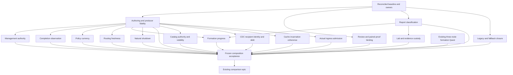

# Canonical authority and reliable formation

This continues `operation-integrity-and-reliable-formation`. A fresh cluster must
complete the existing public formation and user-table journey through one
canonical authority for each permission, completion, policy and routing decision.
Recovery retains obligations and progresses; startup and shutdown own their
resources. The authoring and proof workflow must catch invented contracts and
invalid evidence before integration.

## Current integration summary (11 November 2026)

- **Owner request, 11 November 2026 (queued, not started):** "when things work, please do the comparative systems analysis". Read as: once the sealed acceptance holds (three consecutive green lab formations), run the comparative measurement of Lagrange against the other systems under the epic developer-journey-and-measured-comparisons. Interpretation is the integration owner's; confirm scope with the owner before starting.

- **Governing rules and source:** rule-set revision 5. Committed head
  `103f132c13268321445369d3b4c1183ca2c39c66` on
  `work/canonical-authority-epic-20261110`; the overnight working tree
  (lab candidate fingerprint `5c46e7f33270d58c`) is preserved as local branch
  `snapshot/night-20261111-5c46e7f3` (`67fdf0ce4`). Nothing from it is accepted.
- **Integration responsibility:** the Claude Code session of 11 November owns
  integration, review coordination and landing for this epic's formation work.
  One writer per interaction; the writer assignments are listed below.
- **Latest physical witness:** candidate `5c46e7f33270d58c` on tv-dator,
  adam-laptop and adams-gamla: run 1 pass (147 s), run 2 pass (317 s), run 3
  fail at the 601 s bound. The streak is not three; the
  [formation receipt](../quests/fresh-formation-user-table-routability/evidence/receipt.json)
  still fails. Full compressed node logs are retained under
  `test-output/fresh-formation-wave4/5c46e7f33270d58c/.playback/`.
- **Causal account (quest log, 11 November findings):**
  1. Plan shape is a race. When the first planning pass sees a ready joiner the
     priority partitions spread by REPLACE, and a REPLACE always transfers
     leadership to its target (sealed rule BR11 of `replace-source-removal-owner`),
     moving planner and operation ownership onto joiners. Runs that spread by
     ADD then REMOVE move no leader and finish the priority phase in 70 s;
     REPLACE-shaped runs take 172-286 s with ACK-timeout storms, heartbeat
     failures and unplanned elections on the joiner-seed link.
  2. CDC push delivery is one event per wave behind one node-wide slot with
     head-of-line blocking. Measured 24-68 s behind commit under seed load, and
     one head event stuck about 150 s in run 3. Cache freshness is bounded only
     by periodic authority sweeps.
  3. The background priority-spread release fence counts a 70 s wall-clock
     window from a cache read model that excludes REPLACE source-removal rows;
     passing runs beat it by 61 s and 3.8 s.
  4. Scenario predicate g accepted a stale follower as its authority oracle in
     run 3 (harness fidelity finding; the predicate is sealed and unchanged).
- **Independent review of the overnight candidate:** rejected as composed
  (quest log verification, 11 November). Blocking: error classifier regressions
  (unknown-outcome answer vetoed by a linked cause; coordinator timeouts made
  terminal) and the 400 ms deferred catch-up. The 400 ms catch-up is reverted to
  the committed cadence. Sound at cause and retained: removal of the local-only
  SENDING claim, one-way raft-direct frames, `requireComplete`, late-ACK
  liveness, retained-recovery ordering, cohort preservation.
- **Active work (one writer each, shared checkout, disjoint files):**
  classifier and query budget repairs; rebalancer workflow repairs including
  the remaining owner-local-ahead-of-durable steps; REPLACE leadership rule and
  deterministic plan shape (supersedes BR11; owner confirmation required before
  landing); transport quarantine evidence and causal observability. A staged
  CDC delivery design note (batch shipping, recipient isolation, start
  position, freshness contract) is in preparation before any delivery change.
- **Next action:** review each writer's result independently, run the affected
  unit cones and static gates, then one instrumented lab run before any
  repeat batch. A red run stops the batch and is diagnosed from its first
  divergence. Comparative measurements consume only actual product evidence, as
  recorded in the
  [comparison epic](developer-journey-and-measured-comparisons.md#current-summary).

The dated E0-E9 material below is retained context, not another current summary.
Original observations and accepted bounded repairs keep their original scope.
Use the linked Quest logs and applicable evidence to determine current state.

## P0 reconciliation and explicit completion amendment

The user approved installation of the verified plan on 10 November. The sealed
[formation Quest](../quests/fresh-formation-user-table-routability/quest.json)
now names this epic, matching its pre-existing membership and receipt. Its
statement, constraints, sealing SHA, `doneWhen`, required receipt IDs and failed
receipt are preserved; the routing correction is appended to its log.

This epic's earlier completion criterion consumed only that service receipt.
It is explicitly replaced at the epic level by the broader
[Q12 aggregate](../quests/canonical-authority-formation-acceptance/quest.json).
This is an additional completion obligation, not a change to the sealed service
criterion. Q12 consumes the original service receipt and adds Q1-Q11 and Q13-Q16,
natural exit, evidence custody and frozen-composition proof. It may not duplicate the
service predicate or infer a pass from Quest status, a review note or a plan.
No aggregate receipt is fabricated; before sealing Q12, its existing proof owner
must produce reproducible input validation and a genuine red measurement.

Each new Quest declares its evidence location and concrete required receipt IDs.
Absence currently means `measuring: false`, never pass. New work seals only after
its actual probe measures red. Already sealed or terminal Quests retain their
acceptance; a changed sealed premise requires explicit supersession.

## Registered work and execution dependencies

Each linked record owns its statement, boundary, constraints and acceptance.
All rows apply P0 and Q1's contract-first discipline. Dependencies below govern
admission and final acceptance; Solver does not implement a dependency scheduler.
The semantic owner is named even when no execution agent has been assigned.

| Work | Quest | Responsible interaction | Difficulty | Admission dependency |
| --- | --- | --- | --- | --- |
| Q1 | [Make contract-first authoring executable](../quests/contract-first-authoring-and-producer-fidelity/quest.json) | Quest workflow, fixture guidance and selected real producer/consumer | medium | P0 |
| Q2 | [Bind review and interaction proof to the code](../quests/content-bound-review-and-interaction-proof/quest.json) | Solver/provenance and existing interaction-proof selection | medium | P0 |
| Q3 | [Make report classification refuse unsupported evidence](../quests/canonical-report-outcome-classification/quest.json) | Report producer, classifier and public triage/receipt path | small to medium | P0 |
| Q4 | [Consume management authority from the actual owner](../quests/management-action-authority/quest.json) | Consensus/partition authority and management consumers | high | Q1 |
| Q5 | [Give replica completion one canonical observation](../quests/canonical-replica-completion-observation/quest.json) | Replica repository and completion/recovery consumers | high | Q1 |
| Q6 | [Preserve policy currency for all outstanding reads](../quests/table-policy-outstanding-read-currency/quest.json) | Table-policy producer, outstanding reads and mutation consumer | medium to high | Q1 |
| Q7 | [Retire routing protection only after the relevant state catches up](../quests/routing-overlay-complete-state-retirement/quest.json) | Query engine, cache/projection and query executor | medium to high | Q1 |
| Q8 | [Restore formation progress without weakening safety](../quests/formation-spread-progress-at-cause/quest.json) | Planner, admission, membership and formation release; one writer | high | Q1, Q3 |
| Q9 | [Make failed and successful startup terminate naturally](../quests/node-startup-natural-shutdown/quest.json) | Node lifecycle and retained resource owners | medium to high | Q1 |
| Q10 | [Unify lab, census and benchmark evidence custody](../quests/lab-census-benchmark-evidence-custody/quest.json) | Canonical lab runner, census and benchmark proof producers | medium | Q3 |
| Q11 | [Close legacy and fallback removal by semantic owner](../quests/repository-legacy-fallback-closure/quest.json) | Existing per-owner retirement Quests; integration owns global reconciliation | scope dependent; potentially large | P0 |
| Q12 | [Prove the frozen composition and hand off to comparisons](../quests/canonical-authority-formation-acceptance/quest.json) | Integration and existing service/acceptance owners | integration | Q1-Q11, Q13-Q16 and original formation proof |
| Q13 | [Catalog authority and visible reconciliation](../quests/catalog-authority-and-visible-reconciliation/quest.json) | Catalog read consumer, canonical read-authority gateway and cache reconciliation owner | high | P0/Q1; Q2 review; shared-owner coordination |
| Q14 | [CDC recipient domain and retained debt](../quests/cdc-recipient-domain-and-retained-debt/quest.json) | Latency topology, message-group recipient mapping and CDC propagation progress interaction | high | P0/Q1; Q2 review; shared-owner coordination |
| Q15 | [Cache replica incarnation coherence](../quests/cache-replica-incarnation-coherence/quest.json) | Shared system-table cache ingress/merge and replica lifecycle publication interaction | high | P0/Q1; Q2 review; shared-owner coordination |
| Q16 | [Load admission ingress identity](../quests/load-admission-ingress-identity/quest.json) | Actual load ingress, discovery selection, table admission cache and query dispatch interaction | medium | P0/Q1; Q2 review; shared-owner coordination |

Diagnosis does not wait for every tool change. Q2/Q3 tooling and Q10 runner work
can proceed independently of runtime investigation. Q4-Q7 get separate writers
only after shared gateway/projection contracts are mapped. Q8 has one writer
across the complete transition; Q9 must coordinate if it touches that lifecycle.
Q13/Q15 share cache ingress and reconciliation and require one coordinated
writer; Q16 admission also includes its cache and request-context binding.
Count review, test and integration waits as WIP. Integrate one accepted
interaction at a time and record discovered causal dependencies here.

## Independent review reconciliation (10 November)

The second review supplies four concrete product interactions that the first
Q1-Q12 plan did not isolate adequately. Source inspection at `947fbe658` supports
the mechanisms below; the local runtime files are unchanged by this planning
branch. The report's behavioral witnesses remain verifier-reported: the linked
Library text/ZIP returned login pages and were not retrieved, and this session
ran no runtime reproduction. The reported seven green files/561 assertions are
not promoted to current independent execution evidence.

| Finding | Source-backed gap and disposition |
| --- | --- |
| Q13 catalog authority | The metadata consumer requests owner-local/owner-RPC empty confirmation without required leader authority, checks array-shaped rows rather than complete authoritative scope, and can classify raw fetch results as FOUND/applied while tombstones fence visibility. Repair the consumer and reconciliation contract together; retain genuine absence and stale-replay protection. |
| Q14 CDC recipient identity | Cached latency groups are mapped, but raw tree order is unioned as required message-group targets. Progress retains omitted captured groups. Repair all input mapping and already captured invalid bindings as one obligation-preserving interaction, using the real tree in both propagation modes. |
| Q15 incarnation coherence | Shared stale backfill can fill successor gaps from predecessor fields before the downstream identity guard sees the row. Fence merge/lifecycle advancement before provenance is lost and inspect the actual mutation payload. Durable corruption or quorum loss is not established. |
| Q16 actual ingress | The first local endpoint from mixed PostgreSQL/admin discovery decides admission; the cache is keyed only by table. Preserve actual service/protocol/incarnation through selection, caching and query dispatch, rather than search for any ready endpoint. |
| Comparison C1/C2 | Existing proof binding correctly rejects reformed deployments. The benchmark still needs a supported reset preserving the deployed cohort, and the TiDB runner still lacks required canonical case execution. Their implementation belongs to the existing comparison epic. |

The local branch graph confirms that `947fbe658ebb2efe993900b672ded51d5610dbcb`
and WIP `386644a2109bf2cc7847ee2b4a6002a7ad872e7f` diverge from
`c8215e322cbd1347f50297b7cfa5b6c669fae52a`. The WIP's later timestamp is not
integration precedence. The integrated active-read policy repair must survive
composition; Q6 records its exact source blob and adverse response-order witness
through `PriorityPublicationSafetyRows.getCriticalMinReplicaCount`, with ABA and
eviction controls. Source divergence was checked; this session did not execute
that witness or a destructive REMOVE.

These defects are candidates for the service's causal investigation, not proof
of the complete formation failure. Q8 must still trace the first divergence.
The original quorum, completion, routing, shutdown, custody and global removal
obligations remain open unless their own evidence discharges them. Additional
repairs do not waive the unchanged physical three-consecutive-run service seal.

## Reuse and scope boundaries

- [committed-readiness-fixture-custody](../quests/committed-readiness-fixture-custody/quest.json)
  retains its sealed readiness fixture proof; Q1 adds authoring/type-check
  prevention, not another fixture owner.
- [required-entity-operation-observation](../quests/required-entity-operation-observation/quest.json)
  retains its required entity-read seal. Q5 covers canonical completion and
  the remaining ordinary/per-operation callers excluded by that earlier repair.
  Coordinate the existing
  [system-table-row-decoders](../quests/system-table-row-decoders/quest.json)
  and its caller Quests before changing their shared boundary.
- [partition-placement-declared-target](../quests/partition-placement-declared-target/quest.json)
  retains its placement/policy proof. Q6 first verifies the current active-read
  repair and extends proof only where its actual currency contract requires it.
- [fallback-branch-coverage-census](../quests/fallback-branch-coverage-census/quest.json)
  and [comparative-benchmark-evidence-repair](../quests/comparative-benchmark-evidence-repair/quest.json)
  remain completed claims at their recorded scope. Q10 verifies current custody,
  execution, deployment binding and applicability; it does not reopen their seals.
- [code-navigability-and-mistake-resistance](code-navigability-and-mistake-resistance.md),
  [dead-fallback-retirement](../quests/dead-fallback-retirement/quest.json) and
  [live-dual-path-classification](../quests/live-dual-path-classification/quest.json)
  remain the existing bounded inventory/retirement owners. Q11 reconciles all
  maintained executable paths and global closure, including classes and paths
  beyond those limited probes. Register independent per-owner removal Quests
  where needed, without duplicate writers; include them in Q12 before closure.
- The original formation Quest alone owns the existing three-node user journey.
  Q8 is a bounded causal repair, Q9 adds natural-exit proof, and Q12 consumes
  their evidence. A local five-process diagnostic is not physical qualification.

## Completion and comparison handoff

The epic stays open until all required prevention and bounded repair work is
independently verified against applicable inputs, the original three-node receipt
passes its unchanged three-consecutive-run requirement on the frozen candidate,
natural shutdown and final custody/gates pass, and Q11 reports zero unresolved
legacy/fallback violations and zero unclassified candidate sites across its
repository-wide inventory. Classification, routing a violation to another Quest,
renaming a branch, a coverage gap or raising a ratchet does not close removal.
Legitimate defaults and owned representation conversion require a semantic
justification; they cannot conceal an alternate decision algorithm.

Use current source/caller evidence and meaningful negative controls, with safety,
progress after finite failures and bounded resources at the necessary deterministic,
native and physical layers. No deadlines, safety floors or service predicates are
weakened. Independent review returns all material findings for the interaction;
repeated rejection triggers causal/design reassessment, not another speculative
patch. Completed bounded repairs remain accepted within their measured scope
when a later service gate fails; the epic remains open for the named blocker.

The separate successor is
[developer-journey-and-measured-comparisons](developer-journey-and-measured-comparisons.md),
with its own public workload, five-node topology, actual deployment and semantic
qualification. The superseded matrix is not an execution owner. Three-node
formation, local diagnostics, comparative performance, publication and release
remain different claims. This planning installation authorizes none of their
unexecuted acceptance results.

## Evidence and historical research

The reassessment was captured from `947fbe658ebb2efe993900b672ded51d5610dbcb`.
Q12's append-only log records the retained local assessment/manifest locations
and hashes; no raw logs, copied source trees or fabricated run results are added
here. Q8 and Q9 name the relevant historical failure families in their records.
The existing service receipt and Quest log retain the original red acceptance.

Primary-source comparisons inform the design, not proof of Lagrange behavior:
[Raft membership](https://raft.github.io/raft.pdf) and
[etcd learners](https://etcd.io/docs/v3.5/learning/design-learner/) motivate
consuming the actual consensus configuration and transition evidence;
[FoundationDB's simulator](https://www.foundationdb.org/files/fdb-paper.pdf)
motivates faithful fault witnesses through production owners;
[checkJs](https://www.typescriptlang.org/tsconfig/checkJs.html) supports a bounded
concrete producer/consumer pilot. Configuration alone is not live quorum, a
parallel model is not production proof, and typing does not prove temporal safety.

## Historical milestone and integration baseline (4-6 November)

- **Assigned version milestone:** `0.4.1` (`RM-0.2.9-published-operating-contract`
  in `docs/development/agpl-feature-map.md`), the immediate bounded correctness
  and stabilization release following published `v0.4.0`
  (`07206ba1c8bb396f4eb097a753915bb34580d824`).
- **Preserved successor dependencies:** `0.5` retains five-node comparative
  qualification (`RM-0.4-wasm-public-comparison`, `RM-0.4-scenario-a-comparison`),
  standard HTTP/Hono service authoring (`RM-0.5-standard-http-service-api`), and
  full Queryable Core completion (`RM-0.2.9-stable-core-completion`). Three-node
  formation correctness in `0.4.1` does not claim five-node comparative
  performance.
- **Integration owner:** the current local integration session on
  `work/composed-05-comparison-readiness-20261103`, composing the reviewed
  `work/formation-takeover-20261105` lineage and resuming from the 6 November
  handover at `3bd7e2e8875c5ff32fd94162a3775aea991a35df`.
- **Reviewed baseline SHA:** `77e5b4c5ba01826f2ddceecb088f56fcd27b436e`.
- **Starting candidate SHA at E0:** `63e4a854b783d4b3176b3ecd123677384c96fafa`
  (one commit ahead of `77e5b4c5ba01826f2ddceecb088f56fcd27b436e`, landing
  `ServeEligibilityOwner` published-only epoch ratchet, required-domain node
  readiness completeness in `ControlPlaneReadinessService`, and bounded causal
  aggregation in `ControlPlaneDiagnosticsLedger`).
- **Retained red baseline and quests:** preserves
  `solve/quests/fresh-formation-user-table-routability/quest.json` (red physical
  run `multi-host-lab-run1-20261101T2118Z` retained in relocated bundle
  `comparative-benchmark-evidence-repair--comparative-benchmark-evidence-repair-evidence-435c426b9-2026-11-01.tar.gz`),
  `solve/quests/serve-eligibility-committed-epoch-read/quest.json`,
  `solve/quests/fresh-create-release-authority-from-committed-operation/quest.json`,
  and `solve/quests/replica-admission-from-committed-operation/quest.json`.

### Recorded integration status (6 November)

Resumed after the 14:44 UTC / 15:44 CET handover checkpoint on 6 November
(`/home/peter/Downloads/lagrange-handover-20261106T144624Z/`). The H1 and H2
proof corrections from `independent-planning-implementation-hold.md` are now
complete, including the retained-evidence fixture at
`readiness-planning-snapshot-identity-owner.test.js:854-865`, and the two-file
planning proof passes (2/2 files, 31 reported assertions) alongside all 33
static audits. Rule-set revision 5 remains in force; committed planning proof,
remaining causal repairs, E8, E9, publication, main merge and comparative
measurements remain open.

The two work branches diverged after `fffd9add`. The reviewed composition was
committed and pushed as `4024a23e7`, retaining all seven takeover commits through
`5e1d3223f` together with the composed branch through `827f7be7d`. Production
edits do not overlap. Both
lineages of the formation Quest log are retained byte-for-byte, in their
original order; earlier timestamps below are historical evidence, not current
acceptance. Generated inventories and test metadata are regenerated from the
combined tree.

The takeover contributes schema-job retry custody for temporary provisioning
refusals (`79088e840`, simplified by `9f9e03926`), retained serving-owner source
wakes without the 100 ms polling arm (`340e34e48`), exact FAILED lifecycle/replay
custody and the nested epic YAML parser (`9ee285e1a`), and committed-node lease
consumption without cache fallback (`5e1d3223f`). Its diagnostics/CDC helper
extractions and genuine three-process no-admin witness (`2f344fde5`), plus
startup-owner evidence (`d717874ca`), are retained. The bounded completed-handoff
E3 witness and its disabled-trigger control remain separate from the new
three-process proof. The E6 every-ACK negative, native proposal-count proof and
seven-field E7 accounting remain intact.

The three bounded prerequisites `explicit-single-replica-partition-configuration`,
`parallel-query-read-authority-propagation` and
`admin-diagnostic-owner-consolidation` have each passed independent review and
normal `solve.js land`. Their receipts bind their bounded evidence to source
`26f786b2`; none closes E8, E9 or publication. The takeover's broader gates
remain red: 25 failed files in its 1,350-file change cone, plus six distinct
failures in the earlier Q6 set. Reproduction on a predecessor does not waive
any of these failures. Final F10 liveness lab proof, startup/replay Quest
landing, combined-tree verification and broader publication proof remain due.

The pre-composition transaction-facade failures are retained. The single permitted
unchanged `26f786b2` standalone retry again timed out at I2.1. A separately
instrumented, product-source-identical diagnostic passed I2.1 but failed I2.2b
(expected one callback step, observed zero; 48/49 TAP assertions passed).
Complete logs show `replica_operations-p1` release refusing
`current_control_owner_fact`, then recovering after about a minute. This is
bounded-progress evidence, not proof of a permanent deadlock or of the exact
nested control-owner cause. Tracing the declared priority target and table-policy
authority, and examining the existing release owners, remain investigations;
no speculative cutover repair or deadline relaxation is admitted. The unchanged
transaction fixture passes on composed `4024a23e7` (58 runner assertions,
106,454 ms, first attempt on TV); this does not identify which change affected
its outcome.

All 33 static audits pass on `4024a23e7`. Its 17-file composition proof on Lenovo
passes 16 files (1,372 total reported assertions). The genuine three-process
no-admin witness fails at the application CREATE probe: quorum remains
unavailable within the existing 68,702 ms factor-scaled bound. All three guards
report `installed: true, calls: []`; six retained log/guard files match their
remote hashes. The complete package manifest is
`sha256:36cf52246105c954ec61abd2002e3532931544b285fce33c2686839488977ea4`.
No retry of that combined-source formation witness has been submitted, and E8
remains red.

A separate real-owner discriminator now exposes the historical S6b target
divergence: actual seeded system partition rows and readiness declare RF3,
while table policy with the explicit RF1 application default feeds RF1 into
the actual planner, which emits REMOVE r2 for both `replica_operations` and
`sql_transactions`. Supplying only the existing declared-target answer makes
both planners emit no move. The sealed `partition-placement-declared-target`
repair now projects that sole declaration through table policy, the planner
and coordinator. It removes the alternate table target field, inert setter
APIs, clamping/default target paths and unavailable-policy permission. Admin
and CREATE reject unsupported target requests before effects. Real-owner
local witnesses cover declared RF1/3/5/9, finite policy-read recovery through
the existing scheduler with a disabled-trigger negative, and minimum-five
REMOVE refusal with retained retry custody. Shared policy test fixtures have
one implementation. Independent implementation review, frozen lab proof and
normal Quest landing remain required; this is not E8 or E9 acceptance and
does not explain the separate default-RF3 three-process failure by itself.

Adam's completed migration keeps both active container stores and rollback data
under `/mnt/old/lab`; the last direct check found 12 GiB free on root and 52 GiB
on `/mnt/old`. E9 retains `adam-laptop,lenovo-laptop,tv-dator`, the same physical
scenario and three consecutive fresh-state successes on one final candidate.
The takeover's temporary `adams-gamla` substitution and low-space warning are
historical. No current-candidate E9 run, publication, main merge or comparative
measurement has completed. Comparative measurements follow the main merge.

### Recorded proof package (6 November)

Current integration status: the takeover history is composed and the three
bounded prerequisite Quests have terminal land records. `51269c445` preserves
the lab inventory temporary-file race repair and partition-target fixture
corrections. `b15227816` consolidates readiness test-port construction and
supplied-port custody. `8b08183a7` carries the independently reviewed required
entity-operation observation repair and seven caller-fixture corrections.
Its frozen affected selection reports **1,095 passing files, 40 failing files,
and 43,906 reported assertions across 1,135 files**. This is not the full corpus.
Collected logs and their byte-verified manifest are retained under
`test-output/verification-20261106-partition-target/operation-observation-frozen-callers/`.
Same-host `b15227816` controls reproduce 27 of those failures; 13 files pass
the predecessor, including 12 corrected fixture callers and a retained-seed R1
timeout still under investigation. Neither inherited redness nor a predecessor
pass establishes a cause by itself. The independently reviewed `2b446a7ce`
checkpoint consolidates coordinator construction, storage result construction,
and gateway session forwarding. All 33 static audits pass. Its frozen Lenovo
run passes 30 of 31 files (1,451 reported assertions): all 27 ordinary files,
message-group routing and two partition-policy integrations are green.
Membership-consistency Test 7 now passes, but the file exhausts its unchanged
240-second parent bound at Test 15 after repeated bootstrap delays; that failure
remains open. Logs and checksums are retained in `coordinator-fixture-frozen/`.

Four inherited contract repairs and `system-cache-reconciliation-ingress` are
committed in independently reviewed checkpoint `61ce6e979`: explicit S6a
planner-witness supersession, dead query vocabulary removal, committed readiness
fixture construction, removal of the helper-hidden SQL target trust fallback,
and one private write primitive in the existing cache reconciliation owner.
The prior-source negatives remain retained. The exact committed-tree Lenovo
check passed all 18 focused files with 1,477 reported assertions, attempt one
without retries; `cache-and-contracts-frozen/` retains the logs and byte-verified
manifest. Committed applicability binds the reviewed manifests to that tree.
All 33 static audits passed the reviewed source. The canonical source-range
selection from `2b446a7ce` to `61ce6e979` contains 1,880 files and remains owed;
a later receipt-only change cannot replace that implementation proof. No Quest
or epic receipt is admitted by the bounded results.

The real three-process no-admin witness passed on `205b5683f` at Lenovo's measured
factor 2.3 with zero guarded admin calls. Its predecessor used factor 1.4, so this
is bounded candidate evidence, not a same-budget causal comparison or E9.
`committed-node-remove-safety-wake` now owns the confirmed R17 floor/wake defect:
the workflow cache receiver is unbound, projected floor credit competes with
committed authority, and unavailable evidence must defer before the source-not-
counted SAFE exit. Its independently approved design is implemented in the
current worktree. The first independent implementation review held missing
replica identity admission, unrelated initiator dependencies, mutable intrinsics,
nested row custody, a masked clock assertion and explicit interaction registration.
The follow-up approved four findings but retained HOLD on outer/scalar evidence
admission and mutable map reads through floor credit. Those remaining paths are
corrected in manifest `11308747`; both earlier reviewed byte sets and failed
controls are preserved. The expanded 40-file caller check passes with 3,068
reported assertions, and the unchanged reviewer counterexamples now refuse the
hostile inputs without changing shared identity. All 33 static audits pass.
Independent review `7af63aa2` approves those exact bytes for normal WIP checkpoint
and frozen proof. Committed applicability was verified at `ab55403b`; its
first frozen Lenovo schedule passed 39/40 files and retained the completion
file's unscaled 30-second TAP root timeout. Same-host single-file diagnostics
passed on both parent and candidate without changing their source. The separate
`tap-default-machine-factor-portability` repair owns that execution defect.
Its reviewed and committed `d511e4f0` candidate passes the original 40-file
schedule with 3,068 reported assertions and no retries; the completion file
passes 147 assertions in 33,095 ms process duration. Fresh machine factor 2.4
differs from the prior 2.3 and is recorded, not presented as identical-budget
causal evidence. Independent applicability `325afcdb` verifies the committed
inputs and bounded result. Full source-range/runner proof and receipts remain
required before closure.
The bounded bulk-readiness domain repair removes only unconditional observer-ID
injection. Both bulk readers retain published, required and observed nodes,
including negative missing-row entries. Two focused files pass 163 assertions and
all 33 static audits pass; independent review 59cec4ff approves the three-path
manifest 0a346fe6 for WIP checkpoint. Exact committed applicability at 502c603f
and its first-attempt Lenovo frozen proof (2 files/163 assertions) are approved
by 4dafa304. The strict-hydration fixture now supplies the actual cache and one
explicit router, reaches the real missing-SERVICES verifier and prevents mode
swap; its two files/11 assertions and owned teardown are independently approved
by 9a3a85f9. Exact 6cd5753f committed/frozen applicability is approved by
c5c95acb (2 files/11 assertions, first attempt). This remains a fixture
correction; full source proof and receipt admission are still due.
The unchanged predecessor has three inherited readiness callers red: two
planning identity/build-cost witnesses and the missing-both-rows self-grace
fixture. Planning custody now reduces whole-rig builds from 685 to 565 while
preserving the 1,020 observed readiness results, and its corrected two-file
proof passes 31 reported assertions; committed `ad0d64de` and its first-attempt
Lenovo frozen proof (2 files/31 assertions) are approved by `5e8512cf`. The
missing-both-rows self-grace contract (`readiness-self-grace-service-evidence-contract`)
is committed at `e8fd1cc6`, passes the frozen 28-file readiness caller proof on
Lenovo (28/28 files, 2,738 reported assertions, first attempt), and is
independently approved (`independent-e8fd1cc6-applicability.md`). Operation-bound
failed-create cleanup claim normalization (`failed-create-cleanup-claim-normalization`)
is committed at `6317f224`, passes the frozen 9-file cleanup and admission proof
on Lenovo (9/9 files, 359 reported assertions, first attempt), and is
independently approved (`independent-6317f224-applicability.md`). The remaining
retained source-cone fixture and host-factor repairs (`cluster-test-helpers.js`
partition forwarding, `replace-source-removal-owner.test.js` readiness fixture,
`single-path-partition-cutover.test.js`, `fresh-seed-activation-public-child.js`,
`seed-migration-cutover-persisted.integration.test.js`,
`critical-replica-placement-causal-trace.integration.test.js`, and
`membership-consistency.integration.test.js` machine-factor scaling) are locally
verified and ready for independent review and frozen lab proof. The existing
semantic owner now distinguishes invalid lease data from explicit clearing;
committed node authority supplies floor credit and the existing retained owner
subscribes to meaningful committed changes. The bounded real-owner witness
holds planning deliveries and fallback timers in both arms: disabling only the
committed subscription prevents progress, and releasing the held planning
notification provides the separate recovery control. This isolates that trigger's
contribution without claiming it is production's sole trigger.
Its record explicitly supersedes the exhausted predecessor Quest's lease-zero
carve-out without editing that terminal history or its separate five-node gate.
The adjacent cached SERVICES topology fallback/merge is recorded separately and
is not endorsed as authoritative. The bounded runtime-definition/CREATE repair
now has one canonical policy and one explicit authoritative keyed read, with
retained-origin precedence. The shared Binding owner validates generated version
identity and canonical declaration digest; invalid lineage cannot grant placement
or CREATE. Local expanded proof passes 25 files/792 reported assertions, followed
by 2 files/94 after mechanical test corrections, and all 33 static audits. The real
coordinator recovery witness holds then runs its retained retry callback after a
finite authority failure, preserving the durable operation and replica identity;
its scheduler and persistence boundaries are controlled. Independent review
`71b2104e` approves exact content manifest `337b3a6b` for WIP checkpoint only.
Exact committed applicability at 04459151a is approved by 5231611c, and its frozen
Lenovo 25-file schedule passes 792 reported assertions on the first attempt.
The separate public Binding journey on 04459151a fails before application CALL:
sys-postgres-wire never publishes its endpoint and CREATE repeatedly reports
service_definition_authority_unavailable. Diagnostic-only 339a5463, with product
bytes unchanged from 04459151a, observes the actual handler missing its gateway.
ControlPlaneSetup created the owner without returning it, and seed/join did not
retain it for guarded runtime setup. The bounded repair returns that exact
owner and shares its seed/join handoff, checks the named gateway prerequisite
in the existing startup gate, and clears the retained reference through existing
cleanup owners. Seven focused files/334 assertions and all 33 static audits pass.
Committed `3bd7e2e8` passes the public Binding journey (one file/70 reported
assertions) and the first executed frozen focused batch (31 files/1,117), both
on Lenovo without retries. Independent committed applicability `31d8337a` and
focused addendum `0e464513` approve these bounded claims. The initial wrapper
finished the public journey, then failed before focused planning by reusing a
released source snapshot; its exit-1 disposition is retained. The focused batch
used a fresh snapshot of the same SHA. Full source-range proof and formal receipt
admission remain required. The old-source negatives and independent
malformed-lineage failures remain retained. Readiness diagnostics now attribute
100 additional heavy builds to nested fresh bulk evaluations during publication
planning, not the unexecuted background queue; the required-node output contract
must be preserved while repairing that cost. Other retained reds, final E8,
unchanged E9, publication and main merge remain open. The current
integration session owns the committed planning proof and remaining causal
repairs.
Comparative measurements follow acceptance and main merge. Adam's active stores
remain under `/mnt/old/lab`; a fresh fleet check reports about 52 GiB available
there, and the migration rollback is retained.

- Candidate base: `fffd9addfd600cf58bc0c40b1c7df43d5ba4a899`, clean on takeover;
  rule-set revision 5. The user-provided evening review accepts the bounded
  production repairs in E1, E2, E4, E6 and E7. Their existing adverse schedules
  remain retained; this does not complete E8 or E9.
- E3 now has a bounded completed-placement handoff witness in
  `test/admin/completed-placement-autonomous-progress.test.js`: terminal ADD
  and stale target visibility are initial conditions. A settled SERVICES read
  refusal clears, the existing membership driver and CDC hydration wake the
  real priority-visibility listener, and the publication owner persists a
  satisfied priority summary through the gateway into SQLite. No new ADD
  execution is claimed. The first admin read follows durable assertions.
  Its disabled-trigger negative must remain unresolved for the same 40-second
  virtual recovery bound, preserving the production 5-second driver and
  30-second catch-up cooldown.
- E6 validates **every** proposed `CDC_DELIVERED` command before measuring it;
  adding a 257-event ACK to otherwise valid batches must fail measurement.
  Router deliveries retain a separate transport-count assertion.
- E6 proposal cost is bound to
  `test/topology/cdc-group-propagation-proposal-cost.test.js`:
  `K = 4` distinct source event waves, `M = 3` message groups **including the
  source**, `c = 1`. The healthy schedule has sequential waves, native RF1
  group leaders, no injected faults or leadership changes, and timely native
  application. Count every call to each real consensus port's `propose`,
  including any refused or retried attempt, after group setup. The measured
  bound is `proposals <= c*K*M` (12), with native applied-index advancement
  and cache effects on every group. This counts CDC propagation proposals;
  source-partition SQL/`CDC_DELIVERED`, setup and membership proposals are
  excluded. The negative doubles real native proposals (24) while transport
  stays at eight deliveries and must reject the same bound. This is a
  component/native healthy-schedule claim, not physical performance evidence.
- E7 names the outward seven-field accounting below. E8 final committed-tree
  focused/process-isolated proof and independent verification, and E9 three
  consecutive fresh-state physical runs remain open. The formal receipt stays
  failing until its existing obligations have evidence. Continuation owner:
  the current local integration session; no physical run has yet been submitted.
- E8 on frozen `0bafa0f3e5fba82ab6b580d3f2bc185f70dddf01` passed 28/29
  files on tv-dator (2,130 reported assertions). The one-runtime embedded
  public-seam fixture requested default RF3 and correctly received
  `PROVISIONING_UNAVAILABLE`. The bounded prerequisite
  `explicit-single-replica-partition-configuration` makes RF1 an explicit
  public startup choice for that fixture while retaining default RF3 and
  its requested quorum. The new configuration regression is red on the
  previous schema. E8 must run again on the resulting frozen candidate.
  The earlier E3/E6 content approval is retained, not promoted to E8 approval.
- E9's archived registered red baseline has been recovered and its two
  bundle hashes verified. The first-divergence receipt still needs the
  same-learner authoritative SERVICES/cache observation identified in the
  historical H1 investigation; the current reviewer is checking retained
  owner diagnostics. Three future green runs alone cannot supply that causal
  observation. This does not change any physical acceptance predicate.
- E8 on frozen `1bbbe17dcec3db9c93eb846e9d70f36c0d8d7bf2` passed all
  30 focused/process-isolated files on tv-dator (2,326 reported assertions)
  and received exact-candidate independent approval. Later fixture and
  diagnostic changes require a new frozen verification; this result is not
  current-candidate or whole-corpus acceptance. Two additional public fixtures
  on `5d678fca9c22ff4bf10b0a04e93928246d58111e` passed with explicit RF1
  (transaction facade: 58 assertions; consumer contract: 123 assertions).
  The new default-RF3 fixture observed the specific provisioning refusal and
  retained RF3, then timed out on a follow-on INSERT; that failed attempt is
  preserved and is not counted as a passing file.
- Three bounded historical H1 attempts remain unadmitted. The first used a
  different seed placement; the next two used the original tv-dator/Adam/
  adams-gamla placement. The admin log feed missed native refusal events;
  the corrected container-stdout observer captured them. The original SQL
  shape still used a local-cache shortcut. A corrected routed DISTINCT read
  returned rows but no authority witness because the existing parallel-query
  success mapper dropped that field. The bounded diagnostic prerequisite
  `parallel-query-read-authority-propagation` forwards the serving owner's
  supplied evidence through ordinary and speculative success. It does not
  change formation decisions or retroactively admit unwitnessed observations.
  Historical diagnostic runs are separate from E9's untouched physical gate;
  no current-candidate E9 run has yet been submitted.
- E8 on frozen `6b0d1f2ae3e84c5045cab6448bca93247de79264` passed all
  36 files on tv-dator: 2,708 reported assertions, each file on its first
  attempt. Independent review verified the retained manifest, source hashes,
  worker identity and clean candidate. The default-RF3 negative ends at its
  scoped CREATE refusal and retained RF3; it makes no INSERT latency claim.
  Subsequent admin source consolidation requires a fresh frozen E8 binding.
- The fourth historical run on `e5770352` plus the explicit read-witness
  diagnostic overlay reproduced red in 553,301 ms. Independent review admits
  the prescribed H1 observation for two current learners: witnessed SERVICES
  leader rows, complete seed cache absence brackets, and later same-key
  address refusals whose synchronous resolver had no usable mapping. A third
  capture observes arrival within the bracket and is classified separately.
  The earliest logged visibility-bound breach and repeated CDC holds are
  retained; identifying the precise withholding obligation/subscriber and
  binding the repair to that cause remain distinct from this observation.
  Full logs, report, raw envelopes and review are retained in the
  [verified H1 evidence archive](https://github.com/psvensson/lagrange/releases/download/solve-evidence/fresh-formation-user-table-routability--h1-authority-e5770352-diagnostic-20261106.tar.gz)
  (SHA-256 `580c684639ae62838ef17f83cfacc1994d784700474be908e2faebde833eb9a9`).
- Adam's user-run storage migration is complete. Docker and containerd use
  `/mnt/old/lab`; root has 12 GiB free and `/mnt/old` has 52 GiB free after the
  historical run. Original stores are retained in the migration rollback
  directory. This removes the storage prerequisite, not the formation gate.
- The publication ratchets reproduced 1,726 complexity violations against
  1,720 and source duplication 40 groups / 1,267 lines against 39 / 1,236.
  Bounded Quest `admin-diagnostic-owner-consolidation` removes two exact
  diagnostic clones, shares CDC diagnostic reads and separates per-partition
  projection from aggregation. First measurements are 1,720 complexity
  violations and 38 duplicate groups / 1,207 lines; the duplicate baseline is
  tightened on the checker's hint. Independent review and committed lab proof
  remain required. No physical E9 sequence, publication, merge or comparative
  measurement has been completed.
- Expanded E8 at `de8ccfe430d7836a3ba69df41112089b81573f59` passed
  39/40 files (2,856 reported assertions). The added outward admin fixture
  alone expected an ACTIVE target service to hide a CREATING ADD. The same
  two failures reproduced at `6b0d1f2` on the same tv-dator host; the liveness
  owner and fixture were unchanged. Its correction retains in-flight `1`
  and timeline `true`, as E3 requires. All five isolated embedded/runtime
  files passed. This red package remains retained, not accepted as E8.
- Whole static checks at `de8ccfe43` passed 31/33. The remaining unused
  pressure/timeout helper is now consumed through its existing diagnostic
  owner (unused exports 1,389/1,389). The separate bounded retry-contract
  repair removes an inherited `entity_type` alternative from the normalized
  operation decision; repository ingress already owns conversion to
  `entityType`. Its authority guard passes without changing retry budgets or
  canonical runtime-service retry behaviour.
- Candidate `26f786b202b5b8614d6fc927f6d457be75273d4f` passes all 33
  whole-tree static audits. Its expanded E8 package passes 41/42 files
  (2,888 reported assertions); the first transaction-facade request times
  out and later assertions cascade. The unmodified predecessor `de8ccfe43`
  reproduces that first timeout on the same TV host. Both red runs are
  retained. Warning logs show operation-ledger writes paused after membership
  removal; a separate INFO-level diagnostic must establish the release
  owner's refusal before assigning a repair. No timeout, hold or acceptance
  condition has been relaxed.
- The same `26f786b2` passes ten additional causal witnesses on Lenovo
  (348 reported assertions), independently verified. Existing accepted
  learner/admission/peer repairs implement H1's prescribed alternative:
  the decision reads committed authority instead of awaiting a cache row.
  The historical witness and accepted rejecting controls support that
  boundary; they do not identify a particular CDC subscriber's withholding
  mechanism. Full E8, unchanged E9, receipt admission, publication and merge
  remain open. Comparative measurements follow the main-branch merge.

## Approved user-visible contract

1. **Fresh three-node formation:** each node's serve lane opens from committed
   authority (`serveEligible: true`), all six priority partitions reach
   `readyDistinct == required`, and `replica_operations` reaches `0` in-flight
   for the registered quiet window.
2. **Approved `CREATE TABLE` contract:** completes at the sealed committed
   quorum-minimum cohort with a visible typed `under_replicated` outcome when
   appropriate, returns typed `57P03` (`PROVISIONING_UNAVAILABLE`) below quorum,
   and retains responsibility for completing replication.
3. **Public SQL routability:** `SELECT COUNT(*)`, `INSERT`, and readback succeed
   from every node with zero `learner_address_unresolvable` refusals for
   durably committed learners.
4. **Observational purity:** diagnostics and readiness/snapshot observers
   observe progress without mutating product caches or causing convergence.

## Historical E0-E9 work package map (6 November)

These statuses describe the earlier composition; the current summary and linked
Quest evidence above govern continuation.

| Work package | Invariant | Production owner | Retained obligation / trigger | Test and evidence | Status |
| --- | --- | --- | --- | --- | --- |
| `E0` Candidate & baseline | Single version milestone (`0.4.1`), one composed candidate from `77e5b4c5b`, preserved quest seals and successor links | `solve/epics/operation-integrity-and-reliable-formation.md`, `docs/development/agpl-feature-map.md` | Keep epic/quest/roadmap alignment current at each package boundary | `npm run audit:roadmap-authority`, `node scripts/solve.js board` | Complete (`572461011`) |
| `E1` Authority & metadata meaning | Preserve `ELIGIBLE`/`INELIGIBLE`/`ABSENT`/`UNAVAILABLE` definition outcomes; decisive SQL authoritative absence vs unavailable routing; sealed quorum-minimum initial partition provisioning without observed-singleton RF3 downgrade; `PUBLISHED`-only epoch floor; complete `SELECT` plan propagation and post-overlay routing snapshot repair | `src/node/runtime-service-definition-resolution.js`, `src/node/runtime-service-generic-replica.js`, `src/control-plane/serve-eligibility-owner.js`, `src/query/sql-query-engine-metadata-authority-refresh.js`, `src/query/sql-query-engine-initial-partition-provisioning.js`, `src/query/sql-query-engine-provision-target-methods.js`, `src/query/query-executor-partition-routing-snapshot.js` | Authoritative SQL absence overrides and evicts stale cached presence; RF3 sealed quorum minimum (`2`) never downgrades to `1` on observed singleton node count; `awaitPostOverlayRoutingRepair` passes positional `routingReadinessDimension` through the overlay/serve-refresh chain | `test/node/runtime-service-handler.test.js`, `test/query/sql-query-engine-cold-metadata-plan-coherence.test.js`, `test/query/sql-query-engine-provision-partition-waits.test.js`, `test/control-plane/serve-eligibility-owner.test.js`, `test/control-plane/serve-eligibility-committed-epoch-read.test.js`, `test/query/sql-query-engine-execution.test.js` | Bounded repairs verified by evening review at `fffd9add`; composed acceptance E8/E9 pending |
| `E2` Role-publication freshness & voter readiness | Monotone revision-fenced role publication and shared incarnation-fenced `raft_role` preservation across durable persistence and local seeding; purpose-specific voter readiness | `src/raft/authoritative-row-mutation-helper.js`, `src/partition/partition-service-metadata-mutation-helpers.js`, `src/message-group/message-group-service-metadata-publication.js`, `src/node/replica-state-machine-lifecycle-observation.js`, `src/node/replica-state-machine-transition.js`, `src/node/replica-handler-create-status-methods.js`, `src/node/replica-handler-status-methods.js`, `src/raft/replica-voter-readiness.js` | Superseded flush revision and stale cached `raft_role` yield to current live Raft role; durable role persistence and local priority seeding share one incarnation-matching rule in `replica-state-machine-lifecycle-observation.js` | `test/raft/authoritative-row-mutation-helper.test.js`, `test/partition/durable-voter-visibility-role-write.test.js`, `test/node/replica-state-machine.test.js`, `test/node/replica-local-only-row-convergence.test.js`, `scripts/check-voter-readiness-single-owner.js` (metric 0) | Bounded repairs verified by evening review at `fffd9add`; composed acceptance E8/E9 pending |
| `E3` Causally read-only observation & honest admin liveness | Zero observer-originated product cache writes and convergence progress without admin polling; outward `inFlightCount` uses `replica_operations` terminal state without active-service shortcuts or local observer startup-time erasure of remote owners' operations | `src/cache/read-only-system-table-cache.js`, `src/node/node-runtime-local-authorities.js`, `src/admin/admin-control-snapshot-local-build-base.js`, `src/admin/admin-control-snapshot-leadership-summary.js`, `src/rebalancer/replica-operation-liveness.js` | Read-only cache proxy throws `READ_ONLY_SYSTEM_TABLE_CACHE_MUTATION` on write/reconcile; `ignorePreRestart` requires actual operation owner start-time evidence; convergence progresses without `getControlSnapshot` polling | `test/admin/admin-control-snapshot-local-published-membership-recovery.test.js`, `test/admin/admin-control-snapshot.test.js`, `test/admin/completed-placement-autonomous-progress.test.js` | Bounded handoff proof independently approved; E8/E9 pending |
| `E4` CREATE, retry, transition & cleanup custody | Post-`ACTIVE` transient progress deferral preserves live runtime; confirmed boot/attempt supersession fences and retires superseded runtime via single cleanup owner (`fenceFailedReplicaCreateRuntime`); per-call admission observation; workflow visibility across concurrent admission/membership advancement and terminal timestamp adoption; bounded mutation retry cost | `src/node/replica-create-admission-owner.js`, `src/node/replica-create-admission-retained-recovery.js`, `src/node/replica-runtime-cleanup-custody.js`, `src/node/replica-create-process-owner.js`, `src/node/replica-handler-create-methods.js`, `src/rebalancer/replica-operation-repository-mutation-persistence-methods.js`, `src/rebalancer/operation-workflow-coordinator-created-handoff-scheduling.js`, `src/rebalancer/operation-workflow-transition-retry.js` | Per-call `{progressed, row}` prevents cross-call `lastAdvanceRow` bleed; retained recovery delegates runtime unregistration exclusively to `fenceFailedReplicaCreateRuntime` and requires positive tagged/instance identity match; workflow UPDATE confirms when concurrent admission/membership owner advances its fields | `test/node/replica-create-admission-owner.test.js`, `test/node/replica-create-admission-recovery.test.js`, `test/node/replica-runtime-cleanup-custody.integration.test.js`, `test/rebalancer/replica-operation-confirmation-authority-read.test.js`, `test/rebalancer/coordinator-created-operation-progress-remote-handoff.test.js` | Bounded repairs verified by evening review at `fffd9add`; composed acceptance E8/E9 pending |
| `E5` Deferred join, config & runtime handoffs | Deferred join message-group activation retains owned retry trigger; subscribe-before-hydrate config initialization; `WasmComponentDriver.#prepareRequestCell` generation fence before and after `stop(serviceId)` | `src/bootstrap/node-joining-message-group-runtime-delegation.js`, `src/config/raft-adaptive-timing-controller.js`, `src/config/dynamic-config-service.js`, `src/runtime/wasm-component-driver.js` | Retained `deferredMessageGroupServiceReplicaIds` re-drives on bounded timer until empty or shutdown; `WasmComponentDriver.#prepareRequestCell` aborts after `await stop(serviceId)` if service generation changed | `test/bootstrap/node-joining-service-message-group-activation.test.js`, `test/config/raft-adaptive-timing-controller.test.js`, `test/config/dynamic-config-service.test.js`, `test/runtime/minimal-deployment-request-cell-runtime-readiness.test.js` | Complete (`65cc65b62`) |
| `E6` CDC fairness, exact coverage & hydration handoff | 3+ contender FIFO slice fairness with live credit retention across delayed ACK continuations and lifecycle-only contender retirement; bounded `<= 256` hydration ACK batches with actual-prefix pressure preserved; absolute retry timer deadlines (`dueAtMs`); pre-hydration invocation retirement via progress-cell `logIndex` and verified `command.acknowledged` batches | `src/topology/cdc-group-propagation-durable-delivery.js`, `src/topology/cdc-group-propagation-service.js`, `src/partition/partition-cdc-obligation-progress.js`, `src/partition/partition-cdc-obligation-delivery.js` | Reservation hold expiry (`300ms`) allows ready work without dropping a live contender's FIFO queue position or credit; actual owed-prefix pressure (`readOwedCdcHead`) bounds retained delivered rows; retry timer preemption compares absolute `dueAtMs`; `command.acknowledged` batches verified `<= 256` | `test/topology/cdc-group-propagation-service.test.js`, `test/topology/cdc-group-propagation-proposal-cost.test.js`, `test/partition/cdc-hydration-live-handoff.test.js`, `test/partition/partition-cdc-obligation-reclamation.test.js` | Bounded fixes and explicit ACK/proposal measurements independently approved; E8/E9 pending |
| `E7` First-cause diagnostics & required-domain evaluation | Bounded key-based diagnostic aggregation retaining `firstSample`, `latestSample`, original cause, boundary, owner, trigger, and explicit truncation/eviction loss accounting outward on `AdminControlSnapshot`; complete keyed readiness disposition over published required node domain | `src/control-plane/control-plane-diagnostics-ledger.js`, `src/control-plane/authoritative-node-evidence-reconciler.js`, `src/control-plane/control-plane-readiness-diagnostics-eligibility.js`, `src/control-plane/control-plane-system-table-gateway-dependency-resolution.js`, `src/admin/admin-control-snapshot-readiness-diagnostics-methods.js`, `src/admin/admin-control-snapshot-control-plane-diagnostics.js`, `src/control-plane/control-plane-readiness-service-node-methods.js` | Every required node in published membership receives an explicit readiness entry; `ControlPlaneDiagnosticsLedger` bounds payload values, preserves distinct-key root causes under secondary churn, and exposes explicit loss accounting (`evictedKeys`, `overwrittenEntries`, `droppedSamples`, `truncatedStrings`, `truncatedArrays`, `truncatedObjects`, `totalLossEvents`) outward on `AdminControlSnapshot` | `test/control-plane/control-plane-readiness-service-cluster-health-and-recovery-diagnostics.test.js`, `test/admin/admin-control-snapshot.test.js` | Bounded mechanism verified at `fffd9add`; outward field names reconciled; E8/E9 pending |
| `E8` Composed verification on faithful substrates | Deterministic repros with negative controls and process-isolated embedded-cluster verification covering E1–E7 on one canonical candidate SHA | `test/closure/registry.json`, `test/integration/helpers/embedded-cluster-harness.js`, focused unit/integration suites | Fresh independent verifier must bind approval and negative controls to the final committed candidate; earlier approvals retain only their measured scope | Focused witnesses, genuine three-process `test/integration/fresh-formation-without-admin-polling.integration.test.js`, native owner-wake negative in `test/convergence/dt6-publication-quorum-failback-network.test.js`, public application fixtures and exact-candidate independent verification `approve` | In progress |
| `E9` Unchanged physical acceptance & closure | Three consecutive green fresh-state runs of `fresh-formation-user-table-routability` on `local-three-node.json` (`adam-laptop,lenovo-laptop,tv-dator`) and admitted proof receipt | `scripts/lab.js`, `solve/quests/fresh-formation-user-table-routability/evidence/receipt.json` | Full node logs, harness reports, and admitted receipt bound to exact candidate SHA | `node scripts/lab.js harness run fresh-formation-user-table-routability --base test/distributed/config/local-three-node.json --nodes adam-laptop,lenovo-laptop,tv-dator` (x3 consecutive, frozen clean candidate) + `node scripts/solve.js probe --id fresh-formation-user-table-routability` | In progress |

## Decision log

- 2026-11-04: Created `operation-integrity-and-reliable-formation` for milestone
  `0.4.1` (`RM-0.2.9-published-operating-contract`), binding work packages
  `E0–E9` to one composed candidate starting from reviewed baseline
  `77e5b4c5ba01826f2ddceecb088f56fcd27b436e` (current `HEAD`
  `63e4a854b783d4b3176b3ecd123677384c96fafa`). Preserved existing quest seals
  (`fresh-formation-user-table-routability`,
  `serve-eligibility-committed-epoch-read`,
  `fresh-create-release-authority-from-committed-operation`,
  `replica-admission-from-committed-operation`) and `0.5` successor dependencies
  for five-node comparative qualification.
- 2026-11-05: Reopened `E1`, `E2`, `E3`, `E4`, `E6`, `E7`, and `E8` to address
  the 2026-11-05 independent observer findings on one candidate while retaining
  completed subcases: single-owner custody unregistration and shared incarnation
  provenance (`E4`/`E2`), removal of RF3 observed-singleton quorum downgrade and
  positional `routingReadinessDimension` in `awaitPostOverlayRoutingRepair`
  (`E1`), CDC actual-prefix pressure + live credit retention + absolute
  `dueAtMs` retry deadlines + `command.acknowledged` batch verification (`E6`),
  and bounded cost / progress-without-admin-polling / diagnostic loss accounting
  / receipt applicability (`E3`/`E4`/`E7`/`E8`/`E9`).
- 2026-11-05 takeover: preserved the sealed Quest and previous failures;
  corrected the E8 evidence ceiling and registered the hydration interaction
  witness. Diagnostics aggregation and CDC lane bookkeeping are extracted
  within their existing owners to satisfy the scoped size rule. The physical
  host substitution above resolves a disk preflight refusal without deleting
  another run's data, lowering the requirement, or changing the scenario.

- 2026-11-10: Installed the user-approved canonical-authority plan as Q1-Q12
  unsealed Quest proposals at `947fbe658ebb2efe993900b672ded51d5610dbcb`, rule-set
  revision 5. Corrected only the original formation Quest's epic routing and
  appended its explanation. Explicitly replaced the epic-only completion probe
  with Q12's broader aggregate; preserved the original service seal, failed
  receipt, all completed repair claims and append-only logs. Added natural exit,
  proof custody, prevention and repository-wide no-legacy/fallback closure as
  completion obligations. Corrected the unsealed cleanup planning premise that
  coverage proves code dead; existing retirement/classification work retains
  its bounded owner. This is planning adoption, not implementation or acceptance.

- 2026-11-10 independent-review amendment: added Q13-Q16 and their required
  entries to the still-unsealed Q12 aggregate after inspecting actual owner
  paths and history. Made policy repair preservation explicit in Q6; expanded
  Q1/Q2 to preserve identity/scope through the full producer-to-decision path.
  Routed cohort-preserving reset and missing TiDB execution to C1/C2 under the
  existing comparison epic. No original service/comparison seal, receipt or
  earlier log entry changed. Source confirmation and external reported
  reproduction remain distinct; no new runtime tests or campaign ran here.
